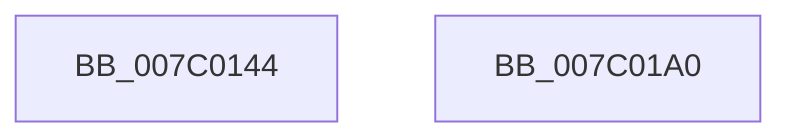

# EtwpLogMemInfoRundown

- RVA: `0x007C0144`–`0x007C01A1` (길이 `93` bytes)
- VA: `0x00000001407C0144`
- 실행 섹션: `PAGE`
- PDB 이름 있음: `예`; PDB Function 태그: `아니요`
- unwind 정보 RVA: `0x000606C0`
- 디코드: `24`개 명령, `93/93` bytes 표시
- 미해석 바이트: `0` (있으면 어셈블리에 `.byte`로 보존)

> 이 문서는 커널 이미지의 기계어와 PDB 기호를 분석해 생성했습니다. 4번과 5번은 함수 원형과 자료형을 바이너리 사용 방식에서 추정한 C 해석이며 원본 소스 복구 결과는 아닙니다.

## 1. Dependencies

- 직접 호출 지점: **4**; 고유 호출 대상: **4**
- 직접 호출자로 확인된 함수: **1**
- RIP 상대 이미지 참조: **1**

### Outgoing calls
- `0x007C016E` → [MmQuerySystemMemoryInformation](../../text/3B/MmQuerySystemMemoryInformation_function_003B98C8.md) (function, `0x003B98C8`)
- `0x007C017B` → [EtwpLogMemInfo](../../text/3B/EtwpLogMemInfo_function_003B9AC0.md) (function, `0x003B9AC0`)
- `0x007C0188` → [EtwpLogMemInfoWs](../91/EtwpLogMemInfoWs_function_0091C594.md) (function, `0x0091C594`)
- `0x007C0195` → [_security_check_cookie](../../text/6A/_security_check_cookie_function_006AC640.md) (function, `0x006AC640`)

### Direct callers
- [EtwpKernelTraceRundown](../9E/EtwpKernelTraceRundown_function_009E4080.md) at `0x009E431C`

### Static image references
- `0x007C014A` → RVA `0x00E0A740` (`.data`; read)

## 2. Other-region calls and transfers

- 다른 실행 섹션으로 향하는 call: **3**
  - `0x007C016E` → [MmQuerySystemMemoryInformation](../../text/3B/MmQuerySystemMemoryInformation_function_003B98C8.md) (`PAGE` → `.text`)
  - `0x007C017B` → [EtwpLogMemInfo](../../text/3B/EtwpLogMemInfo_function_003B9AC0.md) (`PAGE` → `.text`)
  - `0x007C0195` → [_security_check_cookie](../../text/6A/_security_check_cookie_function_006AC640.md) (`PAGE` → `.text`)
- 별도 외부 분기/꼬리 이동을 확인하지 못했습니다.

## 3. Assembly (complete function range)

```asm
007C0144  40 53                           push rbx
007C0146  48 83 EC 50                     sub rsp, 0x50
007C014A  48 8B 05 EF A5 64 00            mov rax, qword ptr [rip + 0x64a5ef]
007C0151  48 33 C4                        xor rax, rsp
007C0154  48 89 44 24 40                  mov qword ptr [rsp + 0x40], rax
007C0159  0F 57 C0                        xorps xmm0, xmm0
007C015C  48 8B D9                        mov rbx, rcx
007C015F  48 8D 4C 24 20                  lea rcx, [rsp + 0x20]
007C0164  0F 11 44 24 20                  movups xmmword ptr [rsp + 0x20], xmm0
007C0169  0F 11 44 24 30                  movups xmmword ptr [rsp + 0x30], xmm0
007C016E  E8 55 97 BF FF                  call 0x1403b98c8
007C0173  48 8D 54 24 20                  lea rdx, [rsp + 0x20]
007C0178  48 8B CB                        mov rcx, rbx
007C017B  E8 40 99 BF FF                  call 0x1403b9ac0
007C0180  48 8B 54 24 20                  mov rdx, qword ptr [rsp + 0x20]
007C0185  48 8B CB                        mov rcx, rbx
007C0188  E8 07 C4 15 00                  call 0x14091c594
007C018D  48 8B 4C 24 40                  mov rcx, qword ptr [rsp + 0x40]
007C0192  48 33 CC                        xor rcx, rsp
007C0195  E8 A6 C4 EE FF                  call 0x1406ac640
007C019A  48 83 C4 50                     add rsp, 0x50
007C019E  5B                              pop rbx
007C019F  C3                              ret
007C01A0  CC                              int3
```

## 4. C-style interpretation (structured pseudocode)

```c
__int64 __fastcall EtwpLogMemInfoRundown(__int64 a1)
{
    __int64 result;
    __int64 v_rsp;
    unsigned __int64 v_stack_m18;
    unsigned __int64 v_stack_m28;
    unsigned __int64 v_stack_m38;

    v_rsp = (v_rsp) - (80);
    result = (*(unsigned __int64 *)(v_rip + 6596079)) ^ (v_rsp);
    v_stack_m18 = result;
    v_stack_m38 = v_xmm0;
    v_stack_m28 = v_xmm0;
    result = MmQuerySystemMemoryInformation(v_stack_m38, a2, a3, a4);
    result = EtwpLogMemInfo(a1, v_stack_m38, a3, a4);
    result = EtwpLogMemInfoWs(a1, v_stack_m38, a3, a4);
    a1 = (v_stack_m18) ^ (v_rsp);
    result = _security_check_cookie(a1, v_stack_m38, a3, a4);
    v_rsp = (v_rsp) + (80);
    return result;
}
```

## 5. (Beta) C Style

```c
int64_t EtwpLogMemInfoRundown(int64_t Arg1)
{
    int64_t result;
    int64_t local_rsp;
    uint64_t v_stack_m18;
    uint64_t v_stack_m28;
    uint64_t v_stack_m38;

    local_rsp = (local_rsp) - (80);
    result = (*(uint64_t *)(v_rip + 0x64A5EF)) ^ (local_rsp);
    v_stack_m18 = result;
    v_stack_m38 = v_xmm0;
    v_stack_m28 = v_xmm0;
    result = MmQuerySystemMemoryInformation(v_stack_m38, a2, a3, a4);
    result = EtwpLogMemInfo(Arg1, v_stack_m38, a3, a4);
    result = EtwpLogMemInfoWs(Arg1, v_stack_m38, a3, a4);
    Arg1 = (v_stack_m18) ^ (local_rsp);
    result = _security_check_cookie(Arg1, v_stack_m38, a3, a4);
    local_rsp = (local_rsp) + (80);
    return result;
}
```

## 6. Execution-region graph

[열기: 2D/3D 그래프와 함수 탐색 컨트롤 패널](../../../control-panel.html?section=page&rva=0x007C0144&view=graph)

- 2D 그래프는 위에서 아래로 흐르고, 3D 그래프는 빈 공간을 드래그해 회전합니다. Shift+드래그는 이동, 휠은 확대·축소, 함수 노드 선택은 대상 보고서 이동입니다.

### Static fallback


