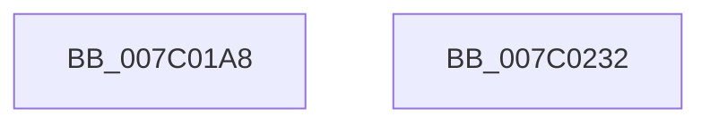

# EtwpLogRefSetAutoMark

- RVA: `0x007C01A8`–`0x007C0233` (길이 `139` bytes)
- VA: `0x00000001407C01A8`
- 실행 섹션: `PAGE`
- PDB 이름 있음: `예`; PDB Function 태그: `아니요`
- unwind 정보 RVA: `0x0006F9F8`
- 디코드: `35`개 명령, `139/139` bytes 표시
- 미해석 바이트: `0` (있으면 어셈블리에 `.byte`로 보존)

> 이 문서는 커널 이미지의 기계어와 PDB 기호를 분석해 생성했습니다. 4번과 5번은 함수 원형과 자료형을 바이너리 사용 방식에서 추정한 C 해석이며 원본 소스 복구 결과는 아닙니다.

## 1. Dependencies

- 직접 호출 지점: **3**; 고유 호출 대상: **3**
- 직접 호출자로 확인된 함수: **1**
- RIP 상대 이미지 참조: **3**

### Outgoing calls
- `0x007C01F9` → [RtlStringCbCopyA](../../text/46/RtlStringCbCopyA_function_0046143C.md) (function, `0x0046143C`)
- `0x007C021B` → [EtwpSetMark](../7B/EtwpSetMark_function_007B878C.md) (function, `0x007B878C`)
- `0x007C0228` → [_security_check_cookie](../../text/6A/_security_check_cookie_function_006AC640.md) (function, `0x006AC640`)

### Direct callers
- [EtwpKernelTraceRundown](../9E/EtwpKernelTraceRundown_function_009E4080.md) at `0x009E40F5`
- [EtwpKernelTraceRundown](../9E/EtwpKernelTraceRundown_function_009E4080.md) at `0x009E4432`

### Static image references
- `0x007C01AC` → RVA `0x00E0A740` (`.data`; read)
- `0x007C01C1` → RVA `0x00B4C2E0` (`RefSetStartString`; read)
- `0x007C01E8` → RVA `0x00B4C250` (`RefSetStopString`; read)

## 2. Other-region calls and transfers

- 다른 실행 섹션으로 향하는 call: **2**
  - `0x007C01F9` → [RtlStringCbCopyA](../../text/46/RtlStringCbCopyA_function_0046143C.md) (`PAGE` → `.text`)
  - `0x007C0228` → [_security_check_cookie](../../text/6A/_security_check_cookie_function_006AC640.md) (`PAGE` → `.text`)
- 별도 외부 분기/꼬리 이동을 확인하지 못했습니다.

## 3. Assembly (complete function range)

```asm
007C01A8  48 83 EC 68                     sub rsp, 0x68
007C01AC  48 8B 05 8D A5 64 00            mov rax, qword ptr [rip + 0x64a58d]
007C01B3  48 33 C4                        xor rax, rsp
007C01B6  48 89 44 24 50                  mov qword ptr [rsp + 0x50], rax
007C01BB  48 83 64 24 44 00               and qword ptr [rsp + 0x44], 0
007C01C1  4C 8D 05 18 C1 38 00            lea r8, [rip + 0x38c118]
007C01C8  33 C0                           xor eax, eax
007C01CA  4C 8B DA                        mov r11, rdx
007C01CD  84 C9                           test cl, cl
007C01CF  44 8A D1                        mov r10b, cl
007C01D2  0F 57 C0                        xorps xmm0, xmm0
007C01D5  BA 16 00 00 00                  mov edx, 0x16
007C01DA  0F 95 C0                        setne al
007C01DD  84 C9                           test cl, cl
007C01DF  89 44 24 30                     mov dword ptr [rsp + 0x30], eax
007C01E3  48 8D 4C 24 34                  lea rcx, [rsp + 0x34]
007C01E8  48 8D 05 61 C0 38 00            lea rax, [rip + 0x38c061]
007C01EF  4C 0F 44 C0                     cmove r8, rax
007C01F3  F3 0F 7F 44 24 34               movdqu xmmword ptr [rsp + 0x34], xmm0
007C01F9  E8 3E 12 CA FF                  call 0x14046143c
007C01FE  41 F6 DA                        neg r10b
007C0201  C6 44 24 20 00                  mov byte ptr [rsp + 0x20], 0
007C0206  41 B1 01                        mov r9b, 1
007C0209  48 8D 54 24 30                  lea rdx, [rsp + 0x30]
007C020E  45 1B C0                        sbb r8d, r8d
007C0211  49 8B CB                        mov rcx, r11
007C0214  41 F7 D8                        neg r8d
007C0217  41 83 C0 19                     add r8d, 0x19
007C021B  E8 6C 85 FF FF                  call 0x1407b878c
007C0220  48 8B 4C 24 50                  mov rcx, qword ptr [rsp + 0x50]
007C0225  48 33 CC                        xor rcx, rsp
007C0228  E8 13 C4 EE FF                  call 0x1406ac640
007C022D  48 83 C4 68                     add rsp, 0x68
007C0231  C3                              ret
007C0232  CC                              int3
```

## 4. C-style interpretation (structured pseudocode)

```c
__int64 __fastcall EtwpLogRefSetAutoMark(unsigned __int8 a1, __int64 a2)
{
    __int64 result;
    __int64 v_r10;
    __int64 v_rsp;
    unsigned __int64 v_stack_m18;
    unsigned __int64 v_stack_m24;
    unsigned __int64 v_stack_m34;
    unsigned int v_stack_m38;
    unsigned __int8 v_stack_m48;

    v_rsp = (v_rsp) - (104);
    result = (*(unsigned __int64 *)(v_rip + 6595981)) ^ (v_rsp);
    v_stack_m18 = result;
    result = 0;
    result = (a1 != 0) ? 1 : 0;
    v_stack_m38 = (unsigned int)(result);
    a3 = v_rip + 3719448;
    if (a1 == 0) { a3 = v_rip + 3719265; }
    v_stack_m34 = v_xmm0;
    result = RtlStringCbCopyA(v_stack_m34, 22, a3, a4);
    v_r10 = (unsigned __int8)(-(a1));
    v_stack_m48 = 0;
    a3 = (unsigned int)(-(a3));
    a3 = (unsigned int)((a3) + (25));
    result = EtwpSetMark(a2, v_stack_m38, a3, 1);
    a1 = (v_stack_m18) ^ (v_rsp);
    result = _security_check_cookie(a1, v_stack_m38, a3, 1);
    v_rsp = (v_rsp) + (104);
    return result;
}
```

## 5. (Beta) C Style

```c
int64_t EtwpLogRefSetAutoMark(uint8_t Arg1, int64_t Arg2)
{
    int64_t result;
    int64_t local_r10;
    int64_t local_rsp;
    uint64_t v_stack_m18;
    uint64_t v_stack_m24;
    uint64_t v_stack_m34;
    uint32_t v_stack_m38;
    uint8_t v_stack_m48;

    local_rsp = (local_rsp) - (104);
    result = (*(uint64_t *)(v_rip + 0x64A58D)) ^ (local_rsp);
    v_stack_m18 = result;
    result = 0;
    result = (Arg1 != 0) ? 1 : 0;
    v_stack_m38 = (uint32_t)(result);
    a3 = v_rip + 3719448;
    if (Arg1 == 0) { a3 = v_rip + 3719265; }
    v_stack_m34 = v_xmm0;
    result = RtlStringCbCopyA(v_stack_m34, 22, a3, a4);
    local_r10 = (uint8_t)(-(Arg1));
    v_stack_m48 = 0;
    a3 = (uint32_t)(-(a3));
    a3 = (uint32_t)((a3) + (25));
    result = EtwpSetMark(Arg2, v_stack_m38, a3, 1);
    Arg1 = (v_stack_m18) ^ (local_rsp);
    result = _security_check_cookie(Arg1, v_stack_m38, a3, 1);
    local_rsp = (local_rsp) + (104);
    return result;
}
```

## 6. Execution-region graph

[열기: 2D/3D 그래프와 함수 탐색 컨트롤 패널](../../../control-panel.html?section=page&rva=0x007C01A8&view=graph)

- 2D 그래프는 위에서 아래로 흐르고, 3D 그래프는 빈 공간을 드래그해 회전합니다. Shift+드래그는 이동, 휠은 확대·축소, 함수 노드 선택은 대상 보고서 이동입니다.

### Static fallback


