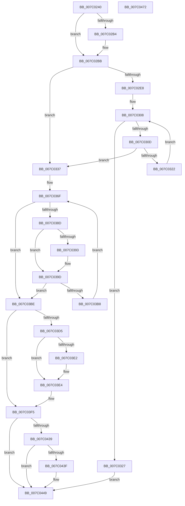

# EtwpObjectHandleEnumCallback

- RVA: `0x007C0240`–`0x007C0473` (길이 `563` bytes)
- VA: `0x00000001407C0240`
- 실행 섹션: `PAGE`
- PDB 이름 있음: `예`; PDB Function 태그: `아니요`
- unwind 정보 RVA: `0x000D3DE4`
- 디코드: `156`개 명령, `563/563` bytes 표시
- 미해석 바이트: `0` (있으면 어셈블리에 `.byte`로 보존)

> 이 문서는 커널 이미지의 기계어와 PDB 기호를 분석해 생성했습니다. 4번과 5번은 함수 원형과 자료형을 바이너리 사용 방식에서 추정한 C 해석이며 원본 소스 복구 결과는 아닙니다.

## 1. Dependencies

- 직접 호출 지점: **12**; 고유 호출 대상: **10**
- 직접 호출자로 확인된 함수: **0**
- RIP 상대 이미지 참조: **4**

### Outgoing calls
- `0x007C0295` → [ExGetHandlePointer](../../text/43/ExGetHandlePointer_function_00430C90.md) (function, `0x00430C90`)
- `0x007C0319` → [ExCheckSingleFilter](../../text/40/ExCheckSingleFilter_function_0040014C.md) (function, `0x0040014C`)
- `0x007C032D` → [ExUnlockHandleTableEntry](../94/ExUnlockHandleTableEntry_function_0094D2D0.md) (function, `0x0094D2D0`)
- `0x007C033F` → [ObfReferenceObjectWithTag](../../text/21/ObfReferenceObjectWithTag_function_00210710.md) (function, `0x00210710`)
- `0x007C034A` → [ExUnlockHandleTableEntry](../94/ExUnlockHandleTableEntry_function_0094D2D0.md) (function, `0x0094D2D0`)
- `0x007C037E` → [ObQueryNameStringMode](../8A/ObQueryNameStringMode_function_008A7ED0.md) (function, `0x008A7ED0`)
- `0x007C0398` → [ExFreePoolWithTag](../../poolcode/B8/ExFreePoolWithTag_function_00B82870.md) (function, `0x00B82870`)
- `0x007C03AB` → [ExAllocatePool2](../../poolcode/B8/ExAllocatePool2_function_00B820F0.md) (function, `0x00B820F0`)
- `0x007C03C6` → [ObfDereferenceObjectWithTag](../../text/2F/ObfDereferenceObjectWithTag_function_002F78E0.md) (function, `0x002F78E0`)
- `0x007C042F` → [EtwpLogKernelEvent](../../text/25/EtwpLogKernelEvent_function_0025CC00.md) (function, `0x0025CC00`)
- `0x007C0444` → [ExFreePoolWithTag](../../poolcode/B8/ExFreePoolWithTag_function_00B82870.md) (function, `0x00B82870`)
- `0x007C0452` → [_security_check_cookie](../../text/6A/_security_check_cookie_function_006AC640.md) (function, `0x006AC640`)

### Direct callers
- 이 함수 시작 RVA로 연결되는 직접 call은 확인되지 않았습니다. 간접 호출은 완전히 역산할 수 없습니다.

### Static image references
- `0x007C025C` → RVA `0x00E0A740` (`.data`; read)
- `0x007C02BB` → RVA `0x00FC6E4C` (`ALMOSTRO`; read)
- `0x007C02ED` → RVA `0x00FC7800` (`ALMOSTRO`; read)
- `0x007C03F5` → RVA `0x000105E0` (`.rdata`; read)

## 2. Other-region calls and transfers

- 다른 실행 섹션으로 향하는 call: **9**
  - `0x007C0295` → [ExGetHandlePointer](../../text/43/ExGetHandlePointer_function_00430C90.md) (`PAGE` → `.text`)
  - `0x007C0319` → [ExCheckSingleFilter](../../text/40/ExCheckSingleFilter_function_0040014C.md) (`PAGE` → `.text`)
  - `0x007C033F` → [ObfReferenceObjectWithTag](../../text/21/ObfReferenceObjectWithTag_function_00210710.md) (`PAGE` → `.text`)
  - `0x007C0398` → [ExFreePoolWithTag](../../poolcode/B8/ExFreePoolWithTag_function_00B82870.md) (`PAGE` → `POOLCODE`)
  - `0x007C03AB` → [ExAllocatePool2](../../poolcode/B8/ExAllocatePool2_function_00B820F0.md) (`PAGE` → `POOLCODE`)
  - `0x007C03C6` → [ObfDereferenceObjectWithTag](../../text/2F/ObfDereferenceObjectWithTag_function_002F78E0.md) (`PAGE` → `.text`)
  - `0x007C042F` → [EtwpLogKernelEvent](../../text/25/EtwpLogKernelEvent_function_0025CC00.md) (`PAGE` → `.text`)
  - `0x007C0444` → [ExFreePoolWithTag](../../poolcode/B8/ExFreePoolWithTag_function_00B82870.md) (`PAGE` → `POOLCODE`)
  - `0x007C0452` → [_security_check_cookie](../../text/6A/_security_check_cookie_function_006AC640.md) (`PAGE` → `.text`)
- 별도 외부 분기/꼬리 이동을 확인하지 못했습니다.

## 3. Assembly (complete function range)

```asm
007C0240  48 89 5C 24 18                  mov qword ptr [rsp + 0x18], rbx
007C0245  55                              push rbp
007C0246  56                              push rsi
007C0247  57                              push rdi
007C0248  41 54                           push r12
007C024A  41 55                           push r13
007C024C  41 56                           push r14
007C024E  41 57                           push r15
007C0250  48 8D 6C 24 D9                  lea rbp, [rsp - 0x27]
007C0255  48 81 EC 90 00 00 00            sub rsp, 0x90
007C025C  48 8B 05 DD A4 64 00            mov rax, qword ptr [rip + 0x64a4dd]
007C0263  48 33 C4                        xor rax, rsp
007C0266  48 89 45 17                     mov qword ptr [rbp + 0x17], rax
007C026A  41 8A 41 40                     mov al, byte ptr [r9 + 0x40]
007C026E  33 F6                           xor esi, esi
007C0270  F6 D8                           neg al
007C0272  89 75 C7                        mov dword ptr [rbp - 0x39], esi
007C0275  4C 8B E1                        mov r12, rcx
007C0278  89 75 E1                        mov dword ptr [rbp - 0x1f], esi
007C027B  66 45 1B ED                     sbb r13w, r13w
007C027F  66 89 75 E5                     mov word ptr [rbp - 0x1b], si
007C0283  48 8B CA                        mov rcx, rdx
007C0286  66 41 81 C5 27 11               add r13w, 0x1127
007C028C  49 8B F9                        mov rdi, r9
007C028F  49 8B D8                        mov rbx, r8
007C0292  4C 8B F2                        mov r14, rdx
007C0295  E8 F6 09 C7 FF                  call 0x140430c90
007C029A  4C 8B C0                        mov r8, rax
007C029D  8B 4F 2C                        mov ecx, dword ptr [rdi + 0x2c]
007C02A0  89 4D D7                        mov dword ptr [rbp - 0x29], ecx
007C02A3  89 5D DB                        mov dword ptr [rbp - 0x25], ebx
007C02A6  4C 8D 78 30                     lea r15, [rax + 0x30]
007C02AA  4C 89 7D CF                     mov qword ptr [rbp - 0x31], r15
007C02AE  40 38 77 44                     cmp byte ptr [rdi + 0x44], sil
007C02B2  74 07                           je 0x1407c02bb
007C02B4  0F BA EB 1F                     bts ebx, 0x1f
007C02B8  89 5D DB                        mov dword ptr [rbp - 0x25], ebx
007C02BB  44 0F B6 15 89 6B 80 00         movzx r10d, byte ptr [rip + 0x806b89]
007C02C3  49 8B D0                        mov rdx, r8
007C02C6  4C 8B 4F 08                     mov r9, qword ptr [rdi + 8]
007C02CA  41 8A C2                        mov al, r10b
007C02CD  41 32 40 18                     xor al, byte ptr [r8 + 0x18]
007C02D1  BE 01 00 00 00                  mov esi, 1
007C02D6  48 C1 EA 08                     shr rdx, 8
007C02DA  32 C2                           xor al, dl
007C02DC  0F B6 C0                        movzx eax, al
007C02DF  66 89 45 DF                     mov word ptr [rbp - 0x21], ax
007C02E3  4D 85 C9                        test r9, r9
007C02E6  74 4F                           je 0x1407c0337
007C02E8  41 0F B6 4F E8                  movzx ecx, byte ptr [r15 - 0x18]
007C02ED  4C 8D 1D 0C 75 80 00            lea r11, [rip + 0x80750c]
007C02F4  49 33 CA                        xor rcx, r10
007C02F7  0F B6 C2                        movzx eax, dl
007C02FA  45 0F B7 11                     movzx r10d, word ptr [r9]
007C02FE  45 33 C0                        xor r8d, r8d
007C0301  48 33 C8                        xor rcx, rax
007C0304  4D 8B 1C CB                     mov r11, qword ptr [r11 + rcx*8]
007C0308  45 3B C2                        cmp r8d, r10d
007C030B  73 1A                           jae 0x1407c0327
007C030D  43 8B 54 81 04                  mov edx, dword ptr [r9 + r8*4 + 4]
007C0312  41 8B 8B C0 00 00 00            mov ecx, dword ptr [r11 + 0xc0]
007C0319  E8 2E FE C3 FF                  call 0x14040014c
007C031E  85 C0                           test eax, eax
007C0320  75 15                           jne 0x1407c0337
007C0322  44 03 C6                        add r8d, esi
007C0325  EB E1                           jmp 0x1407c0308
007C0327  49 8B D6                        mov rdx, r14
007C032A  49 8B CC                        mov rcx, r12
007C032D  E8 9E CF 18 00                  call 0x14094d2d0
007C0332  E9 12 01 00 00                  jmp 0x1407c0449
007C0337  BA 45 74 77 54                  mov edx, 0x54777445
007C033C  49 8B CF                        mov rcx, r15
007C033F  E8 CC 03 A5 FF                  call 0x140210710
007C0344  49 8B D6                        mov rdx, r14
007C0347  49 8B CC                        mov rcx, r12
007C034A  E8 81 CF 18 00                  call 0x14094d2d0
007C034F  44 0F B7 47 18                  movzx r8d, word ptr [rdi + 0x18]
007C0354  48 8D 45 CF                     lea rax, [rbp - 0x31]
007C0358  48 8B 5F 10                     mov rbx, qword ptr [rdi + 0x10]
007C035C  45 33 E4                        xor r12d, r12d
007C035F  48 89 45 E7                     mov qword ptr [rbp - 0x19], rax
007C0363  44 89 45 C7                     mov dword ptr [rbp - 0x39], r8d
007C0367  48 C7 45 EF 12 00 00 00         mov qword ptr [rbp - 0x11], 0x12
007C036F  4C 8D 4D C7                     lea r9, [rbp - 0x39]
007C0373  44 88 64 24 20                  mov byte ptr [rsp + 0x20], r12b
007C0378  48 8B D3                        mov rdx, rbx
007C037B  49 8B CF                        mov rcx, r15
007C037E  E8 4D 7B 0E 00                  call 0x1408a7ed0
007C0383  44 8B F0                        mov r14d, eax
007C0386  3D 04 00 00 C0                  cmp eax, 0xc0000004
007C038B  75 31                           jne 0x1407c03be
007C038D  48 3B 5F 10                     cmp rbx, qword ptr [rdi + 0x10]
007C0391  74 0A                           je 0x1407c039d
007C0393  33 D2                           xor edx, edx
007C0395  48 8B CB                        mov rcx, rbx
007C0398  E8 D3 24 3C 00                  call 0x140b82870
007C039D  8B 55 C7                        mov edx, dword ptr [rbp - 0x39]
007C03A0  B9 00 01 00 00                  mov ecx, 0x100
007C03A5  41 B8 45 74 77 74               mov r8d, 0x74777445
007C03AB  E8 40 1D 3C 00                  call 0x140b820f0
007C03B0  48 8B D8                        mov rbx, rax
007C03B3  48 85 C0                        test rax, rax
007C03B6  74 06                           je 0x1407c03be
007C03B8  44 8B 45 C7                     mov r8d, dword ptr [rbp - 0x39]
007C03BC  EB B1                           jmp 0x1407c036f
007C03BE  BA 45 74 77 54                  mov edx, 0x54777445
007C03C3  49 8B CF                        mov rcx, r15
007C03C6  E8 15 75 B3 FF                  call 0x1402f78e0
007C03CB  BA 02 00 00 00                  mov edx, 2
007C03D0  45 85 F6                        test r14d, r14d
007C03D3  75 20                           jne 0x1407c03f5
007C03D5  0F B7 03                        movzx eax, word ptr [rbx]
007C03D8  B9 00 20 00 00                  mov ecx, 0x2000
007C03DD  66 3B C1                        cmp ax, cx
007C03E0  73 02                           jae 0x1407c03e4
007C03E2  8B C8                           mov ecx, eax
007C03E4  48 8B 43 08                     mov rax, qword ptr [rbx + 8]
007C03E8  8B F2                           mov esi, edx
007C03EA  48 89 45 F7                     mov qword ptr [rbp - 9], rax
007C03EE  89 4D FF                        mov dword ptr [rbp - 1], ecx
007C03F1  44 89 65 03                     mov dword ptr [rbp + 3], r12d
007C03F5  48 8D 0D E4 01 85 FF            lea rcx, [rip - 0x7afe1c]
007C03FC  8B C6                           mov eax, esi
007C03FE  48 03 C0                        add rax, rax
007C0401  C7 44 24 28 02 18 50 00         mov dword ptr [rsp + 0x28], 0x501802
007C0409  44 8D 4E 01                     lea r9d, [rsi + 1]
007C040D  66 44 89 6C 24 20               mov word ptr [rsp + 0x20], r13w
007C0413  48 89 54 C5 EF                  mov qword ptr [rbp + rax*8 - 0x11], rdx
007C0418  48 8B 57 20                     mov rdx, qword ptr [rdi + 0x20]
007C041C  48 89 4C C5 E7                  mov qword ptr [rbp + rax*8 - 0x19], rcx
007C0421  48 8D 4D E7                     lea rcx, [rbp - 0x19]
007C0425  44 8B 02                        mov r8d, dword ptr [rdx]
007C0428  48 8B 92 50 05 00 00            mov rdx, qword ptr [rdx + 0x550]
007C042F  E8 CC C7 A9 FF                  call 0x14025cc00
007C0434  48 85 DB                        test rbx, rbx
007C0437  74 10                           je 0x1407c0449
007C0439  48 3B 5F 10                     cmp rbx, qword ptr [rdi + 0x10]
007C043D  74 0A                           je 0x1407c0449
007C043F  33 D2                           xor edx, edx
007C0441  48 8B CB                        mov rcx, rbx
007C0444  E8 27 24 3C 00                  call 0x140b82870
007C0449  32 C0                           xor al, al
007C044B  48 8B 4D 17                     mov rcx, qword ptr [rbp + 0x17]
007C044F  48 33 CC                        xor rcx, rsp
007C0452  E8 E9 C1 EE FF                  call 0x1406ac640
007C0457  48 8B 9C 24 E0 00 00 00         mov rbx, qword ptr [rsp + 0xe0]
007C045F  48 81 C4 90 00 00 00            add rsp, 0x90
007C0466  41 5F                           pop r15
007C0468  41 5E                           pop r14
007C046A  41 5D                           pop r13
007C046C  41 5C                           pop r12
007C046E  5F                              pop rdi
007C046F  5E                              pop rsi
007C0470  5D                              pop rbp
007C0471  C3                              ret
007C0472  CC                              int3
```

## 4. C-style interpretation (structured pseudocode)

```c
__int64 __fastcall EtwpObjectHandleEnumCallback(__int64 a1, __int64 a2, __int64 a3, __int64 a4)
{
    __int64 result;
    __int64 v_r12;
    __int64 v_r13;
    __int64 v_rsi;
    __int64 v_rsp;
    unsigned __int64 v_stack_m48;
    unsigned int v_stack_m5C;
    unsigned __int64 v_stack_m5F;
    unsigned int v_stack_m60;
    unsigned __int64 v_stack_m68;
    unsigned __int64 v_stack_m70;
    unsigned __int64 v_stack_m78;
    unsigned __int16 v_stack_m7A;
    unsigned int v_stack_m7E;
    unsigned __int16 v_stack_m80;
    unsigned int v_stack_m84;
    unsigned int v_stack_m88;
    unsigned __int64 v_stack_m90;
    unsigned int v_stack_m98;
    unsigned int v_stack_mA0;
    unsigned __int8 v_stack_mA8;
    unsigned __int64 v_stack_p18;

    v_stack_p18 = v_rbx;
    v_rsp = (v_rsp) - (144);
    result = (*(unsigned __int64 *)(v_rip + 6595805)) ^ (v_rsp);
    v_stack_m48 = result;
    v_rsi = 0;
    result = (unsigned __int8)(-(*(unsigned __int8 *)(a4 + 64)));
    v_stack_m98 = 0;
    v_stack_m7E = 0;
    v_stack_m7A = 0;
    v_r13 = (unsigned __int16)((v_r13) + (0x1127ULL));
    result = ExGetHandlePointer(a2, a2, a3, a4);
    v_stack_m88 = (unsigned int)((unsigned int)(*(unsigned int *)(a4 + 44)));
    v_stack_m84 = (unsigned int)(a3);
    v_stack_m90 = result + 48;
    if ((*(unsigned __int8 *)(a4 + 68)) != 0) {
        v_stack_m84 = (unsigned int)(a3);
    }
    result = (unsigned __int8)(((unsigned __int8)(*(unsigned __int8 *)(v_rip + 8416137))) ^ (*(unsigned __int8 *)(result + 24)));
    a2 = (result) >> (8);
    result = (unsigned __int8)((result) ^ ((unsigned __int8)(a2)));
    v_stack_m80 = (unsigned __int16)((unsigned __int8)(result));
    if (*(unsigned __int64 *)(a4 + 8) == 0) goto loc_007C0337;
    a1 = (*(unsigned __int8 *)(result + 48 - 24)) ^ (*(unsigned __int8 *)(v_rip + 8416137));
    a3 = 0;
    a1 = (a1) ^ ((unsigned __int8)(a2));
loc_007C0308:
    if (0 >= ((unsigned int)(*(unsigned __int16 *)(*(unsigned __int64 *)(a4 + 8))))) goto loc_007C0327;
    result = ExCheckSingleFilter((unsigned int)(*(unsigned int *)(*(unsigned __int64 *)(v_rip + 8418572 + a1 * 8) + 192)), (unsigned int)(*(unsigned int *)(*(unsigned __int64 *)(a4 + 8) + a3 * 4 + 4)), a3, *(unsigned __int64 *)(a4 + 8));
    if ((unsigned int)(result) != 0) goto loc_007C0337;
    a3 = (unsigned int)((a3) + (1));
    goto loc_007C0308;
loc_007C0327:
    result = ExUnlockHandleTableEntry(a1, a2, a3, *(unsigned __int64 *)(a4 + 8));
    goto loc_007C0449;
loc_007C0337:
    result = ObfReferenceObjectWithTag(result + 48, (unsigned int)(0x54777445ULL), a3, *(unsigned __int64 *)(a4 + 8));
    result = ExUnlockHandleTableEntry(a1, a2, a3, *(unsigned __int64 *)(a4 + 8));
    v_r12 = 0;
    v_stack_m78 = v_stack_m90;
    v_stack_m98 = (unsigned int)(*(unsigned __int16 *)(a4 + 24));
    v_stack_m70 = 18;
loc_007C036F:
    v_stack_mA8 = 0;
    result = ObQueryNameStringMode(result + 48, *(unsigned __int64 *)(a4 + 16), *(unsigned __int16 *)(a4 + 24), v_stack_m98);
    if (((unsigned int)(result)) != 0xC0000004ULL) goto loc_007C03BE;
    if ((*(unsigned __int64 *)(a4 + 16)) != (*(unsigned __int64 *)(a4 + 16))) {
        a2 = 0;
        a1 = *(unsigned __int64 *)(a4 + 16);
        result = ExFreePoolWithTag(a1, a2, *(unsigned __int16 *)(a4 + 24), v_stack_m98);
    }
    result = ExAllocatePool2(256, (unsigned int)(v_stack_m98), (unsigned int)(0x74777445ULL), v_stack_m98);
    if (result == 0) goto loc_007C03BE;
    goto loc_007C036F;
loc_007C03BE:
    result = ObfDereferenceObjectWithTag(result + 48, (unsigned int)(0x54777445ULL), (unsigned int)(v_stack_m98), v_stack_m98);
    if ((unsigned int)((unsigned int)((unsigned int)(result))) != 0) goto loc_007C03F5;
    if (((unsigned __int16)(*(unsigned __int16 *)(result))) < ((unsigned __int16)((unsigned int)(0x2000ULL)))) {
        a1 = (unsigned int)(*(unsigned __int16 *)(result));
    }
    v_stack_m68 = *(unsigned __int64 *)(result + 8);
    v_stack_m60 = (unsigned int)(a1);
    v_stack_m5C = 0;
loc_007C03F5:
    result = (2) + (2);
    v_stack_mA0 = 0x501802ULL;
    v_stack_mA8 = (unsigned __int16)(v_r13);
    *(unsigned __int64 *)(v_stack_m5F + result * 8 - 17) = 2;
    *(unsigned __int64 *)(v_stack_m5F + result * 8 - 25) = v_rip - 8060444;
    result = EtwpLogKernelEvent(v_stack_m78, *(unsigned __int64 *)(*(unsigned __int64 *)(a4 + 32) + 1360), (unsigned int)(*(unsigned int *)(*(unsigned __int64 *)(a4 + 32))), 2 + 1);
    if (result == 0) goto loc_007C0449;
    if (result != (*(unsigned __int64 *)(a4 + 16))) {
        a2 = 0;
        a1 = result;
        result = ExFreePoolWithTag(a1, a2, (unsigned int)(*(unsigned int *)(*(unsigned __int64 *)(a4 + 32))), 2 + 1);
    }
    result = 0;
    a1 = (v_stack_m48) ^ (v_rsp);
    result = _security_check_cookie(a1, a2, (unsigned int)(*(unsigned int *)(*(unsigned __int64 *)(a4 + 32))), 2 + 1);
    v_rsp = (v_rsp) + (144);
    return result;
}
```

## 5. (Beta) C Style

```c
int64_t EtwpObjectHandleEnumCallback(int64_t Arg1, int64_t Arg2, int64_t Arg3, void *Arg4)
{
    uint8_t *arg4 = (uint8_t *)Arg4;

    int64_t result;
    int64_t local_r12;
    int64_t local_r13;
    int64_t local_rsi;
    int64_t local_rsp;
    uint64_t v_stack_m48;
    uint32_t v_stack_m5C;
    uint64_t v_stack_m5F;
    uint32_t v_stack_m60;
    uint64_t v_stack_m68;
    uint64_t v_stack_m70;
    uint64_t v_stack_m78;
    uint16_t v_stack_m7A;
    uint32_t v_stack_m7E;
    uint16_t v_stack_m80;
    uint32_t v_stack_m84;
    uint32_t v_stack_m88;
    uint64_t v_stack_m90;
    uint32_t v_stack_m98;
    uint32_t v_stack_mA0;
    uint8_t v_stack_mA8;
    uint64_t v_stack_p18;

    v_stack_p18 = local_rbx;
    local_rsp = (local_rsp) - (144);
    result = (*(uint64_t *)(v_rip + 0x64A4DD)) ^ (local_rsp);
    v_stack_m48 = result;
    local_rsi = 0;
    result = (uint8_t)(-(*(uint8_t *)(arg4 + 0x40)));
    v_stack_m98 = 0;
    v_stack_m7E = 0;
    v_stack_m7A = 0;
    local_r13 = (uint16_t)((local_r13) + (0x1127ULL));
    result = ExGetHandlePointer(Arg2, Arg2, Arg3, Arg4);
    v_stack_m88 = (uint32_t)((uint32_t)(*(uint32_t *)(arg4 + 0x2C)));
    v_stack_m84 = (uint32_t)(Arg3);
    v_stack_m90 = result + 48;
    if ((*(uint8_t *)(arg4 + 0x44)) != 0) {
        v_stack_m84 = (uint32_t)(Arg3);
    }
    result = (uint8_t)(((uint8_t)(*(uint8_t *)(v_rip + 0x806B89))) ^ (*(uint8_t *)(result + 0x18)));
    Arg2 = (result) >> (8);
    result = (uint8_t)((result) ^ ((uint8_t)(Arg2)));
    v_stack_m80 = (uint16_t)((uint8_t)(result));
    if (*(uint64_t *)(arg4 + 0x8) == 0) goto loc_007C0337;
    Arg1 = (*(uint8_t *)(result + 0x30 - 0x18)) ^ (*(uint8_t *)(v_rip + 0x806B89));
    Arg3 = 0;
    Arg1 = (Arg1) ^ ((uint8_t)(Arg2));
loc_007C0308:
    if (0 >= ((uint32_t)(*(uint16_t *)(*(uint64_t *)(arg4 + 0x8))))) goto loc_007C0327;
    result = ExCheckSingleFilter((uint32_t)(*(uint32_t *)(*(uint64_t *)(v_rip + 0x80750C + Arg1 * 8) + 0xC0)), (uint32_t)(*(uint32_t *)(*(uint64_t *)(arg4 + 0x8) + Arg3 * 4 + 0x4)), Arg3, *(uint64_t *)(arg4 + 0x8));
    if ((uint32_t)(result) != 0) goto loc_007C0337;
    Arg3 = (uint32_t)((Arg3) + (1));
    goto loc_007C0308;
loc_007C0327:
    result = ExUnlockHandleTableEntry(Arg1, Arg2, Arg3, *(uint64_t *)(arg4 + 0x8));
    goto loc_007C0449;
loc_007C0337:
    result = ObfReferenceObjectWithTag(result + 48, (uint32_t)(0x54777445ULL), Arg3, *(uint64_t *)(arg4 + 0x8));
    result = ExUnlockHandleTableEntry(Arg1, Arg2, Arg3, *(uint64_t *)(arg4 + 0x8));
    local_r12 = 0;
    v_stack_m78 = v_stack_m90;
    v_stack_m98 = (uint32_t)(*(uint16_t *)(arg4 + 0x18));
    v_stack_m70 = 18;
loc_007C036F:
    v_stack_mA8 = 0;
    result = ObQueryNameStringMode(result + 48, *(uint64_t *)(arg4 + 0x10), *(uint16_t *)(arg4 + 0x18), v_stack_m98);
    if (((uint32_t)(result)) != 0xC0000004ULL) goto loc_007C03BE;
    if ((*(uint64_t *)(arg4 + 0x10)) != (*(uint64_t *)(arg4 + 0x10))) {
        Arg2 = 0;
        Arg1 = *(uint64_t *)(arg4 + 0x10);
        result = ExFreePoolWithTag(Arg1, Arg2, *(uint16_t *)(arg4 + 0x18), v_stack_m98);
    }
    result = ExAllocatePool2(256, (uint32_t)(v_stack_m98), (uint32_t)(0x74777445ULL), v_stack_m98);
    if (result == 0) goto loc_007C03BE;
    goto loc_007C036F;
loc_007C03BE:
    result = ObfDereferenceObjectWithTag(result + 48, (uint32_t)(0x54777445ULL), (uint32_t)(v_stack_m98), v_stack_m98);
    if ((uint32_t)((uint32_t)((uint32_t)(result))) != 0) goto loc_007C03F5;
    if (((uint16_t)(*(uint16_t *)(result))) < ((uint16_t)((uint32_t)(0x2000ULL)))) {
        Arg1 = (uint32_t)(*(uint16_t *)(result));
    }
    v_stack_m68 = *(uint64_t *)(result + 0x8);
    v_stack_m60 = (uint32_t)(Arg1);
    v_stack_m5C = 0;
loc_007C03F5:
    result = (2) + (2);
    v_stack_mA0 = 0x501802ULL;
    v_stack_mA8 = (uint16_t)(local_r13);
    *(uint64_t *)(v_stack_m5F + result * 8 - 0x11) = 2;
    *(uint64_t *)(v_stack_m5F + result * 8 - 0x19) = v_rip - 8060444;
    result = EtwpLogKernelEvent(v_stack_m78, *(uint64_t *)(*(uint64_t *)(arg4 + 0x20) + 0x550), (uint32_t)(*(uint32_t *)(*(uint64_t *)(arg4 + 0x20))), 2 + 1);
    if (result == 0) goto loc_007C0449;
    if (result != (*(uint64_t *)(arg4 + 0x10))) {
        Arg2 = 0;
        Arg1 = result;
        result = ExFreePoolWithTag(Arg1, Arg2, (uint32_t)(*(uint32_t *)(*(uint64_t *)(arg4 + 0x20))), 2 + 1);
    }
    result = 0;
    Arg1 = (v_stack_m48) ^ (local_rsp);
    result = _security_check_cookie(Arg1, Arg2, (uint32_t)(*(uint32_t *)(*(uint64_t *)(arg4 + 0x20))), 2 + 1);
    local_rsp = (local_rsp) + (144);
    return result;
}
```

### 관측된 메모리 오프셋

구조체 형식이 확인되지 않은 접근은 인자 기준의 오프셋으로만 기록했습니다.

| 기준 인자 | 오프셋 표현 | 폭 (bit) | 접근 |
|---|---:|---:|---|
| `Arg4` | `+ 0x8` | `64` | `R` |
| `Arg4` | `+ 0x10` | `64` | `R` |
| `Arg4` | `+ 0x18` | `16` | `R` |
| `Arg4` | `+ 0x20` | `64` | `R` |
| `Arg4` | `+ 0x2C` | `32` | `R` |
| `Arg4` | `+ 0x40` | `8` | `R` |
| `Arg4` | `+ 0x44` | `8` | `R` |

## 6. Execution-region graph

[열기: 2D/3D 그래프와 함수 탐색 컨트롤 패널](../../../control-panel.html?section=page&rva=0x007C0240&view=graph)

- 2D 그래프는 위에서 아래로 흐르고, 3D 그래프는 빈 공간을 드래그해 회전합니다. Shift+드래그는 이동, 휠은 확대·축소, 함수 노드 선택은 대상 보고서 이동입니다.

### Static fallback


