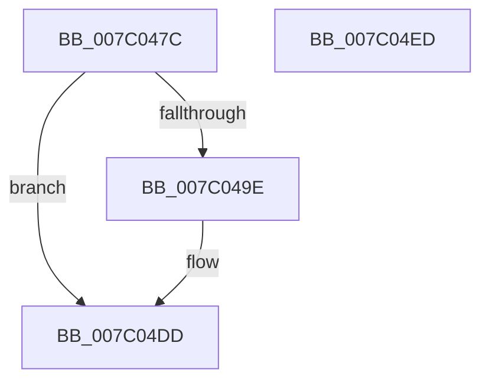

# EtwpObjectHandleRundown

- RVA: `0x007C047C`–`0x007C04EE` (길이 `114` bytes)
- VA: `0x00000001407C047C`
- 실행 섹션: `PAGE`
- PDB 이름 있음: `예`; PDB Function 태그: `아니요`
- unwind 정보 RVA: `0x00060BC4`
- 디코드: `30`개 명령, `114/114` bytes 표시
- 미해석 바이트: `0` (있으면 어셈블리에 `.byte`로 보존)

> 이 문서는 커널 이미지의 기계어와 PDB 기호를 분석해 생성했습니다. 4번과 5번은 함수 원형과 자료형을 바이너리 사용 방식에서 추정한 C 해석이며 원본 소스 복구 결과는 아닙니다.

## 1. Dependencies

- 직접 호출 지점: **4**; 고유 호출 대상: **4**
- 직접 호출자로 확인된 함수: **1**
- RIP 상대 이미지 참조: **1**

### Outgoing calls
- `0x007C0491` → [ObReferenceProcessHandleTable](../89/ObReferenceProcessHandleTable_function_00893B70.md) (function, `0x00893B70`)
- `0x007C04A1` → [PsGetProcessId](../../text/43/PsGetProcessId_function_0043D910.md) (function, `0x0043D910`)
- `0x007C04CC` → [ExEnumHandleTable](../91/ExEnumHandleTable_function_0091DB20.md) (function, `0x0091DB20`)
- `0x007C04D8` → [ExReleaseRundownProtection](../../text/34/ExReleaseRundownProtection_function_00349E80.md) (function, `0x00349E80`)

### Direct callers
- [EtwpProcessEnumCallback](../8A/EtwpProcessEnumCallback_function_008A5F40.md) at `0x008A62F2`

### Static image references
- `0x007C04A9` → RVA `0x007C0240` (`EtwpObjectHandleEnumCallback`; read)

## 2. Other-region calls and transfers

- 다른 실행 섹션으로 향하는 call: **2**
  - `0x007C04A1` → [PsGetProcessId](../../text/43/PsGetProcessId_function_0043D910.md) (`PAGE` → `.text`)
  - `0x007C04D8` → [ExReleaseRundownProtection](../../text/34/ExReleaseRundownProtection_function_00349E80.md) (`PAGE` → `.text`)
- 별도 외부 분기/꼬리 이동을 확인하지 못했습니다.

## 3. Assembly (complete function range)

```asm
007C047C  48 89 5C 24 08                  mov qword ptr [rsp + 8], rbx
007C0481  48 89 74 24 10                  mov qword ptr [rsp + 0x10], rsi
007C0486  57                              push rdi
007C0487  48 83 EC 20                     sub rsp, 0x20
007C048B  48 8B F2                        mov rsi, rdx
007C048E  48 8B D9                        mov rbx, rcx
007C0491  E8 DA 36 0D 00                  call 0x140893b70
007C0496  48 8B F8                        mov rdi, rax
007C0499  48 85 C0                        test rax, rax
007C049C  74 3F                           je 0x1407c04dd
007C049E  48 8B CB                        mov rcx, rbx
007C04A1  E8 6A D4 C7 FF                  call 0x14043d910
007C04A6  89 46 2C                        mov dword ptr [rsi + 0x2c], eax
007C04A9  48 8D 15 90 FD FF FF            lea rdx, [rip - 0x270]
007C04B0  44 8B 83 FC 05 00 00            mov r8d, dword ptr [rbx + 0x5fc]
007C04B7  45 33 C9                        xor r9d, r9d
007C04BA  41 C1 E8 0C                     shr r8d, 0xc
007C04BE  48 8B CF                        mov rcx, rdi
007C04C1  41 80 E0 01                     and r8b, 1
007C04C5  44 88 46 44                     mov byte ptr [rsi + 0x44], r8b
007C04C9  4C 8B C6                        mov r8, rsi
007C04CC  E8 4F D6 15 00                  call 0x14091db20
007C04D1  48 8D 8B E8 01 00 00            lea rcx, [rbx + 0x1e8]
007C04D8  E8 A3 99 B8 FF                  call 0x140349e80
007C04DD  48 8B 5C 24 30                  mov rbx, qword ptr [rsp + 0x30]
007C04E2  48 8B 74 24 38                  mov rsi, qword ptr [rsp + 0x38]
007C04E7  48 83 C4 20                     add rsp, 0x20
007C04EB  5F                              pop rdi
007C04EC  C3                              ret
007C04ED  CC                              int3
```

## 4. C-style interpretation (structured pseudocode)

```c
__int64 __fastcall EtwpObjectHandleRundown(__int64 a1, __int64 a2, __int64 a3, int a4)
{
    __int64 result;
    __int64 v_rsp;
    unsigned __int64 v_stack_p10;
    unsigned __int64 v_stack_p8;

    v_stack_p8 = v_rbx;
    v_stack_p10 = v_rsi;
    v_rsp = (v_rsp) - (32);
    result = ObReferenceProcessHandleTable(a1, a2, a3, a4);
    if (result != 0) {
        a1 = a1;
        result = PsGetProcessId(a1, a2, a3, a4);
        *(unsigned int *)(a2 + 44) = (unsigned int)(result);
        a2 = v_rip - 624;
        a3 = *(unsigned int *)(a1 + 1532);
        a4 = 0;
        a3 = (unsigned int)((a3) >> (12));
        a1 = result;
        a3 = (unsigned __int8)((a3) & (1));
        *(unsigned __int8 *)(a2 + 68) = (unsigned __int8)(a3);
        a3 = a2;
        result = ExEnumHandleTable(a1, a2, a3, a4);
        a1 = a1 + 488;
        result = ExReleaseRundownProtection(a1, a2, a3, a4);
    }
    v_rsp = (v_rsp) + (32);
    return result;
}
```

## 5. (Beta) C Style

```c
int64_t EtwpObjectHandleRundown(void *Arg1, void *Arg2, int64_t Arg3, int32_t Arg4)
{
    uint8_t *arg1 = (uint8_t *)Arg1;
    uint8_t *arg2 = (uint8_t *)Arg2;

    int64_t result;
    int64_t local_rsp;
    uint64_t v_stack_p10;
    uint64_t v_stack_p8;

    v_stack_p8 = local_rbx;
    v_stack_p10 = local_rsi;
    local_rsp = (local_rsp) - (32);
    result = ObReferenceProcessHandleTable(Arg1, Arg2, Arg3, Arg4);
    if (result != 0) {
        Arg1 = Arg1;
        result = PsGetProcessId(Arg1, Arg2, Arg3, Arg4);
        *(uint32_t *)(arg2 + 0x2C) = (uint32_t)(result);
        Arg2 = v_rip - 624;
        Arg3 = *(uint32_t *)(arg1 + 0x5FC);
        Arg4 = 0;
        Arg3 = (uint32_t)((Arg3) >> (12));
        Arg1 = result;
        Arg3 = (uint8_t)((Arg3) & (1));
        *(uint8_t *)(arg2 + 0x44) = (uint8_t)(Arg3);
        Arg3 = Arg2;
        result = ExEnumHandleTable(Arg1, Arg2, Arg3, Arg4);
        Arg1 = Arg1 + 488;
        result = ExReleaseRundownProtection(Arg1, Arg2, Arg3, Arg4);
    }
    local_rsp = (local_rsp) + (32);
    return result;
}
```

### 관측된 메모리 오프셋

구조체 형식이 확인되지 않은 접근은 인자 기준의 오프셋으로만 기록했습니다.

| 기준 인자 | 오프셋 표현 | 폭 (bit) | 접근 |
|---|---:|---:|---|
| `Arg1` | `+ 0x1E8` | `64` | `R` |
| `Arg1` | `+ 0x5FC` | `32` | `R` |
| `Arg2` | `+ 0x2C` | `32` | `W` |
| `Arg2` | `+ 0x44` | `8` | `W` |

## 6. Execution-region graph

[열기: 2D/3D 그래프와 함수 탐색 컨트롤 패널](../../../control-panel.html?section=page&rva=0x007C047C&view=graph)

- 2D 그래프는 위에서 아래로 흐르고, 3D 그래프는 빈 공간을 드래그해 회전합니다. Shift+드래그는 이동, 휠은 확대·축소, 함수 노드 선택은 대상 보고서 이동입니다.

### Static fallback


