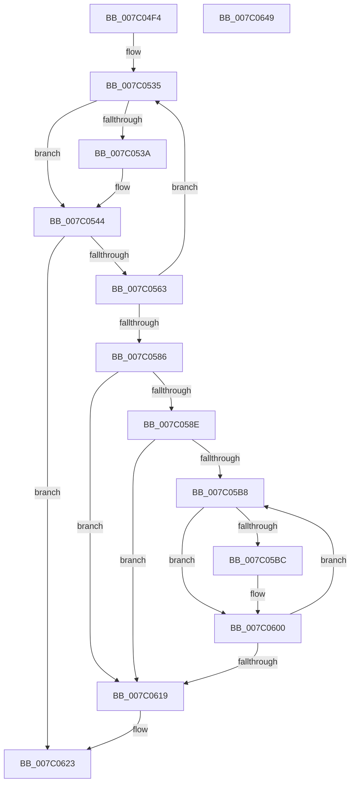

# EtwpObjectTypeRundown

- RVA: `0x007C04F4`–`0x007C064A` (길이 `342` bytes)
- VA: `0x00000001407C04F4`
- 실행 섹션: `PAGE`
- PDB 이름 있음: `예`; PDB Function 태그: `아니요`
- unwind 정보 RVA: `0x000D3E0C`
- 디코드: `93`개 명령, `342/342` bytes 표시
- 미해석 바이트: `0` (있으면 어셈블리에 `.byte`로 보존)

> 이 문서는 커널 이미지의 기계어와 PDB 기호를 분석해 생성했습니다. 4번과 5번은 함수 원형과 자료형을 바이너리 사용 방식에서 추정한 C 해석이며 원본 소스 복구 결과는 아닙니다.

## 1. Dependencies

- 직접 호출 지점: **6**; 고유 호출 대상: **5**
- 직접 호출자로 확인된 함수: **1**
- RIP 상대 이미지 참조: **1**

### Outgoing calls
- `0x007C053F` → [ExFreePoolWithTag](../../poolcode/B8/ExFreePoolWithTag_function_00B82870.md) (function, `0x00B82870`)
- `0x007C0552` → [ExAllocatePool2](../../poolcode/B8/ExAllocatePool2_function_00B820F0.md) (function, `0x00B820F0`)
- `0x007C057A` → [ZwQueryObject](../../text/6A/ZwQueryObject_function_006AD2D0.md) (function, `0x006AD2D0`)
- `0x007C05FB` → [EtwpLogKernelEvent](../../text/25/EtwpLogKernelEvent_function_0025CC00.md) (function, `0x0025CC00`)
- `0x007C061E` → [ExFreePoolWithTag](../../poolcode/B8/ExFreePoolWithTag_function_00B82870.md) (function, `0x00B82870`)
- `0x007C062A` → [_security_check_cookie](../../text/6A/_security_check_cookie_function_006AC640.md) (function, `0x006AC640`)

### Direct callers
- [EtwpKernelTraceRundown](../9E/EtwpKernelTraceRundown_function_009E4080.md) at `0x009E43D3`

### Static image references
- `0x007C050F` → RVA `0x00E0A740` (`.data`; read)

## 2. Other-region calls and transfers

- 다른 실행 섹션으로 향하는 call: **6**
  - `0x007C053F` → [ExFreePoolWithTag](../../poolcode/B8/ExFreePoolWithTag_function_00B82870.md) (`PAGE` → `POOLCODE`)
  - `0x007C0552` → [ExAllocatePool2](../../poolcode/B8/ExAllocatePool2_function_00B820F0.md) (`PAGE` → `POOLCODE`)
  - `0x007C057A` → [ZwQueryObject](../../text/6A/ZwQueryObject_function_006AD2D0.md) (`PAGE` → `.text`)
  - `0x007C05FB` → [EtwpLogKernelEvent](../../text/25/EtwpLogKernelEvent_function_0025CC00.md) (`PAGE` → `.text`)
  - `0x007C061E` → [ExFreePoolWithTag](../../poolcode/B8/ExFreePoolWithTag_function_00B82870.md) (`PAGE` → `POOLCODE`)
  - `0x007C062A` → [_security_check_cookie](../../text/6A/_security_check_cookie_function_006AC640.md) (`PAGE` → `.text`)
- 별도 외부 분기/꼬리 이동을 확인하지 못했습니다.

## 3. Assembly (complete function range)

```asm
007C04F4  48 89 5C 24 10                  mov qword ptr [rsp + 0x10], rbx
007C04F9  48 89 74 24 18                  mov qword ptr [rsp + 0x18], rsi
007C04FE  48 89 7C 24 20                  mov qword ptr [rsp + 0x20], rdi
007C0503  55                              push rbp
007C0504  41 56                           push r14
007C0506  41 57                           push r15
007C0508  48 8B EC                        mov rbp, rsp
007C050B  48 83 EC 70                     sub rsp, 0x70
007C050F  48 8B 05 2A A2 64 00            mov rax, qword ptr [rip + 0x64a22a]
007C0516  48 33 C4                        xor rax, rsp
007C0519  48 89 45 F0                     mov qword ptr [rbp - 0x10], rax
007C051D  33 C0                           xor eax, eax
007C051F  C7 45 C0 00 04 00 00            mov dword ptr [rbp - 0x40], 0x400
007C0526  89 45 C4                        mov dword ptr [rbp - 0x3c], eax
007C0529  33 DB                           xor ebx, ebx
007C052B  66 89 45 C8                     mov word ptr [rbp - 0x38], ax
007C052F  40 8A FA                        mov dil, dl
007C0532  4C 8B F9                        mov r15, rcx
007C0535  48 85 DB                        test rbx, rbx
007C0538  74 0A                           je 0x1407c0544
007C053A  33 D2                           xor edx, edx
007C053C  48 8B CB                        mov rcx, rbx
007C053F  E8 2C 23 3C 00                  call 0x140b82870
007C0544  8B 55 C0                        mov edx, dword ptr [rbp - 0x40]
007C0547  B9 00 01 00 00                  mov ecx, 0x100
007C054C  41 B8 45 74 77 74               mov r8d, 0x74777445
007C0552  E8 99 1B 3C 00                  call 0x140b820f0
007C0557  48 8B D8                        mov rbx, rax
007C055A  48 85 C0                        test rax, rax
007C055D  0F 84 C0 00 00 00               je 0x1407c0623
007C0563  44 8B 4D C0                     mov r9d, dword ptr [rbp - 0x40]
007C0567  48 8D 45 C0                     lea rax, [rbp - 0x40]
007C056B  4C 8B C3                        mov r8, rbx
007C056E  48 89 44 24 20                  mov qword ptr [rsp + 0x20], rax
007C0573  BA 03 00 00 00                  mov edx, 3
007C0578  33 C9                           xor ecx, ecx
007C057A  E8 51 CD EE FF                  call 0x1406ad2d0
007C057F  3D 04 00 00 C0                  cmp eax, 0xc0000004
007C0584  74 AF                           je 0x1407c0535
007C0586  85 C0                           test eax, eax
007C0588  0F 88 8B 00 00 00               js 0x1407c0619
007C058E  40 F6 DF                        neg dil
007C0591  C7 45 D8 04 00 00 00            mov dword ptr [rbp - 0x28], 4
007C0598  48 8D 45 C4                     lea rax, [rbp - 0x3c]
007C059C  66 45 1B F6                     sbb r14w, r14w
007C05A0  48 89 45 D0                     mov qword ptr [rbp - 0x30], rax
007C05A4  83 65 DC 00                     and dword ptr [rbp - 0x24], 0
007C05A8  48 8D 7B 08                     lea rdi, [rbx + 8]
007C05AC  66 41 81 C6 25 11               add r14w, 0x1125
007C05B2  33 F6                           xor esi, esi
007C05B4  39 33                           cmp dword ptr [rbx], esi
007C05B6  76 61                           jbe 0x1407c0619
007C05B8  85 F6                           test esi, esi
007C05BA  74 44                           je 0x1407c0600
007C05BC  0F B6 47 5A                     movzx eax, byte ptr [rdi + 0x5a]
007C05C0  41 B9 02 00 00 00               mov r9d, 2
007C05C6  45 8B 07                        mov r8d, dword ptr [r15]
007C05C9  49 8B 97 50 05 00 00            mov rdx, qword ptr [r15 + 0x550]
007C05D0  66 89 45 C4                     mov word ptr [rbp - 0x3c], ax
007C05D4  0F B7 0F                        movzx ecx, word ptr [rdi]
007C05D7  48 8B 47 08                     mov rax, qword ptr [rdi + 8]
007C05DB  83 C1 02                        add ecx, 2
007C05DE  83 65 EC 00                     and dword ptr [rbp - 0x14], 0
007C05E2  89 4D E8                        mov dword ptr [rbp - 0x18], ecx
007C05E5  48 8D 4D D0                     lea rcx, [rbp - 0x30]
007C05E9  C7 44 24 28 02 18 50 00         mov dword ptr [rsp + 0x28], 0x501802
007C05F1  48 89 45 E0                     mov qword ptr [rbp - 0x20], rax
007C05F5  66 44 89 74 24 20               mov word ptr [rsp + 0x20], r14w
007C05FB  E8 00 C6 A9 FF                  call 0x14025cc00
007C0600  0F B7 47 02                     movzx eax, word ptr [rdi + 2]
007C0604  FF C6                           inc esi
007C0606  48 83 C0 07                     add rax, 7
007C060A  48 83 C7 68                     add rdi, 0x68
007C060E  48 83 E0 F8                     and rax, 0xfffffffffffffff8
007C0612  48 03 F8                        add rdi, rax
007C0615  3B 33                           cmp esi, dword ptr [rbx]
007C0617  72 9F                           jb 0x1407c05b8
007C0619  33 D2                           xor edx, edx
007C061B  48 8B CB                        mov rcx, rbx
007C061E  E8 4D 22 3C 00                  call 0x140b82870
007C0623  48 8B 4D F0                     mov rcx, qword ptr [rbp - 0x10]
007C0627  48 33 CC                        xor rcx, rsp
007C062A  E8 11 C0 EE FF                  call 0x1406ac640
007C062F  4C 8D 5C 24 70                  lea r11, [rsp + 0x70]
007C0634  49 8B 5B 28                     mov rbx, qword ptr [r11 + 0x28]
007C0638  49 8B 73 30                     mov rsi, qword ptr [r11 + 0x30]
007C063C  49 8B 7B 38                     mov rdi, qword ptr [r11 + 0x38]
007C0640  49 8B E3                        mov rsp, r11
007C0643  41 5F                           pop r15
007C0645  41 5E                           pop r14
007C0647  5D                              pop rbp
007C0648  C3                              ret
007C0649  CC                              int3
```

## 4. C-style interpretation (structured pseudocode)

```c
__int64 __fastcall EtwpObjectTypeRundown(__int64 a1, int a2)
{
    __int64 result;
    __int64 v_r14;
    __int64 v_rbx;
    __int64 v_rdi;
    __int64 v_rsi;
    __int64 v_rsp;
    unsigned __int64 v_stack_m18;
    unsigned __int64 v_stack_m28;
    unsigned int v_stack_m2C;
    unsigned int v_stack_m30;
    unsigned __int64 v_stack_m38;
    unsigned int v_stack_m3C;
    unsigned int v_stack_m40;
    unsigned __int64 v_stack_m48;
    unsigned __int16 v_stack_m50;
    unsigned int v_stack_m54;
    unsigned int v_stack_m58;
    unsigned int v_stack_m60;
    unsigned __int64 v_stack_m68;
    unsigned __int64 v_stack_p10;
    unsigned __int64 v_stack_p18;
    unsigned __int64 v_stack_p20;

    v_stack_p10 = v_rbx;
    v_stack_p18 = v_rsi;
    v_stack_p20 = v_rdi;
    v_rsp = (v_rsp) - (112);
    result = (*(unsigned __int64 *)(v_rip + 6595114)) ^ (v_rsp);
    v_stack_m28 = result;
    result = 0;
    v_stack_m58 = 0x400ULL;
    v_stack_m54 = 0;
    v_rbx = 0;
    v_stack_m50 = 0;
loc_007C0535:
    if (0 != 0) {
        a2 = 0;
        a1 = 0;
        result = ExFreePoolWithTag(a1, a2, a3, a4);
    }
    result = ExAllocatePool2(256, (unsigned int)(v_stack_m58), (unsigned int)(0x74777445ULL), a4);
    if (result == 0) goto loc_007C0623;
    v_stack_m68 = v_stack_m58;
    a1 = 0;
    result = ZwQueryObject(a1, 3, result, (unsigned int)(v_stack_m58));
    if (((unsigned int)(result)) == 0xC0000004ULL) goto loc_007C0535;
    if (sign_flag) goto loc_007C0619;
    v_rdi = (unsigned __int8)(-((unsigned __int8)(a2)));
    v_stack_m40 = 4;
    v_stack_m48 = v_stack_m54;
    v_r14 = (unsigned __int16)((v_r14) + (0x1125ULL));
    v_rsi = 0;
    if ((*(unsigned int *)(result)) <= 0) goto loc_007C0619;
loc_007C05B8:
    result = v_stack_m54;
    if (0 != 0) {
        result = *(unsigned __int8 *)(result + 8 + 90);
        a4 = 2;
        a3 = *(unsigned int *)(a1);
        a2 = *(unsigned __int64 *)(a1 + 1360);
        v_stack_m54 = (unsigned __int16)(result);
        a1 = *(unsigned __int16 *)(result + 8);
        result = *(unsigned __int64 *)(result + 8 + 8);
        a1 = (unsigned int)((a1) + (2));
        v_stack_m30 = (unsigned int)(a1);
        a1 = v_stack_m48;
        v_stack_m60 = 0x501802ULL;
        v_stack_m38 = result;
        v_stack_m68 = (unsigned __int16)(v_r14);
        result = EtwpLogKernelEvent(a1, a2, a3, a4);
    }
    v_rsi = (unsigned int)((v_rsi) + 1);
    result = (*(unsigned __int16 *)(result + 8 + 2)) + (7);
    v_rdi = (result + 8) + (104);
    result = (result) & (-8);
    v_rdi = (v_rdi) + (result);
    if (((unsigned int)(v_rsi)) < (*(unsigned int *)(result))) goto loc_007C05B8;
loc_007C0619:
    a2 = 0;
    result = ExFreePoolWithTag(result, a2, a3, a4);
loc_007C0623:
    a1 = (v_stack_m28) ^ (v_rsp);
    result = _security_check_cookie(a1, a2, a3, a4);
    return result;
}
```

## 5. (Beta) C Style

```c
int64_t EtwpObjectTypeRundown(void *Arg1, int32_t Arg2)
{
    uint8_t *arg1 = (uint8_t *)Arg1;

    int64_t result;
    int64_t local_r14;
    int64_t local_rbx;
    int64_t local_rdi;
    int64_t local_rsi;
    int64_t local_rsp;
    uint64_t v_stack_m18;
    uint64_t v_stack_m28;
    uint32_t v_stack_m2C;
    uint32_t v_stack_m30;
    uint64_t v_stack_m38;
    uint32_t v_stack_m3C;
    uint32_t v_stack_m40;
    uint64_t v_stack_m48;
    uint16_t v_stack_m50;
    uint32_t v_stack_m54;
    uint32_t v_stack_m58;
    uint32_t v_stack_m60;
    uint64_t v_stack_m68;
    uint64_t v_stack_p10;
    uint64_t v_stack_p18;
    uint64_t v_stack_p20;

    v_stack_p10 = local_rbx;
    v_stack_p18 = local_rsi;
    v_stack_p20 = local_rdi;
    local_rsp = (local_rsp) - (112);
    result = (*(uint64_t *)(v_rip + 0x64A22A)) ^ (local_rsp);
    v_stack_m28 = result;
    result = 0;
    v_stack_m58 = 0x400ULL;
    v_stack_m54 = 0;
    local_rbx = 0;
    v_stack_m50 = 0;
loc_007C0535:
    if (0 != 0) {
        Arg2 = 0;
        Arg1 = 0;
        result = ExFreePoolWithTag(Arg1, Arg2, a3, a4);
    }
    result = ExAllocatePool2(256, (uint32_t)(v_stack_m58), (uint32_t)(0x74777445ULL), a4);
    if (result == 0) goto loc_007C0623;
    v_stack_m68 = v_stack_m58;
    Arg1 = 0;
    result = ZwQueryObject(Arg1, 3, result, (uint32_t)(v_stack_m58));
    if (((uint32_t)(result)) == 0xC0000004ULL) goto loc_007C0535;
    if (sign_flag) goto loc_007C0619;
    local_rdi = (uint8_t)(-((uint8_t)(Arg2)));
    v_stack_m40 = 4;
    v_stack_m48 = v_stack_m54;
    local_r14 = (uint16_t)((local_r14) + (0x1125ULL));
    local_rsi = 0;
    if ((*(uint32_t *)(result)) <= 0) goto loc_007C0619;
loc_007C05B8:
    result = v_stack_m54;
    if (0 != 0) {
        result = *(uint8_t *)(result + 0x8 + 0x5A);
        a4 = 2;
        a3 = *(uint32_t *)(arg1);
        Arg2 = *(uint64_t *)(arg1 + 0x550);
        v_stack_m54 = (uint16_t)(result);
        Arg1 = *(uint16_t *)(result + 0x8);
        result = *(uint64_t *)(result + 0x8 + 0x8);
        Arg1 = (uint32_t)((Arg1) + (2));
        v_stack_m30 = (uint32_t)(Arg1);
        Arg1 = v_stack_m48;
        v_stack_m60 = 0x501802ULL;
        v_stack_m38 = result;
        v_stack_m68 = (uint16_t)(local_r14);
        result = EtwpLogKernelEvent(Arg1, Arg2, a3, a4);
    }
    local_rsi = (uint32_t)((local_rsi) + 1);
    result = (*(uint16_t *)(result + 0x8 + 0x2)) + (7);
    local_rdi = (result + 8) + (104);
    result = (result) & (-8);
    local_rdi = (local_rdi) + (result);
    if (((uint32_t)(local_rsi)) < (*(uint32_t *)(result))) goto loc_007C05B8;
loc_007C0619:
    Arg2 = 0;
    result = ExFreePoolWithTag(result, Arg2, a3, a4);
loc_007C0623:
    Arg1 = (v_stack_m28) ^ (local_rsp);
    result = _security_check_cookie(Arg1, Arg2, a3, a4);
    return result;
}
```

### 관측된 메모리 오프셋

구조체 형식이 확인되지 않은 접근은 인자 기준의 오프셋으로만 기록했습니다.

| 기준 인자 | 오프셋 표현 | 폭 (bit) | 접근 |
|---|---:|---:|---|
| `Arg1` | `+ 0x0` | `32` | `R` |
| `Arg1` | `+ 0x550` | `64` | `R` |

## 6. Execution-region graph

[열기: 2D/3D 그래프와 함수 탐색 컨트롤 패널](../../../control-panel.html?section=page&rva=0x007C04F4&view=graph)

- 2D 그래프는 위에서 아래로 흐르고, 3D 그래프는 빈 공간을 드래그해 회전합니다. Shift+드래그는 이동, 휠은 확대·축소, 함수 노드 선택은 대상 보고서 이동입니다.

### Static fallback


