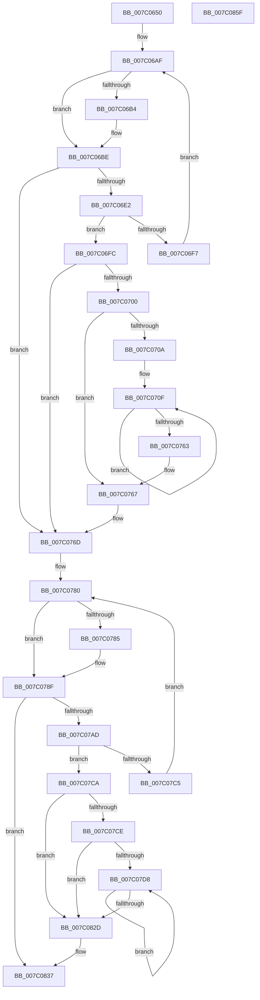

# EtwpPoolRunDown

- RVA: `0x007C0650`–`0x007C0860` (길이 `528` bytes)
- VA: `0x00000001407C0650`
- 실행 섹션: `PAGE`
- PDB 이름 있음: `예`; PDB Function 태그: `아니요`
- unwind 정보 RVA: `0x000D3E30`
- 디코드: `148`개 명령, `528/528` bytes 표시
- 미해석 바이트: `0` (있으면 어셈블리에 `.byte`로 보존)

> 이 문서는 커널 이미지의 기계어와 PDB 기호를 분석해 생성했습니다. 4번과 5번은 함수 원형과 자료형을 바이너리 사용 방식에서 추정한 C 해석이며 원본 소스 복구 결과는 아닙니다.

## 1. Dependencies

- 직접 호출 지점: **10**; 고유 호출 대상: **6**
- 직접 호출자로 확인된 함수: **1**
- RIP 상대 이미지 참조: **1**

### Outgoing calls
- `0x007C06B9` → [ExFreePoolWithTag](../../poolcode/B8/ExFreePoolWithTag_function_00B82870.md) (function, `0x00B82870`)
- `0x007C06CB` → [ExAllocatePool2](../../poolcode/B8/ExAllocatePool2_function_00B820F0.md) (function, `0x00B820F0`)
- `0x007C06EB` → [ExGetPoolTagInfo](../A1/ExGetPoolTagInfo_function_00A170D8.md) (function, `0x00A170D8`)
- `0x007C074E` → [EtwpLogKernelEvent](../../text/25/EtwpLogKernelEvent_function_0025CC00.md) (function, `0x0025CC00`)
- `0x007C078A` → [ExFreePoolWithTag](../../poolcode/B8/ExFreePoolWithTag_function_00B82870.md) (function, `0x00B82870`)
- `0x007C079C` → [ExAllocatePool2](../../poolcode/B8/ExAllocatePool2_function_00B820F0.md) (function, `0x00B820F0`)
- `0x007C07B9` → [ExGetBigPoolInfo](../../text/44/ExGetBigPoolInfo_function_00446970.md) (function, `0x00446970`)
- `0x007C0818` → [EtwpLogKernelEvent](../../text/25/EtwpLogKernelEvent_function_0025CC00.md) (function, `0x0025CC00`)
- `0x007C0832` → [ExFreePoolWithTag](../../poolcode/B8/ExFreePoolWithTag_function_00B82870.md) (function, `0x00B82870`)
- `0x007C083E` → [_security_check_cookie](../../text/6A/_security_check_cookie_function_006AC640.md) (function, `0x006AC640`)

### Direct callers
- [EtwpKernelTraceRundown](../9E/EtwpKernelTraceRundown_function_009E4080.md) at `0x009E4235`

### Static image references
- `0x007C066C` → RVA `0x00E0A740` (`.data`; read)

## 2. Other-region calls and transfers

- 다른 실행 섹션으로 향하는 call: **9**
  - `0x007C06B9` → [ExFreePoolWithTag](../../poolcode/B8/ExFreePoolWithTag_function_00B82870.md) (`PAGE` → `POOLCODE`)
  - `0x007C06CB` → [ExAllocatePool2](../../poolcode/B8/ExAllocatePool2_function_00B820F0.md) (`PAGE` → `POOLCODE`)
  - `0x007C074E` → [EtwpLogKernelEvent](../../text/25/EtwpLogKernelEvent_function_0025CC00.md) (`PAGE` → `.text`)
  - `0x007C078A` → [ExFreePoolWithTag](../../poolcode/B8/ExFreePoolWithTag_function_00B82870.md) (`PAGE` → `POOLCODE`)
  - `0x007C079C` → [ExAllocatePool2](../../poolcode/B8/ExAllocatePool2_function_00B820F0.md) (`PAGE` → `POOLCODE`)
  - `0x007C07B9` → [ExGetBigPoolInfo](../../text/44/ExGetBigPoolInfo_function_00446970.md) (`PAGE` → `.text`)
  - `0x007C0818` → [EtwpLogKernelEvent](../../text/25/EtwpLogKernelEvent_function_0025CC00.md) (`PAGE` → `.text`)
  - `0x007C0832` → [ExFreePoolWithTag](../../poolcode/B8/ExFreePoolWithTag_function_00B82870.md) (`PAGE` → `POOLCODE`)
  - `0x007C083E` → [_security_check_cookie](../../text/6A/_security_check_cookie_function_006AC640.md) (`PAGE` → `.text`)
- 별도 외부 분기/꼬리 이동을 확인하지 못했습니다.

## 3. Assembly (complete function range)

```asm
007C0650  48 89 5C 24 10                  mov qword ptr [rsp + 0x10], rbx
007C0655  48 89 74 24 18                  mov qword ptr [rsp + 0x18], rsi
007C065A  55                              push rbp
007C065B  57                              push rdi
007C065C  41 54                           push r12
007C065E  41 56                           push r14
007C0660  41 57                           push r15
007C0662  48 8B EC                        mov rbp, rsp
007C0665  48 81 EC 80 00 00 00            sub rsp, 0x80
007C066C  48 8B 05 CD A0 64 00            mov rax, qword ptr [rip + 0x64a0cd]
007C0673  48 33 C4                        xor rax, rsp
007C0676  48 89 45 F0                     mov qword ptr [rbp - 0x10], rax
007C067A  83 65 B4 00                     and dword ptr [rbp - 0x4c], 0
007C067E  48 8D 45 B4                     lea rax, [rbp - 0x4c]
007C0682  33 DB                           xor ebx, ebx
007C0684  48 89 45 C0                     mov qword ptr [rbp - 0x40], rax
007C0688  21 5D CC                        and dword ptr [rbp - 0x34], ebx
007C068B  8A C2                           mov al, dl
007C068D  F6 D8                           neg al
007C068F  88 55 B0                        mov byte ptr [rbp - 0x50], dl
007C0692  40 8A F2                        mov sil, dl
007C0695  C7 45 C8 04 00 00 00            mov dword ptr [rbp - 0x38], 4
007C069C  66 45 1B F6                     sbb r14w, r14w
007C06A0  8D 7B 30                        lea edi, [rbx + 0x30]
007C06A3  66 41 81 C6 29 0E               add r14w, 0xe29
007C06A9  89 7D B8                        mov dword ptr [rbp - 0x48], edi
007C06AC  4C 8B E1                        mov r12, rcx
007C06AF  48 85 DB                        test rbx, rbx
007C06B2  74 0A                           je 0x1407c06be
007C06B4  33 D2                           xor edx, edx
007C06B6  48 8B CB                        mov rcx, rbx
007C06B9  E8 B2 21 3C 00                  call 0x140b82870
007C06BE  8B D7                           mov edx, edi
007C06C0  B9 00 01 00 00                  mov ecx, 0x100
007C06C5  41 B8 45 74 77 74               mov r8d, 0x74777445
007C06CB  E8 20 1A 3C 00                  call 0x140b820f0
007C06D0  48 8B D8                        mov rbx, rax
007C06D3  41 BF 64 00 00 00               mov r15d, 0x64
007C06D9  48 85 C0                        test rax, rax
007C06DC  0F 84 8B 00 00 00               je 0x1407c076d
007C06E2  4C 8D 45 B8                     lea r8, [rbp - 0x48]
007C06E6  8B D7                           mov edx, edi
007C06E8  48 8B C8                        mov rcx, rax
007C06EB  E8 E8 69 25 00                  call 0x140a170d8
007C06F0  3D 04 00 00 C0                  cmp eax, 0xc0000004
007C06F5  75 05                           jne 0x1407c06fc
007C06F7  8B 7D B8                        mov edi, dword ptr [rbp - 0x48]
007C06FA  EB B3                           jmp 0x1407c06af
007C06FC  85 C0                           test eax, eax
007C06FE  78 6D                           js 0x1407c076d
007C0700  8B 3B                           mov edi, dword ptr [rbx]
007C0702  4C 8D 7B 08                     lea r15, [rbx + 8]
007C0706  85 FF                           test edi, edi
007C0708  74 5D                           je 0x1407c0767
007C070A  BE 64 00 00 00                  mov esi, 0x64
007C070F  45 8B 04 24                     mov r8d, dword ptr [r12]
007C0713  48 8D 4D C0                     lea rcx, [rbp - 0x40]
007C0717  49 8B 94 24 50 05 00 00         mov rdx, qword ptr [r12 + 0x550]
007C071F  8B C7                           mov eax, edi
007C0721  3B FE                           cmp edi, esi
007C0723  C7 44 24 28 02 18 50 00         mov dword ptr [rsp + 0x28], 0x501802
007C072B  41 B9 02 00 00 00               mov r9d, 2
007C0731  4C 89 7D D0                     mov qword ptr [rbp - 0x30], r15
007C0735  0F 47 C6                        cmova eax, esi
007C0738  66 44 89 74 24 20               mov word ptr [rsp + 0x20], r14w
007C073E  83 65 DC 00                     and dword ptr [rbp - 0x24], 0
007C0742  89 45 B4                        mov dword ptr [rbp - 0x4c], eax
007C0745  8D 04 80                        lea eax, [rax + rax*4]
007C0748  C1 E0 03                        shl eax, 3
007C074B  89 45 D8                        mov dword ptr [rbp - 0x28], eax
007C074E  E8 AD C4 A9 FF                  call 0x14025cc00
007C0753  8B 45 B4                        mov eax, dword ptr [rbp - 0x4c]
007C0756  48 8D 0C 80                     lea rcx, [rax + rax*4]
007C075A  4D 8D 3C CF                     lea r15, [r15 + rcx*8]
007C075E  2B 7D B4                        sub edi, dword ptr [rbp - 0x4c]
007C0761  75 AC                           jne 0x1407c070f
007C0763  40 8A 75 B0                     mov sil, byte ptr [rbp - 0x50]
007C0767  41 BF 64 00 00 00               mov r15d, 0x64
007C076D  40 F6 DE                        neg sil
007C0770  BF 20 00 00 00                  mov edi, 0x20
007C0775  89 7D B8                        mov dword ptr [rbp - 0x48], edi
007C0778  66 1B F6                        sbb si, si
007C077B  66 81 C6 2B 0E                  add si, 0xe2b
007C0780  48 85 DB                        test rbx, rbx
007C0783  74 0A                           je 0x1407c078f
007C0785  33 D2                           xor edx, edx
007C0787  48 8B CB                        mov rcx, rbx
007C078A  E8 E1 20 3C 00                  call 0x140b82870
007C078F  8B D7                           mov edx, edi
007C0791  B9 00 01 00 00                  mov ecx, 0x100
007C0796  41 B8 45 74 77 74               mov r8d, 0x74777445
007C079C  E8 4F 19 3C 00                  call 0x140b820f0
007C07A1  48 8B D8                        mov rbx, rax
007C07A4  48 85 C0                        test rax, rax
007C07A7  0F 84 8A 00 00 00               je 0x1407c0837
007C07AD  4C 8D 4D B8                     lea r9, [rbp - 0x48]
007C07B1  44 8B C7                        mov r8d, edi
007C07B4  48 8B D0                        mov rdx, rax
007C07B7  33 C9                           xor ecx, ecx
007C07B9  E8 B2 61 C8 FF                  call 0x140446970
007C07BE  3D 04 00 00 C0                  cmp eax, 0xc0000004
007C07C3  75 05                           jne 0x1407c07ca
007C07C5  8B 7D B8                        mov edi, dword ptr [rbp - 0x48]
007C07C8  EB B6                           jmp 0x1407c0780
007C07CA  85 C0                           test eax, eax
007C07CC  78 5F                           js 0x1407c082d
007C07CE  8B 3B                           mov edi, dword ptr [rbx]
007C07D0  4C 8D 73 08                     lea r14, [rbx + 8]
007C07D4  85 FF                           test edi, edi
007C07D6  74 55                           je 0x1407c082d
007C07D8  45 8B 04 24                     mov r8d, dword ptr [r12]
007C07DC  48 8D 4D C0                     lea rcx, [rbp - 0x40]
007C07E0  49 8B 94 24 50 05 00 00         mov rdx, qword ptr [r12 + 0x550]
007C07E8  8B C7                           mov eax, edi
007C07EA  41 3B FF                        cmp edi, r15d
007C07ED  C7 44 24 28 02 18 50 00         mov dword ptr [rsp + 0x28], 0x501802
007C07F5  41 B9 02 00 00 00               mov r9d, 2
007C07FB  4C 89 75 D0                     mov qword ptr [rbp - 0x30], r14
007C07FF  41 0F 47 C7                     cmova eax, r15d
007C0803  66 89 74 24 20                  mov word ptr [rsp + 0x20], si
007C0808  83 65 DC 00                     and dword ptr [rbp - 0x24], 0
007C080C  89 45 B4                        mov dword ptr [rbp - 0x4c], eax
007C080F  8D 04 40                        lea eax, [rax + rax*2]
007C0812  C1 E0 03                        shl eax, 3
007C0815  89 45 D8                        mov dword ptr [rbp - 0x28], eax
007C0818  E8 E3 C3 A9 FF                  call 0x14025cc00
007C081D  8B 45 B4                        mov eax, dword ptr [rbp - 0x4c]
007C0820  48 8D 0C 40                     lea rcx, [rax + rax*2]
007C0824  4D 8D 34 CE                     lea r14, [r14 + rcx*8]
007C0828  2B 7D B4                        sub edi, dword ptr [rbp - 0x4c]
007C082B  75 AB                           jne 0x1407c07d8
007C082D  33 D2                           xor edx, edx
007C082F  48 8B CB                        mov rcx, rbx
007C0832  E8 39 20 3C 00                  call 0x140b82870
007C0837  48 8B 4D F0                     mov rcx, qword ptr [rbp - 0x10]
007C083B  48 33 CC                        xor rcx, rsp
007C083E  E8 FD BD EE FF                  call 0x1406ac640
007C0843  4C 8D 9C 24 80 00 00 00         lea r11, [rsp + 0x80]
007C084B  49 8B 5B 38                     mov rbx, qword ptr [r11 + 0x38]
007C084F  49 8B 73 40                     mov rsi, qword ptr [r11 + 0x40]
007C0853  49 8B E3                        mov rsp, r11
007C0856  41 5F                           pop r15
007C0858  41 5E                           pop r14
007C085A  41 5C                           pop r12
007C085C  5F                              pop rdi
007C085D  5D                              pop rbp
007C085E  C3                              ret
007C085F  CC                              int3
```

## 4. C-style interpretation (structured pseudocode)

```c
__int64 __fastcall EtwpPoolRunDown(__int64 a1, int a2)
{
    __int64 result;
    __int64 v_r14;
    __int64 v_rbx;
    __int64 v_rdi;
    __int64 v_rsi;
    __int64 v_rsp;
    unsigned __int64 v_stack_m28;
    unsigned __int64 v_stack_m38;
    unsigned int v_stack_m4C;
    unsigned int v_stack_m50;
    unsigned __int64 v_stack_m58;
    unsigned int v_stack_m5C;
    unsigned int v_stack_m60;
    unsigned __int64 v_stack_m68;
    unsigned int v_stack_m70;
    unsigned int v_stack_m74;
    unsigned __int8 v_stack_m78;
    unsigned int v_stack_m80;
    unsigned __int16 v_stack_m88;
    unsigned __int64 v_stack_p10;
    unsigned __int64 v_stack_p18;

    v_stack_p10 = v_rbx;
    v_stack_p18 = v_rsi;
    v_rsp = (v_rsp) - (128);
    result = (*(unsigned __int64 *)(v_rip + 6594765)) ^ (v_rsp);
    v_stack_m38 = result;
    v_rbx = 0;
    v_stack_m68 = v_stack_m74;
    result = (unsigned __int8)(-((unsigned __int8)(a2)));
    v_stack_m78 = (unsigned __int8)(a2);
    v_stack_m60 = 4;
    v_r14 = (unsigned __int16)((v_r14) + (0xE29ULL));
    v_stack_m70 = (unsigned int)(v_rbx + 48);
loc_007C06AF:
    if (0 != 0) {
        a2 = 0;
        a1 = 0;
        result = ExFreePoolWithTag(a1, a2, a3, a4);
    }
    result = ExAllocatePool2(256, (unsigned int)((unsigned int)(v_rbx + 48)), (unsigned int)(0x74777445ULL), a4);
    if (result == 0) goto loc_007C076D;
    result = ExGetPoolTagInfo(result, (unsigned int)((unsigned int)(v_rbx + 48)), v_stack_m70, a4);
    if (((unsigned int)(result)) != 0xC0000004ULL) goto loc_007C06FC;
    goto loc_007C06AF;
loc_007C06FC:
    if (sign_flag) goto loc_007C076D;
    if ((unsigned int)((unsigned int)(*(unsigned int *)(result))) == 0) goto loc_007C0767;
loc_007C070F:
    v_stack_m80 = 0x501802ULL;
    v_stack_m58 = result + 8;
    result = (unsigned int)((unsigned int)((unsigned int)(*(unsigned int *)(result))));
    if (((unsigned int)((unsigned int)(*(unsigned int *)(result)))) > 100) { result = 100; }
    v_stack_m88 = (unsigned __int16)(v_r14);
    v_stack_m74 = (unsigned int)(result);
    result = (unsigned int)((result + result * 4) << (3));
    v_stack_m50 = (unsigned int)(result);
    result = EtwpLogKernelEvent(v_stack_m68, *(unsigned __int64 *)(a1 + 1360), (unsigned int)(*(unsigned int *)(a1)), 2);
    v_rdi = (unsigned int)(((unsigned int)(*(unsigned int *)(result))) - (v_stack_m74));
    if (condition_is_not_equal) goto loc_007C070F;
loc_007C0767:
loc_007C076D:
    v_rsi = (unsigned __int8)(-(v_stack_m78));
    v_stack_m70 = 32;
    v_rsi = (unsigned __int16)((v_rsi) + (0xE2BULL));
loc_007C0780:
    result = (unsigned int)(v_stack_m74);
    if (result != 0) {
        a2 = 0;
        a1 = result;
        result = ExFreePoolWithTag(a1, a2, (unsigned int)(*(unsigned int *)(a1)), 2);
    }
    result = ExAllocatePool2(256, 32, (unsigned int)(0x74777445ULL), 2);
    if (result == 0) goto loc_007C0837;
    a1 = 0;
    result = ExGetBigPoolInfo(a1, result, 32, v_stack_m70);
    if (((unsigned int)(result)) != 0xC0000004ULL) goto loc_007C07CA;
    goto loc_007C0780;
loc_007C07CA:
    if (sign_flag) goto loc_007C082D;
    if ((unsigned int)((unsigned int)(*(unsigned int *)(result))) == 0) goto loc_007C082D;
loc_007C07D8:
    v_stack_m80 = 0x501802ULL;
    v_stack_m58 = result + 8;
    result = (unsigned int)((unsigned int)((unsigned int)(*(unsigned int *)(result))));
    if (((unsigned int)((unsigned int)(*(unsigned int *)(result)))) > 100) { result = 100; }
    v_stack_m88 = (unsigned __int16)(v_rsi);
    v_stack_m74 = (unsigned int)(result);
    result = (unsigned int)((result + result * 2) << (3));
    v_stack_m50 = (unsigned int)(result);
    result = EtwpLogKernelEvent(v_stack_m68, *(unsigned __int64 *)(a1 + 1360), (unsigned int)(*(unsigned int *)(a1)), 2);
    v_rdi = (unsigned int)(((unsigned int)(*(unsigned int *)(result))) - (v_stack_m74));
    if (condition_is_not_equal) goto loc_007C07D8;
loc_007C082D:
    a2 = 0;
    result = ExFreePoolWithTag(result, a2, (unsigned int)(*(unsigned int *)(a1)), 2);
loc_007C0837:
    a1 = (v_stack_m38) ^ (v_rsp);
    result = _security_check_cookie(a1, a2, (unsigned int)(*(unsigned int *)(a1)), 2);
    return result;
}
```

## 5. (Beta) C Style

```c
int64_t EtwpPoolRunDown(void *Arg1, int32_t Arg2)
{
    uint8_t *arg1 = (uint8_t *)Arg1;

    int64_t result;
    int64_t local_r14;
    int64_t local_rbx;
    int64_t local_rdi;
    int64_t local_rsi;
    int64_t local_rsp;
    uint64_t v_stack_m28;
    uint64_t v_stack_m38;
    uint32_t v_stack_m4C;
    uint32_t v_stack_m50;
    uint64_t v_stack_m58;
    uint32_t v_stack_m5C;
    uint32_t v_stack_m60;
    uint64_t v_stack_m68;
    uint32_t v_stack_m70;
    uint32_t v_stack_m74;
    uint8_t v_stack_m78;
    uint32_t v_stack_m80;
    uint16_t v_stack_m88;
    uint64_t v_stack_p10;
    uint64_t v_stack_p18;

    v_stack_p10 = local_rbx;
    v_stack_p18 = local_rsi;
    local_rsp = (local_rsp) - (128);
    result = (*(uint64_t *)(v_rip + 0x64A0CD)) ^ (local_rsp);
    v_stack_m38 = result;
    local_rbx = 0;
    v_stack_m68 = v_stack_m74;
    result = (uint8_t)(-((uint8_t)(Arg2)));
    v_stack_m78 = (uint8_t)(Arg2);
    v_stack_m60 = 4;
    local_r14 = (uint16_t)((local_r14) + (0xE29ULL));
    v_stack_m70 = (uint32_t)(local_rbx + 48);
loc_007C06AF:
    if (0 != 0) {
        Arg2 = 0;
        Arg1 = 0;
        result = ExFreePoolWithTag(Arg1, Arg2, a3, a4);
    }
    result = ExAllocatePool2(256, (uint32_t)((uint32_t)(local_rbx + 48)), (uint32_t)(0x74777445ULL), a4);
    if (result == 0) goto loc_007C076D;
    result = ExGetPoolTagInfo(result, (uint32_t)((uint32_t)(local_rbx + 48)), v_stack_m70, a4);
    if (((uint32_t)(result)) != 0xC0000004ULL) goto loc_007C06FC;
    goto loc_007C06AF;
loc_007C06FC:
    if (sign_flag) goto loc_007C076D;
    if ((uint32_t)((uint32_t)(*(uint32_t *)(result))) == 0) goto loc_007C0767;
loc_007C070F:
    v_stack_m80 = 0x501802ULL;
    v_stack_m58 = result + 8;
    result = (uint32_t)((uint32_t)((uint32_t)(*(uint32_t *)(result))));
    if (((uint32_t)((uint32_t)(*(uint32_t *)(result)))) > 100) { result = 100; }
    v_stack_m88 = (uint16_t)(local_r14);
    v_stack_m74 = (uint32_t)(result);
    result = (uint32_t)((result + result * 4) << (3));
    v_stack_m50 = (uint32_t)(result);
    result = EtwpLogKernelEvent(v_stack_m68, *(uint64_t *)(arg1 + 0x550), (uint32_t)(*(uint32_t *)(arg1)), 2);
    local_rdi = (uint32_t)(((uint32_t)(*(uint32_t *)(result))) - (v_stack_m74));
    if (condition_is_not_equal) goto loc_007C070F;
loc_007C0767:
loc_007C076D:
    local_rsi = (uint8_t)(-(v_stack_m78));
    v_stack_m70 = 32;
    local_rsi = (uint16_t)((local_rsi) + (0xE2BULL));
loc_007C0780:
    result = (uint32_t)(v_stack_m74);
    if (result != 0) {
        Arg2 = 0;
        Arg1 = result;
        result = ExFreePoolWithTag(Arg1, Arg2, (uint32_t)(*(uint32_t *)(arg1)), 2);
    }
    result = ExAllocatePool2(256, 32, (uint32_t)(0x74777445ULL), 2);
    if (result == 0) goto loc_007C0837;
    Arg1 = 0;
    result = ExGetBigPoolInfo(Arg1, result, 32, v_stack_m70);
    if (((uint32_t)(result)) != 0xC0000004ULL) goto loc_007C07CA;
    goto loc_007C0780;
loc_007C07CA:
    if (sign_flag) goto loc_007C082D;
    if ((uint32_t)((uint32_t)(*(uint32_t *)(result))) == 0) goto loc_007C082D;
loc_007C07D8:
    v_stack_m80 = 0x501802ULL;
    v_stack_m58 = result + 8;
    result = (uint32_t)((uint32_t)((uint32_t)(*(uint32_t *)(result))));
    if (((uint32_t)((uint32_t)(*(uint32_t *)(result)))) > 100) { result = 100; }
    v_stack_m88 = (uint16_t)(local_rsi);
    v_stack_m74 = (uint32_t)(result);
    result = (uint32_t)((result + result * 2) << (3));
    v_stack_m50 = (uint32_t)(result);
    result = EtwpLogKernelEvent(v_stack_m68, *(uint64_t *)(arg1 + 0x550), (uint32_t)(*(uint32_t *)(arg1)), 2);
    local_rdi = (uint32_t)(((uint32_t)(*(uint32_t *)(result))) - (v_stack_m74));
    if (condition_is_not_equal) goto loc_007C07D8;
loc_007C082D:
    Arg2 = 0;
    result = ExFreePoolWithTag(result, Arg2, (uint32_t)(*(uint32_t *)(arg1)), 2);
loc_007C0837:
    Arg1 = (v_stack_m38) ^ (local_rsp);
    result = _security_check_cookie(Arg1, Arg2, (uint32_t)(*(uint32_t *)(arg1)), 2);
    return result;
}
```

### 관측된 메모리 오프셋

구조체 형식이 확인되지 않은 접근은 인자 기준의 오프셋으로만 기록했습니다.

| 기준 인자 | 오프셋 표현 | 폭 (bit) | 접근 |
|---|---:|---:|---|
| `Arg1` | `+ 0x0` | `32` | `R` |
| `Arg1` | `+ 0x550` | `64` | `R` |

## 6. Execution-region graph

[열기: 2D/3D 그래프와 함수 탐색 컨트롤 패널](../../../control-panel.html?section=page&rva=0x007C0650&view=graph)

- 2D 그래프는 위에서 아래로 흐르고, 3D 그래프는 빈 공간을 드래그해 회전합니다. Shift+드래그는 이동, 휠은 확대·축소, 함수 노드 선택은 대상 보고서 이동입니다.

### Static fallback


