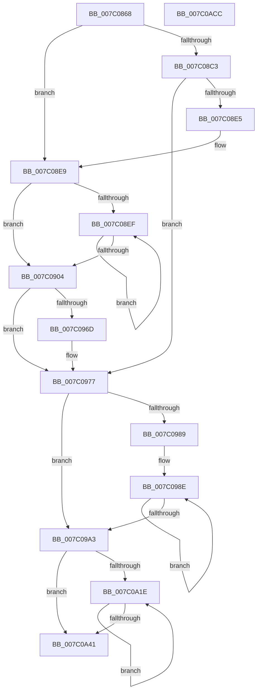

# EtwpProcessorRundown

- RVA: `0x007C0868`–`0x007C0ACD` (길이 `613` bytes)
- VA: `0x00000001407C0868`
- 실행 섹션: `PAGE`
- PDB 이름 있음: `예`; PDB Function 태그: `아니요`
- unwind 정보 RVA: `0x000D3DC0`
- 디코드: `136`개 명령, `613/613` bytes 표시
- 미해석 바이트: `0` (있으면 어셈블리에 `.byte`로 보존)

> 이 문서는 커널 이미지의 기계어와 PDB 기호를 분석해 생성했습니다. 4번과 5번은 함수 원형과 자료형을 바이너리 사용 방식에서 추정한 C 해석이며 원본 소스 복구 결과는 아닙니다.

## 1. Dependencies

- 직접 호출 지점: **13**; 고유 호출 대상: **11**
- 직접 호출자로 확인된 함수: **1**
- RIP 상대 이미지 참조: **1**

### Outgoing calls
- `0x007C08A6` → [memset](../../text/6C/memset_function_006C6C40.md) (function, `0x006C6C40`)
- `0x007C08B5` → [KeQueryActiveProcessorCountEx](../../text/24/KeQueryActiveProcessorCountEx_function_00249EF0.md) (function, `0x00249EF0`)
- `0x007C08D4` → [ExAllocatePool2](../../poolcode/B8/ExAllocatePool2_function_00B820F0.md) (function, `0x00B820F0`)
- `0x007C08F5` → [KeGetProcessorNumberFromIndex](../../text/2D/KeGetProcessorNumberFromIndex_function_002DD320.md) (function, `0x002DD320`)
- `0x007C095E` → [EtwpLogKernelEvent](../../text/25/EtwpLogKernelEvent_function_0025CC00.md) (function, `0x0025CC00`)
- `0x007C0972` → [ExFreePoolWithTag](../../poolcode/B8/ExFreePoolWithTag_function_00B82870.md) (function, `0x00B82870`)
- `0x007C0977` → [KeQueryActiveGroupCount](../../text/48/KeQueryActiveGroupCount_function_0048C600.md) (function, `0x0048C600`)
- `0x007C0991` → [KeQueryGroupAffinity](../../text/47/KeQueryGroupAffinity_function_00471A60.md) (function, `0x00471A60`)
- `0x007C0A06` → [EtwpLogKernelEvent](../../text/25/EtwpLogKernelEvent_function_0025CC00.md) (function, `0x0025CC00`)
- `0x007C0A0B` → [KeQueryHighestNodeNumber](../../text/45/KeQueryHighestNodeNumber_function_0045CEC0.md) (function, `0x0045CEC0`)
- `0x007C0A32` → [KeQueryNodeActiveAffinity](../../text/43/KeQueryNodeActiveAffinity_function_0043EF80.md) (function, `0x0043EF80`)
- `0x007C0AA0` → [EtwpLogKernelEvent](../../text/25/EtwpLogKernelEvent_function_0025CC00.md) (function, `0x0025CC00`)
- `0x007C0AAF` → [_security_check_cookie](../../text/6A/_security_check_cookie_function_006AC640.md) (function, `0x006AC640`)

### Direct callers
- [EtwpKernelTraceRundown](../9E/EtwpKernelTraceRundown_function_009E4080.md) at `0x009E43E9`

### Static image references
- `0x007C0885` → RVA `0x00E0A740` (`.data`; read)

## 2. Other-region calls and transfers

- 다른 실행 섹션으로 향하는 call: **13**
  - `0x007C08A6` → [memset](../../text/6C/memset_function_006C6C40.md) (`PAGE` → `.text`)
  - `0x007C08B5` → [KeQueryActiveProcessorCountEx](../../text/24/KeQueryActiveProcessorCountEx_function_00249EF0.md) (`PAGE` → `.text`)
  - `0x007C08D4` → [ExAllocatePool2](../../poolcode/B8/ExAllocatePool2_function_00B820F0.md) (`PAGE` → `POOLCODE`)
  - `0x007C08F5` → [KeGetProcessorNumberFromIndex](../../text/2D/KeGetProcessorNumberFromIndex_function_002DD320.md) (`PAGE` → `.text`)
  - `0x007C095E` → [EtwpLogKernelEvent](../../text/25/EtwpLogKernelEvent_function_0025CC00.md) (`PAGE` → `.text`)
  - `0x007C0972` → [ExFreePoolWithTag](../../poolcode/B8/ExFreePoolWithTag_function_00B82870.md) (`PAGE` → `POOLCODE`)
  - `0x007C0977` → [KeQueryActiveGroupCount](../../text/48/KeQueryActiveGroupCount_function_0048C600.md) (`PAGE` → `.text`)
  - `0x007C0991` → [KeQueryGroupAffinity](../../text/47/KeQueryGroupAffinity_function_00471A60.md) (`PAGE` → `.text`)
  - `0x007C0A06` → [EtwpLogKernelEvent](../../text/25/EtwpLogKernelEvent_function_0025CC00.md) (`PAGE` → `.text`)
  - `0x007C0A0B` → [KeQueryHighestNodeNumber](../../text/45/KeQueryHighestNodeNumber_function_0045CEC0.md) (`PAGE` → `.text`)
  - `0x007C0A32` → [KeQueryNodeActiveAffinity](../../text/43/KeQueryNodeActiveAffinity_function_0043EF80.md) (`PAGE` → `.text`)
  - `0x007C0AA0` → [EtwpLogKernelEvent](../../text/25/EtwpLogKernelEvent_function_0025CC00.md) (`PAGE` → `.text`)
  - `0x007C0AAF` → [_security_check_cookie](../../text/6A/_security_check_cookie_function_006AC640.md) (`PAGE` → `.text`)
- 별도 외부 분기/꼬리 이동을 확인하지 못했습니다.

## 3. Assembly (complete function range)

```asm
007C0868  48 89 5C 24 10                  mov qword ptr [rsp + 0x10], rbx
007C086D  48 89 74 24 18                  mov qword ptr [rsp + 0x18], rsi
007C0872  55                              push rbp
007C0873  57                              push rdi
007C0874  41 56                           push r14
007C0876  48 8D AC 24 90 FC FF FF         lea rbp, [rsp - 0x370]
007C087E  48 81 EC 70 04 00 00            sub rsp, 0x470
007C0885  48 8B 05 B4 9E 64 00            mov rax, qword ptr [rip + 0x649eb4]
007C088C  48 33 C4                        xor rax, rsp
007C088F  48 89 85 60 03 00 00            mov qword ptr [rbp + 0x360], rax
007C0896  4C 8B F1                        mov r14, rcx
007C0899  33 D2                           xor edx, edx
007C089B  48 8D 4C 24 40                  lea rcx, [rsp + 0x40]
007C08A0  41 B8 00 04 00 00               mov r8d, 0x400
007C08A6  E8 95 63 F0 FF                  call 0x1406c6c40
007C08AB  B9 FF FF 00 00                  mov ecx, 0xffff
007C08B0  48 8D 7C 24 40                  lea rdi, [rsp + 0x40]
007C08B5  E8 36 96 A8 FF                  call 0x140249ef0
007C08BA  89 44 24 30                     mov dword ptr [rsp + 0x30], eax
007C08BE  83 F8 20                        cmp eax, 0x20
007C08C1  76 26                           jbe 0x1407c08e9
007C08C3  8B D0                           mov edx, eax
007C08C5  B9 00 01 00 00                  mov ecx, 0x100
007C08CA  48 C1 E2 02                     shl rdx, 2
007C08CE  41 B8 45 74 77 74               mov r8d, 0x74777445
007C08D4  E8 17 18 3C 00                  call 0x140b820f0
007C08D9  48 8B F8                        mov rdi, rax
007C08DC  48 85 C0                        test rax, rax
007C08DF  0F 84 92 00 00 00               je 0x1407c0977
007C08E5  8B 44 24 30                     mov eax, dword ptr [rsp + 0x30]
007C08E9  33 DB                           xor ebx, ebx
007C08EB  85 C0                           test eax, eax
007C08ED  74 15                           je 0x1407c0904
007C08EF  48 8D 14 9F                     lea rdx, [rdi + rbx*4]
007C08F3  8B CB                           mov ecx, ebx
007C08F5  E8 26 CA B1 FF                  call 0x1402dd320
007C08FA  8B 44 24 30                     mov eax, dword ptr [rsp + 0x30]
007C08FE  FF C3                           inc ebx
007C0900  3B D8                           cmp ebx, eax
007C0902  72 EB                           jb 0x1407c08ef
007C0904  45 8B 06                        mov r8d, dword ptr [r14]
007C0907  48 8D 4C 24 30                  lea rcx, [rsp + 0x30]
007C090C  49 8B 96 50 05 00 00            mov rdx, qword ptr [r14 + 0x550]
007C0913  41 B9 02 00 00 00               mov r9d, 2
007C0919  83 A5 4C 03 00 00 00            and dword ptr [rbp + 0x34c], 0
007C0920  83 A5 5C 03 00 00 00            and dword ptr [rbp + 0x35c], 0
007C0927  48 89 8D 40 03 00 00            mov qword ptr [rbp + 0x340], rcx
007C092E  48 8D 8D 40 03 00 00            lea rcx, [rbp + 0x340]
007C0935  C1 E0 02                        shl eax, 2
007C0938  C7 44 24 28 02 18 50 00         mov dword ptr [rsp + 0x28], 0x501802
007C0940  C7 85 48 03 00 00 04 00 00 00   mov dword ptr [rbp + 0x348], 4
007C094A  48 89 BD 50 03 00 00            mov qword ptr [rbp + 0x350], rdi
007C0951  89 85 58 03 00 00               mov dword ptr [rbp + 0x358], eax
007C0957  66 C7 44 24 20 1B 0B            mov word ptr [rsp + 0x20], 0xb1b
007C095E  E8 9D C2 A9 FF                  call 0x14025cc00
007C0963  48 8D 44 24 40                  lea rax, [rsp + 0x40]
007C0968  48 3B F8                        cmp rdi, rax
007C096B  74 0A                           je 0x1407c0977
007C096D  33 D2                           xor edx, edx
007C096F  48 8B CF                        mov rcx, rdi
007C0972  E8 F9 1E 3C 00                  call 0x140b82870
007C0977  E8 84 BC CC FF                  call 0x14048c600
007C097C  0F B7 F8                        movzx edi, ax
007C097F  33 DB                           xor ebx, ebx
007C0981  89 7C 24 38                     mov dword ptr [rsp + 0x38], edi
007C0985  85 FF                           test edi, edi
007C0987  74 1A                           je 0x1407c09a3
007C0989  48 8D 74 24 40                  lea rsi, [rsp + 0x40]
007C098E  0F B7 CB                        movzx ecx, bx
007C0991  E8 CA 10 CB FF                  call 0x140471a60
007C0996  FF C3                           inc ebx
007C0998  48 89 06                        mov qword ptr [rsi], rax
007C099B  48 8D 76 08                     lea rsi, [rsi + 8]
007C099F  3B DF                           cmp ebx, edi
007C09A1  72 EB                           jb 0x1407c098e
007C09A3  45 8B 06                        mov r8d, dword ptr [r14]
007C09A6  48 8D 44 24 38                  lea rax, [rsp + 0x38]
007C09AB  49 8B 96 50 05 00 00            mov rdx, qword ptr [r14 + 0x550]
007C09B2  48 8D 8D 40 03 00 00            lea rcx, [rbp + 0x340]
007C09B9  83 A5 4C 03 00 00 00            and dword ptr [rbp + 0x34c], 0
007C09C0  41 B9 02 00 00 00               mov r9d, 2
007C09C6  83 A5 5C 03 00 00 00            and dword ptr [rbp + 0x35c], 0
007C09CD  48 89 85 40 03 00 00            mov qword ptr [rbp + 0x340], rax
007C09D4  48 8D 44 24 40                  lea rax, [rsp + 0x40]
007C09D9  48 89 85 50 03 00 00            mov qword ptr [rbp + 0x350], rax
007C09E0  8D 04 FD 00 00 00 00            lea eax, [rdi*8]
007C09E7  C7 44 24 28 02 18 50 00         mov dword ptr [rsp + 0x28], 0x501802
007C09EF  89 85 58 03 00 00               mov dword ptr [rbp + 0x358], eax
007C09F5  C7 85 48 03 00 00 04 00 00 00   mov dword ptr [rbp + 0x348], 4
007C09FF  66 C7 44 24 20 1A 0B            mov word ptr [rsp + 0x20], 0xb1a
007C0A06  E8 F5 C1 A9 FF                  call 0x14025cc00
007C0A0B  E8 B0 C4 C9 FF                  call 0x14045cec0
007C0A10  0F B7 C0                        movzx eax, ax
007C0A13  33 DB                           xor ebx, ebx
007C0A15  83 C0 01                        add eax, 1
007C0A18  89 44 24 34                     mov dword ptr [rsp + 0x34], eax
007C0A1C  74 23                           je 0x1407c0a41
007C0A1E  8B C3                           mov eax, ebx
007C0A20  48 8D 54 24 40                  lea rdx, [rsp + 0x40]
007C0A25  48 C1 E0 04                     shl rax, 4
007C0A29  45 33 C0                        xor r8d, r8d
007C0A2C  48 03 D0                        add rdx, rax
007C0A2F  0F B7 CB                        movzx ecx, bx
007C0A32  E8 49 E5 C7 FF                  call 0x14043ef80
007C0A37  8B 44 24 34                     mov eax, dword ptr [rsp + 0x34]
007C0A3B  FF C3                           inc ebx
007C0A3D  3B D8                           cmp ebx, eax
007C0A3F  72 DD                           jb 0x1407c0a1e
007C0A41  83 A5 4C 03 00 00 00            and dword ptr [rbp + 0x34c], 0
007C0A48  48 8D 4C 24 34                  lea rcx, [rsp + 0x34]
007C0A4D  83 A5 5C 03 00 00 00            and dword ptr [rbp + 0x35c], 0
007C0A54  41 B9 02 00 00 00               mov r9d, 2
007C0A5A  45 8B 06                        mov r8d, dword ptr [r14]
007C0A5D  49 8B 96 50 05 00 00            mov rdx, qword ptr [r14 + 0x550]
007C0A64  48 89 8D 40 03 00 00            mov qword ptr [rbp + 0x340], rcx
007C0A6B  48 8D 4C 24 40                  lea rcx, [rsp + 0x40]
007C0A70  48 89 8D 50 03 00 00            mov qword ptr [rbp + 0x350], rcx
007C0A77  48 8D 8D 40 03 00 00            lea rcx, [rbp + 0x340]
007C0A7E  C1 E0 04                        shl eax, 4
007C0A81  C7 44 24 28 02 18 50 00         mov dword ptr [rsp + 0x28], 0x501802
007C0A89  C7 85 48 03 00 00 04 00 00 00   mov dword ptr [rbp + 0x348], 4
007C0A93  89 85 58 03 00 00               mov dword ptr [rbp + 0x358], eax
007C0A99  66 C7 44 24 20 18 0B            mov word ptr [rsp + 0x20], 0xb18
007C0AA0  E8 5B C1 A9 FF                  call 0x14025cc00
007C0AA5  48 8B 8D 60 03 00 00            mov rcx, qword ptr [rbp + 0x360]
007C0AAC  48 33 CC                        xor rcx, rsp
007C0AAF  E8 8C BB EE FF                  call 0x1406ac640
007C0AB4  4C 8D 9C 24 70 04 00 00         lea r11, [rsp + 0x470]
007C0ABC  49 8B 5B 28                     mov rbx, qword ptr [r11 + 0x28]
007C0AC0  49 8B 73 30                     mov rsi, qword ptr [r11 + 0x30]
007C0AC4  49 8B E3                        mov rsp, r11
007C0AC7  41 5E                           pop r14
007C0AC9  5F                              pop rdi
007C0ACA  5D                              pop rbp
007C0ACB  C3                              ret
007C0ACC  CC                              int3
```

## 4. C-style interpretation (structured pseudocode)

```c
__int64 __fastcall EtwpProcessorRundown(__int64 a1, int a2)
{
    __int64 result;
    __int64 v_rbx;
    __int64 v_rsp;
    unsigned __int64 v_stack_m18;
    unsigned __int64 v_stack_m28;
    unsigned int v_stack_m2C;
    unsigned int v_stack_m30;
    unsigned __int64 v_stack_m38;
    unsigned __int64 v_stack_m388;
    unsigned int v_stack_m3C;
    unsigned int v_stack_m40;
    unsigned __int64 v_stack_m448;
    unsigned int v_stack_m450;
    unsigned int v_stack_m454;
    unsigned int v_stack_m458;
    unsigned int v_stack_m460;
    unsigned __int16 v_stack_m468;
    unsigned __int64 v_stack_m48;
    unsigned __int64 v_stack_p10;
    unsigned __int64 v_stack_p18;

    v_stack_p10 = v_rbx;
    v_stack_p18 = v_rsi;
    v_rsp = (v_rsp) - (0x470ULL);
    result = (*(unsigned __int64 *)(v_rip + 6594228)) ^ (v_rsp);
    v_stack_m28 = result;
    a2 = 0;
    result = memset(v_stack_m448, a2, (unsigned int)(0x400ULL), a4);
    result = KeQueryActiveProcessorCountEx((unsigned int)(0xFFFFULL), a2, (unsigned int)(0x400ULL), a4);
    v_stack_m458 = (unsigned int)(result);
    if (((unsigned int)(result)) <= 32) goto loc_007C08E9;
    a2 = ((unsigned int)((unsigned int)(result))) << (2);
    result = ExAllocatePool2(256, a2, (unsigned int)(0x74777445ULL), a4);
    if (result == 0) goto loc_007C0977;
loc_007C08E9:
    v_rbx = 0;
    if ((unsigned int)((unsigned int)(v_stack_m458)) == 0) goto loc_007C0904;
loc_007C08EF:
    result = KeGetProcessorNumberFromIndex(0, result + v_rbx * 4, (unsigned int)(0x74777445ULL), a4);
    v_rbx = (unsigned int)((v_rbx) + 1);
    if (((unsigned int)(v_rbx)) < ((unsigned int)((unsigned int)(v_stack_m458)))) goto loc_007C08EF;
loc_007C0904:
    v_stack_m48 = v_stack_m458;
    result = (unsigned int)(((unsigned int)(v_stack_m458)) << (2));
    v_stack_m460 = 0x501802ULL;
    v_stack_m40 = 4;
    v_stack_m38 = result;
    v_stack_m30 = (unsigned int)(result);
    v_stack_m468 = 0xB1BULL;
    result = EtwpLogKernelEvent(v_stack_m48, *(unsigned __int64 *)(a1 + 1360), (unsigned int)(*(unsigned int *)(a1)), 2);
    result = v_stack_m448;
    if (result != v_stack_m448) {
        a2 = 0;
        a1 = result;
        result = ExFreePoolWithTag(a1, a2, (unsigned int)(*(unsigned int *)(a1)), 2);
    }
    result = KeQueryActiveGroupCount(a1, a2, (unsigned int)(*(unsigned int *)(a1)), 2);
    v_rbx = 0;
    v_stack_m450 = (unsigned int)((unsigned __int16)(result));
    if ((unsigned int)((unsigned __int16)(result)) == 0) goto loc_007C09A3;
loc_007C098E:
    result = KeQueryGroupAffinity(0, a2, (unsigned int)(*(unsigned int *)(a1)), 2);
    v_rbx = (unsigned int)((v_rbx) + 1);
    *(unsigned __int64 *)(v_stack_m448) = result;
    if (((unsigned int)(v_rbx)) < ((unsigned int)((unsigned __int16)(result)))) goto loc_007C098E;
loc_007C09A3:
    v_stack_m48 = v_stack_m450;
    v_stack_m38 = v_stack_m448;
    v_stack_m460 = 0x501802ULL;
    v_stack_m30 = (unsigned int)((unsigned __int16)(result) * 8);
    v_stack_m40 = 4;
    v_stack_m468 = 0xB1AULL;
    result = EtwpLogKernelEvent(v_stack_m48, *(unsigned __int64 *)(a1 + 1360), (unsigned int)(*(unsigned int *)(a1)), 2);
    result = KeQueryHighestNodeNumber(v_stack_m48, *(unsigned __int64 *)(a1 + 1360), (unsigned int)(*(unsigned int *)(a1)), 2);
    v_rbx = 0;
    result = (unsigned int)(((unsigned __int16)(result)) + (1));
    v_stack_m454 = (unsigned int)(result);
    if (condition_is_equal) goto loc_007C0A41;
loc_007C0A1E:
    result = (0) << (4);
    a3 = 0;
    a2 = (v_stack_m448) + (result);
    result = KeQueryNodeActiveAffinity(0, a2, a3, 2);
    v_rbx = (unsigned int)((v_rbx) + 1);
    if (((unsigned int)(v_rbx)) < ((unsigned int)((unsigned int)(v_stack_m454)))) goto loc_007C0A1E;
loc_007C0A41:
    v_stack_m48 = v_stack_m454;
    v_stack_m38 = v_stack_m448;
    result = (unsigned int)(((unsigned int)(v_stack_m454)) << (4));
    v_stack_m460 = 0x501802ULL;
    v_stack_m40 = 4;
    v_stack_m30 = (unsigned int)(result);
    v_stack_m468 = 0xB18ULL;
    result = EtwpLogKernelEvent(v_stack_m48, *(unsigned __int64 *)(a1 + 1360), (unsigned int)(*(unsigned int *)(a1)), 2);
    a1 = (v_stack_m28) ^ (v_rsp);
    result = _security_check_cookie(a1, *(unsigned __int64 *)(a1 + 1360), (unsigned int)(*(unsigned int *)(a1)), 2);
    return result;
}
```

## 5. (Beta) C Style

```c
int64_t EtwpProcessorRundown(void *Arg1, int32_t Arg2)
{
    uint8_t *arg1 = (uint8_t *)Arg1;

    int64_t result;
    int64_t local_rbx;
    int64_t local_rsp;
    uint64_t v_stack_m18;
    uint64_t v_stack_m28;
    uint32_t v_stack_m2C;
    uint32_t v_stack_m30;
    uint64_t v_stack_m38;
    uint64_t v_stack_m388;
    uint32_t v_stack_m3C;
    uint32_t v_stack_m40;
    uint64_t v_stack_m448;
    uint32_t v_stack_m450;
    uint32_t v_stack_m454;
    uint32_t v_stack_m458;
    uint32_t v_stack_m460;
    uint16_t v_stack_m468;
    uint64_t v_stack_m48;
    uint64_t v_stack_p10;
    uint64_t v_stack_p18;

    v_stack_p10 = local_rbx;
    v_stack_p18 = local_rsi;
    local_rsp = (local_rsp) - (0x470ULL);
    result = (*(uint64_t *)(v_rip + 0x649EB4)) ^ (local_rsp);
    v_stack_m28 = result;
    Arg2 = 0;
    result = memset(v_stack_m448, Arg2, (uint32_t)(0x400ULL), a4);
    result = KeQueryActiveProcessorCountEx((uint32_t)(0xFFFFULL), Arg2, (uint32_t)(0x400ULL), a4);
    v_stack_m458 = (uint32_t)(result);
    if (((uint32_t)(result)) <= 32) goto loc_007C08E9;
    Arg2 = ((uint32_t)((uint32_t)(result))) << (2);
    result = ExAllocatePool2(256, Arg2, (uint32_t)(0x74777445ULL), a4);
    if (result == 0) goto loc_007C0977;
loc_007C08E9:
    local_rbx = 0;
    if ((uint32_t)((uint32_t)(v_stack_m458)) == 0) goto loc_007C0904;
loc_007C08EF:
    result = KeGetProcessorNumberFromIndex(0, result + local_rbx * 4, (uint32_t)(0x74777445ULL), a4);
    local_rbx = (uint32_t)((local_rbx) + 1);
    if (((uint32_t)(local_rbx)) < ((uint32_t)((uint32_t)(v_stack_m458)))) goto loc_007C08EF;
loc_007C0904:
    v_stack_m48 = v_stack_m458;
    result = (uint32_t)(((uint32_t)(v_stack_m458)) << (2));
    v_stack_m460 = 0x501802ULL;
    v_stack_m40 = 4;
    v_stack_m38 = result;
    v_stack_m30 = (uint32_t)(result);
    v_stack_m468 = 0xB1BULL;
    result = EtwpLogKernelEvent(v_stack_m48, *(uint64_t *)(arg1 + 0x550), (uint32_t)(*(uint32_t *)(arg1)), 2);
    result = v_stack_m448;
    if (result != v_stack_m448) {
        Arg2 = 0;
        Arg1 = result;
        result = ExFreePoolWithTag(Arg1, Arg2, (uint32_t)(*(uint32_t *)(arg1)), 2);
    }
    result = KeQueryActiveGroupCount(Arg1, Arg2, (uint32_t)(*(uint32_t *)(arg1)), 2);
    local_rbx = 0;
    v_stack_m450 = (uint32_t)((uint16_t)(result));
    if ((uint32_t)((uint16_t)(result)) == 0) goto loc_007C09A3;
loc_007C098E:
    result = KeQueryGroupAffinity(0, Arg2, (uint32_t)(*(uint32_t *)(arg1)), 2);
    local_rbx = (uint32_t)((local_rbx) + 1);
    *(uint64_t *)(v_stack_m448) = result;
    if (((uint32_t)(local_rbx)) < ((uint32_t)((uint16_t)(result)))) goto loc_007C098E;
loc_007C09A3:
    v_stack_m48 = v_stack_m450;
    v_stack_m38 = v_stack_m448;
    v_stack_m460 = 0x501802ULL;
    v_stack_m30 = (uint32_t)((uint16_t)(result) * 8);
    v_stack_m40 = 4;
    v_stack_m468 = 0xB1AULL;
    result = EtwpLogKernelEvent(v_stack_m48, *(uint64_t *)(arg1 + 0x550), (uint32_t)(*(uint32_t *)(arg1)), 2);
    result = KeQueryHighestNodeNumber(v_stack_m48, *(uint64_t *)(arg1 + 0x550), (uint32_t)(*(uint32_t *)(arg1)), 2);
    local_rbx = 0;
    result = (uint32_t)(((uint16_t)(result)) + (1));
    v_stack_m454 = (uint32_t)(result);
    if (condition_is_equal) goto loc_007C0A41;
loc_007C0A1E:
    result = (0) << (4);
    a3 = 0;
    Arg2 = (v_stack_m448) + (result);
    result = KeQueryNodeActiveAffinity(0, Arg2, a3, 2);
    local_rbx = (uint32_t)((local_rbx) + 1);
    if (((uint32_t)(local_rbx)) < ((uint32_t)((uint32_t)(v_stack_m454)))) goto loc_007C0A1E;
loc_007C0A41:
    v_stack_m48 = v_stack_m454;
    v_stack_m38 = v_stack_m448;
    result = (uint32_t)(((uint32_t)(v_stack_m454)) << (4));
    v_stack_m460 = 0x501802ULL;
    v_stack_m40 = 4;
    v_stack_m30 = (uint32_t)(result);
    v_stack_m468 = 0xB18ULL;
    result = EtwpLogKernelEvent(v_stack_m48, *(uint64_t *)(arg1 + 0x550), (uint32_t)(*(uint32_t *)(arg1)), 2);
    Arg1 = (v_stack_m28) ^ (local_rsp);
    result = _security_check_cookie(Arg1, *(uint64_t *)(arg1 + 0x550), (uint32_t)(*(uint32_t *)(arg1)), 2);
    return result;
}
```

### 관측된 메모리 오프셋

구조체 형식이 확인되지 않은 접근은 인자 기준의 오프셋으로만 기록했습니다.

| 기준 인자 | 오프셋 표현 | 폭 (bit) | 접근 |
|---|---:|---:|---|
| `Arg1` | `+ 0x0` | `32` | `R` |
| `Arg1` | `+ 0x550` | `64` | `R` |

## 6. Execution-region graph

[열기: 2D/3D 그래프와 함수 탐색 컨트롤 패널](../../../control-panel.html?section=page&rva=0x007C0868&view=graph)

- 2D 그래프는 위에서 아래로 흐르고, 3D 그래프는 빈 공간을 드래그해 회전합니다. Shift+드래그는 이동, 휠은 확대·축소, 함수 노드 선택은 대상 보고서 이동입니다.

### Static fallback


