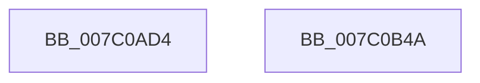

# EtwpPsProvCaptureState

- RVA: `0x007C0AD4`–`0x007C0B4B` (길이 `119` bytes)
- VA: `0x00000001407C0AD4`
- 실행 섹션: `PAGE`
- PDB 이름 있음: `예`; PDB Function 태그: `아니요`
- unwind 정보 RVA: `0x000AB2E4`
- 디코드: `29`개 명령, `119/119` bytes 표시
- 미해석 바이트: `0` (있으면 어셈블리에 `.byte`로 보존)

> 이 문서는 커널 이미지의 기계어와 PDB 기호를 분석해 생성했습니다. 4번과 5번은 함수 원형과 자료형을 바이너리 사용 방식에서 추정한 C 해석이며 원본 소스 복구 결과는 아닙니다.

## 1. Dependencies

- 직접 호출 지점: **5**; 고유 호출 대상: **4**
- 직접 호출자로 확인된 함수: **2**
- RIP 상대 이미지 참조: **4**

### Outgoing calls
- `0x007C0B07` → [IoSetThreadHardErrorMode](../../text/46/IoSetThreadHardErrorMode_function_00466BF0.md) (function, `0x00466BF0`)
- `0x007C0B1A` → [EtwpPsProvProcessEnumCallback](../A7/EtwpPsProvProcessEnumCallback_function_00A76690.md) (function, `0x00A76690`)
- `0x007C0B2B` → [PsEnumProcesses](../91/PsEnumProcesses_function_0091BE84.md) (function, `0x0091BE84`)
- `0x007C0B32` → [IoSetThreadHardErrorMode](../../text/46/IoSetThreadHardErrorMode_function_00466BF0.md) (function, `0x00466BF0`)
- `0x007C0B3F` → [_security_check_cookie](../../text/6A/_security_check_cookie_function_006AC640.md) (function, `0x006AC640`)

### Direct callers
- [EtwpCrimsonProvEnableCallback](../A8/EtwpCrimsonProvEnableCallback_function_00A80540.md) at `0x00A80787`
- [EtwpTraceLoggingProvEnableCallback](../AA/EtwpTraceLoggingProvEnableCallback_function_00AA5B10.md) at `0x00AA5B33`

### Static image references
- `0x007C0ADA` → RVA `0x00E0A740` (`.data`; read)
- `0x007C0AE9` → RVA `0x0001C850` (`.rdata`; read)
- `0x007C0B0C` → RVA `0x00FC6B70` (`ALMOSTRO`; read)
- `0x007C0B24` → RVA `0x00A76690` (`EtwpPsProvProcessEnumCallback`; read)

## 2. Other-region calls and transfers

- 다른 실행 섹션으로 향하는 call: **3**
  - `0x007C0B07` → [IoSetThreadHardErrorMode](../../text/46/IoSetThreadHardErrorMode_function_00466BF0.md) (`PAGE` → `.text`)
  - `0x007C0B32` → [IoSetThreadHardErrorMode](../../text/46/IoSetThreadHardErrorMode_function_00466BF0.md) (`PAGE` → `.text`)
  - `0x007C0B3F` → [_security_check_cookie](../../text/6A/_security_check_cookie_function_006AC640.md) (`PAGE` → `.text`)
- 별도 외부 분기/꼬리 이동을 확인하지 못했습니다.

## 3. Assembly (complete function range)

```asm
007C0AD4  40 53                           push rbx
007C0AD6  48 83 EC 40                     sub rsp, 0x40
007C0ADA  48 8B 05 5F 9C 64 00            mov rax, qword ptr [rip + 0x649c5f]
007C0AE1  48 33 C4                        xor rax, rsp
007C0AE4  48 89 44 24 30                  mov qword ptr [rsp + 0x30], rax
007C0AE9  48 8D 05 60 BD 85 FF            lea rax, [rip - 0x7a42a0]
007C0AF0  0F 57 C0                        xorps xmm0, xmm0
007C0AF3  48 3B C8                        cmp rcx, rax
007C0AF6  0F 11 44 24 20                  movups xmmword ptr [rsp + 0x20], xmm0
007C0AFB  48 89 54 24 20                  mov qword ptr [rsp + 0x20], rdx
007C0B00  0F 94 44 24 29                  sete byte ptr [rsp + 0x29]
007C0B05  33 C9                           xor ecx, ecx
007C0B07  E8 E4 60 CA FF                  call 0x140466bf0
007C0B0C  48 8B 0D 5D 60 80 00            mov rcx, qword ptr [rip + 0x80605d]
007C0B13  48 8D 54 24 20                  lea rdx, [rsp + 0x20]
007C0B18  8A D8                           mov bl, al
007C0B1A  E8 71 5B 2B 00                  call 0x140a76690
007C0B1F  48 8D 54 24 20                  lea rdx, [rsp + 0x20]
007C0B24  48 8D 0D 65 5B 2B 00            lea rcx, [rip + 0x2b5b65]
007C0B2B  E8 54 B3 15 00                  call 0x14091be84
007C0B30  8A CB                           mov cl, bl
007C0B32  E8 B9 60 CA FF                  call 0x140466bf0
007C0B37  48 8B 4C 24 30                  mov rcx, qword ptr [rsp + 0x30]
007C0B3C  48 33 CC                        xor rcx, rsp
007C0B3F  E8 FC BA EE FF                  call 0x1406ac640
007C0B44  48 83 C4 40                     add rsp, 0x40
007C0B48  5B                              pop rbx
007C0B49  C3                              ret
007C0B4A  CC                              int3
```

## 4. C-style interpretation (structured pseudocode)

```c
__int64 __fastcall EtwpPsProvCaptureState(__int64 a1, __int64 a2)
{
    __int64 result;
    __int64 v_rsp;
    unsigned __int64 v_stack_m18;
    unsigned __int8 v_stack_m1F;
    unsigned __int64 v_stack_m28;

    v_rsp = (v_rsp) - (64);
    result = (*(unsigned __int64 *)(v_rip + 6593631)) ^ (v_rsp);
    v_stack_m18 = result;
    v_stack_m28 = v_xmm0;
    v_stack_m28 = a2;
    a1 = 0;
    result = IoSetThreadHardErrorMode(a1, a2, a3, a4);
    result = EtwpPsProvProcessEnumCallback(*(unsigned __int64 *)(v_rip + 8413277), v_stack_m28, a3, a4);
    result = PsEnumProcesses(v_rip + 2841445, v_stack_m28, a3, a4);
    result = IoSetThreadHardErrorMode((unsigned __int8)((unsigned __int8)(result)), v_stack_m28, a3, a4);
    a1 = (v_stack_m18) ^ (v_rsp);
    result = _security_check_cookie(a1, v_stack_m28, a3, a4);
    v_rsp = (v_rsp) + (64);
    return result;
}
```

## 5. (Beta) C Style

```c
int64_t EtwpPsProvCaptureState(int64_t Arg1, int64_t Arg2)
{
    int64_t result;
    int64_t local_rsp;
    uint64_t v_stack_m18;
    uint8_t v_stack_m1F;
    uint64_t v_stack_m28;

    local_rsp = (local_rsp) - (64);
    result = (*(uint64_t *)(v_rip + 0x649C5F)) ^ (local_rsp);
    v_stack_m18 = result;
    v_stack_m28 = v_xmm0;
    v_stack_m28 = Arg2;
    Arg1 = 0;
    result = IoSetThreadHardErrorMode(Arg1, Arg2, a3, a4);
    result = EtwpPsProvProcessEnumCallback(*(uint64_t *)(v_rip + 0x80605D), v_stack_m28, a3, a4);
    result = PsEnumProcesses(v_rip + 2841445, v_stack_m28, a3, a4);
    result = IoSetThreadHardErrorMode((uint8_t)((uint8_t)(result)), v_stack_m28, a3, a4);
    Arg1 = (v_stack_m18) ^ (local_rsp);
    result = _security_check_cookie(Arg1, v_stack_m28, a3, a4);
    local_rsp = (local_rsp) + (64);
    return result;
}
```

## 6. Execution-region graph

[열기: 2D/3D 그래프와 함수 탐색 컨트롤 패널](../../../control-panel.html?section=page&rva=0x007C0AD4&view=graph)

- 2D 그래프는 위에서 아래로 흐르고, 3D 그래프는 빈 공간을 드래그해 회전합니다. Shift+드래그는 이동, 휠은 확대·축소, 함수 노드 선택은 대상 보고서 이동입니다.

### Static fallback


