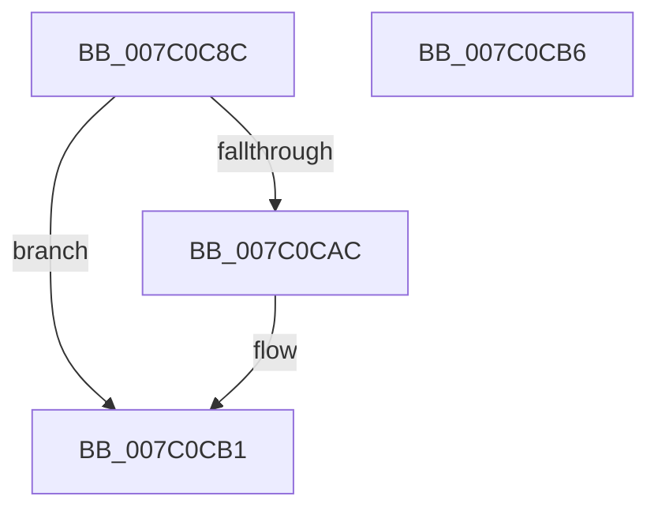

# EtwpRealtimeResetReferenceTime

- RVA: `0x007C0C8C`–`0x007C0CB7` (길이 `43` bytes)
- VA: `0x00000001407C0C8C`
- 실행 섹션: `PAGE`
- PDB 이름 있음: `예`; PDB Function 태그: `아니요`
- unwind 정보 RVA: `0x0005C788`
- 디코드: `11`개 명령, `43/43` bytes 표시
- 미해석 바이트: `0` (있으면 어셈블리에 `.byte`로 보존)

> 이 문서는 커널 이미지의 기계어와 PDB 기호를 분석해 생성했습니다. 4번과 5번은 함수 원형과 자료형을 바이너리 사용 방식에서 추정한 C 해석이며 원본 소스 복구 결과는 아닙니다.

## 1. Dependencies

- 직접 호출 지점: **1**; 고유 호출 대상: **1**
- 직접 호출자로 확인된 함수: **2**
- RIP 상대 이미지 참조: **0**

### Outgoing calls
- `0x007C0CAC` → [EtwpRealtimeUpdateReferenceTime](EtwpRealtimeUpdateReferenceTime_function_007C0CC0.md) (function, `0x007C0CC0`)

### Direct callers
- [EtwpRealtimeFlushSavedBuffers](../9B/EtwpRealtimeFlushSavedBuffers_function_009BF1B0.md) at `0x009BF352`
- [sub_00B2EA5E](../B2/Unknown_function_00B2EA5E.md) at `0x00B2EAC2`

### Static image references
- 디코드된 RIP-relative 메모리 참조가 없습니다.

## 2. Other-region calls and transfers

- 다른 실행 섹션으로 향하는 call: **0**
- 별도 외부 분기/꼬리 이동을 확인하지 못했습니다.

## 3. Assembly (complete function range)

```asm
007C0C8C  48 83 EC 28                     sub rsp, 0x28
007C0C90  0F 10 81 30 01 00 00            movups xmm0, xmmword ptr [rcx + 0x130]
007C0C97  33 C0                           xor eax, eax
007C0C99  48 8D 91 B0 01 00 00            lea rdx, [rcx + 0x1b0]
007C0CA0  F3 0F 7F 02                     movdqu xmmword ptr [rdx], xmm0
007C0CA4  39 81 58 01 00 00               cmp dword ptr [rcx + 0x158], eax
007C0CAA  76 05                           jbe 0x1407c0cb1
007C0CAC  E8 0F 00 00 00                  call 0x1407c0cc0
007C0CB1  48 83 C4 28                     add rsp, 0x28
007C0CB5  C3                              ret
007C0CB6  CC                              int3
```

## 4. C-style interpretation (structured pseudocode)

```c
__int64 __fastcall EtwpRealtimeResetReferenceTime(__int64 a1)
{
    __int64 result;
    __int64 v_rsp;

    v_rsp = (v_rsp) - (40);
    result = 0;
    *(unsigned __int64 *)(a1 + 432) = v_xmm0;
    if ((*(unsigned int *)(a1 + 344)) >= = 0) {
        result = EtwpRealtimeUpdateReferenceTime(a1, a1 + 432, a3, a4);
    }
    v_rsp = (v_rsp) + (40);
    return result;
}
```

## 5. (Beta) C Style

```c
int64_t EtwpRealtimeResetReferenceTime(void *Arg1)
{
    uint8_t *arg1 = (uint8_t *)Arg1;

    int64_t result;
    int64_t local_rsp;

    local_rsp = (local_rsp) - (40);
    result = 0;
    *(uint64_t *)(arg1 + 0x1B0) = v_xmm0;
    if ((*(uint32_t *)(arg1 + 0x158)) >= = 0) {
        result = EtwpRealtimeUpdateReferenceTime(Arg1, Arg1 + 432, a3, a4);
    }
    local_rsp = (local_rsp) + (40);
    return result;
}
```

### 관측된 메모리 오프셋

구조체 형식이 확인되지 않은 접근은 인자 기준의 오프셋으로만 기록했습니다.

| 기준 인자 | 오프셋 표현 | 폭 (bit) | 접근 |
|---|---:|---:|---|
| `Arg1` | `+ 0x0` | `128` | `W` |
| `Arg1` | `+ 0x130` | `128` | `R` |
| `Arg1` | `+ 0x158` | `32` | `R` |
| `Arg1` | `+ 0x1B0` | `64` | `R` |

## 6. Execution-region graph

[열기: 2D/3D 그래프와 함수 탐색 컨트롤 패널](../../../control-panel.html?section=page&rva=0x007C0C8C&view=graph)

- 2D 그래프는 위에서 아래로 흐르고, 3D 그래프는 빈 공간을 드래그해 회전합니다. Shift+드래그는 이동, 휠은 확대·축소, 함수 노드 선택은 대상 보고서 이동입니다.

### Static fallback


