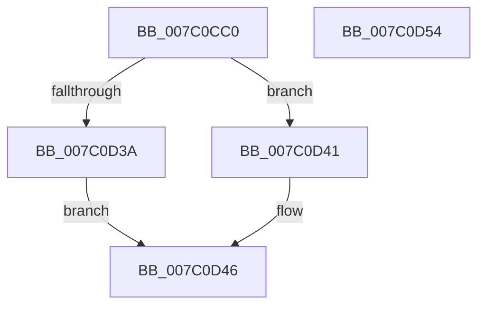

# EtwpRealtimeUpdateReferenceTime

- RVA: `0x007C0CC0`–`0x007C0D55` (길이 `149` bytes)
- VA: `0x00000001407C0CC0`
- 실행 섹션: `PAGE`
- PDB 이름 있음: `예`; PDB Function 태그: `아니요`
- unwind 정보 RVA: `0x000BA0F0`
- 디코드: `35`개 명령, `149/149` bytes 표시
- 미해석 바이트: `0` (있으면 어셈블리에 `.byte`로 보존)

> 이 문서는 커널 이미지의 기계어와 PDB 기호를 분석해 생성했습니다. 4번과 5번은 함수 원형과 자료형을 바이너리 사용 방식에서 추정한 C 해석이며 원본 소스 복구 결과는 아닙니다.

## 1. Dependencies

- 직접 호출 지점: **5**; 고유 호출 대상: **5**
- 직접 호출자로 확인된 함수: **2**
- RIP 상대 이미지 참조: **0**

### Outgoing calls
- `0x007C0CDB` → [memset](../../text/6C/memset_function_006C6C40.md) (function, `0x006C6C40`)
- `0x007C0CE8` → [EtwpInitializeBufferHeader](../../text/3E/EtwpInitializeBufferHeader_function_003EB010.md) (function, `0x003EB010`)
- `0x007C0D01` → [EtwpResetBufferHeader](../../text/3E/EtwpResetBufferHeader_function_003EB558.md) (function, `0x003EB558`)
- `0x007C0D3A` → [EtwpRealtimeSaveBuffer](../9B/EtwpRealtimeSaveBuffer_function_009BFF48.md) (function, `0x009BFF48`)
- `0x007C0D41` → [EtwpRealtimeDeliverBuffer](../9B/EtwpRealtimeDeliverBuffer_function_009BF780.md) (function, `0x009BF780`)

### Direct callers
- [EtwpRealtimeResetReferenceTime](EtwpRealtimeResetReferenceTime_function_007C0C8C.md) at `0x007C0CAC`
- [sub_00B2EA5E](../B2/Unknown_function_00B2EA5E.md) at `0x00B2EAA8`

### Static image references
- 디코드된 RIP-relative 메모리 참조가 없습니다.

## 2. Other-region calls and transfers

- 다른 실행 섹션으로 향하는 call: **3**
  - `0x007C0CDB` → [memset](../../text/6C/memset_function_006C6C40.md) (`PAGE` → `.text`)
  - `0x007C0CE8` → [EtwpInitializeBufferHeader](../../text/3E/EtwpInitializeBufferHeader_function_003EB010.md) (`PAGE` → `.text`)
  - `0x007C0D01` → [EtwpResetBufferHeader](../../text/3E/EtwpResetBufferHeader_function_003EB558.md) (`PAGE` → `.text`)
- 별도 외부 분기/꼬리 이동을 확인하지 못했습니다.

## 3. Assembly (complete function range)

```asm
007C0CC0  48 89 5C 24 08                  mov qword ptr [rsp + 8], rbx
007C0CC5  57                              push rdi
007C0CC6  48 83 EC 70                     sub rsp, 0x70
007C0CCA  48 8B DA                        mov rbx, rdx
007C0CCD  48 8B F9                        mov rdi, rcx
007C0CD0  33 D2                           xor edx, edx
007C0CD2  48 8D 4C 24 20                  lea rcx, [rsp + 0x20]
007C0CD7  44 8D 42 48                     lea r8d, [rdx + 0x48]
007C0CDB  E8 60 5F F0 FF                  call 0x1406c6c40
007C0CE0  48 8D 54 24 20                  lea rdx, [rsp + 0x20]
007C0CE5  48 8B CF                        mov rcx, rdi
007C0CE8  E8 23 A3 C2 FF                  call 0x1403eb010
007C0CED  B8 FF FE 00 00                  mov eax, 0xfeff
007C0CF2  48 8D 4C 24 20                  lea rcx, [rsp + 0x20]
007C0CF7  66 21 44 24 54                  and word ptr [rsp + 0x54], ax
007C0CFC  BA 03 00 00 00                  mov edx, 3
007C0D01  E8 52 A8 C2 FF                  call 0x1403eb558
007C0D06  83 BF A8 01 00 00 00            cmp dword ptr [rdi + 0x1a8], 0
007C0D0D  48 8D 54 24 20                  lea rdx, [rsp + 0x20]
007C0D12  0F 10 03                        movups xmm0, xmmword ptr [rbx]
007C0D15  B8 01 00 00 00                  mov eax, 1
007C0D1A  C7 44 24 4C 03 00 00 00         mov dword ptr [rsp + 0x4c], 3
007C0D22  C7 44 24 50 48 00 00 00         mov dword ptr [rsp + 0x50], 0x48
007C0D2A  48 8B CF                        mov rcx, rdi
007C0D2D  F3 0F 7F 44 24 58               movdqu xmmword ptr [rsp + 0x58], xmm0
007C0D33  66 89 44 24 54                  mov word ptr [rsp + 0x54], ax
007C0D38  76 07                           jbe 0x1407c0d41
007C0D3A  E8 09 F2 1F 00                  call 0x1409bff48
007C0D3F  EB 05                           jmp 0x1407c0d46
007C0D41  E8 3A EA 1F 00                  call 0x1409bf780
007C0D46  48 8B 9C 24 80 00 00 00         mov rbx, qword ptr [rsp + 0x80]
007C0D4E  48 83 C4 70                     add rsp, 0x70
007C0D52  5F                              pop rdi
007C0D53  C3                              ret
007C0D54  CC                              int3
```

## 4. C-style interpretation (structured pseudocode)

```c
__int64 __fastcall EtwpRealtimeUpdateReferenceTime(__int64 a1, __int64 a2)
{
    __int64 result;
    __int64 v_rsp;
    unsigned __int64 v_stack_m20;
    unsigned __int16 v_stack_m24;
    unsigned int v_stack_m28;
    unsigned int v_stack_m2C;
    unsigned __int64 v_stack_m58;
    unsigned __int64 v_stack_p8;

    v_stack_p8 = v_rbx;
    v_rsp = (v_rsp) - (112);
    a2 = 0;
    result = memset(v_stack_m58, a2, a2 + 72, a4);
    result = EtwpInitializeBufferHeader(a1, v_stack_m58, a2 + 72, a4);
    result = EtwpResetBufferHeader(v_stack_m58, 3, a2 + 72, a4);
    v_stack_m2C = 3;
    v_stack_m28 = 72;
    v_stack_m20 = v_xmm0;
    v_stack_m24 = 1;
    if ((*(unsigned int *)(a1 + 424)) <= 0) goto loc_007C0D41;
    result = EtwpRealtimeSaveBuffer(a1, v_stack_m58, a2 + 72, a4);
    goto loc_007C0D46;
loc_007C0D41:
    result = EtwpRealtimeDeliverBuffer(a1, v_stack_m58, a2 + 72, a4);
loc_007C0D46:
    v_rsp = (v_rsp) + (112);
    return result;
}
```

## 5. (Beta) C Style

```c
int64_t EtwpRealtimeUpdateReferenceTime(void *Arg1, void *Arg2)
{
    uint8_t *arg1 = (uint8_t *)Arg1;
    uint8_t *arg2 = (uint8_t *)Arg2;

    int64_t result;
    int64_t local_rsp;
    uint64_t v_stack_m20;
    uint16_t v_stack_m24;
    uint32_t v_stack_m28;
    uint32_t v_stack_m2C;
    uint64_t v_stack_m58;
    uint64_t v_stack_p8;

    v_stack_p8 = local_rbx;
    local_rsp = (local_rsp) - (112);
    Arg2 = 0;
    result = memset(v_stack_m58, Arg2, Arg2 + 72, a4);
    result = EtwpInitializeBufferHeader(Arg1, v_stack_m58, Arg2 + 72, a4);
    result = EtwpResetBufferHeader(v_stack_m58, 3, Arg2 + 72, a4);
    v_stack_m2C = 3;
    v_stack_m28 = 72;
    v_stack_m20 = v_xmm0;
    v_stack_m24 = 1;
    if ((*(uint32_t *)(arg1 + 0x1A8)) <= 0) goto loc_007C0D41;
    result = EtwpRealtimeSaveBuffer(Arg1, v_stack_m58, Arg2 + 72, a4);
    goto loc_007C0D46;
loc_007C0D41:
    result = EtwpRealtimeDeliverBuffer(Arg1, v_stack_m58, Arg2 + 72, a4);
loc_007C0D46:
    local_rsp = (local_rsp) + (112);
    return result;
}
```

### 관측된 메모리 오프셋

구조체 형식이 확인되지 않은 접근은 인자 기준의 오프셋으로만 기록했습니다.

| 기준 인자 | 오프셋 표현 | 폭 (bit) | 접근 |
|---|---:|---:|---|
| `Arg1` | `+ 0x1A8` | `32` | `R` |
| `Arg2` | `+ 0x0` | `128` | `R` |

## 6. Execution-region graph

[열기: 2D/3D 그래프와 함수 탐색 컨트롤 패널](../../../control-panel.html?section=page&rva=0x007C0CC0&view=graph)

- 2D 그래프는 위에서 아래로 흐르고, 3D 그래프는 빈 공간을 드래그해 회전합니다. Shift+드래그는 이동, 휠은 확대·축소, 함수 노드 선택은 대상 보고서 이동입니다.

### Static fallback


