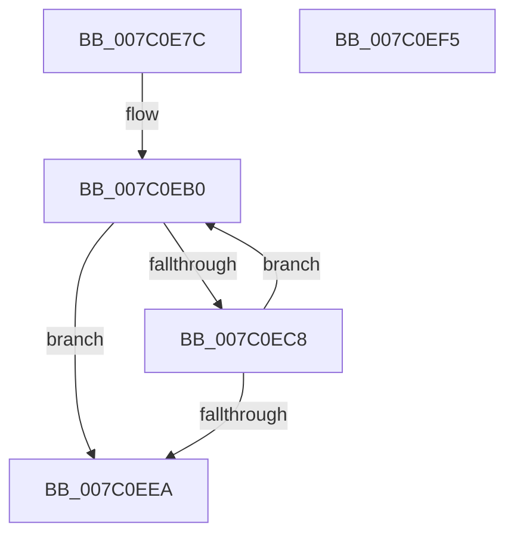

# EtwpReferenceLastBranchLookasideList

- RVA: `0x007C0E7C`–`0x007C0EF6` (길이 `122` bytes)
- VA: `0x00000001407C0E7C`
- 실행 섹션: `PAGE`
- PDB 이름 있음: `예`; PDB Function 태그: `아니요`
- unwind 정보 RVA: `0x0005CAAC`
- 디코드: `31`개 명령, `122/122` bytes 표시
- 미해석 바이트: `0` (있으면 어셈블리에 `.byte`로 보존)

> 이 문서는 커널 이미지의 기계어와 PDB 기호를 분석해 생성했습니다. 4번과 5번은 함수 원형과 자료형을 바이너리 사용 방식에서 추정한 C 해석이며 원본 소스 복구 결과는 아닙니다.

## 1. Dependencies

- 직접 호출 지점: **2**; 고유 호출 대상: **2**
- 직접 호출자로 확인된 함수: **1**
- RIP 상대 이미지 참조: **5**

### Outgoing calls
- `0x007C0EBE` → [ExAllocatePool2](../../poolcode/B8/ExAllocatePool2_function_00B820F0.md) (function, `0x00B820F0`)
- `0x007C0ED2` → [ExpInterlockedPushEntrySList](../../text/6B/ExpInterlockedPushEntrySList_function_006BA5B0.md) (function, `0x006BA5B0`)

### Direct callers
- [EtwpUpdateLastBranchTracingHalState](../../text/65/EtwpUpdateLastBranchTracingHalState_function_006539F8.md) at `0x00653A47`

### Static image references
- `0x007C0E86` → RVA `0x00FC6DA0` (`ALMOSTRO`; read)
- `0x007C0E94` → RVA `0x00FC6A80` (`ALMOSTRO`; read)
- `0x007C0EA1` → RVA `0x00E28FC0` (`.data`; read/write)
- `0x007C0ECB` → RVA `0x00E28FB0` (`.data`; read)
- `0x007C0EDC` → RVA `0x00E28FC4` (`.data`; read/write)

## 2. Other-region calls and transfers

- 다른 실행 섹션으로 향하는 call: **2**
  - `0x007C0EBE` → [ExAllocatePool2](../../poolcode/B8/ExAllocatePool2_function_00B820F0.md) (`PAGE` → `POOLCODE`)
  - `0x007C0ED2` → [ExpInterlockedPushEntrySList](../../text/6B/ExpInterlockedPushEntrySList_function_006BA5B0.md) (`PAGE` → `.text`)
- 별도 외부 분기/꼬리 이동을 확인하지 못했습니다.

## 3. Assembly (complete function range)

```asm
007C0E7C  48 89 5C 24 08                  mov qword ptr [rsp + 8], rbx
007C0E81  57                              push rdi
007C0E82  48 83 EC 20                     sub rsp, 0x20
007C0E86  8B 05 14 5F 80 00               mov eax, dword ptr [rip + 0x805f14]
007C0E8C  BB 01 00 00 00                  mov ebx, 1
007C0E91  8D 0C 40                        lea ecx, [rax + rax*2]
007C0E94  8B 05 E6 5B 80 00               mov eax, dword ptr [rip + 0x805be6]
007C0E9A  8D 3C CD 10 00 00 00            lea edi, [rcx*8 + 0x10]
007C0EA1  F0 0F C1 1D 17 81 66 00         lock xadd dword ptr [rip + 0x668117], ebx
007C0EA9  FF C3                           inc ebx
007C0EAB  0F AF D8                        imul ebx, eax
007C0EAE  03 DB                           add ebx, ebx
007C0EB0  41 B8 45 74 77 78               mov r8d, 0x78777445
007C0EB6  48 8B D7                        mov rdx, rdi
007C0EB9  B9 40 00 00 00                  mov ecx, 0x40
007C0EBE  E8 2D 12 3C 00                  call 0x140b820f0
007C0EC3  48 85 C0                        test rax, rax
007C0EC6  74 22                           je 0x1407c0eea
007C0EC8  48 8B D0                        mov rdx, rax
007C0ECB  48 8D 0D DE 80 66 00            lea rcx, [rip + 0x6680de]
007C0ED2  E8 D9 96 EF FF                  call 0x1406ba5b0
007C0ED7  B8 01 00 00 00                  mov eax, 1
007C0EDC  F0 0F C1 05 E0 80 66 00         lock xadd dword ptr [rip + 0x6680e0], eax
007C0EE4  FF C0                           inc eax
007C0EE6  3B C3                           cmp eax, ebx
007C0EE8  7C C6                           jl 0x1407c0eb0
007C0EEA  48 8B 5C 24 30                  mov rbx, qword ptr [rsp + 0x30]
007C0EEF  48 83 C4 20                     add rsp, 0x20
007C0EF3  5F                              pop rdi
007C0EF4  C3                              ret
007C0EF5  CC                              int3
```

## 4. C-style interpretation (structured pseudocode)

```c
__int64 __fastcall EtwpReferenceLastBranchLookasideList(void)
{
    __int64 result;
    __int64 v_rbx;
    __int64 v_rsp;
    unsigned __int64 v_stack_p8;

    v_stack_p8 = v_rbx;
    v_rsp = (v_rsp) - (32);
    v_rbx = (unsigned int)((1) + 1);
    v_rbx = (unsigned int)((v_rbx) * ((unsigned int)((unsigned int)(*(unsigned int *)(v_rip + 8412134)))));
    v_rbx = (unsigned int)((v_rbx) + ((unsigned int)(v_rbx)));
loc_007C0EB0:
    result = ExAllocatePool2(64, (unsigned int)(*(unsigned int *)(v_rip + 8412948)) + (unsigned int)(*(unsigned int *)(v_rip + 8412948)) * 2 * 8 + 16, (unsigned int)(0x78777445ULL), a4);
    if (result == 0) goto loc_007C0EEA;
    result = ExpInterlockedPushEntrySList(v_rip + 6717662, result, (unsigned int)(0x78777445ULL), a4);
    result = (unsigned int)((1) + 1);
    if (((unsigned int)(result)) < ((unsigned int)(v_rbx))) goto loc_007C0EB0;
loc_007C0EEA:
    v_rsp = (v_rsp) + (32);
    return result;
}
```

## 5. (Beta) C Style

```c
void EtwpReferenceLastBranchLookasideList(void)
{
    int64_t result;
    int64_t local_rbx;
    int64_t local_rsp;
    uint64_t v_stack_p8;

    v_stack_p8 = local_rbx;
    local_rsp = (local_rsp) - (32);
    local_rbx = (uint32_t)((1) + 1);
    local_rbx = (uint32_t)((local_rbx) * ((uint32_t)((uint32_t)(*(uint32_t *)(v_rip + 0x805BE6)))));
    local_rbx = (uint32_t)((local_rbx) + ((uint32_t)(local_rbx)));
loc_007C0EB0:
    result = ExAllocatePool2(64, (uint32_t)(*(uint32_t *)(v_rip + 0x805F14)) + (uint32_t)(*(uint32_t *)(v_rip + 0x805F14)) * 2 * 8 + 16, (uint32_t)(0x78777445ULL), a4);
    if (result == 0) goto loc_007C0EEA;
    result = ExpInterlockedPushEntrySList(v_rip + 6717662, result, (uint32_t)(0x78777445ULL), a4);
    result = (uint32_t)((1) + 1);
    if (((uint32_t)(result)) < ((uint32_t)(local_rbx))) goto loc_007C0EB0;
loc_007C0EEA:
    local_rsp = (local_rsp) + (32);
    return result;
}
```

## 6. Execution-region graph

[열기: 2D/3D 그래프와 함수 탐색 컨트롤 패널](../../../control-panel.html?section=page&rva=0x007C0E7C&view=graph)

- 2D 그래프는 위에서 아래로 흐르고, 3D 그래프는 빈 공간을 드래그해 회전합니다. Shift+드래그는 이동, 휠은 확대·축소, 함수 노드 선택은 대상 보고서 이동입니다.

### Static fallback


