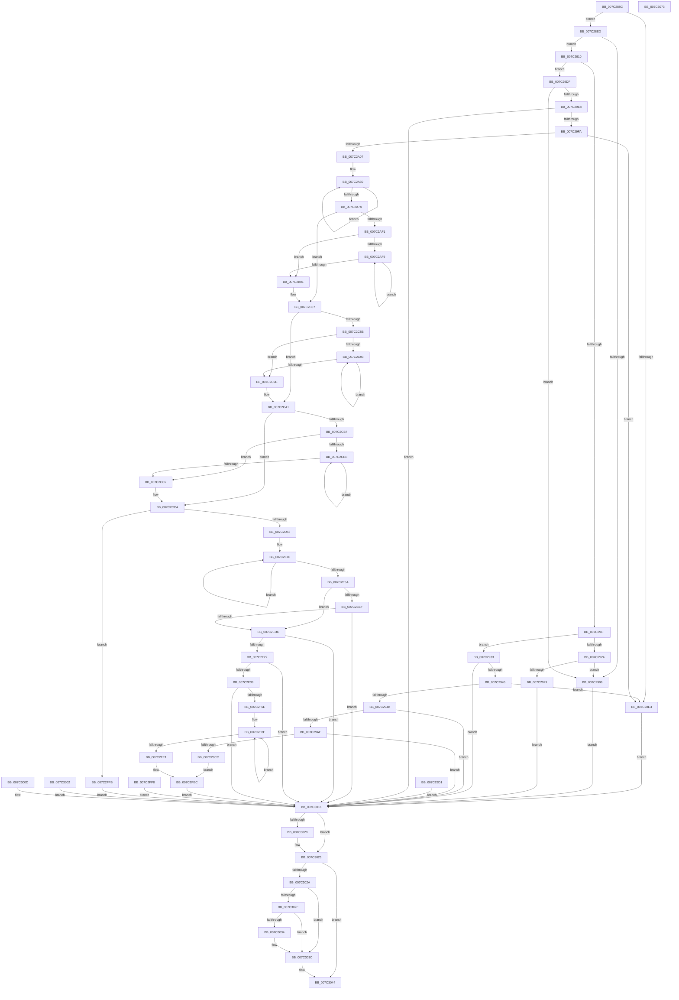

# EtwpSetCoverageSamplerInformation

- RVA: `0x007C288C`–`0x007C3074` (길이 `2,024` bytes)
- VA: `0x00000001407C288C`
- 실행 섹션: `PAGE`
- PDB 이름 있음: `예`; PDB Function 태그: `아니요`
- unwind 정보 RVA: `0x000D3F70`
- 디코드: `464`개 명령, `2,024/2,024` bytes 표시
- 미해석 바이트: `0` (있으면 어셈블리에 `.byte`로 보존)

> 이 문서는 커널 이미지의 기계어와 PDB 기호를 분석해 생성했습니다. 4번과 5번은 함수 원형과 자료형을 바이너리 사용 방식에서 추정한 C 해석이며 원본 소스 복구 결과는 아닙니다.

## 1. Dependencies

- 직접 호출 지점: **37**; 고유 호출 대상: **15**
- 직접 호출자로 확인된 함수: **1**
- RIP 상대 이미지 참조: **3**

### Outgoing calls
- `0x007C2936` → [ExCheckFullProcessInformationAccess](../95/ExCheckFullProcessInformationAccess_function_0095D93C.md) (function, `0x0095D93C`)
- `0x007C299B` → [ObReferenceObjectByHandle](../86/ObReferenceObjectByHandle_function_00868DB0.md) (function, `0x00868DB0`)
- `0x007C29BD` → [EtwpCoverageSamplerSetBloomFilter](EtwpCoverageSamplerSetBloomFilter_function_007C2070.md) (function, `0x007C2070`)
- `0x007C29EB` → [ExCheckFullProcessInformationAccess](../95/ExCheckFullProcessInformationAccess_function_0095D93C.md) (function, `0x0095D93C`)
- `0x007C2A13` → [ProbeForWrite](../8E/ProbeForWrite_function_008E91C0.md) (function, `0x008E91C0`)
- `0x007C2A9F` → [EtwpCovSampApplyBounds](EtwpCovSampApplyBounds_function_007C1314.md) (function, `0x007C1314`)
- `0x007C2AB8` → [EtwpCovSampApplyBounds](EtwpCovSampApplyBounds_function_007C1314.md) (function, `0x007C1314`)
- `0x007C2AD3` → [EtwpCovSampApplyBounds](EtwpCovSampApplyBounds_function_007C1314.md) (function, `0x007C1314`)
- `0x007C2B31` → [EtwpCovSampApplyBounds](EtwpCovSampApplyBounds_function_007C1314.md) (function, `0x007C1314`)
- `0x007C2B41` → [EtwpCovSampApplyBounds](EtwpCovSampApplyBounds_function_007C1314.md) (function, `0x007C1314`)
- `0x007C2B51` → [EtwpCovSampApplyBounds](EtwpCovSampApplyBounds_function_007C1314.md) (function, `0x007C1314`)
- `0x007C2B61` → [EtwpCovSampApplyBounds](EtwpCovSampApplyBounds_function_007C1314.md) (function, `0x007C1314`)
- `0x007C2B73` → [EtwpCovSampApplyBounds](EtwpCovSampApplyBounds_function_007C1314.md) (function, `0x007C1314`)
- `0x007C2B82` → [EtwpCovSampApplyBounds](EtwpCovSampApplyBounds_function_007C1314.md) (function, `0x007C1314`)
- `0x007C2B91` → [EtwpCovSampApplyBounds](EtwpCovSampApplyBounds_function_007C1314.md) (function, `0x007C1314`)
- `0x007C2BA0` → [EtwpCovSampApplyBounds](EtwpCovSampApplyBounds_function_007C1314.md) (function, `0x007C1314`)
- `0x007C2BB8` → [EtwpCovSampApplyBounds](EtwpCovSampApplyBounds_function_007C1314.md) (function, `0x007C1314`)
- `0x007C2BD6` → [EtwpCovSampApplyBounds](EtwpCovSampApplyBounds_function_007C1314.md) (function, `0x007C1314`)
- `0x007C2BF2` → [EtwpCovSampApplyBounds](EtwpCovSampApplyBounds_function_007C1314.md) (function, `0x007C1314`)
- `0x007C2C1E` → [EtwpCovSampApplyBounds](EtwpCovSampApplyBounds_function_007C1314.md) (function, `0x007C1314`)
- `0x007C2C30` → [EtwpCovSampApplyBounds](EtwpCovSampApplyBounds_function_007C1314.md) (function, `0x007C1314`)
- `0x007C2C4B` → [EtwpCovSampApplyBounds](EtwpCovSampApplyBounds_function_007C1314.md) (function, `0x007C1314`)
- `0x007C2C5D` → [EtwpCovSampApplyBounds](EtwpCovSampApplyBounds_function_007C1314.md) (function, `0x007C1314`)
- `0x007C2D44` → [ObCreateObjectEx](../89/ObCreateObjectEx_function_0089B1E0.md) (function, `0x0089B1E0`)
- `0x007C2D60` → [memset](../../text/6C/memset_function_006C6C40.md) (function, `0x006C6C40`)
- `0x007C2D77` → [memset](../../text/6C/memset_function_006C6C40.md) (function, `0x006C6C40`)
- `0x007C2E94` → [EtwpCovSampSplitSegments](EtwpCovSampSplitSegments_function_007C1C3C.md) (function, `0x007C1C3C`)
- `0x007C2EAA` → [EtwpCovSampSplitSegments](EtwpCovSampSplitSegments_function_007C1C3C.md) (function, `0x007C1C3C`)
- `0x007C2ECD` → [EtwpCoverageSamplerSetBloomFilter](EtwpCoverageSamplerSetBloomFilter_function_007C2070.md) (function, `0x007C2070`)
- `0x007C2F07` → [ObReferenceObjectByHandle](../86/ObReferenceObjectByHandle_function_00868DB0.md) (function, `0x00868DB0`)
- `0x007C2F2A` → [EtwpCoverageSamplerStart](EtwpCoverageSamplerStart_function_007C2248.md) (function, `0x007C2248`)
- `0x007C2F3C` → [ObfReferenceObject](../../text/20/ObfReferenceObject_function_0020FA20.md) (function, `0x0020FA20`)
- `0x007C2F5F` → [ObInsertObjectEx](../8B/ObInsertObjectEx_function_008B97A0.md) (function, `0x008B97A0`)
- `0x007C3020` → [NtClose](../86/NtClose_function_00868870.md) (function, `0x00868870`)
- `0x007C3037` → [EtwpCoverageSamplerStop](EtwpCoverageSamplerStop_function_007C2564.md) (function, `0x007C2564`)
- `0x007C303F` → [ObfDereferenceObject](../../text/2F/ObfDereferenceObject_function_002F9350.md) (function, `0x002F9350`)
- `0x007C3051` → [_security_check_cookie](../../text/6A/_security_check_cookie_function_006AC640.md) (function, `0x006AC640`)

### Direct callers
- [EtwSetPerformanceTraceInformation](../A5/EtwSetPerformanceTraceInformation_function_00A53928.md) at `0x00A53C07`

### Static image references
- `0x007C28A6` → RVA `0x00E0A740` (`.data`; read)
- `0x007C2973` → RVA `0x00EFF1D0` (`.data`; read)
- `0x007C2EDC` → RVA `0x00FC6B80` (`ALMOSTRO`; read)

## 2. Other-region calls and transfers

- 다른 실행 섹션으로 향하는 call: **5**
  - `0x007C2D60` → [memset](../../text/6C/memset_function_006C6C40.md) (`PAGE` → `.text`)
  - `0x007C2D77` → [memset](../../text/6C/memset_function_006C6C40.md) (`PAGE` → `.text`)
  - `0x007C2F3C` → [ObfReferenceObject](../../text/20/ObfReferenceObject_function_0020FA20.md) (`PAGE` → `.text`)
  - `0x007C303F` → [ObfDereferenceObject](../../text/2F/ObfDereferenceObject_function_002F9350.md) (`PAGE` → `.text`)
  - `0x007C3051` → [_security_check_cookie](../../text/6A/_security_check_cookie_function_006AC640.md) (`PAGE` → `.text`)
- 별도 외부 분기/꼬리 이동을 확인하지 못했습니다.

## 3. Assembly (complete function range)

```asm
007C288C  48 89 5C 24 18                  mov qword ptr [rsp + 0x18], rbx
007C2891  48 89 74 24 20                  mov qword ptr [rsp + 0x20], rsi
007C2896  57                              push rdi
007C2897  41 54                           push r12
007C2899  41 55                           push r13
007C289B  41 56                           push r14
007C289D  41 57                           push r15
007C289F  48 81 EC 70 05 00 00            sub rsp, 0x570
007C28A6  48 8B 05 93 7E 64 00            mov rax, qword ptr [rip + 0x647e93]
007C28AD  48 33 C4                        xor rax, rsp
007C28B0  48 89 84 24 60 05 00 00         mov qword ptr [rsp + 0x560], rax
007C28B8  45 8A E0                        mov r12b, r8b
007C28BB  44 8B FA                        mov r15d, edx
007C28BE  4C 8B F1                        mov r14, rcx
007C28C1  33 DB                           xor ebx, ebx
007C28C3  8B F3                           mov esi, ebx
007C28C5  48 89 5C 24 58                  mov qword ptr [rsp + 0x58], rbx
007C28CA  48 89 5C 24 60                  mov qword ptr [rsp + 0x60], rbx
007C28CF  89 5C 24 7C                     mov dword ptr [rsp + 0x7c], ebx
007C28D3  89 9C 24 94 00 00 00            mov dword ptr [rsp + 0x94], ebx
007C28DA  88 5C 24 50                     mov byte ptr [rsp + 0x50], bl
007C28DE  83 FA 10                        cmp edx, 0x10
007C28E1  73 0A                           jae 0x1407c28ed
007C28E3  BF 04 00 00 C0                  mov edi, 0xc0000004
007C28E8  E9 29 07 00 00                  jmp 0x1407c3016
007C28ED  0F 10 01                        movups xmm0, xmmword ptr [rcx]
007C28F0  F3 0F 7F 44 24 68               movdqu xmmword ptr [rsp + 0x68], xmm0
007C28F6  48 8B 4C 24 68                  mov rcx, qword ptr [rsp + 0x68]
007C28FB  48 8B C1                        mov rax, rcx
007C28FE  48 C1 E8 28                     shr rax, 0x28
007C2902  3C CF                           cmp al, 0xcf
007C2904  74 0A                           je 0x1407c2910
007C2906  BF BB 00 00 C0                  mov edi, 0xc00000bb
007C290B  E9 06 07 00 00                  jmp 0x1407c3016
007C2910  48 C1 E9 20                     shr rcx, 0x20
007C2914  0F B6 C9                        movzx ecx, cl
007C2917  85 C9                           test ecx, ecx
007C2919  0F 84 C0 00 00 00               je 0x1407c29df
007C291F  83 E9 02                        sub ecx, 2
007C2922  74 0F                           je 0x1407c2933
007C2924  83 F9 01                        cmp ecx, 1
007C2927  74 DD                           je 0x1407c2906
007C2929  BF 03 00 00 C0                  mov edi, 0xc0000003
007C292E  E9 E3 06 00 00                  jmp 0x1407c3016
007C2933  41 8A CC                        mov cl, r12b
007C2936  E8 01 B0 19 00                  call 0x14095d93c
007C293B  8B F8                           mov edi, eax
007C293D  85 C0                           test eax, eax
007C293F  0F 88 D1 06 00 00               js 0x1407c3016
007C2945  41 83 FF 28                     cmp r15d, 0x28
007C2949  75 98                           jne 0x1407c28e3
007C294B  41 0F 10 06                     movups xmm0, xmmword ptr [r14]
007C294F  0F 11 84 24 A8 00 00 00         movups xmmword ptr [rsp + 0xa8], xmm0
007C2957  41 0F 10 4E 10                  movups xmm1, xmmword ptr [r14 + 0x10]
007C295C  0F 11 8C 24 B8 00 00 00         movups xmmword ptr [rsp + 0xb8], xmm1
007C2964  F2 41 0F 10 46 20               movsd xmm0, qword ptr [r14 + 0x20]
007C296A  F2 0F 11 84 24 C8 00 00 00      movsd qword ptr [rsp + 0xc8], xmm0
007C2973  4C 8B 05 56 C8 73 00            mov r8, qword ptr [rip + 0x73c856]
007C297A  48 89 5C 24 58                  mov qword ptr [rsp + 0x58], rbx
007C297F  48 89 5C 24 28                  mov qword ptr [rsp + 0x28], rbx
007C2984  48 8D 44 24 58                  lea rax, [rsp + 0x58]
007C2989  48 89 44 24 20                  mov qword ptr [rsp + 0x20], rax
007C298E  45 8A CC                        mov r9b, r12b
007C2991  BA 01 00 00 00                  mov edx, 1
007C2996  48 8B 4C 24 70                  mov rcx, qword ptr [rsp + 0x70]
007C299B  E8 10 64 0A 00                  call 0x140868db0
007C29A0  8B F8                           mov edi, eax
007C29A2  48 8B 74 24 58                  mov rsi, qword ptr [rsp + 0x58]
007C29A7  85 C0                           test eax, eax
007C29A9  0F 88 67 06 00 00               js 0x1407c3016
007C29AF  45 8A C4                        mov r8b, r12b
007C29B2  48 8D 94 24 B8 00 00 00         lea rdx, [rsp + 0xb8]
007C29BA  48 8B CE                        mov rcx, rsi
007C29BD  E8 AE F6 FF FF                  call 0x1407c2070
007C29C2  8B F8                           mov edi, eax
007C29C4  85 C0                           test eax, eax
007C29C6  0F 88 4A 06 00 00               js 0x1407c3016
007C29CC  E9 1B 06 00 00                  jmp 0x1407c2fec
007C29D1  8B F8                           mov edi, eax
007C29D3  33 DB                           xor ebx, ebx
007C29D5  48 8B 74 24 58                  mov rsi, qword ptr [rsp + 0x58]
007C29DA  E9 37 06 00 00                  jmp 0x1407c3016
007C29DF  45 84 E4                        test r12b, r12b
007C29E2  0F 84 1E FF FF FF               je 0x1407c2906
007C29E8  41 8A CC                        mov cl, r12b
007C29EB  E8 4C AF 19 00                  call 0x14095d93c
007C29F0  8B F8                           mov edi, eax
007C29F2  85 C0                           test eax, eax
007C29F4  0F 88 1C 06 00 00               js 0x1407c3016
007C29FA  41 81 FF 88 04 00 00            cmp r15d, 0x488
007C2A01  0F 82 DC FE FF FF               jb 0x1407c28e3
007C2A07  49 8B D7                        mov rdx, r15
007C2A0A  41 B8 04 00 00 00               mov r8d, 4
007C2A10  49 8B CE                        mov rcx, r14
007C2A13  E8 A8 67 12 00                  call 0x1408e91c0
007C2A18  49 8B C6                        mov rax, r14
007C2A1B  48 8D 8C 24 D0 00 00 00         lea rcx, [rsp + 0xd0]
007C2A23  41 BD 09 00 00 00               mov r13d, 9
007C2A29  41 8B D5                        mov edx, r13d
007C2A2C  41 8D 7D 77                     lea edi, [r13 + 0x77]
007C2A30  0F 10 00                        movups xmm0, xmmword ptr [rax]
007C2A33  0F 11 01                        movups xmmword ptr [rcx], xmm0
007C2A36  0F 10 48 10                     movups xmm1, xmmword ptr [rax + 0x10]
007C2A3A  0F 11 49 10                     movups xmmword ptr [rcx + 0x10], xmm1
007C2A3E  0F 10 40 20                     movups xmm0, xmmword ptr [rax + 0x20]
007C2A42  0F 11 41 20                     movups xmmword ptr [rcx + 0x20], xmm0
007C2A46  0F 10 48 30                     movups xmm1, xmmword ptr [rax + 0x30]
007C2A4A  0F 11 49 30                     movups xmmword ptr [rcx + 0x30], xmm1
007C2A4E  0F 10 40 40                     movups xmm0, xmmword ptr [rax + 0x40]
007C2A52  0F 11 41 40                     movups xmmword ptr [rcx + 0x40], xmm0
007C2A56  0F 10 48 50                     movups xmm1, xmmword ptr [rax + 0x50]
007C2A5A  0F 11 49 50                     movups xmmword ptr [rcx + 0x50], xmm1
007C2A5E  0F 10 40 60                     movups xmm0, xmmword ptr [rax + 0x60]
007C2A62  0F 11 41 60                     movups xmmword ptr [rcx + 0x60], xmm0
007C2A66  48 03 CF                        add rcx, rdi
007C2A69  0F 10 48 70                     movups xmm1, xmmword ptr [rax + 0x70]
007C2A6D  0F 11 49 F0                     movups xmmword ptr [rcx - 0x10], xmm1
007C2A71  48 03 C7                        add rax, rdi
007C2A74  48 83 EA 01                     sub rdx, 1
007C2A78  75 B6                           jne 0x1407c2a30
007C2A7A  48 8B 00                        mov rax, qword ptr [rax]
007C2A7D  48 89 01                        mov qword ptr [rcx], rax
007C2A80  BE 10 00 00 00                  mov esi, 0x10
007C2A85  41 B9 00 40 00 00               mov r9d, 0x4000
007C2A8B  44 8B C6                        mov r8d, esi
007C2A8E  41 BB 00 04 00 00               mov r11d, 0x400
007C2A94  41 8B D3                        mov edx, r11d
007C2A97  48 8D 8C 24 E8 00 00 00         lea rcx, [rsp + 0xe8]
007C2A9F  E8 70 E8 FF FF                  call 0x1407c1314
007C2AA4  45 8B CB                        mov r9d, r11d
007C2AA7  41 BB 00 01 00 00               mov r11d, 0x100
007C2AAD  41 8B D3                        mov edx, r11d
007C2AB0  48 8D 8C 24 28 01 00 00         lea rcx, [rsp + 0x128]
007C2AB8  E8 57 E8 FF FF                  call 0x1407c1314
007C2ABD  41 B9 00 00 01 00               mov r9d, 0x10000
007C2AC3  45 8B C3                        mov r8d, r11d
007C2AC6  BA 00 08 00 00                  mov edx, 0x800
007C2ACB  48 8D 8C 24 2C 01 00 00         lea rcx, [rsp + 0x12c]
007C2AD3  E8 3C E8 FF FF                  call 0x1407c1314
007C2AD8  44 8B 84 24 2C 01 00 00         mov r8d, dword ptr [rsp + 0x12c]
007C2AE0  41 8D 40 FF                     lea eax, [r8 - 1]
007C2AE4  41 83 CB FF                     or r11d, 0xffffffff
007C2AE8  44 8D 7E F1                     lea r15d, [rsi - 0xf]
007C2AEC  41 85 C0                        test r8d, eax
007C2AEF  74 16                           je 0x1407c2b07
007C2AF1  41 8B CB                        mov ecx, r11d
007C2AF4  45 85 C0                        test r8d, r8d
007C2AF7  74 08                           je 0x1407c2b01
007C2AF9  41 03 CF                        add ecx, r15d
007C2AFC  41 D1 E8                        shr r8d, 1
007C2AFF  75 F8                           jne 0x1407c2af9
007C2B01  45 8B C7                        mov r8d, r15d
007C2B04  41 D3 E0                        shl r8d, cl
007C2B07  F6 84 24 E0 00 00 00 40         test byte ptr [rsp + 0xe0], 0x40
007C2B0F  44 0F 45 C3                     cmovne r8d, ebx
007C2B13  44 89 84 24 2C 01 00 00         mov dword ptr [rsp + 0x12c], r8d
007C2B1B  41 B9 00 D2 49 6B               mov r9d, 0x6b49d200
007C2B21  45 8B C7                        mov r8d, r15d
007C2B24  BA E8 03 00 00                  mov edx, 0x3e8
007C2B29  48 8D 8C 24 08 01 00 00         lea rcx, [rsp + 0x108]
007C2B31  E8 DE E7 FF FF                  call 0x1407c1314
007C2B36  41 8B D7                        mov edx, r15d
007C2B39  48 8D 8C 24 10 01 00 00         lea rcx, [rsp + 0x110]
007C2B41  E8 CE E7 FF FF                  call 0x1407c1314
007C2B46  41 8B D7                        mov edx, r15d
007C2B49  48 8D 8C 24 18 01 00 00         lea rcx, [rsp + 0x118]
007C2B51  E8 BE E7 FF FF                  call 0x1407c1314
007C2B56  41 8B D7                        mov edx, r15d
007C2B59  48 8D 8C 24 20 01 00 00         lea rcx, [rsp + 0x120]
007C2B61  E8 AE E7 FF FF                  call 0x1407c1314
007C2B66  45 33 C0                        xor r8d, r8d
007C2B69  33 D2                           xor edx, edx
007C2B6B  48 8D 8C 24 0C 01 00 00         lea rcx, [rsp + 0x10c]
007C2B73  E8 9C E7 FF FF                  call 0x1407c1314
007C2B78  33 D2                           xor edx, edx
007C2B7A  48 8D 8C 24 14 01 00 00         lea rcx, [rsp + 0x114]
007C2B82  E8 8D E7 FF FF                  call 0x1407c1314
007C2B87  33 D2                           xor edx, edx
007C2B89  48 8D 8C 24 1C 01 00 00         lea rcx, [rsp + 0x11c]
007C2B91  E8 7E E7 FF FF                  call 0x1407c1314
007C2B96  33 D2                           xor edx, edx
007C2B98  48 8D 8C 24 24 01 00 00         lea rcx, [rsp + 0x124]
007C2BA0  E8 6F E7 FF FF                  call 0x1407c1314
007C2BA5  44 8B CF                        mov r9d, edi
007C2BA8  45 8B C7                        mov r8d, r15d
007C2BAB  BA 08 00 00 00                  mov edx, 8
007C2BB0  48 8D 8C 24 F4 00 00 00         lea rcx, [rsp + 0xf4]
007C2BB8  E8 57 E7 FF FF                  call 0x1407c1314
007C2BBD  BA 00 00 02 00                  mov edx, 0x20000
007C2BC2  41 B9 00 00 10 00               mov r9d, 0x100000
007C2BC8  41 B8 00 40 00 00               mov r8d, 0x4000
007C2BCE  48 8D 8C 24 F8 00 00 00         lea rcx, [rsp + 0xf8]
007C2BD6  E8 39 E7 FF FF                  call 0x1407c1314
007C2BDB  BA 04 00 00 00                  mov edx, 4
007C2BE0  41 B9 00 01 00 00               mov r9d, 0x100
007C2BE6  44 8D 42 FE                     lea r8d, [rdx - 2]
007C2BEA  48 8D 8C 24 FC 00 00 00         lea rcx, [rsp + 0xfc]
007C2BF2  E8 1D E7 FF FF                  call 0x1407c1314
007C2BF7  40 84 BC 24 E0 00 00 00         test byte ptr [rsp + 0xe0], dil
007C2BFF  8B 84 24 FC 00 00 00            mov eax, dword ptr [rsp + 0xfc]
007C2C06  0F 45 C3                        cmovne eax, ebx
007C2C09  89 84 24 FC 00 00 00            mov dword ptr [rsp + 0xfc], eax
007C2C10  41 8D 78 02                     lea edi, [r8 + 2]
007C2C14  8B D7                           mov edx, edi
007C2C16  48 8D 8C 24 00 01 00 00         lea rcx, [rsp + 0x100]
007C2C1E  E8 F1 E6 FF FF                  call 0x1407c1314
007C2C23  44 8B C7                        mov r8d, edi
007C2C26  8B D6                           mov edx, esi
007C2C28  48 8D 8C 24 04 01 00 00         lea rcx, [rsp + 0x104]
007C2C30  E8 DF E6 FF FF                  call 0x1407c1314
007C2C35  41 B9 00 00 00 08               mov r9d, 0x8000000
007C2C3B  44 8B C6                        mov r8d, esi
007C2C3E  BA 00 04 00 00                  mov edx, 0x400
007C2C43  48 8D 8C 24 EC 00 00 00         lea rcx, [rsp + 0xec]
007C2C4B  E8 C4 E6 FF FF                  call 0x1407c1314
007C2C50  BA 00 00 01 00                  mov edx, 0x10000
007C2C55  48 8D 8C 24 F0 00 00 00         lea rcx, [rsp + 0xf0]
007C2C5D  E8 B2 E6 FF FF                  call 0x1407c1314
007C2C62  8B 8C 24 28 01 00 00            mov ecx, dword ptr [rsp + 0x128]
007C2C69  44 8D 04 8D 00 00 00 00         lea r8d, [rcx*4]
007C2C71  44 39 84 24 EC 00 00 00         cmp dword ptr [rsp + 0xec], r8d
007C2C79  44 0F 43 84 24 EC 00 00 00      cmovae r8d, dword ptr [rsp + 0xec]
007C2C82  41 8D 40 FF                     lea eax, [r8 - 1]
007C2C86  41 85 C0                        test r8d, eax
007C2C89  74 16                           je 0x1407c2ca1
007C2C8B  41 8B CB                        mov ecx, r11d
007C2C8E  45 85 C0                        test r8d, r8d
007C2C91  74 08                           je 0x1407c2c9b
007C2C93  41 03 CF                        add ecx, r15d
007C2C96  41 D1 E8                        shr r8d, 1
007C2C99  75 F8                           jne 0x1407c2c93
007C2C9B  45 8B C7                        mov r8d, r15d
007C2C9E  41 D3 E0                        shl r8d, cl
007C2CA1  44 89 84 24 EC 00 00 00         mov dword ptr [rsp + 0xec], r8d
007C2CA9  8B 94 24 F0 00 00 00            mov edx, dword ptr [rsp + 0xf0]
007C2CB0  8D 42 FF                        lea eax, [rdx - 1]
007C2CB3  85 C2                           test edx, eax
007C2CB5  74 13                           je 0x1407c2cca
007C2CB7  85 D2                           test edx, edx
007C2CB9  74 07                           je 0x1407c2cc2
007C2CBB  45 03 DF                        add r11d, r15d
007C2CBE  D1 EA                           shr edx, 1
007C2CC0  75 F9                           jne 0x1407c2cbb
007C2CC2  41 8B CB                        mov ecx, r11d
007C2CC5  41 8B D7                        mov edx, r15d
007C2CC8  D3 E2                           shl edx, cl
007C2CCA  41 3B D0                        cmp edx, r8d
007C2CCD  41 0F 42 D0                     cmovb edx, r8d
007C2CD1  89 94 24 F0 00 00 00            mov dword ptr [rsp + 0xf0], edx
007C2CD8  66 89 9C 24 32 05 00 00         mov word ptr [rsp + 0x532], bx
007C2CE0  66 89 9C 24 32 03 00 00         mov word ptr [rsp + 0x332], bx
007C2CE8  C7 44 24 78 30 00 00 00         mov dword ptr [rsp + 0x78], 0x30
007C2CF0  48 89 9C 24 80 00 00 00         mov qword ptr [rsp + 0x80], rbx
007C2CF8  89 9C 24 90 00 00 00            mov dword ptr [rsp + 0x90], ebx
007C2CFF  48 89 9C 24 88 00 00 00         mov qword ptr [rsp + 0x88], rbx
007C2D07  0F 57 C0                        xorps xmm0, xmm0
007C2D0A  F3 0F 7F 84 24 98 00 00 00      movdqu xmmword ptr [rsp + 0x98], xmm0
007C2D13  48 8B 15 B6 C4 73 00            mov rdx, qword ptr [rip + 0x73c4b6]
007C2D1A  48 89 5C 24 48                  mov qword ptr [rsp + 0x48], rbx
007C2D1F  48 8D 44 24 58                  lea rax, [rsp + 0x58]
007C2D24  48 89 44 24 40                  mov qword ptr [rsp + 0x40], rax
007C2D29  89 5C 24 38                     mov dword ptr [rsp + 0x38], ebx
007C2D2D  89 5C 24 30                     mov dword ptr [rsp + 0x30], ebx
007C2D31  BE C8 06 00 00                  mov esi, 0x6c8
007C2D36  89 74 24 28                     mov dword ptr [rsp + 0x28], esi
007C2D3A  45 8A CC                        mov r9b, r12b
007C2D3D  4C 8D 44 24 78                  lea r8, [rsp + 0x78]
007C2D42  33 C9                           xor ecx, ecx
007C2D44  E8 97 84 0D 00                  call 0x14089b1e0
007C2D49  8B F8                           mov edi, eax
007C2D4B  85 C0                           test eax, eax
007C2D4D  0F 88 A8 02 00 00               js 0x1407c2ffb
007C2D53  44 8B C6                        mov r8d, esi
007C2D56  33 D2                           xor edx, edx
007C2D58  48 8B 74 24 58                  mov rsi, qword ptr [rsp + 0x58]
007C2D5D  48 8B CE                        mov rcx, rsi
007C2D60  E8 DB 3E F0 FF                  call 0x1406c6c40
007C2D65  48 89 1E                        mov qword ptr [rsi], rbx
007C2D68  48 8D 7E 10                     lea rdi, [rsi + 0x10]
007C2D6C  33 D2                           xor edx, edx
007C2D6E  41 B8 70 06 00 00               mov r8d, 0x670
007C2D74  48 8B CF                        mov rcx, rdi
007C2D77  E8 C4 3E F0 FF                  call 0x1406c6c40
007C2D7C  44 89 BF 60 06 00 00            mov dword ptr [rdi + 0x660], r15d
007C2D83  48 89 9F 98 04 00 00            mov qword ptr [rdi + 0x498], rbx
007C2D8A  48 8D 87 C8 04 00 00            lea rax, [rdi + 0x4c8]
007C2D91  48 89 40 08                     mov qword ptr [rax + 8], rax
007C2D95  48 89 00                        mov qword ptr [rax], rax
007C2D98  48 89 9F A8 04 00 00            mov qword ptr [rdi + 0x4a8], rbx
007C2D9F  48 89 9F B0 04 00 00            mov qword ptr [rdi + 0x4b0], rbx
007C2DA6  48 89 9F B8 04 00 00            mov qword ptr [rdi + 0x4b8], rbx
007C2DAD  48 89 9F C0 04 00 00            mov qword ptr [rdi + 0x4c0], rbx
007C2DB4  0F 57 C0                        xorps xmm0, xmm0
007C2DB7  33 C0                           xor eax, eax
007C2DB9  0F 11 87 E0 04 00 00            movups xmmword ptr [rdi + 0x4e0], xmm0
007C2DC0  0F 11 87 F0 04 00 00            movups xmmword ptr [rdi + 0x4f0], xmm0
007C2DC7  0F 11 87 00 05 00 00            movups xmmword ptr [rdi + 0x500], xmm0
007C2DCE  48 89 87 10 05 00 00            mov qword ptr [rdi + 0x510], rax
007C2DD5  48 89 9F E8 04 00 00            mov qword ptr [rdi + 0x4e8], rbx
007C2DDC  48 89 BF E0 04 00 00            mov qword ptr [rdi + 0x4e0], rdi
007C2DE3  48 89 37                        mov qword ptr [rdi], rsi
007C2DE6  44 89 BE BC 06 00 00            mov dword ptr [rsi + 0x6bc], r15d
007C2DED  48 8D 86 90 06 00 00            lea rax, [rsi + 0x690]
007C2DF4  48 89 40 08                     mov qword ptr [rax + 8], rax
007C2DF8  48 89 00                        mov qword ptr [rax], rax
007C2DFB  48 8D 4F 08                     lea rcx, [rdi + 8]
007C2DFF  48 8D 84 24 E0 00 00 00         lea rax, [rsp + 0xe0]
007C2E07  BA 08 00 00 00                  mov edx, 8
007C2E0C  44 8D 42 78                     lea r8d, [rdx + 0x78]
007C2E10  0F 10 00                        movups xmm0, xmmword ptr [rax]
007C2E13  0F 11 01                        movups xmmword ptr [rcx], xmm0
007C2E16  0F 10 48 10                     movups xmm1, xmmword ptr [rax + 0x10]
007C2E1A  0F 11 49 10                     movups xmmword ptr [rcx + 0x10], xmm1
007C2E1E  0F 10 40 20                     movups xmm0, xmmword ptr [rax + 0x20]
007C2E22  0F 11 41 20                     movups xmmword ptr [rcx + 0x20], xmm0
007C2E26  0F 10 48 30                     movups xmm1, xmmword ptr [rax + 0x30]
007C2E2A  0F 11 49 30                     movups xmmword ptr [rcx + 0x30], xmm1
007C2E2E  0F 10 40 40                     movups xmm0, xmmword ptr [rax + 0x40]
007C2E32  0F 11 41 40                     movups xmmword ptr [rcx + 0x40], xmm0
007C2E36  0F 10 48 50                     movups xmm1, xmmword ptr [rax + 0x50]
007C2E3A  0F 11 49 50                     movups xmmword ptr [rcx + 0x50], xmm1
007C2E3E  0F 10 40 60                     movups xmm0, xmmword ptr [rax + 0x60]
007C2E42  0F 11 41 60                     movups xmmword ptr [rcx + 0x60], xmm0
007C2E46  49 03 C8                        add rcx, r8
007C2E49  0F 10 48 70                     movups xmm1, xmmword ptr [rax + 0x70]
007C2E4D  0F 11 49 F0                     movups xmmword ptr [rcx - 0x10], xmm1
007C2E51  49 03 C0                        add rax, r8
007C2E54  48 83 EA 01                     sub rdx, 1
007C2E58  75 B6                           jne 0x1407c2e10
007C2E5A  0F 10 00                        movups xmm0, xmmword ptr [rax]
007C2E5D  0F 11 01                        movups xmmword ptr [rcx], xmm0
007C2E60  0F 10 48 10                     movups xmm1, xmmword ptr [rax + 0x10]
007C2E64  0F 11 49 10                     movups xmmword ptr [rcx + 0x10], xmm1
007C2E68  0F 10 40 20                     movups xmm0, xmmword ptr [rax + 0x20]
007C2E6C  0F 11 41 20                     movups xmmword ptr [rcx + 0x20], xmm0
007C2E70  0F 10 48 30                     movups xmm1, xmmword ptr [rax + 0x30]
007C2E74  0F 11 49 30                     movups xmmword ptr [rcx + 0x30], xmm1
007C2E78  0F 10 40 40                     movups xmm0, xmmword ptr [rax + 0x40]
007C2E7C  0F 11 41 40                     movups xmmword ptr [rcx + 0x40], xmm0
007C2E80  8B 40 50                        mov eax, dword ptr [rax + 0x50]
007C2E83  89 41 50                        mov dword ptr [rcx + 0x50], eax
007C2E86  48 8D 97 B8 05 00 00            lea rdx, [rdi + 0x5b8]
007C2E8D  48 8D 8F 5C 02 00 00            lea rcx, [rdi + 0x25c]
007C2E94  E8 A3 ED FF FF                  call 0x1407c1c3c
007C2E99  89 87 5C 06 00 00               mov dword ptr [rdi + 0x65c], eax
007C2E9F  48 8D 97 18 05 00 00            lea rdx, [rdi + 0x518]
007C2EA6  48 8D 4F 5C                     lea rcx, [rdi + 0x5c]
007C2EAA  E8 8D ED FF FF                  call 0x1407c1c3c
007C2EAF  89 87 58 06 00 00               mov dword ptr [rdi + 0x658], eax
007C2EB5  48 39 9C 24 38 05 00 00         cmp qword ptr [rsp + 0x538], rbx
007C2EBD  74 1D                           je 0x1407c2edc
007C2EBF  45 8A C4                        mov r8b, r12b
007C2EC2  48 8D 94 24 38 05 00 00         lea rdx, [rsp + 0x538]
007C2ECA  48 8B CE                        mov rcx, rsi
007C2ECD  E8 9E F1 FF FF                  call 0x1407c2070
007C2ED2  8B F8                           mov edi, eax
007C2ED4  85 C0                           test eax, eax
007C2ED6  0F 88 3A 01 00 00               js 0x1407c3016
007C2EDC  4C 8B 05 9D 3C 80 00            mov r8, qword ptr [rip + 0x803c9d]
007C2EE3  48 89 5C 24 68                  mov qword ptr [rsp + 0x68], rbx
007C2EE8  48 89 5C 24 28                  mov qword ptr [rsp + 0x28], rbx
007C2EED  48 8D 44 24 68                  lea rax, [rsp + 0x68]
007C2EF2  48 89 44 24 20                  mov qword ptr [rsp + 0x20], rax
007C2EF7  45 8A CC                        mov r9b, r12b
007C2EFA  BA 03 00 1F 00                  mov edx, 0x1f0003
007C2EFF  48 8B 8C 24 50 05 00 00         mov rcx, qword ptr [rsp + 0x550]
007C2F07  E8 A4 5E 0A 00                  call 0x140868db0
007C2F0C  8B F8                           mov edi, eax
007C2F0E  48 8B 44 24 68                  mov rax, qword ptr [rsp + 0x68]
007C2F13  48 89 86 88 06 00 00            mov qword ptr [rsi + 0x688], rax
007C2F1A  85 FF                           test edi, edi
007C2F1C  0F 88 F4 00 00 00               js 0x1407c3016
007C2F22  44 88 7C 24 50                  mov byte ptr [rsp + 0x50], r15b
007C2F27  48 8B CE                        mov rcx, rsi
007C2F2A  E8 19 F3 FF FF                  call 0x1407c2248
007C2F2F  8B F8                           mov edi, eax
007C2F31  85 C0                           test eax, eax
007C2F33  0F 88 DD 00 00 00               js 0x1407c3016
007C2F39  48 8B CE                        mov rcx, rsi
007C2F3C  E8 DF CA A4 FF                  call 0x14020fa20
007C2F41  48 8D 44 24 60                  lea rax, [rsp + 0x60]
007C2F46  48 89 44 24 30                  mov qword ptr [rsp + 0x30], rax
007C2F4B  48 89 5C 24 28                  mov qword ptr [rsp + 0x28], rbx
007C2F50  89 5C 24 20                     mov dword ptr [rsp + 0x20], ebx
007C2F54  45 33 C9                        xor r9d, r9d
007C2F57  45 8B C7                        mov r8d, r15d
007C2F5A  33 D2                           xor edx, edx
007C2F5C  48 8B CE                        mov rcx, rsi
007C2F5F  E8 3C 68 0F 00                  call 0x1408b97a0
007C2F64  8B F8                           mov edi, eax
007C2F66  85 C0                           test eax, eax
007C2F68  0F 88 A8 00 00 00               js 0x1407c3016
007C2F6E  48 8B 44 24 60                  mov rax, qword ptr [rsp + 0x60]
007C2F73  48 89 84 24 D8 00 00 00         mov qword ptr [rsp + 0xd8], rax
007C2F7B  88 9C 24 D6 00 00 00            mov byte ptr [rsp + 0xd6], bl
007C2F82  48 8D 84 24 D0 00 00 00         lea rax, [rsp + 0xd0]
007C2F8A  B9 80 00 00 00                  mov ecx, 0x80
007C2F8F  0F 10 00                        movups xmm0, xmmword ptr [rax]
007C2F92  41 0F 11 06                     movups xmmword ptr [r14], xmm0
007C2F96  0F 10 48 10                     movups xmm1, xmmword ptr [rax + 0x10]
007C2F9A  41 0F 11 4E 10                  movups xmmword ptr [r14 + 0x10], xmm1
007C2F9F  0F 10 40 20                     movups xmm0, xmmword ptr [rax + 0x20]
007C2FA3  41 0F 11 46 20                  movups xmmword ptr [r14 + 0x20], xmm0
007C2FA8  0F 10 48 30                     movups xmm1, xmmword ptr [rax + 0x30]
007C2FAC  41 0F 11 4E 30                  movups xmmword ptr [r14 + 0x30], xmm1
007C2FB1  0F 10 40 40                     movups xmm0, xmmword ptr [rax + 0x40]
007C2FB5  41 0F 11 46 40                  movups xmmword ptr [r14 + 0x40], xmm0
007C2FBA  0F 10 48 50                     movups xmm1, xmmword ptr [rax + 0x50]
007C2FBE  41 0F 11 4E 50                  movups xmmword ptr [r14 + 0x50], xmm1
007C2FC3  0F 10 40 60                     movups xmm0, xmmword ptr [rax + 0x60]
007C2FC7  41 0F 11 46 60                  movups xmmword ptr [r14 + 0x60], xmm0
007C2FCC  4C 03 F1                        add r14, rcx
007C2FCF  0F 10 48 70                     movups xmm1, xmmword ptr [rax + 0x70]
007C2FD3  41 0F 11 4E F0                  movups xmmword ptr [r14 - 0x10], xmm1
007C2FD8  48 03 C1                        add rax, rcx
007C2FDB  49 83 ED 01                     sub r13, 1
007C2FDF  75 AE                           jne 0x1407c2f8f
007C2FE1  48 8B 00                        mov rax, qword ptr [rax]
007C2FE4  49 89 06                        mov qword ptr [r14], rax
007C2FE7  48 89 5C 24 60                  mov qword ptr [rsp + 0x60], rbx
007C2FEC  8B FB                           mov edi, ebx
007C2FEE  EB 26                           jmp 0x1407c3016
007C2FF0  8B F8                           mov edi, eax
007C2FF2  33 DB                           xor ebx, ebx
007C2FF4  48 8B 74 24 58                  mov rsi, qword ptr [rsp + 0x58]
007C2FF9  EB 1B                           jmp 0x1407c3016
007C2FFB  48 8B 74 24 58                  mov rsi, qword ptr [rsp + 0x58]
007C3000  EB 14                           jmp 0x1407c3016
007C3002  8B F8                           mov edi, eax
007C3004  33 DB                           xor ebx, ebx
007C3006  48 8B 74 24 58                  mov rsi, qword ptr [rsp + 0x58]
007C300B  EB 09                           jmp 0x1407c3016
007C300D  8B F8                           mov edi, eax
007C300F  33 DB                           xor ebx, ebx
007C3011  48 8B 74 24 58                  mov rsi, qword ptr [rsp + 0x58]
007C3016  48 8B 4C 24 60                  mov rcx, qword ptr [rsp + 0x60]
007C301B  48 85 C9                        test rcx, rcx
007C301E  74 05                           je 0x1407c3025
007C3020  E8 4B 58 0A 00                  call 0x140868870
007C3025  48 85 F6                        test rsi, rsi
007C3028  74 1A                           je 0x1407c3044
007C302A  85 FF                           test edi, edi
007C302C  79 0E                           jns 0x1407c303c
007C302E  38 5C 24 50                     cmp byte ptr [rsp + 0x50], bl
007C3032  74 08                           je 0x1407c303c
007C3034  48 8B CE                        mov rcx, rsi
007C3037  E8 28 F5 FF FF                  call 0x1407c2564
007C303C  48 8B CE                        mov rcx, rsi
007C303F  E8 0C 63 B3 FF                  call 0x1402f9350
007C3044  8B C7                           mov eax, edi
007C3046  48 8B 8C 24 60 05 00 00         mov rcx, qword ptr [rsp + 0x560]
007C304E  48 33 CC                        xor rcx, rsp
007C3051  E8 EA 95 EE FF                  call 0x1406ac640
007C3056  4C 8D 9C 24 70 05 00 00         lea r11, [rsp + 0x570]
007C305E  49 8B 5B 40                     mov rbx, qword ptr [r11 + 0x40]
007C3062  49 8B 73 48                     mov rsi, qword ptr [r11 + 0x48]
007C3066  49 8B E3                        mov rsp, r11
007C3069  41 5F                           pop r15
007C306B  41 5E                           pop r14
007C306D  41 5D                           pop r13
007C306F  41 5C                           pop r12
007C3071  5F                              pop rdi
007C3072  C3                              ret
007C3073  CC                              int3
```

## 4. C-style interpretation (structured pseudocode)

```c
__int64 __fastcall EtwpSetCoverageSamplerInformation(__int64 a1, int a2, unsigned __int8 a3)
{
    __int64 result;
    __int64 v_r11;
    __int64 v_r13;
    __int64 v_r14;
    __int64 v_rbx;
    __int64 v_rsp;
    unsigned __int16 v_stack_m266;
    unsigned __int64 v_stack_m28;
    unsigned __int64 v_stack_m38;
    unsigned __int64 v_stack_m46C;
    unsigned __int64 v_stack_m470;
    unsigned __int64 v_stack_m474;
    unsigned __int64 v_stack_m478;
    unsigned __int64 v_stack_m47C;
    unsigned __int64 v_stack_m48;
    unsigned __int64 v_stack_m480;
    unsigned __int64 v_stack_m484;
    unsigned __int64 v_stack_m488;
    unsigned __int64 v_stack_m48C;
    unsigned __int64 v_stack_m490;
    unsigned __int64 v_stack_m494;
    unsigned __int64 v_stack_m498;
    unsigned __int64 v_stack_m49C;
    unsigned __int64 v_stack_m4A0;
    unsigned __int64 v_stack_m4A4;
    unsigned __int64 v_stack_m4A8;
    unsigned __int64 v_stack_m4AC;
    unsigned __int64 v_stack_m4B0;
    unsigned __int8 v_stack_m4B8;
    unsigned __int64 v_stack_m4C0;
    unsigned __int8 v_stack_m4C2;
    unsigned __int64 v_stack_m4C8;
    unsigned __int64 v_stack_m4D0;
    unsigned __int64 v_stack_m4E0;
    unsigned __int64 v_stack_m4F0;
    unsigned __int64 v_stack_m500;
    unsigned int v_stack_m504;
    unsigned int v_stack_m508;
    unsigned __int64 v_stack_m510;
    unsigned __int64 v_stack_m518;
    unsigned int v_stack_m51C;
    unsigned int v_stack_m520;
    unsigned __int64 v_stack_m528;
    unsigned __int64 v_stack_m530;
    unsigned __int64 v_stack_m538;
    unsigned __int64 v_stack_m540;
    unsigned __int8 v_stack_m548;
    unsigned __int64 v_stack_m550;
    unsigned __int64 v_stack_m558;
    unsigned int v_stack_m560;
    unsigned int v_stack_m568;
    unsigned __int64 v_stack_m570;
    unsigned __int64 v_stack_m578;
    unsigned __int64 v_stack_m60;
    unsigned __int16 v_stack_m66;
    unsigned __int64 v_stack_p18;
    unsigned __int64 v_stack_p20;

    v_stack_p18 = v_rbx;
    v_stack_p20 = v_rsi;
    v_rsp = (v_rsp) - (0x570ULL);
    result = (*(unsigned __int64 *)(v_rip + 6586003)) ^ (v_rsp);
    v_stack_m38 = result;
    v_rbx = 0;
    v_stack_m540 = 0;
    v_stack_m538 = 0;
    v_stack_m51C = 0;
    v_stack_m504 = 0;
    v_stack_m548 = 0;
    if (a2 >= 16) goto loc_007C28ED;
loc_007C28E3:
    goto loc_007C3016;
loc_007C28ED:
    v_stack_m530 = v_xmm0;
    result = (v_stack_m530) >> (40);
    if (((unsigned __int8)(result)) == 207) goto loc_007C2910;
loc_007C2906:
    goto loc_007C3016;
loc_007C2910:
    a1 = (v_stack_m530) >> (32);
    if ((unsigned int)((unsigned __int8)(a1)) == 0) goto loc_007C29DF;
    a1 = (unsigned int)(((unsigned __int8)(a1)) - (2));
    if (condition_is_equal) goto loc_007C2933;
    if (((unsigned int)(a1)) == 1) goto loc_007C2906;
    goto loc_007C3016;
loc_007C2933:
    result = ExCheckFullProcessInformationAccess(a3, a2, a3, a4);
    if (sign_flag) goto loc_007C3016;
    if (((unsigned int)((unsigned int)(a2))) != 40) goto loc_007C28E3;
    v_stack_m4F0 = v_xmm0;
    v_stack_m4E0 = v_xmm1;
    v_stack_m4D0 = v_xmm0;
    v_stack_m540 = 0;
    v_stack_m570 = 0;
    v_stack_m578 = v_stack_m540;
    result = ObReferenceObjectByHandle(v_stack_m528, 1, *(unsigned __int64 *)(v_rip + 7587926), a3);
    if (sign_flag) goto loc_007C3016;
    result = EtwpCoverageSamplerSetBloomFilter(v_stack_m540, v_stack_m4E0, a3, a3);
    if (sign_flag) goto loc_007C3016;
    goto loc_007C2FEC;
loc_007C29DF:
    if (a3 == 0) goto loc_007C2906;
    result = ExCheckFullProcessInformationAccess(a3, v_stack_m4E0, a3, a3);
    if (sign_flag) goto loc_007C3016;
    if (((unsigned int)((unsigned int)(a2))) < 0x488ULL) goto loc_007C28E3;
    result = ProbeForWrite(a1, (unsigned int)(a2), 4, a3);
loc_007C2A30:
    *(unsigned __int64 *)(v_stack_m4C8) = v_xmm0;
    *(unsigned __int64 *)(v_stack_m4C8 + 16) = v_xmm1;
    *(unsigned __int64 *)(v_stack_m4C8 + 32) = v_xmm0;
    *(unsigned __int64 *)(v_stack_m4C8 + 48) = v_xmm1;
    *(unsigned __int64 *)(v_stack_m4C8 + 64) = v_xmm0;
    *(unsigned __int64 *)(v_stack_m4C8 + 80) = v_xmm1;
    *(unsigned __int64 *)(v_stack_m4C8 + 96) = v_xmm0;
    a1 = (v_stack_m4C8) + (9 + 119);
    *(unsigned __int64 *)(a1 - 16) = v_xmm1;
    result = (a1) + (9 + 119);
    a2 = (9) - (1);
    if (condition_is_not_equal) goto loc_007C2A30;
    *(unsigned __int64 *)(a1) = *(unsigned __int64 *)(result);
    result = EtwpCovSampApplyBounds(v_stack_m4B0, (unsigned int)((unsigned int)((unsigned int)(0x400ULL))), 16, (unsigned int)(0x4000ULL));
    result = EtwpCovSampApplyBounds(v_stack_m470, 256, 16, (unsigned int)((unsigned int)((unsigned int)(0x400ULL))));
    result = EtwpCovSampApplyBounds(v_stack_m46C, (unsigned int)(0x800ULL), 256, (unsigned int)(0x10000ULL));
    v_r11 = (unsigned int)((256) | (0xFFFFFFFFULL));
    if ((((unsigned int)((unsigned int)(v_stack_m46C))) & ((unsigned int)((unsigned int)(v_stack_m46C) - 1))) == 0) goto loc_007C2B07;
    if ((unsigned int)((unsigned int)(v_stack_m46C)) == 0) goto loc_007C2B01;
loc_007C2AF9:
    a1 = (unsigned int)(((unsigned int)((unsigned int)(v_r11))) + ((unsigned int)(16 - 15)));
    a3 = (unsigned int)(((unsigned int)(v_stack_m46C)) >> (1));
    if (condition_is_not_equal) goto loc_007C2AF9;
loc_007C2B01:
    a3 = (unsigned int)(((unsigned int)((unsigned int)(16 - 15))) << ((unsigned __int8)(a1)));
loc_007C2B07:
    if (((v_stack_m4B8) & (64)) != 0) { a3 = 0; }
    v_stack_m46C = a3;
    result = EtwpCovSampApplyBounds(v_stack_m490, 1000, (unsigned int)((unsigned int)(16 - 15)), (unsigned int)(0x6B49D200ULL));
    result = EtwpCovSampApplyBounds(v_stack_m488, (unsigned int)((unsigned int)(16 - 15)), (unsigned int)((unsigned int)(16 - 15)), (unsigned int)(0x6B49D200ULL));
    result = EtwpCovSampApplyBounds(v_stack_m480, (unsigned int)((unsigned int)(16 - 15)), (unsigned int)((unsigned int)(16 - 15)), (unsigned int)(0x6B49D200ULL));
    result = EtwpCovSampApplyBounds(v_stack_m478, (unsigned int)((unsigned int)(16 - 15)), (unsigned int)((unsigned int)(16 - 15)), (unsigned int)(0x6B49D200ULL));
    a3 = 0;
    a2 = 0;
    result = EtwpCovSampApplyBounds(v_stack_m48C, a2, a3, (unsigned int)(0x6B49D200ULL));
    a2 = 0;
    result = EtwpCovSampApplyBounds(v_stack_m484, a2, a3, (unsigned int)(0x6B49D200ULL));
    a2 = 0;
    result = EtwpCovSampApplyBounds(v_stack_m47C, a2, a3, (unsigned int)(0x6B49D200ULL));
    a2 = 0;
    result = EtwpCovSampApplyBounds(v_stack_m474, a2, a3, (unsigned int)(0x6B49D200ULL));
    result = EtwpCovSampApplyBounds(v_stack_m4A4, 8, (unsigned int)((unsigned int)(16 - 15)), (unsigned int)((unsigned int)(9 + 119)));
    result = EtwpCovSampApplyBounds(v_stack_m4A0, (unsigned int)(0x20000ULL), (unsigned int)(0x4000ULL), (unsigned int)(0x100000ULL));
    result = EtwpCovSampApplyBounds(v_stack_m49C, 4, 4 - 2, 256);
    result = (unsigned int)(v_stack_m49C);
    if (((v_stack_m4B8) & ((unsigned __int8)(9 + 119))) != 0) { result = 0; }
    v_stack_m49C = (unsigned int)(result);
    result = EtwpCovSampApplyBounds(v_stack_m498, (unsigned int)((unsigned int)(4 - 2 + 2)), 4 - 2, 256);
    result = EtwpCovSampApplyBounds(v_stack_m494, 16, (unsigned int)((unsigned int)(4 - 2 + 2)), 256);
    result = EtwpCovSampApplyBounds(v_stack_m4AC, (unsigned int)(0x400ULL), 16, (unsigned int)(0x8000000ULL));
    result = EtwpCovSampApplyBounds(v_stack_m4A8, (unsigned int)(0x10000ULL), 16, (unsigned int)(0x8000000ULL));
    a3 = (unsigned int)(v_stack_m470) * 4;
    if (v_stack_m4AC >= ((unsigned int)((unsigned int)(v_stack_m470) * 4))) { a3 = v_stack_m4AC; }
    if (((a3) & ((unsigned int)(a3 - 1))) == 0) goto loc_007C2CA1;
    if (a3 == 0) goto loc_007C2C9B;
loc_007C2C93:
    a1 = (unsigned int)(((unsigned int)((unsigned int)(v_r11))) + ((unsigned int)(16 - 15)));
    a3 = (unsigned int)((a3) >> (1));
    if (condition_is_not_equal) goto loc_007C2C93;
loc_007C2C9B:
    a3 = (unsigned int)(((unsigned int)((unsigned int)(16 - 15))) << ((unsigned __int8)(a1)));
loc_007C2CA1:
    v_stack_m4AC = a3;
    if ((((unsigned int)((unsigned int)(v_stack_m4A8))) & ((unsigned int)((unsigned int)(v_stack_m4A8) - 1))) == 0) goto loc_007C2CCA;
    if ((unsigned int)((unsigned int)(v_stack_m4A8)) == 0) goto loc_007C2CC2;
loc_007C2CBB:
    v_r11 = (unsigned int)((v_r11) + ((unsigned int)(16 - 15)));
    a2 = (unsigned int)(((unsigned int)(v_stack_m4A8)) >> (1));
    if (condition_is_not_equal) goto loc_007C2CBB;
loc_007C2CC2:
    a2 = (unsigned int)(((unsigned int)((unsigned int)(16 - 15))) << ((unsigned __int8)((unsigned int)((unsigned int)(v_r11)))));
loc_007C2CCA:
    if (a2 < a3) { a2 = a3; }
    v_stack_m4A8 = a2;
    v_stack_m66 = 0;
    v_stack_m266 = 0;
    v_stack_m520 = 48;
    v_stack_m518 = 0;
    v_stack_m508 = 0;
    v_stack_m510 = 0;
    v_stack_m500 = v_xmm0;
    v_stack_m550 = 0;
    v_stack_m558 = v_stack_m540;
    v_stack_m560 = 0;
    v_stack_m568 = 0;
    v_stack_m570 = (unsigned int)((unsigned int)(0x6C8ULL));
    a1 = 0;
    result = ObCreateObjectEx(a1, *(unsigned __int64 *)(v_rip + 7586998), v_stack_m520, a3);
    if (sign_flag) goto loc_007C2FFB;
    a2 = 0;
    result = memset(v_stack_m540, a2, (unsigned int)((unsigned int)((unsigned int)(0x6C8ULL))), a3);
    *(unsigned __int64 *)(v_stack_m540) = 0;
    a2 = 0;
    result = memset(v_stack_m540 + 16, a2, (unsigned int)(0x670ULL), a3);
    *(unsigned int *)(v_stack_m540 + 16 + 1632) = (unsigned int)(16 - 15);
    *(unsigned __int64 *)(v_stack_m540 + 16 + 1176) = 0;
    *(unsigned __int64 *)(v_stack_m540 + 16 + 1224 + 8) = v_stack_m540 + 16 + 1224;
    *(unsigned __int64 *)(v_stack_m540 + 16 + 1224) = v_stack_m540 + 16 + 1224;
    *(unsigned __int64 *)(v_stack_m540 + 16 + 1192) = 0;
    *(unsigned __int64 *)(v_stack_m540 + 16 + 1200) = 0;
    *(unsigned __int64 *)(v_stack_m540 + 16 + 1208) = 0;
    *(unsigned __int64 *)(v_stack_m540 + 16 + 1216) = 0;
    result = 0;
    *(unsigned __int64 *)(v_stack_m540 + 16 + 1248) = v_xmm0;
    *(unsigned __int64 *)(v_stack_m540 + 16 + 1264) = v_xmm0;
    *(unsigned __int64 *)(v_stack_m540 + 16 + 1280) = v_xmm0;
    *(unsigned __int64 *)(v_stack_m540 + 16 + 1296) = 0;
    *(unsigned __int64 *)(v_stack_m540 + 16 + 1256) = 0;
    *(unsigned __int64 *)(v_stack_m540 + 16 + 1248) = v_stack_m540 + 16;
    *(unsigned __int64 *)(v_stack_m540 + 16) = v_stack_m540;
    *(unsigned int *)(v_stack_m540 + 1724) = (unsigned int)(16 - 15);
    *(unsigned __int64 *)(v_stack_m540 + 1680 + 8) = v_stack_m540 + 1680;
    *(unsigned __int64 *)(v_stack_m540 + 1680) = v_stack_m540 + 1680;
loc_007C2E10:
    *(unsigned __int64 *)(v_stack_m540 + 16 + 8) = v_xmm0;
    *(unsigned __int64 *)(v_stack_m540 + 16 + 8 + 16) = v_xmm1;
    *(unsigned __int64 *)(v_stack_m540 + 16 + 8 + 32) = v_xmm0;
    *(unsigned __int64 *)(v_stack_m540 + 16 + 8 + 48) = v_xmm1;
    *(unsigned __int64 *)(v_stack_m540 + 16 + 8 + 64) = v_xmm0;
    *(unsigned __int64 *)(v_stack_m540 + 16 + 8 + 80) = v_xmm1;
    *(unsigned __int64 *)(v_stack_m540 + 16 + 8 + 96) = v_xmm0;
    a1 = (v_stack_m540 + 16 + 8) + (8 + 120);
    *(unsigned __int64 *)(a1 - 16) = v_xmm1;
    result = (v_stack_m4B8) + (8 + 120);
    a2 = (8) - (1);
    if (condition_is_not_equal) goto loc_007C2E10;
    *(unsigned __int64 *)(a1) = v_xmm0;
    *(unsigned __int64 *)(a1 + 16) = v_xmm1;
    *(unsigned __int64 *)(a1 + 32) = v_xmm0;
    *(unsigned __int64 *)(a1 + 48) = v_xmm1;
    *(unsigned __int64 *)(a1 + 64) = v_xmm0;
    *(unsigned int *)(a1 + 80) = (unsigned int)((unsigned int)(*(unsigned int *)(result + 80)));
    result = EtwpCovSampSplitSegments(v_stack_m540 + 16 + 604, v_stack_m540 + 16 + 1464, 8 + 120, a3);
    *(unsigned int *)(v_stack_m540 + 16 + 1628) = (unsigned int)(result);
    result = EtwpCovSampSplitSegments(v_stack_m540 + 16 + 92, v_stack_m540 + 16 + 1304, 8 + 120, a3);
    *(unsigned int *)(v_stack_m540 + 16 + 1624) = (unsigned int)(result);
    if (v_stack_m60 == 0) goto loc_007C2EDC;
    result = EtwpCoverageSamplerSetBloomFilter(v_stack_m540, v_stack_m60, a3, a3);
    if (sign_flag) goto loc_007C3016;
loc_007C2EDC:
    v_stack_m530 = 0;
    v_stack_m570 = 0;
    v_stack_m578 = v_stack_m530;
    result = ObReferenceObjectByHandle(v_stack_m48, (unsigned int)(0x1F0003ULL), *(unsigned __int64 *)(v_rip + 8404125), a3);
    *(unsigned __int64 *)(v_stack_m540 + 1672) = v_stack_m530;
    if (sign_flag) goto loc_007C3016;
    v_stack_m548 = (unsigned __int8)(16 - 15);
    result = EtwpCoverageSamplerStart(v_stack_m540, (unsigned int)(0x1F0003ULL), *(unsigned __int64 *)(v_rip + 8404125), a3);
    if (sign_flag) goto loc_007C3016;
    result = ObfReferenceObject(v_stack_m540, (unsigned int)(0x1F0003ULL), *(unsigned __int64 *)(v_rip + 8404125), a3);
    v_stack_m568 = v_stack_m538;
    v_stack_m570 = 0;
    v_stack_m578 = 0;
    a4 = 0;
    a2 = 0;
    result = ObInsertObjectEx(v_stack_m540, a2, (unsigned int)((unsigned int)(16 - 15)), a4);
    if (sign_flag) goto loc_007C3016;
    v_stack_m4C0 = v_stack_m538;
    v_stack_m4C2 = 0;
loc_007C2F8F:
    *(unsigned __int64 *)(a1) = v_xmm0;
    *(unsigned __int64 *)(a1 + 16) = v_xmm1;
    *(unsigned __int64 *)(a1 + 32) = v_xmm0;
    *(unsigned __int64 *)(a1 + 48) = v_xmm1;
    *(unsigned __int64 *)(a1 + 64) = v_xmm0;
    *(unsigned __int64 *)(a1 + 80) = v_xmm1;
    *(unsigned __int64 *)(a1 + 96) = v_xmm0;
    v_r14 = (a1) + (128);
    *(unsigned __int64 *)(v_r14 - 16) = v_xmm1;
    result = (v_stack_m4C8) + (128);
    v_r13 = (9) - (1);
    if (condition_is_not_equal) goto loc_007C2F8F;
    *(unsigned __int64 *)(v_r14) = *(unsigned __int64 *)(result);
    v_stack_m538 = 0;
loc_007C2FEC:
    goto loc_007C3016;
loc_007C2FFB:
    goto loc_007C3016;
loc_007C3016:
    result = *(unsigned __int64 *)(result);
    if (v_stack_m538 != 0) {
        result = NtClose(v_stack_m538, a2, (unsigned int)((unsigned int)(16 - 15)), a4);
    }
    if (v_stack_m540 == 0) goto loc_007C3044;
    if (!sign_flag) goto loc_007C303C;
    if (v_stack_m548 != 0) {
        a1 = v_stack_m540;
        result = EtwpCoverageSamplerStop(a1, a2, (unsigned int)((unsigned int)(16 - 15)), a4);
    }
    result = ObfDereferenceObject(v_stack_m540, a2, (unsigned int)((unsigned int)(16 - 15)), a4);
loc_007C3044:
    a1 = (v_stack_m38) ^ (v_rsp);
    result = _security_check_cookie(a1, a2, (unsigned int)((unsigned int)(16 - 15)), a4);
    return result;
}
```

## 5. (Beta) C Style

```c
int64_t EtwpSetCoverageSamplerInformation(void *Arg1, int32_t Arg2, uint8_t Arg3)
{
    uint8_t *arg1 = (uint8_t *)Arg1;

    int64_t result;
    int64_t local_r11;
    int64_t local_r13;
    int64_t local_r14;
    int64_t local_rbx;
    int64_t local_rsp;
    uint16_t v_stack_m266;
    uint64_t v_stack_m28;
    uint64_t v_stack_m38;
    uint64_t v_stack_m46C;
    uint64_t v_stack_m470;
    uint64_t v_stack_m474;
    uint64_t v_stack_m478;
    uint64_t v_stack_m47C;
    uint64_t v_stack_m48;
    uint64_t v_stack_m480;
    uint64_t v_stack_m484;
    uint64_t v_stack_m488;
    uint64_t v_stack_m48C;
    uint64_t v_stack_m490;
    uint64_t v_stack_m494;
    uint64_t v_stack_m498;
    uint64_t v_stack_m49C;
    uint64_t v_stack_m4A0;
    uint64_t v_stack_m4A4;
    uint64_t v_stack_m4A8;
    uint64_t v_stack_m4AC;
    uint64_t v_stack_m4B0;
    uint8_t v_stack_m4B8;
    uint64_t v_stack_m4C0;
    uint8_t v_stack_m4C2;
    uint64_t v_stack_m4C8;
    uint64_t v_stack_m4D0;
    uint64_t v_stack_m4E0;
    uint64_t v_stack_m4F0;
    uint64_t v_stack_m500;
    uint32_t v_stack_m504;
    uint32_t v_stack_m508;
    uint64_t v_stack_m510;
    uint64_t v_stack_m518;
    uint32_t v_stack_m51C;
    uint32_t v_stack_m520;
    uint64_t v_stack_m528;
    uint64_t v_stack_m530;
    uint64_t v_stack_m538;
    uint64_t v_stack_m540;
    uint8_t v_stack_m548;
    uint64_t v_stack_m550;
    uint64_t v_stack_m558;
    uint32_t v_stack_m560;
    uint32_t v_stack_m568;
    uint64_t v_stack_m570;
    uint64_t v_stack_m578;
    uint64_t v_stack_m60;
    uint16_t v_stack_m66;
    uint64_t v_stack_p18;
    uint64_t v_stack_p20;

    v_stack_p18 = local_rbx;
    v_stack_p20 = local_rsi;
    local_rsp = (local_rsp) - (0x570ULL);
    result = (*(uint64_t *)(v_rip + 0x647E93)) ^ (local_rsp);
    v_stack_m38 = result;
    local_rbx = 0;
    v_stack_m540 = 0;
    v_stack_m538 = 0;
    v_stack_m51C = 0;
    v_stack_m504 = 0;
    v_stack_m548 = 0;
    if (Arg2 >= 16) goto loc_007C28ED;
loc_007C28E3:
    goto loc_007C3016;
loc_007C28ED:
    v_stack_m530 = v_xmm0;
    result = (v_stack_m530) >> (40);
    if (((uint8_t)(result)) == 207) goto loc_007C2910;
loc_007C2906:
    goto loc_007C3016;
loc_007C2910:
    Arg1 = (v_stack_m530) >> (32);
    if ((uint32_t)((uint8_t)(Arg1)) == 0) goto loc_007C29DF;
    Arg1 = (uint32_t)(((uint8_t)(Arg1)) - (2));
    if (condition_is_equal) goto loc_007C2933;
    if (((uint32_t)(Arg1)) == 1) goto loc_007C2906;
    goto loc_007C3016;
loc_007C2933:
    result = ExCheckFullProcessInformationAccess(Arg3, Arg2, Arg3, a4);
    if (sign_flag) goto loc_007C3016;
    if (((uint32_t)((uint32_t)(Arg2))) != 40) goto loc_007C28E3;
    v_stack_m4F0 = v_xmm0;
    v_stack_m4E0 = v_xmm1;
    v_stack_m4D0 = v_xmm0;
    v_stack_m540 = 0;
    v_stack_m570 = 0;
    v_stack_m578 = v_stack_m540;
    result = ObReferenceObjectByHandle(v_stack_m528, 1, *(uint64_t *)(v_rip + 0x73C856), Arg3);
    if (sign_flag) goto loc_007C3016;
    result = EtwpCoverageSamplerSetBloomFilter(v_stack_m540, v_stack_m4E0, Arg3, Arg3);
    if (sign_flag) goto loc_007C3016;
    goto loc_007C2FEC;
loc_007C29DF:
    if (Arg3 == 0) goto loc_007C2906;
    result = ExCheckFullProcessInformationAccess(Arg3, v_stack_m4E0, Arg3, Arg3);
    if (sign_flag) goto loc_007C3016;
    if (((uint32_t)((uint32_t)(Arg2))) < 0x488ULL) goto loc_007C28E3;
    result = ProbeForWrite(Arg1, (uint32_t)(Arg2), 4, Arg3);
loc_007C2A30:
    *(uint64_t *)(v_stack_m4C8) = v_xmm0;
    *(uint64_t *)(v_stack_m4C8 + 0x10) = v_xmm1;
    *(uint64_t *)(v_stack_m4C8 + 0x20) = v_xmm0;
    *(uint64_t *)(v_stack_m4C8 + 0x30) = v_xmm1;
    *(uint64_t *)(v_stack_m4C8 + 0x40) = v_xmm0;
    *(uint64_t *)(v_stack_m4C8 + 0x50) = v_xmm1;
    *(uint64_t *)(v_stack_m4C8 + 0x60) = v_xmm0;
    Arg1 = (v_stack_m4C8) + (9 + 119);
    *(uint64_t *)(arg1 - 0x10) = v_xmm1;
    result = (Arg1) + (9 + 119);
    Arg2 = (9) - (1);
    if (condition_is_not_equal) goto loc_007C2A30;
    *(uint64_t *)(arg1) = *(uint64_t *)(result);
    result = EtwpCovSampApplyBounds(v_stack_m4B0, (uint32_t)((uint32_t)((uint32_t)(0x400ULL))), 16, (uint32_t)(0x4000ULL));
    result = EtwpCovSampApplyBounds(v_stack_m470, 256, 16, (uint32_t)((uint32_t)((uint32_t)(0x400ULL))));
    result = EtwpCovSampApplyBounds(v_stack_m46C, (uint32_t)(0x800ULL), 256, (uint32_t)(0x10000ULL));
    local_r11 = (uint32_t)((256) | (0xFFFFFFFFULL));
    if ((((uint32_t)((uint32_t)(v_stack_m46C))) & ((uint32_t)((uint32_t)(v_stack_m46C) - 1))) == 0) goto loc_007C2B07;
    if ((uint32_t)((uint32_t)(v_stack_m46C)) == 0) goto loc_007C2B01;
loc_007C2AF9:
    Arg1 = (uint32_t)(((uint32_t)((uint32_t)(local_r11))) + ((uint32_t)(16 - 15)));
    Arg3 = (uint32_t)(((uint32_t)(v_stack_m46C)) >> (1));
    if (condition_is_not_equal) goto loc_007C2AF9;
loc_007C2B01:
    Arg3 = (uint32_t)(((uint32_t)((uint32_t)(16 - 15))) << ((uint8_t)(Arg1)));
loc_007C2B07:
    if (((v_stack_m4B8) & (64)) != 0) { Arg3 = 0; }
    v_stack_m46C = Arg3;
    result = EtwpCovSampApplyBounds(v_stack_m490, 1000, (uint32_t)((uint32_t)(16 - 15)), (uint32_t)(0x6B49D200ULL));
    result = EtwpCovSampApplyBounds(v_stack_m488, (uint32_t)((uint32_t)(16 - 15)), (uint32_t)((uint32_t)(16 - 15)), (uint32_t)(0x6B49D200ULL));
    result = EtwpCovSampApplyBounds(v_stack_m480, (uint32_t)((uint32_t)(16 - 15)), (uint32_t)((uint32_t)(16 - 15)), (uint32_t)(0x6B49D200ULL));
    result = EtwpCovSampApplyBounds(v_stack_m478, (uint32_t)((uint32_t)(16 - 15)), (uint32_t)((uint32_t)(16 - 15)), (uint32_t)(0x6B49D200ULL));
    Arg3 = 0;
    Arg2 = 0;
    result = EtwpCovSampApplyBounds(v_stack_m48C, Arg2, Arg3, (uint32_t)(0x6B49D200ULL));
    Arg2 = 0;
    result = EtwpCovSampApplyBounds(v_stack_m484, Arg2, Arg3, (uint32_t)(0x6B49D200ULL));
    Arg2 = 0;
    result = EtwpCovSampApplyBounds(v_stack_m47C, Arg2, Arg3, (uint32_t)(0x6B49D200ULL));
    Arg2 = 0;
    result = EtwpCovSampApplyBounds(v_stack_m474, Arg2, Arg3, (uint32_t)(0x6B49D200ULL));
    result = EtwpCovSampApplyBounds(v_stack_m4A4, 8, (uint32_t)((uint32_t)(16 - 15)), (uint32_t)((uint32_t)(9 + 119)));
    result = EtwpCovSampApplyBounds(v_stack_m4A0, (uint32_t)(0x20000ULL), (uint32_t)(0x4000ULL), (uint32_t)(0x100000ULL));
    result = EtwpCovSampApplyBounds(v_stack_m49C, 4, 4 - 2, 256);
    result = (uint32_t)(v_stack_m49C);
    if (((v_stack_m4B8) & ((uint8_t)(9 + 119))) != 0) { result = 0; }
    v_stack_m49C = (uint32_t)(result);
    result = EtwpCovSampApplyBounds(v_stack_m498, (uint32_t)((uint32_t)(4 - 2 + 2)), 4 - 2, 256);
    result = EtwpCovSampApplyBounds(v_stack_m494, 16, (uint32_t)((uint32_t)(4 - 2 + 2)), 256);
    result = EtwpCovSampApplyBounds(v_stack_m4AC, (uint32_t)(0x400ULL), 16, (uint32_t)(0x8000000ULL));
    result = EtwpCovSampApplyBounds(v_stack_m4A8, (uint32_t)(0x10000ULL), 16, (uint32_t)(0x8000000ULL));
    Arg3 = (uint32_t)(v_stack_m470) * 4;
    if (v_stack_m4AC >= ((uint32_t)((uint32_t)(v_stack_m470) * 4))) { Arg3 = v_stack_m4AC; }
    if (((Arg3) & ((uint32_t)(Arg3 - 1))) == 0) goto loc_007C2CA1;
    if (Arg3 == 0) goto loc_007C2C9B;
loc_007C2C93:
    Arg1 = (uint32_t)(((uint32_t)((uint32_t)(local_r11))) + ((uint32_t)(16 - 15)));
    Arg3 = (uint32_t)((Arg3) >> (1));
    if (condition_is_not_equal) goto loc_007C2C93;
loc_007C2C9B:
    Arg3 = (uint32_t)(((uint32_t)((uint32_t)(16 - 15))) << ((uint8_t)(Arg1)));
loc_007C2CA1:
    v_stack_m4AC = Arg3;
    if ((((uint32_t)((uint32_t)(v_stack_m4A8))) & ((uint32_t)((uint32_t)(v_stack_m4A8) - 1))) == 0) goto loc_007C2CCA;
    if ((uint32_t)((uint32_t)(v_stack_m4A8)) == 0) goto loc_007C2CC2;
loc_007C2CBB:
    local_r11 = (uint32_t)((local_r11) + ((uint32_t)(16 - 15)));
    Arg2 = (uint32_t)(((uint32_t)(v_stack_m4A8)) >> (1));
    if (condition_is_not_equal) goto loc_007C2CBB;
loc_007C2CC2:
    Arg2 = (uint32_t)(((uint32_t)((uint32_t)(16 - 15))) << ((uint8_t)((uint32_t)((uint32_t)(local_r11)))));
loc_007C2CCA:
    if (Arg2 < Arg3) { Arg2 = Arg3; }
    v_stack_m4A8 = Arg2;
    v_stack_m66 = 0;
    v_stack_m266 = 0;
    v_stack_m520 = 48;
    v_stack_m518 = 0;
    v_stack_m508 = 0;
    v_stack_m510 = 0;
    v_stack_m500 = v_xmm0;
    v_stack_m550 = 0;
    v_stack_m558 = v_stack_m540;
    v_stack_m560 = 0;
    v_stack_m568 = 0;
    v_stack_m570 = (uint32_t)((uint32_t)(0x6C8ULL));
    Arg1 = 0;
    result = ObCreateObjectEx(Arg1, *(uint64_t *)(v_rip + 0x73C4B6), v_stack_m520, Arg3);
    if (sign_flag) goto loc_007C2FFB;
    Arg2 = 0;
    result = memset(v_stack_m540, Arg2, (uint32_t)((uint32_t)((uint32_t)(0x6C8ULL))), Arg3);
    *(uint64_t *)(v_stack_m540) = 0;
    Arg2 = 0;
    result = memset(v_stack_m540 + 16, Arg2, (uint32_t)(0x670ULL), Arg3);
    *(uint32_t *)(v_stack_m540 + 0x10 + 0x660) = (uint32_t)(16 - 15);
    *(uint64_t *)(v_stack_m540 + 0x10 + 0x498) = 0;
    *(uint64_t *)(v_stack_m540 + 0x10 + 0x4C8 + 0x8) = v_stack_m540 + 16 + 1224;
    *(uint64_t *)(v_stack_m540 + 0x10 + 0x4C8) = v_stack_m540 + 16 + 1224;
    *(uint64_t *)(v_stack_m540 + 0x10 + 0x4A8) = 0;
    *(uint64_t *)(v_stack_m540 + 0x10 + 0x4B0) = 0;
    *(uint64_t *)(v_stack_m540 + 0x10 + 0x4B8) = 0;
    *(uint64_t *)(v_stack_m540 + 0x10 + 0x4C0) = 0;
    result = 0;
    *(uint64_t *)(v_stack_m540 + 0x10 + 0x4E0) = v_xmm0;
    *(uint64_t *)(v_stack_m540 + 0x10 + 0x4F0) = v_xmm0;
    *(uint64_t *)(v_stack_m540 + 0x10 + 0x500) = v_xmm0;
    *(uint64_t *)(v_stack_m540 + 0x10 + 0x510) = 0;
    *(uint64_t *)(v_stack_m540 + 0x10 + 0x4E8) = 0;
    *(uint64_t *)(v_stack_m540 + 0x10 + 0x4E0) = v_stack_m540 + 16;
    *(uint64_t *)(v_stack_m540 + 0x10) = v_stack_m540;
    *(uint32_t *)(v_stack_m540 + 0x6BC) = (uint32_t)(16 - 15);
    *(uint64_t *)(v_stack_m540 + 0x690 + 0x8) = v_stack_m540 + 1680;
    *(uint64_t *)(v_stack_m540 + 0x690) = v_stack_m540 + 1680;
loc_007C2E10:
    *(uint64_t *)(v_stack_m540 + 0x10 + 0x8) = v_xmm0;
    *(uint64_t *)(v_stack_m540 + 0x10 + 0x8 + 0x10) = v_xmm1;
    *(uint64_t *)(v_stack_m540 + 0x10 + 0x8 + 0x20) = v_xmm0;
    *(uint64_t *)(v_stack_m540 + 0x10 + 0x8 + 0x30) = v_xmm1;
    *(uint64_t *)(v_stack_m540 + 0x10 + 0x8 + 0x40) = v_xmm0;
    *(uint64_t *)(v_stack_m540 + 0x10 + 0x8 + 0x50) = v_xmm1;
    *(uint64_t *)(v_stack_m540 + 0x10 + 0x8 + 0x60) = v_xmm0;
    Arg1 = (v_stack_m540 + 16 + 8) + (8 + 120);
    *(uint64_t *)(arg1 - 0x10) = v_xmm1;
    result = (v_stack_m4B8) + (8 + 120);
    Arg2 = (8) - (1);
    if (condition_is_not_equal) goto loc_007C2E10;
    *(uint64_t *)(arg1) = v_xmm0;
    *(uint64_t *)(arg1 + 0x10) = v_xmm1;
    *(uint64_t *)(arg1 + 0x20) = v_xmm0;
    *(uint64_t *)(arg1 + 0x30) = v_xmm1;
    *(uint64_t *)(arg1 + 0x40) = v_xmm0;
    *(uint32_t *)(arg1 + 0x50) = (uint32_t)((uint32_t)(*(uint32_t *)(result + 0x50)));
    result = EtwpCovSampSplitSegments(v_stack_m540 + 16 + 604, v_stack_m540 + 16 + 1464, 8 + 120, Arg3);
    *(uint32_t *)(v_stack_m540 + 0x10 + 0x65C) = (uint32_t)(result);
    result = EtwpCovSampSplitSegments(v_stack_m540 + 16 + 92, v_stack_m540 + 16 + 1304, 8 + 120, Arg3);
    *(uint32_t *)(v_stack_m540 + 0x10 + 0x658) = (uint32_t)(result);
    if (v_stack_m60 == 0) goto loc_007C2EDC;
    result = EtwpCoverageSamplerSetBloomFilter(v_stack_m540, v_stack_m60, Arg3, Arg3);
    if (sign_flag) goto loc_007C3016;
loc_007C2EDC:
    v_stack_m530 = 0;
    v_stack_m570 = 0;
    v_stack_m578 = v_stack_m530;
    result = ObReferenceObjectByHandle(v_stack_m48, (uint32_t)(0x1F0003ULL), *(uint64_t *)(v_rip + 0x803C9D), Arg3);
    *(uint64_t *)(v_stack_m540 + 0x688) = v_stack_m530;
    if (sign_flag) goto loc_007C3016;
    v_stack_m548 = (uint8_t)(16 - 15);
    result = EtwpCoverageSamplerStart(v_stack_m540, (uint32_t)(0x1F0003ULL), *(uint64_t *)(v_rip + 0x803C9D), Arg3);
    if (sign_flag) goto loc_007C3016;
    result = ObfReferenceObject(v_stack_m540, (uint32_t)(0x1F0003ULL), *(uint64_t *)(v_rip + 0x803C9D), Arg3);
    v_stack_m568 = v_stack_m538;
    v_stack_m570 = 0;
    v_stack_m578 = 0;
    a4 = 0;
    Arg2 = 0;
    result = ObInsertObjectEx(v_stack_m540, Arg2, (uint32_t)((uint32_t)(16 - 15)), a4);
    if (sign_flag) goto loc_007C3016;
    v_stack_m4C0 = v_stack_m538;
    v_stack_m4C2 = 0;
loc_007C2F8F:
    *(uint64_t *)(arg1) = v_xmm0;
    *(uint64_t *)(arg1 + 0x10) = v_xmm1;
    *(uint64_t *)(arg1 + 0x20) = v_xmm0;
    *(uint64_t *)(arg1 + 0x30) = v_xmm1;
    *(uint64_t *)(arg1 + 0x40) = v_xmm0;
    *(uint64_t *)(arg1 + 0x50) = v_xmm1;
    *(uint64_t *)(arg1 + 0x60) = v_xmm0;
    local_r14 = (Arg1) + (128);
    *(uint64_t *)(local_r14 - 0x10) = v_xmm1;
    result = (v_stack_m4C8) + (128);
    local_r13 = (9) - (1);
    if (condition_is_not_equal) goto loc_007C2F8F;
    *(uint64_t *)(local_r14) = *(uint64_t *)(result);
    v_stack_m538 = 0;
loc_007C2FEC:
    goto loc_007C3016;
loc_007C2FFB:
    goto loc_007C3016;
loc_007C3016:
    result = *(uint64_t *)(result);
    if (v_stack_m538 != 0) {
        result = NtClose(v_stack_m538, Arg2, (uint32_t)((uint32_t)(16 - 15)), a4);
    }
    if (v_stack_m540 == 0) goto loc_007C3044;
    if (!sign_flag) goto loc_007C303C;
    if (v_stack_m548 != 0) {
        Arg1 = v_stack_m540;
        result = EtwpCoverageSamplerStop(Arg1, Arg2, (uint32_t)((uint32_t)(16 - 15)), a4);
    }
    result = ObfDereferenceObject(v_stack_m540, Arg2, (uint32_t)((uint32_t)(16 - 15)), a4);
loc_007C3044:
    Arg1 = (v_stack_m38) ^ (local_rsp);
    result = _security_check_cookie(Arg1, Arg2, (uint32_t)((uint32_t)(16 - 15)), a4);
    return result;
}
```

### 관측된 메모리 오프셋

구조체 형식이 확인되지 않은 접근은 인자 기준의 오프셋으로만 기록했습니다.

| 기준 인자 | 오프셋 표현 | 폭 (bit) | 접근 |
|---|---:|---:|---|
| `Arg1` | `- 0x10` | `128` | `R` |
| `Arg1` | `+ 0x0` | `64` | `R` |
| `Arg1` | `+ 0x0` | `64` | `W` |
| `Arg1` | `+ 0x0` | `128` | `R` |
| `Arg1` | `+ 0x10` | `128` | `R` |
| `Arg1` | `+ 0x20` | `64` | `R` |
| `Arg1` | `+ 0x20` | `128` | `R` |
| `Arg1` | `+ 0x30` | `128` | `R` |
| `Arg1` | `+ 0x40` | `128` | `R` |
| `Arg1` | `+ 0x50` | `128` | `R` |
| `Arg1` | `+ 0x60` | `128` | `R` |
| `Arg1` | `+ 0x70` | `128` | `R` |

## 6. Execution-region graph

[열기: 2D/3D 그래프와 함수 탐색 컨트롤 패널](../../../control-panel.html?section=page&rva=0x007C288C&view=graph)

- 2D 그래프는 위에서 아래로 흐르고, 3D 그래프는 빈 공간을 드래그해 회전합니다. Shift+드래그는 이동, 휠은 확대·축소, 함수 노드 선택은 대상 보고서 이동입니다.

### Static fallback


