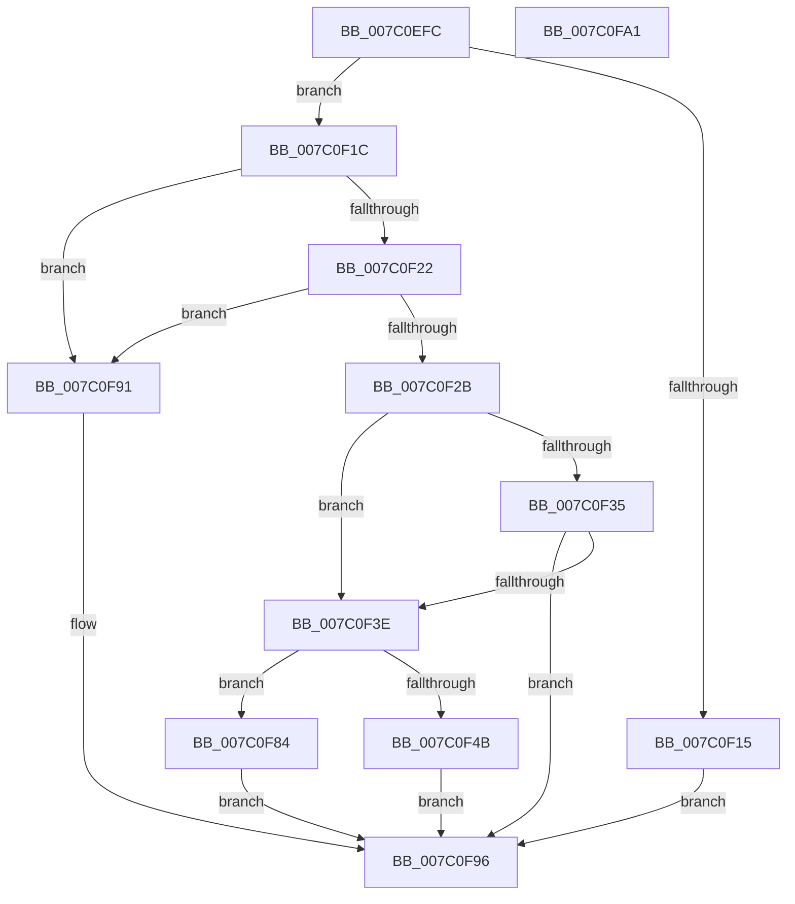

# EtwpUpdateLastBranchTracingConfiguration

- RVA: `0x007C0EFC`–`0x007C0FA2` (길이 `166` bytes)
- VA: `0x00000001407C0EFC`
- 실행 섹션: `PAGE`
- PDB 이름 있음: `예`; PDB Function 태그: `아니요`
- unwind 정보 RVA: `0x0005CAAC`
- 디코드: `48`개 명령, `166/166` bytes 표시
- 미해석 바이트: `0` (있으면 어셈블리에 `.byte`로 보존)

> 이 문서는 커널 이미지의 기계어와 PDB 기호를 분석해 생성했습니다. 4번과 5번은 함수 원형과 자료형을 바이너리 사용 방식에서 추정한 C 해석이며 원본 소스 복구 결과는 아닙니다.

## 1. Dependencies

- 직접 호출 지점: **4**; 고유 호출 대상: **3**
- 직접 호출자로 확인된 함수: **1**
- RIP 상대 이미지 참조: **3**

### Outgoing calls
- `0x007C0F35` → [EtwpAllocateLbrData](EtwpAllocateLbrData_function_007C0D5C.md) (function, `0x007C0D5C`)
- `0x007C0F52` → [guard_dispatch_icall](../../text/6B/guard_dispatch_icall_function_006BAAD0.md) (function, `0x006BAAD0`)
- `0x007C0F7D` → [guard_dispatch_icall](../../text/6B/guard_dispatch_icall_function_006BAAD0.md) (function, `0x006BAAD0`)
- `0x007C0F8A` → [EtwpUpdateLastBranchTracingHalState](../../text/65/EtwpUpdateLastBranchTracingHalState_function_006539F8.md) (function, `0x006539F8`)

### Direct callers
- [sub_00B3C988](../B3/Unknown_function_00B3C988.md) at `0x00B3D302`

### Static image references
- `0x007C0F06` → RVA `0x00FC6D40` (`ALMOSTRO`; read)
- `0x007C0F4B` → RVA `0x00E00C18` (`.data`; read)
- `0x007C0F6D` → RVA `0x00E00C10` (`.data`; read)

## 2. Other-region calls and transfers

- 다른 실행 섹션으로 향하는 call: **3**
  - `0x007C0F52` → [guard_dispatch_icall](../../text/6B/guard_dispatch_icall_function_006BAAD0.md) (`PAGE` → `.text`)
  - `0x007C0F7D` → [guard_dispatch_icall](../../text/6B/guard_dispatch_icall_function_006BAAD0.md) (`PAGE` → `.text`)
  - `0x007C0F8A` → [EtwpUpdateLastBranchTracingHalState](../../text/65/EtwpUpdateLastBranchTracingHalState_function_006539F8.md) (`PAGE` → `.text`)
- 별도 외부 분기/꼬리 이동을 확인하지 못했습니다.

## 3. Assembly (complete function range)

```asm
007C0EFC  48 89 5C 24 08                  mov qword ptr [rsp + 8], rbx
007C0F01  57                              push rdi
007C0F02  48 83 EC 20                     sub rsp, 0x20
007C0F06  8B 05 34 5E 80 00               mov eax, dword ptr [rip + 0x805e34]
007C0F0C  8B FA                           mov edi, edx
007C0F0E  48 8B D9                        mov rbx, rcx
007C0F11  85 C0                           test eax, eax
007C0F13  75 07                           jne 0x1407c0f1c
007C0F15  B8 BB 00 00 C0                  mov eax, 0xc00000bb
007C0F1A  EB 7A                           jmp 0x1407c0f96
007C0F1C  F7 D0                           not eax
007C0F1E  85 C7                           test edi, eax
007C0F20  75 6F                           jne 0x1407c0f91
007C0F22  8B C7                           mov eax, edi
007C0F24  83 E0 03                        and eax, 3
007C0F27  3C 03                           cmp al, 3
007C0F29  74 66                           je 0x1407c0f91
007C0F2B  48 83 B9 30 04 00 00 00         cmp qword ptr [rcx + 0x430], 0
007C0F33  75 09                           jne 0x1407c0f3e
007C0F35  E8 22 FE FF FF                  call 0x1407c0d5c
007C0F3A  85 C0                           test eax, eax
007C0F3C  78 58                           js 0x1407c0f96
007C0F3E  48 8B 83 30 04 00 00            mov rax, qword ptr [rbx + 0x430]
007C0F45  8B 08                           mov ecx, dword ptr [rax]
007C0F47  85 C9                           test ecx, ecx
007C0F49  74 39                           je 0x1407c0f84
007C0F4B  48 8B 05 C6 FC 63 00            mov rax, qword ptr [rip + 0x63fcc6]
007C0F52  E8 79 9B EF FF                  call 0x1406baad0
007C0F57  48 8B 83 30 04 00 00            mov rax, qword ptr [rbx + 0x430]
007C0F5E  83 20 00                        and dword ptr [rax], 0
007C0F61  8B C7                           mov eax, edi
007C0F63  48 8B 8B 30 04 00 00            mov rcx, qword ptr [rbx + 0x430]
007C0F6A  87 41 04                        xchg dword ptr [rcx + 4], eax
007C0F6D  48 8B 05 9C FC 63 00            mov rax, qword ptr [rip + 0x63fc9c]
007C0F74  8B CF                           mov ecx, edi
007C0F76  48 8B 93 30 04 00 00            mov rdx, qword ptr [rbx + 0x430]
007C0F7D  E8 4E 9B EF FF                  call 0x1406baad0
007C0F82  EB 12                           jmp 0x1407c0f96
007C0F84  87 78 04                        xchg dword ptr [rax + 4], edi
007C0F87  48 8B CB                        mov rcx, rbx
007C0F8A  E8 69 2A E9 FF                  call 0x1406539f8
007C0F8F  EB 05                           jmp 0x1407c0f96
007C0F91  B8 0D 00 00 C0                  mov eax, 0xc000000d
007C0F96  48 8B 5C 24 30                  mov rbx, qword ptr [rsp + 0x30]
007C0F9B  48 83 C4 20                     add rsp, 0x20
007C0F9F  5F                              pop rdi
007C0FA0  C3                              ret
007C0FA1  CC                              int3
```

## 4. C-style interpretation (structured pseudocode)

```c
__int64 __fastcall EtwpUpdateLastBranchTracingConfiguration(__int64 a1, int a2)
{
    __int64 result;
    __int64 v_rsp;
    unsigned __int64 v_stack_p8;

    v_stack_p8 = v_rbx;
    v_rsp = (v_rsp) - (32);
    if ((unsigned int)((unsigned int)(*(unsigned int *)(v_rip + 8412724))) != 0) goto loc_007C0F1C;
    goto loc_007C0F96;
loc_007C0F1C:
    result = (unsigned int)(~((unsigned int)(0xC00000BBULL)));
    if ((((unsigned int)((unsigned int)(a2))) & ((unsigned int)(result))) != 0) goto loc_007C0F91;
    result = (unsigned int)(((unsigned int)((unsigned int)((unsigned int)(a2)))) & (3));
    if (((unsigned __int8)(result)) == 3) goto loc_007C0F91;
    if ((*(unsigned __int64 *)(a1 + 1072)) != 0) goto loc_007C0F3E;
    result = EtwpAllocateLbrData(a1, a2, a3, a4);
    if (sign_flag) goto loc_007C0F96;
loc_007C0F3E:
    if ((unsigned int)((unsigned int)(*(unsigned int *)(*(unsigned __int64 *)(a1 + 1072)))) == 0) goto loc_007C0F84;
    result = guard_dispatch_icall((unsigned int)(*(unsigned int *)(*(unsigned __int64 *)(a1 + 1072))), a2, a3, a4);
    result = guard_dispatch_icall((unsigned int)((unsigned int)((unsigned int)(a2))), *(unsigned __int64 *)(a1 + 1072), a3, a4);
    goto loc_007C0F96;
loc_007C0F84:
    result = EtwpUpdateLastBranchTracingHalState(a1, *(unsigned __int64 *)(a1 + 1072), a3, a4);
    goto loc_007C0F96;
loc_007C0F91:
loc_007C0F96:
    v_rsp = (v_rsp) + (32);
    return (unsigned int)(0xC000000DULL);
}
```

## 5. (Beta) C Style

```c
int64_t EtwpUpdateLastBranchTracingConfiguration(void *Arg1, int32_t Arg2)
{
    uint8_t *arg1 = (uint8_t *)Arg1;

    int64_t result;
    int64_t local_rsp;
    uint64_t v_stack_p8;

    v_stack_p8 = local_rbx;
    local_rsp = (local_rsp) - (32);
    if ((uint32_t)((uint32_t)(*(uint32_t *)(v_rip + 0x805E34))) != 0) goto loc_007C0F1C;
    goto loc_007C0F96;
loc_007C0F1C:
    result = (uint32_t)(~((uint32_t)(0xC00000BBULL)));
    if ((((uint32_t)((uint32_t)(Arg2))) & ((uint32_t)(result))) != 0) goto loc_007C0F91;
    result = (uint32_t)(((uint32_t)((uint32_t)((uint32_t)(Arg2)))) & (3));
    if (((uint8_t)(result)) == 3) goto loc_007C0F91;
    if ((*(uint64_t *)(arg1 + 0x430)) != 0) goto loc_007C0F3E;
    result = EtwpAllocateLbrData(Arg1, Arg2, a3, a4);
    if (sign_flag) goto loc_007C0F96;
loc_007C0F3E:
    if ((uint32_t)((uint32_t)(*(uint32_t *)(*(uint64_t *)(arg1 + 0x430)))) == 0) goto loc_007C0F84;
    result = guard_dispatch_icall((uint32_t)(*(uint32_t *)(*(uint64_t *)(arg1 + 0x430))), Arg2, a3, a4);
    result = guard_dispatch_icall((uint32_t)((uint32_t)((uint32_t)(Arg2))), *(uint64_t *)(arg1 + 0x430), a3, a4);
    goto loc_007C0F96;
loc_007C0F84:
    result = EtwpUpdateLastBranchTracingHalState(Arg1, *(uint64_t *)(arg1 + 0x430), a3, a4);
    goto loc_007C0F96;
loc_007C0F91:
loc_007C0F96:
    local_rsp = (local_rsp) + (32);
    return (uint32_t)(0xC000000DULL);
}
```

### 관측된 메모리 오프셋

구조체 형식이 확인되지 않은 접근은 인자 기준의 오프셋으로만 기록했습니다.

| 기준 인자 | 오프셋 표현 | 폭 (bit) | 접근 |
|---|---:|---:|---|
| `Arg1` | `+ 0x430` | `64` | `R` |

## 6. Execution-region graph

[열기: 2D/3D 그래프와 함수 탐색 컨트롤 패널](../../../control-panel.html?section=page&rva=0x007C0EFC&view=graph)

- 2D 그래프는 위에서 아래로 흐르고, 3D 그래프는 빈 공간을 드래그해 회전합니다. Shift+드래그는 이동, 휠은 확대·축소, 함수 노드 선택은 대상 보고서 이동입니다.

### Static fallback


