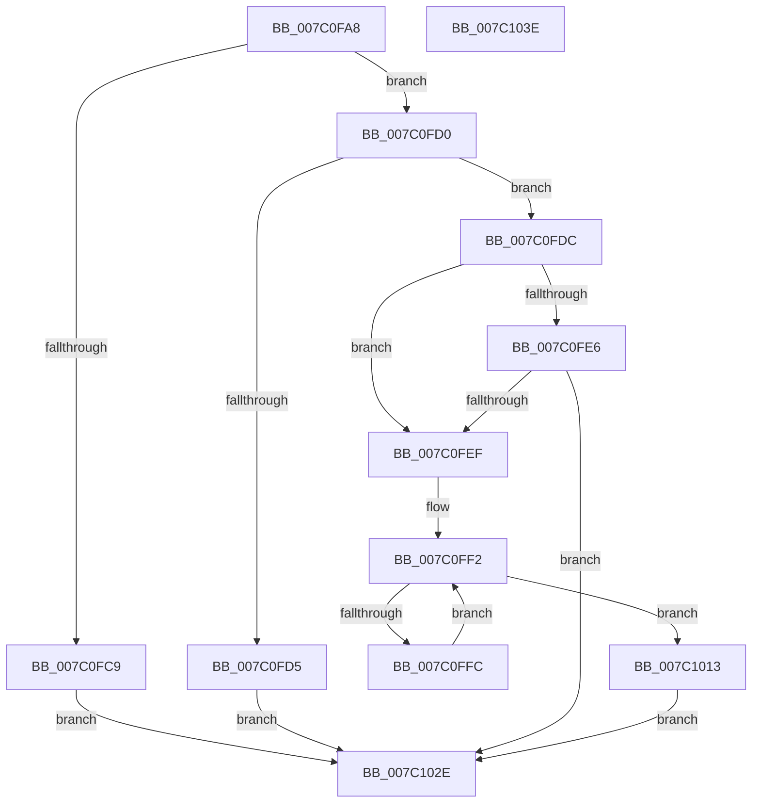

# EtwpUpdateLastBranchTracingEvents

- RVA: `0x007C0FA8`–`0x007C103F` (길이 `151` bytes)
- VA: `0x00000001407C0FA8`
- 실행 섹션: `PAGE`
- PDB 이름 있음: `예`; PDB Function 태그: `아니요`
- unwind 정보 RVA: `0x000D3ECC`
- 디코드: `42`개 명령, `151/151` bytes 표시
- 미해석 바이트: `0` (있으면 어셈블리에 `.byte`로 보존)

> 이 문서는 커널 이미지의 기계어와 PDB 기호를 분석해 생성했습니다. 4번과 5번은 함수 원형과 자료형을 바이너리 사용 방식에서 추정한 C 해석이며 원본 소스 복구 결과는 아닙니다.

## 1. Dependencies

- 직접 호출 지점: **2**; 고유 호출 대상: **2**
- 직접 호출자로 확인된 함수: **1**
- RIP 상대 이미지 참조: **1**

### Outgoing calls
- `0x007C0FE6` → [EtwpAllocateLbrData](EtwpAllocateLbrData_function_007C0D5C.md) (function, `0x007C0D5C`)
- `0x007C1025` → [EtwpUpdateLastBranchTracingHalState](../../text/65/EtwpUpdateLastBranchTracingHalState_function_006539F8.md) (function, `0x006539F8`)

### Direct callers
- [sub_00B3C988](../B3/Unknown_function_00B3C988.md) at `0x00B3D475`

### Static image references
- `0x007C0FC0` → RVA `0x00FC6D40` (`ALMOSTRO`; read)

## 2. Other-region calls and transfers

- 다른 실행 섹션으로 향하는 call: **1**
  - `0x007C1025` → [EtwpUpdateLastBranchTracingHalState](../../text/65/EtwpUpdateLastBranchTracingHalState_function_006539F8.md) (`PAGE` → `.text`)
- 별도 외부 분기/꼬리 이동을 확인하지 못했습니다.

## 3. Assembly (complete function range)

```asm
007C0FA8  48 89 5C 24 08                  mov qword ptr [rsp + 8], rbx
007C0FAD  48 89 74 24 10                  mov qword ptr [rsp + 0x10], rsi
007C0FB2  57                              push rdi
007C0FB3  48 83 EC 30                     sub rsp, 0x30
007C0FB7  41 8B F8                        mov edi, r8d
007C0FBA  48 8B F2                        mov rsi, rdx
007C0FBD  48 8B D9                        mov rbx, rcx
007C0FC0  83 3D 79 5D 80 00 00            cmp dword ptr [rip + 0x805d79], 0
007C0FC7  75 07                           jne 0x1407c0fd0
007C0FC9  B8 BB 00 00 C0                  mov eax, 0xc00000bb
007C0FCE  EB 5E                           jmp 0x1407c102e
007C0FD0  83 FF 04                        cmp edi, 4
007C0FD3  76 07                           jbe 0x1407c0fdc
007C0FD5  B8 0D 00 00 C0                  mov eax, 0xc000000d
007C0FDA  EB 52                           jmp 0x1407c102e
007C0FDC  48 83 B9 30 04 00 00 00         cmp qword ptr [rcx + 0x430], 0
007C0FE4  75 09                           jne 0x1407c0fef
007C0FE6  E8 71 FD FF FF                  call 0x1407c0d5c
007C0FEB  85 C0                           test eax, eax
007C0FED  78 3F                           js 0x1407c102e
007C0FEF  45 33 C0                        xor r8d, r8d
007C0FF2  44 89 44 24 20                  mov dword ptr [rsp + 0x20], r8d
007C0FF7  44 3B C7                        cmp r8d, edi
007C0FFA  73 17                           jae 0x1407c1013
007C0FFC  42 0F B7 0C 86                  movzx ecx, word ptr [rsi + r8*4]
007C1001  48 8B 83 30 04 00 00            mov rax, qword ptr [rbx + 0x430]
007C1008  66 42 89 4C 40 0C               mov word ptr [rax + r8*2 + 0xc], cx
007C100E  41 FF C0                        inc r8d
007C1011  EB DF                           jmp 0x1407c0ff2
007C1013  F0 83 0C 24 00                  lock or dword ptr [rsp], 0
007C1018  48 8B 83 30 04 00 00            mov rax, qword ptr [rbx + 0x430]
007C101F  89 78 08                        mov dword ptr [rax + 8], edi
007C1022  48 8B CB                        mov rcx, rbx
007C1025  E8 CE 29 E9 FF                  call 0x1406539f8
007C102A  33 C0                           xor eax, eax
007C102C  EB 00                           jmp 0x1407c102e
007C102E  48 8B 5C 24 40                  mov rbx, qword ptr [rsp + 0x40]
007C1033  48 8B 74 24 48                  mov rsi, qword ptr [rsp + 0x48]
007C1038  48 83 C4 30                     add rsp, 0x30
007C103C  5F                              pop rdi
007C103D  C3                              ret
007C103E  CC                              int3
```

## 4. C-style interpretation (structured pseudocode)

```c
__int64 __fastcall EtwpUpdateLastBranchTracingEvents(__int64 a1, __int64 a2, int a3)
{
    __int64 result;
    __int64 v_rsp;
    unsigned int v_stack_m18;
    unsigned int v_stack_m38;
    unsigned __int64 v_stack_p10;
    unsigned __int64 v_stack_p8;

    v_stack_p8 = v_rbx;
    v_stack_p10 = v_rsi;
    v_rsp = (v_rsp) - (48);
    if ((*(unsigned int *)(v_rip + 8412537)) != 0) goto loc_007C0FD0;
    goto loc_007C102E;
loc_007C0FD0:
    if (((unsigned int)((unsigned int)(a3))) <= 4) goto loc_007C0FDC;
    goto loc_007C102E;
loc_007C0FDC:
    if ((*(unsigned __int64 *)(a1 + 1072)) != 0) goto loc_007C0FEF;
    result = EtwpAllocateLbrData(a1, a2, a3, a4);
    if (sign_flag) goto loc_007C102E;
loc_007C0FEF:
    a3 = 0;
loc_007C0FF2:
    v_stack_m18 = 0;
    if (0 >= ((unsigned int)((unsigned int)(a3)))) goto loc_007C1013;
    *(unsigned __int16 *)(*(unsigned __int64 *)(a1 + 1072) + a3 * 2 + 12) = (unsigned __int16)(*(unsigned __int16 *)(a2 + a3 * 4));
    a3 = (unsigned int)((a3) + 1);
    goto loc_007C0FF2;
loc_007C1013:
    *(unsigned int *)(*(unsigned __int64 *)(a1 + 1072) + 8) = (unsigned int)((unsigned int)(a3));
    result = EtwpUpdateLastBranchTracingHalState(a1, a2, a3, a4);
    result = 0;
    goto loc_007C102E;
loc_007C102E:
    v_rsp = (v_rsp) + (48);
    return result;
}
```

## 5. (Beta) C Style

```c
int64_t EtwpUpdateLastBranchTracingEvents(void *Arg1, void *Arg2, int32_t Arg3)
{
    uint8_t *arg1 = (uint8_t *)Arg1;
    uint8_t *arg2 = (uint8_t *)Arg2;

    int64_t result;
    int64_t local_rsp;
    uint32_t v_stack_m18;
    uint32_t v_stack_m38;
    uint64_t v_stack_p10;
    uint64_t v_stack_p8;

    v_stack_p8 = local_rbx;
    v_stack_p10 = local_rsi;
    local_rsp = (local_rsp) - (48);
    if ((*(uint32_t *)(v_rip + 0x805D79)) != 0) goto loc_007C0FD0;
    goto loc_007C102E;
loc_007C0FD0:
    if (((uint32_t)((uint32_t)(Arg3))) <= 4) goto loc_007C0FDC;
    goto loc_007C102E;
loc_007C0FDC:
    if ((*(uint64_t *)(arg1 + 0x430)) != 0) goto loc_007C0FEF;
    result = EtwpAllocateLbrData(Arg1, Arg2, Arg3, a4);
    if (sign_flag) goto loc_007C102E;
loc_007C0FEF:
    Arg3 = 0;
loc_007C0FF2:
    v_stack_m18 = 0;
    if (0 >= ((uint32_t)((uint32_t)(Arg3)))) goto loc_007C1013;
    *(uint16_t *)(*(uint64_t *)(arg1 + 0x430) + Arg3 * 2 + 0xC) = (uint16_t)(*(uint16_t *)(arg2 + Arg3 * 4));
    Arg3 = (uint32_t)((Arg3) + 1);
    goto loc_007C0FF2;
loc_007C1013:
    *(uint32_t *)(*(uint64_t *)(arg1 + 0x430) + 0x8) = (uint32_t)((uint32_t)(Arg3));
    result = EtwpUpdateLastBranchTracingHalState(Arg1, Arg2, Arg3, a4);
    result = 0;
    goto loc_007C102E;
loc_007C102E:
    local_rsp = (local_rsp) + (48);
    return result;
}
```

### 관측된 메모리 오프셋

구조체 형식이 확인되지 않은 접근은 인자 기준의 오프셋으로만 기록했습니다.

| 기준 인자 | 오프셋 표현 | 폭 (bit) | 접근 |
|---|---:|---:|---|
| `Arg1` | `+ 0x430` | `64` | `R` |
| `Arg2` | `+ 0x0 + r8*4` | `16` | `R` |

## 6. Execution-region graph

[열기: 2D/3D 그래프와 함수 탐색 컨트롤 패널](../../../control-panel.html?section=page&rva=0x007C0FA8&view=graph)

- 2D 그래프는 위에서 아래로 흐르고, 3D 그래프는 빈 공간을 드래그해 회전합니다. Shift+드래그는 이동, 휠은 확대·축소, 함수 노드 선택은 대상 보고서 이동입니다.

### Static fallback


