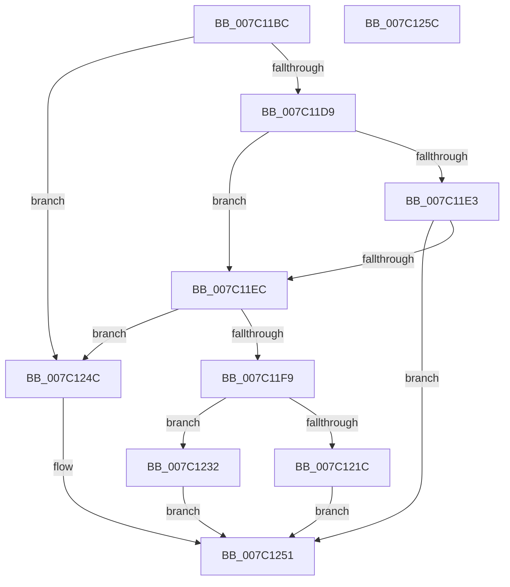

# EtwpUpdateProcessorTraceConfiguration

- RVA: `0x007C11BC`–`0x007C125D` (길이 `161` bytes)
- VA: `0x00000001407C11BC`
- 실행 섹션: `PAGE`
- PDB 이름 있음: `예`; PDB Function 태그: `아니요`
- unwind 정보 RVA: `0x0005CAAC`
- 디코드: `38`개 명령, `161/161` bytes 표시
- 미해석 바이트: `0` (있으면 어셈블리에 `.byte`로 보존)

> 이 문서는 커널 이미지의 기계어와 PDB 기호를 분석해 생성했습니다. 4번과 5번은 함수 원형과 자료형을 바이너리 사용 방식에서 추정한 C 해석이며 원본 소스 복구 결과는 아닙니다.

## 1. Dependencies

- 직접 호출 지점: **2**; 고유 호출 대상: **2**
- 직접 호출자로 확인된 함수: **1**
- RIP 상대 이미지 참조: **1**

### Outgoing calls
- `0x007C11E3` → [EtwpConstructIptData](EtwpConstructIptData_function_007C1048.md) (function, `0x007C1048`)
- `0x007C1213` → [guard_dispatch_icall](../../text/6B/guard_dispatch_icall_function_006BAAD0.md) (function, `0x006BAAD0`)

### Direct callers
- [sub_00B3C988](../B3/Unknown_function_00B3C988.md) at `0x00B3D356`

### Static image references
- `0x007C11F9` → RVA `0x00F475C0` (`.data`; read/write)

## 2. Other-region calls and transfers

- 다른 실행 섹션으로 향하는 call: **1**
  - `0x007C1213` → [guard_dispatch_icall](../../text/6B/guard_dispatch_icall_function_006BAAD0.md) (`PAGE` → `.text`)
- 별도 외부 분기/꼬리 이동을 확인하지 못했습니다.

## 3. Assembly (complete function range)

```asm
007C11BC  48 89 5C 24 08                  mov qword ptr [rsp + 8], rbx
007C11C1  57                              push rdi
007C11C2  48 83 EC 20                     sub rsp, 0x20
007C11C6  F7 81 30 03 00 00 00 00 00 04   test dword ptr [rcx + 0x330], 0x4000000
007C11D0  48 8B D9                        mov rbx, rcx
007C11D3  48 8B 7A 10                     mov rdi, qword ptr [rdx + 0x10]
007C11D7  75 73                           jne 0x1407c124c
007C11D9  48 83 B9 38 04 00 00 00         cmp qword ptr [rcx + 0x438], 0
007C11E1  75 09                           jne 0x1407c11ec
007C11E3  E8 60 FE FF FF                  call 0x1407c1048
007C11E8  85 C0                           test eax, eax
007C11EA  78 65                           js 0x1407c1251
007C11EC  48 8B 83 38 04 00 00            mov rax, qword ptr [rbx + 0x438]
007C11F3  48 83 38 00                     cmp qword ptr [rax], 0
007C11F7  75 53                           jne 0x1407c124c
007C11F9  F0 0F BA 2D BE 63 78 00 02      lock bts dword ptr [rip + 0x7863be], 2
007C1202  48 8B 93 38 04 00 00            mov rdx, qword ptr [rbx + 0x438]
007C1209  48 8B CF                        mov rcx, rdi
007C120C  48 8B 42 10                     mov rax, qword ptr [rdx + 0x10]
007C1210  48 8B 00                        mov rax, qword ptr [rax]
007C1213  E8 B8 98 EF FF                  call 0x1406baad0
007C1218  85 C0                           test eax, eax
007C121A  79 16                           jns 0x1407c1232
007C121C  F0 0F BA 35 9B 63 78 00 02      lock btr dword ptr [rip + 0x78639b], 2
007C1225  48 8B 8B 38 04 00 00            mov rcx, qword ptr [rbx + 0x438]
007C122C  48 83 21 00                     and qword ptr [rcx], 0
007C1230  EB 1F                           jmp 0x1407c1251
007C1232  48 8B 83 38 04 00 00            mov rax, qword ptr [rbx + 0x438]
007C1239  48 89 78 08                     mov qword ptr [rax + 8], rdi
007C123D  F0 81 8B 30 03 00 00 00 00 00 04  lock or dword ptr [rbx + 0x330], 0x4000000
007C1248  33 C0                           xor eax, eax
007C124A  EB 05                           jmp 0x1407c1251
007C124C  B8 03 03 00 C0                  mov eax, 0xc0000303
007C1251  48 8B 5C 24 30                  mov rbx, qword ptr [rsp + 0x30]
007C1256  48 83 C4 20                     add rsp, 0x20
007C125A  5F                              pop rdi
007C125B  C3                              ret
007C125C  CC                              int3
```

## 4. C-style interpretation (structured pseudocode)

```c
__int64 __fastcall EtwpUpdateProcessorTraceConfiguration(__int64 a1, __int64 a2)
{
    __int64 result;
    __int64 v_rsp;
    unsigned __int64 v_stack_p8;

    v_stack_p8 = v_rbx;
    v_rsp = (v_rsp) - (32);
    if (((*(unsigned int *)(a1 + 816)) & (0x4000000ULL)) != 0) goto loc_007C124C;
    if ((*(unsigned __int64 *)(a1 + 1080)) != 0) goto loc_007C11EC;
    result = EtwpConstructIptData(a1, a2, a3, a4);
    if (sign_flag) goto loc_007C1251;
loc_007C11EC:
    if ((*(unsigned __int64 *)(*(unsigned __int64 *)(a1 + 1080))) != 0) goto loc_007C124C;
    result = guard_dispatch_icall(*(unsigned __int64 *)(a2 + 16), *(unsigned __int64 *)(a1 + 1080), a3, a4);
    if (!sign_flag) goto loc_007C1232;
    goto loc_007C1251;
loc_007C1232:
    *(unsigned __int64 *)(*(unsigned __int64 *)(a1 + 1080) + 8) = *(unsigned __int64 *)(a2 + 16);
    result = 0;
    goto loc_007C1251;
loc_007C124C:
loc_007C1251:
    v_rsp = (v_rsp) + (32);
    return (unsigned int)(0xC0000303ULL);
}
```

## 5. (Beta) C Style

```c
int64_t EtwpUpdateProcessorTraceConfiguration(void *Arg1, void *Arg2)
{
    uint8_t *arg1 = (uint8_t *)Arg1;
    uint8_t *arg2 = (uint8_t *)Arg2;

    int64_t result;
    int64_t local_rsp;
    uint64_t v_stack_p8;

    v_stack_p8 = local_rbx;
    local_rsp = (local_rsp) - (32);
    if (((*(uint32_t *)(arg1 + 0x330)) & (0x4000000ULL)) != 0) goto loc_007C124C;
    if ((*(uint64_t *)(arg1 + 0x438)) != 0) goto loc_007C11EC;
    result = EtwpConstructIptData(Arg1, Arg2, a3, a4);
    if (sign_flag) goto loc_007C1251;
loc_007C11EC:
    if ((*(uint64_t *)(*(uint64_t *)(arg1 + 0x438))) != 0) goto loc_007C124C;
    result = guard_dispatch_icall(*(uint64_t *)(arg2 + 0x10), *(uint64_t *)(arg1 + 0x438), a3, a4);
    if (!sign_flag) goto loc_007C1232;
    goto loc_007C1251;
loc_007C1232:
    *(uint64_t *)(*(uint64_t *)(arg1 + 0x438) + 0x8) = *(uint64_t *)(arg2 + 0x10);
    result = 0;
    goto loc_007C1251;
loc_007C124C:
loc_007C1251:
    local_rsp = (local_rsp) + (32);
    return (uint32_t)(0xC0000303ULL);
}
```

### 관측된 메모리 오프셋

구조체 형식이 확인되지 않은 접근은 인자 기준의 오프셋으로만 기록했습니다.

| 기준 인자 | 오프셋 표현 | 폭 (bit) | 접근 |
|---|---:|---:|---|
| `Arg1` | `+ 0x330` | `32` | `R` |
| `Arg1` | `+ 0x330` | `32` | `R/W` |
| `Arg1` | `+ 0x438` | `64` | `R` |
| `Arg2` | `+ 0x10` | `64` | `R` |

## 6. Execution-region graph

[열기: 2D/3D 그래프와 함수 탐색 컨트롤 패널](../../../control-panel.html?section=page&rva=0x007C11BC&view=graph)

- 2D 그래프는 위에서 아래로 흐르고, 3D 그래프는 빈 공간을 드래그해 회전합니다. Shift+드래그는 이동, 휠은 확대·축소, 함수 노드 선택은 대상 보고서 이동입니다.

### Static fallback


