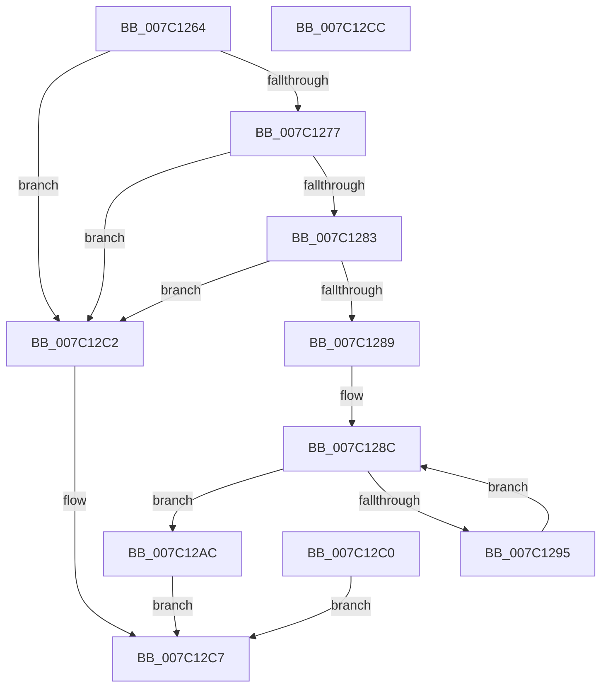

# EtwpUpdateProcessorTraceEvents

- RVA: `0x007C1264`–`0x007C12CD` (길이 `105` bytes)
- VA: `0x00000001407C1264`
- 실행 섹션: `PAGE`
- PDB 이름 있음: `예`; PDB Function 태그: `아니요`
- unwind 정보 RVA: `0x000D3EF8`
- 디코드: `30`개 명령, `105/105` bytes 표시
- 미해석 바이트: `0` (있으면 어셈블리에 `.byte`로 보존)

> 이 문서는 커널 이미지의 기계어와 PDB 기호를 분석해 생성했습니다. 4번과 5번은 함수 원형과 자료형을 바이너리 사용 방식에서 추정한 C 해석이며 원본 소스 복구 결과는 아닙니다.

## 1. Dependencies

- 직접 호출 지점: **0**; 고유 호출 대상: **0**
- 직접 호출자로 확인된 함수: **1**
- RIP 상대 이미지 참조: **0**

### Outgoing calls
- 직접 디코드된 call 명령이 없습니다.

### Direct callers
- [sub_00B3C988](../B3/Unknown_function_00B3C988.md) at `0x00B3D48A`

### Static image references
- 디코드된 RIP-relative 메모리 참조가 없습니다.

## 2. Other-region calls and transfers

- 다른 실행 섹션으로 향하는 call: **0**
- 별도 외부 분기/꼬리 이동을 확인하지 못했습니다.

## 3. Assembly (complete function range)

```asm
007C1264  48 83 EC 18                     sub rsp, 0x18
007C1268  45 8B C8                        mov r9d, r8d
007C126B  4C 8B D1                        mov r10, rcx
007C126E  41 8D 40 FF                     lea eax, [r8 - 1]
007C1272  83 F8 03                        cmp eax, 3
007C1275  77 4B                           ja 0x1407c12c2
007C1277  48 8B 81 38 04 00 00            mov rax, qword ptr [rcx + 0x438]
007C127E  48 85 C0                        test rax, rax
007C1281  74 3F                           je 0x1407c12c2
007C1283  48 83 38 00                     cmp qword ptr [rax], 0
007C1287  74 39                           je 0x1407c12c2
007C1289  45 33 C0                        xor r8d, r8d
007C128C  44 89 04 24                     mov dword ptr [rsp], r8d
007C1290  45 3B C1                        cmp r8d, r9d
007C1293  73 17                           jae 0x1407c12ac
007C1295  42 0F B7 0C 82                  movzx ecx, word ptr [rdx + r8*4]
007C129A  49 8B 82 38 04 00 00            mov rax, qword ptr [r10 + 0x438]
007C12A1  66 42 89 4C 40 1C               mov word ptr [rax + r8*2 + 0x1c], cx
007C12A7  41 FF C0                        inc r8d
007C12AA  EB E0                           jmp 0x1407c128c
007C12AC  F0 83 0C 24 00                  lock or dword ptr [rsp], 0
007C12B1  49 8B 82 38 04 00 00            mov rax, qword ptr [r10 + 0x438]
007C12B8  44 89 48 18                     mov dword ptr [rax + 0x18], r9d
007C12BC  33 C0                           xor eax, eax
007C12BE  EB 07                           jmp 0x1407c12c7
007C12C0  EB 05                           jmp 0x1407c12c7
007C12C2  B8 0D 00 00 C0                  mov eax, 0xc000000d
007C12C7  48 83 C4 18                     add rsp, 0x18
007C12CB  C3                              ret
007C12CC  CC                              int3
```

## 4. C-style interpretation (structured pseudocode)

```c
__int64 __fastcall EtwpUpdateProcessorTraceEvents(__int64 a1, __int64 a2, __int64 a3)
{
    __int64 result;
    __int64 v_rsp;
    unsigned int v_stack_m18;

    v_rsp = (v_rsp) - (24);
    if (((unsigned int)(a3 - 1)) > 3) goto loc_007C12C2;
    if (*(unsigned __int64 *)(a1 + 1080) == 0) goto loc_007C12C2;
    if ((*(unsigned __int64 *)(*(unsigned __int64 *)(a1 + 1080))) == 0) goto loc_007C12C2;
    a3 = 0;
loc_007C128C:
    v_stack_m18 = 0;
    if (0 >= ((unsigned int)((unsigned int)((unsigned int)(a3))))) goto loc_007C12AC;
    *(unsigned __int16 *)(*(unsigned __int64 *)(a1 + 1080) + a3 * 2 + 28) = (unsigned __int16)(*(unsigned __int16 *)(a2 + a3 * 4));
    a3 = (unsigned int)((a3) + 1);
    goto loc_007C128C;
loc_007C12AC:
    *(unsigned int *)(*(unsigned __int64 *)(a1 + 1080) + 24) = (unsigned int)((unsigned int)((unsigned int)(a3)));
    result = 0;
    goto loc_007C12C7;
loc_007C12C2:
loc_007C12C7:
    v_rsp = (v_rsp) + (24);
    return (unsigned int)(0xC000000DULL);
}
```

## 5. (Beta) C Style

```c
int64_t EtwpUpdateProcessorTraceEvents(void *Arg1, void *Arg2, void *Arg3)
{
    uint8_t *arg1 = (uint8_t *)Arg1;
    uint8_t *arg2 = (uint8_t *)Arg2;
    uint8_t *arg3 = (uint8_t *)Arg3;

    int64_t result;
    int64_t local_rsp;
    uint32_t v_stack_m18;

    local_rsp = (local_rsp) - (24);
    if (((uint32_t)(Arg3 - 1)) > 3) goto loc_007C12C2;
    if (*(uint64_t *)(arg1 + 0x438) == 0) goto loc_007C12C2;
    if ((*(uint64_t *)(*(uint64_t *)(arg1 + 0x438))) == 0) goto loc_007C12C2;
    Arg3 = 0;
loc_007C128C:
    v_stack_m18 = 0;
    if (0 >= ((uint32_t)((uint32_t)((uint32_t)(Arg3))))) goto loc_007C12AC;
    *(uint16_t *)(*(uint64_t *)(arg1 + 0x438) + arg3 * 2 + 0x1C) = (uint16_t)(*(uint16_t *)(arg2 + arg3 * 4));
    Arg3 = (uint32_t)((Arg3) + 1);
    goto loc_007C128C;
loc_007C12AC:
    *(uint32_t *)(*(uint64_t *)(arg1 + 0x438) + 0x18) = (uint32_t)((uint32_t)((uint32_t)(Arg3)));
    result = 0;
    goto loc_007C12C7;
loc_007C12C2:
loc_007C12C7:
    local_rsp = (local_rsp) + (24);
    return (uint32_t)(0xC000000DULL);
}
```

### 관측된 메모리 오프셋

구조체 형식이 확인되지 않은 접근은 인자 기준의 오프셋으로만 기록했습니다.

| 기준 인자 | 오프셋 표현 | 폭 (bit) | 접근 |
|---|---:|---:|---|
| `Arg1` | `+ 0x438` | `64` | `R` |
| `Arg2` | `+ 0x0 + r8*4` | `16` | `R` |
| `Arg3` | `- 0x1` | `32` | `R` |

## 6. Execution-region graph

[열기: 2D/3D 그래프와 함수 탐색 컨트롤 패널](../../../control-panel.html?section=page&rva=0x007C1264&view=graph)

- 2D 그래프는 위에서 아래로 흐르고, 3D 그래프는 빈 공간을 드래그해 회전합니다. Shift+드래그는 이동, 휠은 확대·축소, 함수 노드 선택은 대상 보고서 이동입니다.

### Static fallback


