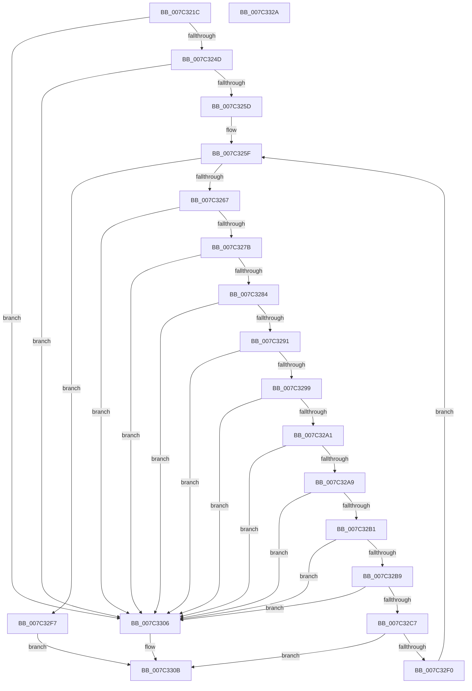

# EtwpValidateTraceControlFilterDescriptors

- RVA: `0x007C321C`–`0x007C332B` (길이 `271` bytes)
- VA: `0x00000001407C321C`
- 실행 섹션: `PAGE`
- PDB 이름 있음: `예`; PDB Function 태그: `아니요`
- unwind 정보 RVA: `0x000847EC`
- 디코드: `77`개 명령, `271/271` bytes 표시
- 미해석 바이트: `0` (있으면 어셈블리에 `.byte`로 보존)

> 이 문서는 커널 이미지의 기계어와 PDB 기호를 분석해 생성했습니다. 4번과 5번은 함수 원형과 자료형을 바이너리 사용 방식에서 추정한 C 해석이며 원본 소스 복구 결과는 아닙니다.

## 1. Dependencies

- 직접 호출 지점: **1**; 고유 호출 대상: **1**
- 직접 호출자로 확인된 함수: **1**
- RIP 상대 이미지 참조: **0**

### Outgoing calls
- `0x007C32E7` → [EtwpAllocateFilter](../9F/EtwpAllocateFilter_function_009FC948.md) (function, `0x009FC948`)

### Direct callers
- [EtwpNotifyGuid](../8C/EtwpNotifyGuid_function_008C8110.md) at `0x008C84B5`

### Static image references
- 디코드된 RIP-relative 메모리 참조가 없습니다.

## 2. Other-region calls and transfers

- 다른 실행 섹션으로 향하는 call: **0**
- 별도 외부 분기/꼬리 이동을 확인하지 못했습니다.

## 3. Assembly (complete function range)

```asm
007C321C  48 8B C4                        mov rax, rsp
007C321F  48 89 58 08                     mov qword ptr [rax + 8], rbx
007C3223  48 89 68 10                     mov qword ptr [rax + 0x10], rbp
007C3227  48 89 70 18                     mov qword ptr [rax + 0x18], rsi
007C322B  48 89 78 20                     mov qword ptr [rax + 0x20], rdi
007C322F  41 54                           push r12
007C3231  41 56                           push r14
007C3233  41 57                           push r15
007C3235  48 83 EC 30                     sub rsp, 0x30
007C3239  41 8B F0                        mov esi, r8d
007C323C  4D 8B E1                        mov r12, r9
007C323F  4C 8B F2                        mov r14, rdx
007C3242  8B E9                           mov ebp, ecx
007C3244  83 F9 0D                        cmp ecx, 0xd
007C3247  0F 87 B9 00 00 00               ja 0x1407c3306
007C324D  8B D9                           mov ebx, ecx
007C324F  45 33 FF                        xor r15d, r15d
007C3252  C1 E3 04                        shl ebx, 4
007C3255  3B DE                           cmp ebx, esi
007C3257  0F 87 A9 00 00 00               ja 0x1407c3306
007C325D  33 FF                           xor edi, edi
007C325F  3B FD                           cmp edi, ebp
007C3261  0F 83 90 00 00 00               jae 0x1407c32f7
007C3267  8B D7                           mov edx, edi
007C3269  48 03 D2                        add rdx, rdx
007C326C  8B C3                           mov eax, ebx
007C326E  4D 8B 04 D6                     mov r8, qword ptr [r14 + rdx*8]
007C3272  4C 3B C0                        cmp r8, rax
007C3275  0F 82 8B 00 00 00               jb 0x1407c3306
007C327B  4C 3B C6                        cmp r8, rsi
007C327E  0F 83 82 00 00 00               jae 0x1407c3306
007C3284  41 8B 4C D6 0C                  mov ecx, dword ptr [r14 + rdx*8 + 0xc]
007C3289  81 F9 00 10 00 80               cmp ecx, 0x80001000
007C328F  74 75                           je 0x1407c3306
007C3291  81 F9 00 02 00 80               cmp ecx, 0x80000200
007C3297  74 6D                           je 0x1407c3306
007C3299  81 F9 00 04 00 80               cmp ecx, 0x80000400
007C329F  74 65                           je 0x1407c3306
007C32A1  81 F9 00 01 00 80               cmp ecx, 0x80000100
007C32A7  74 5D                           je 0x1407c3306
007C32A9  81 F9 00 00 00 80               cmp ecx, 0x80000000
007C32AF  74 55                           je 0x1407c3306
007C32B1  81 F9 02 00 00 80               cmp ecx, 0x80000002
007C32B7  74 4D                           je 0x1407c3306
007C32B9  45 8B 4C D6 08                  mov r9d, dword ptr [r14 + rdx*8 + 8]
007C32BE  4B 8D 04 08                     lea rax, [r8 + r9]
007C32C2  48 3B C6                        cmp rax, rsi
007C32C5  77 3F                           ja 0x1407c3306
007C32C7  4B 8D 04 30                     lea rax, [r8 + r14]
007C32CB  44 89 4C 24 28                  mov dword ptr [rsp + 0x28], r9d
007C32D0  45 03 F9                        add r15d, r9d
007C32D3  48 89 44 24 20                  mov qword ptr [rsp + 0x20], rax
007C32D8  45 33 C9                        xor r9d, r9d
007C32DB  89 4C 24 2C                     mov dword ptr [rsp + 0x2c], ecx
007C32DF  4D 8B C4                        mov r8, r12
007C32E2  48 8D 54 24 20                  lea rdx, [rsp + 0x20]
007C32E7  E8 5C 96 23 00                  call 0x1409fc948
007C32EC  85 C0                           test eax, eax
007C32EE  78 1B                           js 0x1407c330b
007C32F0  FF C7                           inc edi
007C32F2  E9 68 FF FF FF                  jmp 0x1407c325f
007C32F7  42 8D 04 3B                     lea eax, [rbx + r15]
007C32FB  3B F0                           cmp esi, eax
007C32FD  1B C0                           sbb eax, eax
007C32FF  25 0D 00 00 C0                  and eax, 0xc000000d
007C3304  EB 05                           jmp 0x1407c330b
007C3306  B8 0D 00 00 C0                  mov eax, 0xc000000d
007C330B  48 8B 5C 24 50                  mov rbx, qword ptr [rsp + 0x50]
007C3310  48 8B 6C 24 58                  mov rbp, qword ptr [rsp + 0x58]
007C3315  48 8B 74 24 60                  mov rsi, qword ptr [rsp + 0x60]
007C331A  48 8B 7C 24 68                  mov rdi, qword ptr [rsp + 0x68]
007C331F  48 83 C4 30                     add rsp, 0x30
007C3323  41 5F                           pop r15
007C3325  41 5E                           pop r14
007C3327  41 5C                           pop r12
007C3329  C3                              ret
007C332A  CC                              int3
```

## 4. C-style interpretation (structured pseudocode)

```c
__int64 __fastcall EtwpValidateTraceControlFilterDescriptors(int a1, __int64 a2, int a3, __int64 a4)
{
    __int64 result;
    __int64 v_r15;
    __int64 v_rbx;
    __int64 v_rdi;
    __int64 v_rsp;
    unsigned int v_stack_m1C;
    unsigned int v_stack_m20;
    unsigned __int64 v_stack_m28;
    unsigned __int64 v_stack_p10;
    unsigned __int64 v_stack_p18;
    unsigned __int64 v_stack_p20;
    unsigned __int64 v_stack_p8;

    *(unsigned __int64 *)(v_rsp + 8) = v_rbx;
    *(unsigned __int64 *)(v_rsp + 16) = v_rbp;
    *(unsigned __int64 *)(v_rsp + 24) = v_rsi;
    *(unsigned __int64 *)(v_rsp + 32) = v_rdi;
    v_rsp = (v_rsp) - (48);
    if (a1 > 13) goto loc_007C3306;
    v_r15 = 0;
    v_rbx = (unsigned int)(((unsigned int)(a1)) << (4));
    if (((unsigned int)(v_rbx)) > ((unsigned int)((unsigned int)(a3)))) goto loc_007C3306;
    v_rdi = 0;
loc_007C325F:
    if (0 >= ((unsigned int)((unsigned int)(a1)))) goto loc_007C32F7;
    a2 = (0) + (0);
    if ((*(unsigned __int64 *)(a2 + a2 * 8)) < ((unsigned int)((unsigned int)(v_rbx)))) goto loc_007C3306;
    if ((*(unsigned __int64 *)(a2 + a2 * 8)) >= ((unsigned int)(a3))) goto loc_007C3306;
    if (((unsigned int)((unsigned int)(*(unsigned int *)(a2 + a2 * 8 + 12)))) == 0x80001000ULL) goto loc_007C3306;
    if (((unsigned int)((unsigned int)(*(unsigned int *)(a2 + a2 * 8 + 12)))) == 0x80000200ULL) goto loc_007C3306;
    if (((unsigned int)((unsigned int)(*(unsigned int *)(a2 + a2 * 8 + 12)))) == 0x80000400ULL) goto loc_007C3306;
    if (((unsigned int)((unsigned int)(*(unsigned int *)(a2 + a2 * 8 + 12)))) == 0x80000100ULL) goto loc_007C3306;
    if (((unsigned int)((unsigned int)(*(unsigned int *)(a2 + a2 * 8 + 12)))) == 0x80000000ULL) goto loc_007C3306;
    if (((unsigned int)((unsigned int)(*(unsigned int *)(a2 + a2 * 8 + 12)))) == 0x80000002ULL) goto loc_007C3306;
    if ((*(unsigned __int64 *)(a2 + a2 * 8) + (unsigned int)(*(unsigned int *)(a2 + a2 * 8 + 8)) * 1) > ((unsigned int)(a3))) goto loc_007C3306;
    v_stack_m20 = (unsigned int)((unsigned int)(*(unsigned int *)(a2 + a2 * 8 + 8)));
    v_r15 = (unsigned int)((v_r15) + ((unsigned int)((unsigned int)(*(unsigned int *)(a2 + a2 * 8 + 8)))));
    v_stack_m28 = *(unsigned __int64 *)(a2 + a2 * 8) + a2 * 1;
    a4 = 0;
    v_stack_m1C = (unsigned int)((unsigned int)(*(unsigned int *)(a2 + a2 * 8 + 12)));
    result = EtwpAllocateFilter((unsigned int)(*(unsigned int *)(a2 + a2 * 8 + 12)), v_stack_m28, 0, a4);
    if (sign_flag) goto loc_007C330B;
    v_rdi = (unsigned int)((v_rdi) + 1);
    goto loc_007C325F;
loc_007C32F7:
    result = (unsigned int)((v_rbx + v_r15 * 1) & (0xC000000DULL));
    goto loc_007C330B;
loc_007C3306:
loc_007C330B:
    v_rsp = (v_rsp) + (48);
    return (unsigned int)(0xC000000DULL);
}
```

## 5. (Beta) C Style

```c
int64_t EtwpValidateTraceControlFilterDescriptors(int32_t Arg1, void *Arg2, int32_t Arg3, int64_t Arg4)
{
    uint8_t *arg2 = (uint8_t *)Arg2;

    int64_t result;
    int64_t local_r15;
    int64_t local_rbx;
    int64_t local_rdi;
    int64_t local_rsp;
    uint32_t v_stack_m1C;
    uint32_t v_stack_m20;
    uint64_t v_stack_m28;
    uint64_t v_stack_p10;
    uint64_t v_stack_p18;
    uint64_t v_stack_p20;
    uint64_t v_stack_p8;

    *(uint64_t *)(local_rsp + 0x8) = local_rbx;
    *(uint64_t *)(local_rsp + 0x10) = local_rbp;
    *(uint64_t *)(local_rsp + 0x18) = local_rsi;
    *(uint64_t *)(local_rsp + 0x20) = local_rdi;
    local_rsp = (local_rsp) - (48);
    if (Arg1 > 13) goto loc_007C3306;
    local_r15 = 0;
    local_rbx = (uint32_t)(((uint32_t)(Arg1)) << (4));
    if (((uint32_t)(local_rbx)) > ((uint32_t)((uint32_t)(Arg3)))) goto loc_007C3306;
    local_rdi = 0;
loc_007C325F:
    if (0 >= ((uint32_t)((uint32_t)(Arg1)))) goto loc_007C32F7;
    Arg2 = (0) + (0);
    if ((*(uint64_t *)(arg2 + arg2 * 8)) < ((uint32_t)((uint32_t)(local_rbx)))) goto loc_007C3306;
    if ((*(uint64_t *)(arg2 + arg2 * 8)) >= ((uint32_t)(Arg3))) goto loc_007C3306;
    if (((uint32_t)((uint32_t)(*(uint32_t *)(arg2 + arg2 * 8 + 0xC)))) == 0x80001000ULL) goto loc_007C3306;
    if (((uint32_t)((uint32_t)(*(uint32_t *)(arg2 + arg2 * 8 + 0xC)))) == 0x80000200ULL) goto loc_007C3306;
    if (((uint32_t)((uint32_t)(*(uint32_t *)(arg2 + arg2 * 8 + 0xC)))) == 0x80000400ULL) goto loc_007C3306;
    if (((uint32_t)((uint32_t)(*(uint32_t *)(arg2 + arg2 * 8 + 0xC)))) == 0x80000100ULL) goto loc_007C3306;
    if (((uint32_t)((uint32_t)(*(uint32_t *)(arg2 + arg2 * 8 + 0xC)))) == 0x80000000ULL) goto loc_007C3306;
    if (((uint32_t)((uint32_t)(*(uint32_t *)(arg2 + arg2 * 8 + 0xC)))) == 0x80000002ULL) goto loc_007C3306;
    if ((*(uint64_t *)(arg2 + arg2 * 8) + (uint32_t)(*(uint32_t *)(arg2 + arg2 * 8 + 0x8)) * 1) > ((uint32_t)(Arg3))) goto loc_007C3306;
    v_stack_m20 = (uint32_t)((uint32_t)(*(uint32_t *)(arg2 + arg2 * 8 + 0x8)));
    local_r15 = (uint32_t)((local_r15) + ((uint32_t)((uint32_t)(*(uint32_t *)(arg2 + arg2 * 8 + 0x8)))));
    v_stack_m28 = *(uint64_t *)(arg2 + arg2 * 8) + Arg2 * 1;
    Arg4 = 0;
    v_stack_m1C = (uint32_t)((uint32_t)(*(uint32_t *)(arg2 + arg2 * 8 + 0xC)));
    result = EtwpAllocateFilter((uint32_t)(*(uint32_t *)(arg2 + arg2 * 8 + 0xC)), v_stack_m28, 0, Arg4);
    if (sign_flag) goto loc_007C330B;
    local_rdi = (uint32_t)((local_rdi) + 1);
    goto loc_007C325F;
loc_007C32F7:
    result = (uint32_t)((local_rbx + local_r15 * 1) & (0xC000000DULL));
    goto loc_007C330B;
loc_007C3306:
loc_007C330B:
    local_rsp = (local_rsp) + (48);
    return (uint32_t)(0xC000000DULL);
}
```

### 관측된 메모리 오프셋

구조체 형식이 확인되지 않은 접근은 인자 기준의 오프셋으로만 기록했습니다.

| 기준 인자 | 오프셋 표현 | 폭 (bit) | 접근 |
|---|---:|---:|---|
| `Arg2` | `+ 0x0 + rdx*8` | `64` | `R` |
| `Arg2` | `+ 0x8 + rdx*8` | `32` | `R` |
| `Arg2` | `+ 0xC + rdx*8` | `32` | `R` |

## 6. Execution-region graph

[열기: 2D/3D 그래프와 함수 탐색 컨트롤 패널](../../../control-panel.html?section=page&rva=0x007C321C&view=graph)

- 2D 그래프는 위에서 아래로 흐르고, 3D 그래프는 빈 공간을 드래그해 회전합니다. Shift+드래그는 이동, 휠은 확대·축소, 함수 노드 선택은 대상 보고서 이동입니다.

### Static fallback


