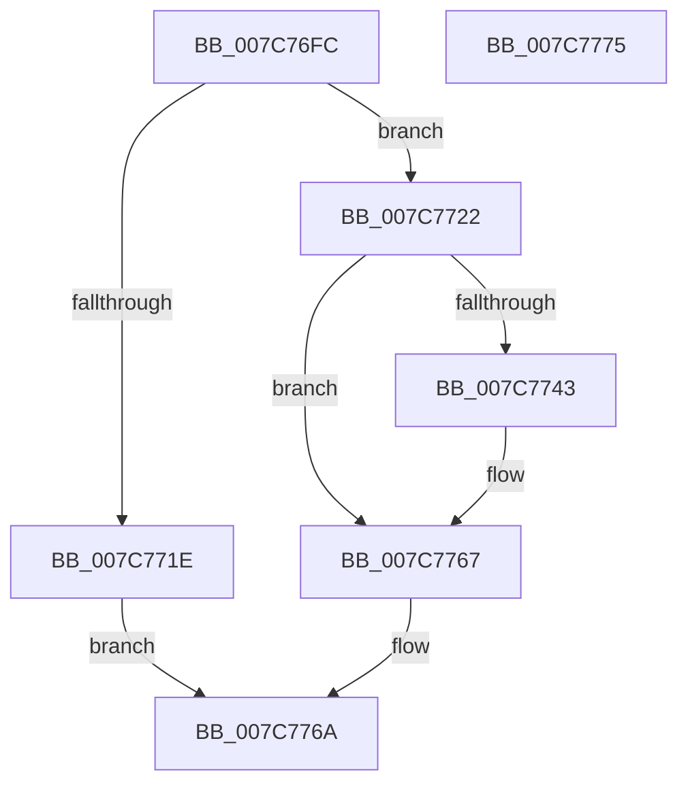

# ExCreatePoolTagTable

- RVA: `0x007C76FC`–`0x007C7776` (길이 `122` bytes)
- VA: `0x00000001407C76FC`
- 실행 섹션: `PAGE`
- PDB 이름 있음: `예`; PDB Function 태그: `아니요`
- unwind 정보 RVA: `0x0005CAAC`
- 디코드: `34`개 명령, `122/122` bytes 표시
- 미해석 바이트: `0` (있으면 어셈블리에 `.byte`로 보존)

> 이 문서는 커널 이미지의 기계어와 PDB 기호를 분석해 생성했습니다. 4번과 5번은 함수 원형과 자료형을 바이너리 사용 방식에서 추정한 C 해석이며 원본 소스 복구 결과는 아닙니다.

## 1. Dependencies

- 직접 호출 지점: **2**; 고유 호출 대상: **2**
- 직접 호출자로 확인된 함수: **2**
- RIP 상대 이미지 참조: **2**

### Outgoing calls
- `0x007C7736` → [MmAllocateIndependentPagesEx](../AA/MmAllocateIndependentPagesEx_function_00AA0CFC.md) (function, `0x00AA0CFC`)
- `0x007C7757` → [memset](../../text/6C/memset_function_006C6C40.md) (function, `0x006C6C40`)

### Direct callers
- [KiStartDynamicProcessor](../74/KiStartDynamicProcessor_function_007456C8.md) at `0x00745837`
- [KeStartAllProcessors](../../init/C3/KeStartAllProcessors_function_00C36F78.md) at `0x00C371C2`

### Static image references
- `0x007C7706` → RVA `0x00EFED50` (`.data`; read)
- `0x007C775C` → RVA `0x00EFAD20` (`.data`; read)

## 2. Other-region calls and transfers

- 다른 실행 섹션으로 향하는 call: **1**
  - `0x007C7757` → [memset](../../text/6C/memset_function_006C6C40.md) (`PAGE` → `.text`)
- 별도 외부 분기/꼬리 이동을 확인하지 못했습니다.

## 3. Assembly (complete function range)

```asm
007C76FC  48 89 5C 24 08                  mov qword ptr [rsp + 8], rbx
007C7701  57                              push rdi
007C7702  48 83 EC 20                     sub rsp, 0x20
007C7706  48 8B 05 43 76 73 00            mov rax, qword ptr [rip + 0x737643]
007C770D  8B F9                           mov edi, ecx
007C770F  48 B9 32 33 33 33 33 33 33 03   movabs rcx, 0x333333333333332
007C7719  48 3B C1                        cmp rax, rcx
007C771C  72 04                           jb 0x1407c7722
007C771E  33 C0                           xor eax, eax
007C7720  EB 48                           jmp 0x1407c776a
007C7722  48 FF C0                        inc rax
007C7725  0F B7 D2                        movzx edx, dx
007C7728  45 33 C9                        xor r9d, r9d
007C772B  45 33 C0                        xor r8d, r8d
007C772E  48 8D 0C 80                     lea rcx, [rax + rax*4]
007C7732  48 C1 E1 04                     shl rcx, 4
007C7736  E8 C1 95 2D 00                  call 0x140aa0cfc
007C773B  48 8B D8                        mov rbx, rax
007C773E  48 85 C0                        test rax, rax
007C7741  74 24                           je 0x1407c7767
007C7743  48 8B 0D 06 76 73 00            mov rcx, qword ptr [rip + 0x737606]
007C774A  33 D2                           xor edx, edx
007C774C  4C 8D 04 89                     lea r8, [rcx + rcx*4]
007C7750  48 8B C8                        mov rcx, rax
007C7753  49 C1 E0 04                     shl r8, 4
007C7757  E8 E4 F4 EF FF                  call 0x1406c6c40
007C775C  48 8D 05 BD 35 73 00            lea rax, [rip + 0x7335bd]
007C7763  48 89 1C F8                     mov qword ptr [rax + rdi*8], rbx
007C7767  48 8B C3                        mov rax, rbx
007C776A  48 8B 5C 24 30                  mov rbx, qword ptr [rsp + 0x30]
007C776F  48 83 C4 20                     add rsp, 0x20
007C7773  5F                              pop rdi
007C7774  C3                              ret
007C7775  CC                              int3
```

## 4. C-style interpretation (structured pseudocode)

```c
__int64 __fastcall ExCreatePoolTagTable(int a1, unsigned __int16 a2, int a3, int a4)
{
    __int64 result;
    __int64 v_rsp;
    unsigned __int64 v_stack_p8;

    v_stack_p8 = v_rbx;
    v_rsp = (v_rsp) - (32);
    if ((*(unsigned __int64 *)(v_rip + 7566915)) < a1) goto loc_007C7722;
    result = 0;
    goto loc_007C776A;
loc_007C7722:
    result = (result) + 1;
    a4 = 0;
    a3 = 0;
    a1 = (result + result * 4) << (4);
    result = MmAllocateIndependentPagesEx(a1, a2, a3, a4);
    if (result != 0) {
        a1 = *(unsigned __int64 *)(v_rip + 7566854);
        a2 = 0;
        a3 = a1 + a1 * 4;
        a1 = result;
        a3 = (a3) << (4);
        result = memset(a1, a2, a3, a4);
        result = v_rip + 7550397;
        *(unsigned __int64 *)(result + (unsigned int)(a1) * 8) = result;
    }
loc_007C776A:
    v_rsp = (v_rsp) + (32);
    return result;
}
```

## 5. (Beta) C Style

```c
int64_t ExCreatePoolTagTable(int32_t Arg1, uint16_t Arg2, int32_t Arg3, int32_t Arg4)
{
    int64_t result;
    int64_t local_rsp;
    uint64_t v_stack_p8;

    v_stack_p8 = local_rbx;
    local_rsp = (local_rsp) - (32);
    if ((*(uint64_t *)(v_rip + 0x737643)) < Arg1) goto loc_007C7722;
    result = 0;
    goto loc_007C776A;
loc_007C7722:
    result = (result) + 1;
    Arg4 = 0;
    Arg3 = 0;
    Arg1 = (result + result * 4) << (4);
    result = MmAllocateIndependentPagesEx(Arg1, Arg2, Arg3, Arg4);
    if (result != 0) {
        Arg1 = *(uint64_t *)(v_rip + 0x737606);
        Arg2 = 0;
        Arg3 = Arg1 + Arg1 * 4;
        Arg1 = result;
        Arg3 = (Arg3) << (4);
        result = memset(Arg1, Arg2, Arg3, Arg4);
        result = v_rip + 7550397;
        *(uint64_t *)(result + (uint32_t)(Arg1) * 8) = result;
    }
loc_007C776A:
    local_rsp = (local_rsp) + (32);
    return result;
}
```

## 6. Execution-region graph

[열기: 2D/3D 그래프와 함수 탐색 컨트롤 패널](../../../control-panel.html?section=page&rva=0x007C76FC&view=graph)

- 2D 그래프는 위에서 아래로 흐르고, 3D 그래프는 빈 공간을 드래그해 회전합니다. Shift+드래그는 이동, 휠은 확대·축소, 함수 노드 선택은 대상 보고서 이동입니다.

### Static fallback


