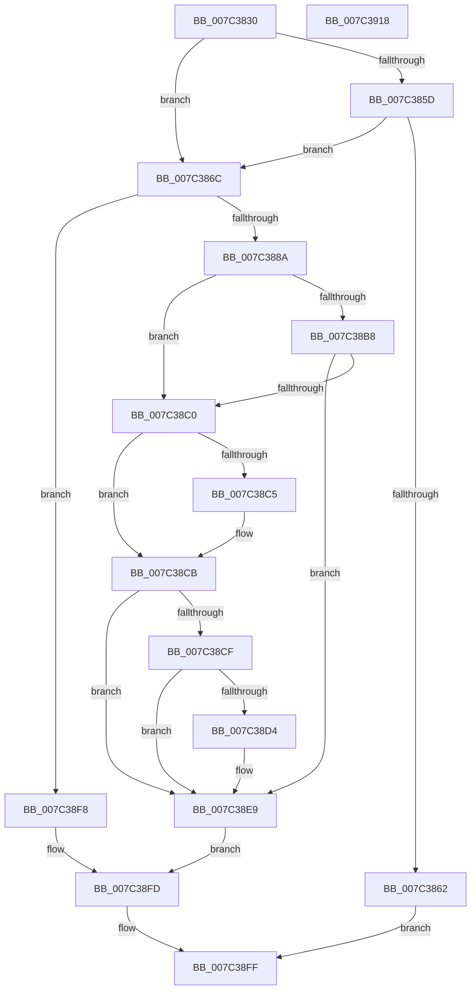

# ExEnumerateSystemFirmwareTables

- RVA: `0x007C3830`–`0x007C3919` (길이 `233` bytes)
- VA: `0x00000001407C3830`
- 실행 섹션: `PAGE`
- PDB 이름 있음: `예`; PDB Function 태그: `아니요`
- unwind 정보 RVA: `0x00095AD0`
- 디코드: `71`개 명령, `233/233` bytes 표시
- 미해석 바이트: `0` (있으면 어셈블리에 `.byte`로 보존)

> 이 문서는 커널 이미지의 기계어와 PDB 기호를 분석해 생성했습니다. 4번과 5번은 함수 원형과 자료형을 바이너리 사용 방식에서 추정한 C 해석이며 원본 소스 복구 결과는 아닙니다.

## 1. Dependencies

- 직접 호출 지점: **4**; 고유 호출 대상: **4**
- 직접 호출자로 확인된 함수: **0**
- RIP 상대 이미지 참조: **0**

### Outgoing calls
- `0x007C387D` → [ExAllocatePool2](../../poolcode/B8/ExAllocatePool2_function_00B820F0.md) (function, `0x00B820F0`)
- `0x007C38A5` → [ExpGetSystemFirmwareTableInformation](../A3/ExpGetSystemFirmwareTableInformation_function_00A38A2C.md) (function, `0x00A38A2C`)
- `0x007C38E4` → [memcpy](../../text/6C/memcpy_function_006C6840.md) (function, `0x006C6840`)
- `0x007C38F1` → [ExFreePoolWithTag](../../poolcode/B8/ExFreePoolWithTag_function_00B82870.md) (function, `0x00B82870`)

### Direct callers
- 이 함수 시작 RVA로 연결되는 직접 call은 확인되지 않았습니다. 간접 호출은 완전히 역산할 수 없습니다.

### Static image references
- 디코드된 RIP-relative 메모리 참조가 없습니다.

## 2. Other-region calls and transfers

- 다른 실행 섹션으로 향하는 call: **3**
  - `0x007C387D` → [ExAllocatePool2](../../poolcode/B8/ExAllocatePool2_function_00B820F0.md) (`PAGE` → `POOLCODE`)
  - `0x007C38E4` → [memcpy](../../text/6C/memcpy_function_006C6840.md) (`PAGE` → `.text`)
  - `0x007C38F1` → [ExFreePoolWithTag](../../poolcode/B8/ExFreePoolWithTag_function_00B82870.md) (`PAGE` → `POOLCODE`)
- 별도 외부 분기/꼬리 이동을 확인하지 못했습니다.

## 3. Assembly (complete function range)

```asm
007C3830  48 8B C4                        mov rax, rsp
007C3833  48 89 58 08                     mov qword ptr [rax + 8], rbx
007C3837  48 89 68 18                     mov qword ptr [rax + 0x18], rbp
007C383B  48 89 70 20                     mov qword ptr [rax + 0x20], rsi
007C383F  57                              push rdi
007C3840  41 56                           push r14
007C3842  41 57                           push r15
007C3844  48 83 EC 20                     sub rsp, 0x20
007C3848  83 60 10 00                     and dword ptr [rax + 0x10], 0
007C384C  4D 8B F1                        mov r14, r9
007C384F  41 8B F8                        mov edi, r8d
007C3852  48 8B F2                        mov rsi, rdx
007C3855  44 8B F9                        mov r15d, ecx
007C3858  48 85 D2                        test rdx, rdx
007C385B  75 0F                           jne 0x1407c386c
007C385D  45 85 C0                        test r8d, r8d
007C3860  74 0A                           je 0x1407c386c
007C3862  B8 0D 00 00 C0                  mov eax, 0xc000000d
007C3867  E9 93 00 00 00                  jmp 0x1407c38ff
007C386C  41 8D 68 10                     lea ebp, [r8 + 0x10]
007C3870  B9 00 01 00 00                  mov ecx, 0x100
007C3875  8B D5                           mov edx, ebp
007C3877  41 B8 41 52 46 54               mov r8d, 0x54465241
007C387D  E8 6E E8 3B 00                  call 0x140b820f0
007C3882  48 8B D8                        mov rbx, rax
007C3885  48 85 C0                        test rax, rax
007C3888  74 6E                           je 0x1407c38f8
007C388A  83 60 04 00                     and dword ptr [rax + 4], 0
007C388E  4C 8D 4C 24 48                  lea r9, [rsp + 0x48]
007C3893  83 60 08 00                     and dword ptr [rax + 8], 0
007C3897  44 8B C5                        mov r8d, ebp
007C389A  33 D2                           xor edx, edx
007C389C  89 78 0C                        mov dword ptr [rax + 0xc], edi
007C389F  48 8B C8                        mov rcx, rax
007C38A2  44 89 38                        mov dword ptr [rax], r15d
007C38A5  E8 82 51 27 00                  call 0x140a38a2c
007C38AA  8B F8                           mov edi, eax
007C38AC  B8 00 00 00 80                  mov eax, 0x80000000
007C38B1  8D 0C 07                        lea ecx, [rdi + rax]
007C38B4  85 C8                           test eax, ecx
007C38B6  75 08                           jne 0x1407c38c0
007C38B8  81 FF 23 00 00 C0               cmp edi, 0xc0000023
007C38BE  75 29                           jne 0x1407c38e9
007C38C0  4D 85 F6                        test r14, r14
007C38C3  74 06                           je 0x1407c38cb
007C38C5  8B 4B 0C                        mov ecx, dword ptr [rbx + 0xc]
007C38C8  41 89 0E                        mov dword ptr [r14], ecx
007C38CB  85 FF                           test edi, edi
007C38CD  78 1A                           js 0x1407c38e9
007C38CF  48 85 F6                        test rsi, rsi
007C38D2  74 15                           je 0x1407c38e9
007C38D4  44 8B 44 24 48                  mov r8d, dword ptr [rsp + 0x48]
007C38D9  48 8D 53 10                     lea rdx, [rbx + 0x10]
007C38DD  41 83 C0 F0                     add r8d, -0x10
007C38E1  48 8B CE                        mov rcx, rsi
007C38E4  E8 57 2F F0 FF                  call 0x1406c6840
007C38E9  BA 41 52 46 54                  mov edx, 0x54465241
007C38EE  48 8B CB                        mov rcx, rbx
007C38F1  E8 7A EF 3B 00                  call 0x140b82870
007C38F6  EB 05                           jmp 0x1407c38fd
007C38F8  BF 9A 00 00 C0                  mov edi, 0xc000009a
007C38FD  8B C7                           mov eax, edi
007C38FF  48 8B 5C 24 40                  mov rbx, qword ptr [rsp + 0x40]
007C3904  48 8B 6C 24 50                  mov rbp, qword ptr [rsp + 0x50]
007C3909  48 8B 74 24 58                  mov rsi, qword ptr [rsp + 0x58]
007C390E  48 83 C4 20                     add rsp, 0x20
007C3912  41 5F                           pop r15
007C3914  41 5E                           pop r14
007C3916  5F                              pop rdi
007C3917  C3                              ret
007C3918  CC                              int3
```

## 4. C-style interpretation (structured pseudocode)

```c
__int64 __fastcall ExEnumerateSystemFirmwareTables(int a1, __int64 a2, __int64 a3, __int64 a4)
{
    __int64 result;
    __int64 v_rsp;
    unsigned __int64 v_stack_p10;
    unsigned __int64 v_stack_p18;
    unsigned __int64 v_stack_p20;
    unsigned __int64 v_stack_p8;

    *(unsigned __int64 *)(v_rsp + 8) = v_rbx;
    *(unsigned __int64 *)(v_rsp + 24) = v_rbp;
    *(unsigned __int64 *)(v_rsp + 32) = v_rsi;
    v_rsp = (v_rsp) - (32);
    if (a2 != 0) goto loc_007C386C;
    if ((unsigned int)(a3) == 0) goto loc_007C386C;
    goto loc_007C38FF;
loc_007C386C:
    result = ExAllocatePool2(256, (unsigned int)((unsigned int)(a3 + 16)), (unsigned int)(0x54465241ULL), a4);
    if (result == 0) goto loc_007C38F8;
    a2 = 0;
    *(unsigned int *)(result + 12) = (unsigned int)((unsigned int)((unsigned int)(a3)));
    *(unsigned int *)(result) = (unsigned int)((unsigned int)(a1));
    result = ExpGetSystemFirmwareTableInformation(result, a2, (unsigned int)((unsigned int)(a3 + 16)), v_stack_p10);
    if ((((unsigned int)((unsigned int)(0x80000000ULL))) & ((unsigned int)((unsigned int)((unsigned int)(result)) + (unsigned int)(0x80000000ULL) * 1))) != 0) goto loc_007C38C0;
    if (((unsigned int)((unsigned int)((unsigned int)(result)))) != 0xC0000023ULL) goto loc_007C38E9;
loc_007C38C0:
    if (a4 != 0) {
        a1 = *(unsigned int *)(result + 12);
        *(unsigned int *)(a4) = a1;
    }
    if (sign_flag) goto loc_007C38E9;
    result = (unsigned int)(0x80000000ULL);
    if (0 != 0) {
        a3 = v_stack_p10;
        a2 = result + 16;
        a3 = (unsigned int)((a3) + (-16));
        a1 = a2;
        result = memcpy(a1, a2, a3, v_stack_p10);
    }
    result = ExFreePoolWithTag(result, (unsigned int)(0x54465241ULL), a3, v_stack_p10);
    goto loc_007C38FD;
loc_007C38F8:
loc_007C38FD:
loc_007C38FF:
    v_rsp = (v_rsp) + (32);
    return (unsigned int)((unsigned int)((unsigned int)(0xC000009AULL)));
}
```

## 5. (Beta) C Style

```c
int64_t ExEnumerateSystemFirmwareTables(int32_t Arg1, int64_t Arg2, int64_t Arg3, int64_t Arg4)
{
    int64_t result;
    int64_t local_rsp;
    uint64_t v_stack_p10;
    uint64_t v_stack_p18;
    uint64_t v_stack_p20;
    uint64_t v_stack_p8;

    *(uint64_t *)(local_rsp + 0x8) = local_rbx;
    *(uint64_t *)(local_rsp + 0x18) = local_rbp;
    *(uint64_t *)(local_rsp + 0x20) = local_rsi;
    local_rsp = (local_rsp) - (32);
    if (Arg2 != 0) goto loc_007C386C;
    if ((uint32_t)(Arg3) == 0) goto loc_007C386C;
    goto loc_007C38FF;
loc_007C386C:
    result = ExAllocatePool2(256, (uint32_t)((uint32_t)(Arg3 + 16)), (uint32_t)(0x54465241ULL), Arg4);
    if (result == 0) goto loc_007C38F8;
    Arg2 = 0;
    *(uint32_t *)(result + 0xC) = (uint32_t)((uint32_t)((uint32_t)(Arg3)));
    *(uint32_t *)(result) = (uint32_t)((uint32_t)(Arg1));
    result = ExpGetSystemFirmwareTableInformation(result, Arg2, (uint32_t)((uint32_t)(Arg3 + 16)), v_stack_p10);
    if ((((uint32_t)((uint32_t)(0x80000000ULL))) & ((uint32_t)((uint32_t)((uint32_t)(result)) + (uint32_t)(0x80000000ULL) * 1))) != 0) goto loc_007C38C0;
    if (((uint32_t)((uint32_t)((uint32_t)(result)))) != 0xC0000023ULL) goto loc_007C38E9;
loc_007C38C0:
    if (Arg4 != 0) {
        Arg1 = *(uint32_t *)(result + 0xC);
        *(uint32_t *)(Arg4) = Arg1;
    }
    if (sign_flag) goto loc_007C38E9;
    result = (uint32_t)(0x80000000ULL);
    if (0 != 0) {
        Arg3 = v_stack_p10;
        Arg2 = result + 16;
        Arg3 = (uint32_t)((Arg3) + (-16));
        Arg1 = Arg2;
        result = memcpy(Arg1, Arg2, Arg3, v_stack_p10);
    }
    result = ExFreePoolWithTag(result, (uint32_t)(0x54465241ULL), Arg3, v_stack_p10);
    goto loc_007C38FD;
loc_007C38F8:
loc_007C38FD:
loc_007C38FF:
    local_rsp = (local_rsp) + (32);
    return (uint32_t)((uint32_t)((uint32_t)(0xC000009AULL)));
}
```

## 6. Execution-region graph

[열기: 2D/3D 그래프와 함수 탐색 컨트롤 패널](../../../control-panel.html?section=page&rva=0x007C3830&view=graph)

- 2D 그래프는 위에서 아래로 흐르고, 3D 그래프는 빈 공간을 드래그해 회전합니다. Shift+드래그는 이동, 휠은 확대·축소, 함수 노드 선택은 대상 보고서 이동입니다.

### Static fallback


