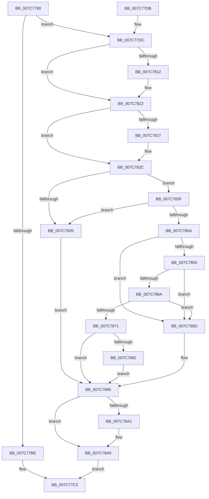

# ExFetchLicenseData

- RVA: `0x007C7780`–`0x007C78BF` (길이 `319` bytes)
- VA: `0x00000001407C7780`
- 실행 섹션: `PAGE`
- PDB 이름 있음: `아니요`; PDB Function 태그: `아니요`
- unwind 정보 RVA: `0x000D5024`
- 디코드: `90`개 명령, `319/319` bytes 표시
- 미해석 바이트: `0` (있으면 어셈블리에 `.byte`로 보존)

> 이 문서는 커널 이미지의 기계어와 PDB 기호를 분석해 생성했습니다. 4번과 5번은 함수 원형과 자료형을 바이너리 사용 방식에서 추정한 C 해석이며 원본 소스 복구 결과는 아닙니다.

## 1. Dependencies

- 직접 호출 지점: **7**; 고유 호출 대상: **7**
- 직접 호출자로 확인된 함수: **0**
- RIP 상대 이미지 참조: **0**

### Outgoing calls
- `0x007C77A8` → [PsGetCurrentServerSiloGlobals](../../text/2F/PsGetCurrentServerSiloGlobals_function_002FE1F0.md) (function, `0x002FE1F0`)
- `0x007C77FC` → [KeAbPreAcquire](../../text/21/KeAbPreAcquire_function_00210230.md) (function, `0x00210230`)
- `0x007C781D` → [ExfAcquirePushLockSharedEx](../../text/21/ExfAcquirePushLockSharedEx_function_0021044C.md) (function, `0x0021044C`)
- `0x007C7877` → [memcpy](../../text/6C/memcpy_function_006C6840.md) (function, `0x006C6840`)
- `0x007C78A4` → [ExfReleasePushLockShared](../../text/26/ExfReleasePushLockShared_function_00263440.md) (function, `0x00263440`)
- `0x007C78AC` → [KeAbPostRelease](../../text/2E/KeAbPostRelease_function_002E1600.md) (function, `0x002E1600`)
- `0x007C78B1` → [KeLeaveCriticalRegion](../../text/25/KeLeaveCriticalRegion_function_0025D8B0.md) (function, `0x0025D8B0`)

### Direct callers
- 이 함수 시작 RVA로 연결되는 직접 call은 확인되지 않았습니다. 간접 호출은 완전히 역산할 수 없습니다.

### Static image references
- 디코드된 RIP-relative 메모리 참조가 없습니다.

## 2. Other-region calls and transfers

- 다른 실행 섹션으로 향하는 call: **7**
  - `0x007C77A8` → [PsGetCurrentServerSiloGlobals](../../text/2F/PsGetCurrentServerSiloGlobals_function_002FE1F0.md) (`PAGE` → `.text`)
  - `0x007C77FC` → [KeAbPreAcquire](../../text/21/KeAbPreAcquire_function_00210230.md) (`PAGE` → `.text`)
  - `0x007C781D` → [ExfAcquirePushLockSharedEx](../../text/21/ExfAcquirePushLockSharedEx_function_0021044C.md) (`PAGE` → `.text`)
  - `0x007C7877` → [memcpy](../../text/6C/memcpy_function_006C6840.md) (`PAGE` → `.text`)
  - `0x007C78A4` → [ExfReleasePushLockShared](../../text/26/ExfReleasePushLockShared_function_00263440.md) (`PAGE` → `.text`)
  - `0x007C78AC` → [KeAbPostRelease](../../text/2E/KeAbPostRelease_function_002E1600.md) (`PAGE` → `.text`)
  - `0x007C78B1` → [KeLeaveCriticalRegion](../../text/25/KeLeaveCriticalRegion_function_0025D8B0.md) (`PAGE` → `.text`)
- 별도 외부 분기/꼬리 이동을 확인하지 못했습니다.

## 3. Assembly (complete function range)

```asm
007C7780  48 89 5C 24 08                  mov qword ptr [rsp + 8], rbx
007C7785  48 89 74 24 10                  mov qword ptr [rsp + 0x10], rsi
007C778A  57                              push rdi
007C778B  41 54                           push r12
007C778D  41 55                           push r13
007C778F  41 56                           push r14
007C7791  41 57                           push r15
007C7793  48 83 EC 30                     sub rsp, 0x30
007C7797  4D 8B E0                        mov r12, r8
007C779A  44 8B F2                        mov r14d, edx
007C779D  48 8B F9                        mov rdi, rcx
007C77A0  45 33 ED                        xor r13d, r13d
007C77A3  44 89 6C 24 70                  mov dword ptr [rsp + 0x70], r13d
007C77A8  E8 43 6A B3 FF                  call 0x1402fe1f0
007C77AD  48 8B B0 68 03 00 00            mov rsi, qword ptr [rax + 0x368]
007C77B4  48 89 74 24 78                  mov qword ptr [rsp + 0x78], rsi
007C77B9  4D 85 C0                        test r8, r8
007C77BC  75 1E                           jne 0x1407c77dc
007C77BE  B8 0D 00 00 C0                  mov eax, 0xc000000d
007C77C3  48 8B 5C 24 60                  mov rbx, qword ptr [rsp + 0x60]
007C77C8  48 8B 74 24 68                  mov rsi, qword ptr [rsp + 0x68]
007C77CD  48 83 C4 30                     add rsp, 0x30
007C77D1  41 5F                           pop r15
007C77D3  41 5E                           pop r14
007C77D5  41 5D                           pop r13
007C77D7  41 5C                           pop r12
007C77D9  5F                              pop rdi
007C77DA  C3                              ret
007C77DB  CC                              int3
007C77DC  65 48 8B 04 25 88 01 00 00      mov rax, qword ptr gs:[0x188]
007C77E5  66 FF 88 E4 01 00 00            dec word ptr [rax + 0x1e4]
007C77EC  90                              nop
007C77ED  48 8D 9E F8 B6 00 00            lea rbx, [rsi + 0xb6f8]
007C77F4  45 33 C0                        xor r8d, r8d
007C77F7  33 D2                           xor edx, edx
007C77F9  48 8B CB                        mov rcx, rbx
007C77FC  E8 2F 8A A4 FF                  call 0x140210230
007C7801  4C 8B F8                        mov r15, rax
007C7804  B9 11 00 00 00                  mov ecx, 0x11
007C7809  33 C0                           xor eax, eax
007C780B  F0 48 0F B1 0B                  lock cmpxchg qword ptr [rbx], rcx
007C7810  74 10                           je 0x1407c7822
007C7812  4C 8B CB                        mov r9, rbx
007C7815  4D 8B C7                        mov r8, r15
007C7818  33 D2                           xor edx, edx
007C781A  48 8B CB                        mov rcx, rbx
007C781D  E8 2A 8C A4 FF                  call 0x14021044c
007C7822  4D 85 FF                        test r15, r15
007C7825  74 05                           je 0x1407c782c
007C7827  41 C6 47 0A 01                  mov byte ptr [r15 + 0xa], 1
007C782C  44 38 AE 90 B7 00 00            cmp byte ptr [rsi + 0xb790], r13b
007C7833  74 0A                           je 0x1407c783f
007C7835  C7 44 24 70 E5 00 00 C0         mov dword ptr [rsp + 0x70], 0xc00000e5
007C783D  EB 56                           jmp 0x1407c7895
007C783F  48 8B 96 F0 B6 00 00            mov rdx, qword ptr [rsi + 0xb6f0]
007C7846  48 8B 06                        mov rax, qword ptr [rsi]
007C7849  48 85 C0                        test rax, rax
007C784C  48 0F 45 D0                     cmovne rdx, rax
007C7850  48 89 54 24 28                  mov qword ptr [rsp + 0x28], rdx
007C7855  48 85 D2                        test rdx, rdx
007C7858  74 DB                           je 0x1407c7835
007C785A  8B 02                           mov eax, dword ptr [rdx]
007C785C  41 89 04 24                     mov dword ptr [r12], eax
007C7860  48 85 FF                        test rdi, rdi
007C7863  74 28                           je 0x1407c788d
007C7865  45 85 F6                        test r14d, r14d
007C7868  74 23                           je 0x1407c788d
007C786A  8B 02                           mov eax, dword ptr [rdx]
007C786C  44 3B F0                        cmp r14d, eax
007C786F  72 1C                           jb 0x1407c788d
007C7871  44 8B C0                        mov r8d, eax
007C7874  48 8B CF                        mov rcx, rdi
007C7877  E8 C4 EF EF FF                  call 0x1406c6840
007C787C  41 83 FE 14                     cmp r14d, 0x14
007C7880  72 13                           jb 0x1407c7895
007C7882  8B 47 0C                        mov eax, dword ptr [rdi + 0xc]
007C7885  83 E0 FE                        and eax, 0xfffffffe
007C7888  89 47 0C                        mov dword ptr [rdi + 0xc], eax
007C788B  EB 08                           jmp 0x1407c7895
007C788D  C7 44 24 70 23 00 00 C0         mov dword ptr [rsp + 0x70], 0xc0000023
007C7895  B8 11 00 00 00                  mov eax, 0x11
007C789A  F0 4C 0F B1 2B                  lock cmpxchg qword ptr [rbx], r13
007C789F  74 08                           je 0x1407c78a9
007C78A1  48 8B CB                        mov rcx, rbx
007C78A4  E8 97 BB A9 FF                  call 0x140263440
007C78A9  48 8B CB                        mov rcx, rbx
007C78AC  E8 4F 9D B1 FF                  call 0x1402e1600
007C78B1  E8 FA 5F A9 FF                  call 0x14025d8b0
007C78B6  8B 44 24 70                     mov eax, dword ptr [rsp + 0x70]
007C78BA  E9 04 FF FF FF                  jmp 0x1407c77c3
```

## 4. C-style interpretation (structured pseudocode)

```c
__int64 __fastcall ExFetchLicenseData(__int64 a1, int a2, __int64 a3)
{
    __int64 result;
    __int64 v_r13;
    __int64 v_rsp;
    unsigned __int64 v_stack_p10;
    unsigned int v_stack_p18;
    unsigned __int64 v_stack_p20;
    unsigned __int64 v_stack_p28;
    unsigned int v_stack_p70;
    unsigned __int64 v_stack_p8;

    v_stack_p8 = v_rbx;
    v_stack_p10 = v_rsi;
    v_rsp = (v_rsp) - (48);
    v_r13 = 0;
    v_stack_p18 = 0;
    result = PsGetCurrentServerSiloGlobals(a1, a2, a3, a4);
    v_stack_p20 = *(unsigned __int64 *)(result + 872);
    if (a3 != 0) goto loc_007C77DC;
loc_007C77C3:
    v_rsp = (v_rsp) + (48);
    return (unsigned int)(0xC000000DULL);
loc_007C77DC:
    a3 = 0;
    a2 = 0;
    result = KeAbPreAcquire(v_stack_p10 + 46840, a2, a3, a4);
    result = 0;
    if (!(condition_is_equal)) {
        a4 = v_stack_p10 + 46840;
        a3 = 0;
        a2 = 0;
        a1 = v_stack_p10 + 46840;
        result = ExfAcquirePushLockSharedEx(a1, a2, a3, a4);
    }
    if (result != 0) {
        *(unsigned __int8 *)(result + 10) = 1;
    }
    if ((*(unsigned __int8 *)(v_stack_p10 + 46992)) == 0) goto loc_007C783F;
loc_007C7835:
    v_stack_p70 = 0xC00000E5ULL;
    goto loc_007C7895;
loc_007C783F:
    a2 = *(unsigned __int64 *)(v_stack_p10 + 46832);
    if (*(unsigned __int64 *)(v_stack_p10) != 0) { a2 = *(unsigned __int64 *)(v_stack_p10); }
    v_stack_p28 = a2;
    if (a2 == 0) goto loc_007C7835;
    *(unsigned int *)(a3) = (unsigned int)((unsigned int)(*(unsigned int *)(a2)));
    if (a1 == 0) goto loc_007C788D;
    if ((unsigned int)((unsigned int)(a2)) == 0) goto loc_007C788D;
    if (((unsigned int)((unsigned int)(a2))) < ((unsigned int)((unsigned int)(*(unsigned int *)(a2))))) goto loc_007C788D;
    result = memcpy(a1, a2, (unsigned int)((unsigned int)((unsigned int)(*(unsigned int *)(a2)))), a4);
    if (((unsigned int)((unsigned int)(a2))) < 20) goto loc_007C7895;
    result = (unsigned int)(((unsigned int)(*(unsigned int *)(a1 + 12))) & (0xFFFFFFFEULL));
    *(unsigned int *)(a1 + 12) = (unsigned int)(result);
    goto loc_007C7895;
loc_007C788D:
    v_stack_p70 = 0xC0000023ULL;
loc_007C7895:
    result = 17;
    if (!(condition_is_equal)) {
        a1 = v_stack_p10 + 46840;
        result = ExfReleasePushLockShared(a1, a2, (unsigned int)((unsigned int)((unsigned int)(*(unsigned int *)(a2)))), a4);
    }
    result = KeAbPostRelease(v_stack_p10 + 46840, a2, (unsigned int)((unsigned int)((unsigned int)(*(unsigned int *)(a2)))), a4);
    result = KeLeaveCriticalRegion(v_stack_p10 + 46840, a2, (unsigned int)((unsigned int)((unsigned int)(*(unsigned int *)(a2)))), a4);
    goto loc_007C77C3;
}
```

## 5. (Beta) C Style

```c
int64_t ExFetchLicenseData(int64_t Arg1, int32_t Arg2, void *Arg3)
{
    uint8_t *arg3 = (uint8_t *)Arg3;

    int64_t result;
    int64_t local_r13;
    int64_t local_rsp;
    uint64_t v_stack_p10;
    uint32_t v_stack_p18;
    uint64_t v_stack_p20;
    uint64_t v_stack_p28;
    uint32_t v_stack_p70;
    uint64_t v_stack_p8;

    v_stack_p8 = local_rbx;
    v_stack_p10 = local_rsi;
    local_rsp = (local_rsp) - (48);
    local_r13 = 0;
    v_stack_p18 = 0;
    result = PsGetCurrentServerSiloGlobals(Arg1, Arg2, Arg3, a4);
    v_stack_p20 = *(uint64_t *)(result + 0x368);
    if (Arg3 != NULL) goto loc_007C77DC;
loc_007C77C3:
    local_rsp = (local_rsp) + (48);
    return (uint32_t)(0xC000000DULL);
loc_007C77DC:
    Arg3 = 0;
    Arg2 = 0;
    result = KeAbPreAcquire(v_stack_p10 + 46840, Arg2, Arg3, a4);
    result = 0;
    if (!(condition_is_equal)) {
        a4 = v_stack_p10 + 46840;
        Arg3 = 0;
        Arg2 = 0;
        Arg1 = v_stack_p10 + 46840;
        result = ExfAcquirePushLockSharedEx(Arg1, Arg2, Arg3, a4);
    }
    if (result != 0) {
        *(uint8_t *)(result + 0xA) = 1;
    }
    if ((*(uint8_t *)(v_stack_p10 + 0xB790)) == 0) goto loc_007C783F;
loc_007C7835:
    v_stack_p70 = 0xC00000E5ULL;
    goto loc_007C7895;
loc_007C783F:
    Arg2 = *(uint64_t *)(v_stack_p10 + 0xB6F0);
    if (*(uint64_t *)(v_stack_p10) != 0) { Arg2 = *(uint64_t *)(v_stack_p10); }
    v_stack_p28 = Arg2;
    if (Arg2 == 0) goto loc_007C7835;
    *(uint32_t *)(arg3) = (uint32_t)((uint32_t)(*(uint32_t *)(Arg2)));
    if (Arg1 == 0) goto loc_007C788D;
    if ((uint32_t)((uint32_t)(Arg2)) == 0) goto loc_007C788D;
    if (((uint32_t)((uint32_t)(Arg2))) < ((uint32_t)((uint32_t)(*(uint32_t *)(Arg2))))) goto loc_007C788D;
    result = memcpy(Arg1, Arg2, (uint32_t)((uint32_t)((uint32_t)(*(uint32_t *)(Arg2)))), a4);
    if (((uint32_t)((uint32_t)(Arg2))) < 20) goto loc_007C7895;
    result = (uint32_t)(((uint32_t)(*(uint32_t *)(Arg1 + 0xC))) & (0xFFFFFFFEULL));
    *(uint32_t *)(Arg1 + 0xC) = (uint32_t)(result);
    goto loc_007C7895;
loc_007C788D:
    v_stack_p70 = 0xC0000023ULL;
loc_007C7895:
    result = 17;
    if (!(condition_is_equal)) {
        Arg1 = v_stack_p10 + 46840;
        result = ExfReleasePushLockShared(Arg1, Arg2, (uint32_t)((uint32_t)((uint32_t)(*(uint32_t *)(Arg2)))), a4);
    }
    result = KeAbPostRelease(v_stack_p10 + 46840, Arg2, (uint32_t)((uint32_t)((uint32_t)(*(uint32_t *)(Arg2)))), a4);
    result = KeLeaveCriticalRegion(v_stack_p10 + 46840, Arg2, (uint32_t)((uint32_t)((uint32_t)(*(uint32_t *)(Arg2)))), a4);
    goto loc_007C77C3;
}
```

### 관측된 메모리 오프셋

구조체 형식이 확인되지 않은 접근은 인자 기준의 오프셋으로만 기록했습니다.

| 기준 인자 | 오프셋 표현 | 폭 (bit) | 접근 |
|---|---:|---:|---|
| `Arg3` | `+ 0x0` | `32` | `W` |

## 6. Execution-region graph

[열기: 2D/3D 그래프와 함수 탐색 컨트롤 패널](../../../control-panel.html?section=page&rva=0x007C7780&view=graph)

- 2D 그래프는 위에서 아래로 흐르고, 3D 그래프는 빈 공간을 드래그해 회전합니다. Shift+드래그는 이동, 휠은 확대·축소, 함수 노드 선택은 대상 보고서 이동입니다.

### Static fallback


