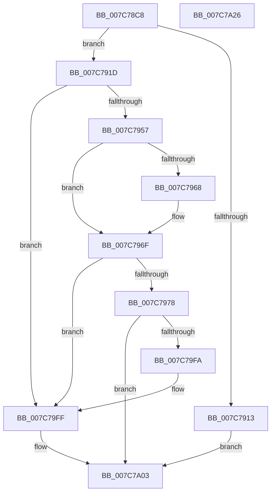

# ExGetExpirationDate

- RVA: `0x007C78C8`–`0x007C7A27` (길이 `351` bytes)
- VA: `0x00000001407C78C8`
- 실행 섹션: `PAGE`
- PDB 이름 있음: `예`; PDB Function 태그: `아니요`
- unwind 정보 RVA: `0x000C7508`
- 디코드: `95`개 명령, `351/351` bytes 표시
- 미해석 바이트: `0` (있으면 어셈블리에 `.byte`로 보존)

> 이 문서는 커널 이미지의 기계어와 PDB 기호를 분석해 생성했습니다. 4번과 5번은 함수 원형과 자료형을 바이너리 사용 방식에서 추정한 C 해석이며 원본 소스 복구 결과는 아닙니다.

## 1. Dependencies

- 직접 호출 지점: **4**; 고유 호출 대상: **4**
- 직접 호출자로 확인된 함수: **2**
- RIP 상대 이미지 참조: **2**

### Outgoing calls
- `0x007C7928` → [RtlInitUnicodeString](../../text/42/RtlInitUnicodeString_function_0042A780.md) (function, `0x0042A780`)
- `0x007C7948` → [ZwQueryLicenseValue](../../text/6A/ZwQueryLicenseValue_function_006AFCF0.md) (function, `0x006AFCF0`)
- `0x007C79F1` → [RtlTimeFieldsToTime](../../text/42/RtlTimeFieldsToTime_function_0042E6B0.md) (function, `0x0042E6B0`)
- `0x007C7A0C` → [_security_check_cookie](../../text/6A/_security_check_cookie_function_006AC640.md) (function, `0x006AC640`)

### Direct callers
- [sub_009669C4](../96/Unknown_function_009669C4.md) at `0x00966D9A`
- [ExInitializeTimeRefresh](../../init/C5/ExInitializeTimeRefresh_function_00C51090.md) at `0x00C510B0`

### Static image references
- `0x007C78DF` → RVA `0x00E0A740` (`.data`; read)
- `0x007C791D` → RVA `0x00B086D0` (` ?? ::NNGAKEGL::`string'`; read)

## 2. Other-region calls and transfers

- 다른 실행 섹션으로 향하는 call: **4**
  - `0x007C7928` → [RtlInitUnicodeString](../../text/42/RtlInitUnicodeString_function_0042A780.md) (`PAGE` → `.text`)
  - `0x007C7948` → [ZwQueryLicenseValue](../../text/6A/ZwQueryLicenseValue_function_006AFCF0.md) (`PAGE` → `.text`)
  - `0x007C79F1` → [RtlTimeFieldsToTime](../../text/42/RtlTimeFieldsToTime_function_0042E6B0.md) (`PAGE` → `.text`)
  - `0x007C7A0C` → [_security_check_cookie](../../text/6A/_security_check_cookie_function_006AC640.md) (`PAGE` → `.text`)
- 별도 외부 분기/꼬리 이동을 확인하지 못했습니다.

## 3. Assembly (complete function range)

```asm
007C78C8  48 89 5C 24 10                  mov qword ptr [rsp + 0x10], rbx
007C78CD  48 89 7C 24 18                  mov qword ptr [rsp + 0x18], rdi
007C78D2  55                              push rbp
007C78D3  48 8D 6C 24 A9                  lea rbp, [rsp - 0x57]
007C78D8  48 81 EC 90 00 00 00            sub rsp, 0x90
007C78DF  48 8B 05 5A 2E 64 00            mov rax, qword ptr [rip + 0x642e5a]
007C78E6  48 33 C4                        xor rax, rsp
007C78E9  48 89 45 47                     mov qword ptr [rbp + 0x47], rax
007C78ED  83 65 13 00                     and dword ptr [rbp + 0x13], 0
007C78F1  0F 57 C0                        xorps xmm0, xmm0
007C78F4  83 65 FF 00                     and dword ptr [rbp - 1], 0
007C78F8  0F 57 C9                        xorps xmm1, xmm1
007C78FB  83 65 FB 00                     and dword ptr [rbp - 5], 0
007C78FF  48 8B F9                        mov rdi, rcx
007C7902  0F 11 45 17                     movups xmmword ptr [rbp + 0x17], xmm0
007C7906  0F 11 4D 27                     movups xmmword ptr [rbp + 0x27], xmm1
007C790A  0F 11 45 37                     movups xmmword ptr [rbp + 0x37], xmm0
007C790E  48 85 C9                        test rcx, rcx
007C7911  75 0A                           jne 0x1407c791d
007C7913  BB 0D 00 00 C0                  mov ebx, 0xc000000d
007C7918  E9 E6 00 00 00                  jmp 0x1407c7a03
007C791D  48 8D 15 AC 0D 34 00            lea rdx, [rip + 0x340dac]
007C7924  48 8D 4D 17                     lea rcx, [rbp + 0x17]
007C7928  E8 53 2E C6 FF                  call 0x14042a780
007C792D  48 8D 45 FB                     lea rax, [rbp - 5]
007C7931  41 B9 10 00 00 00               mov r9d, 0x10
007C7937  4C 8D 45 27                     lea r8, [rbp + 0x27]
007C793B  48 89 44 24 20                  mov qword ptr [rsp + 0x20], rax
007C7940  48 8D 55 FF                     lea rdx, [rbp - 1]
007C7944  48 8D 4D 17                     lea rcx, [rbp + 0x17]
007C7948  E8 A3 83 EE FF                  call 0x1406afcf0
007C794D  8B D8                           mov ebx, eax
007C794F  85 C0                           test eax, eax
007C7951  0F 88 A8 00 00 00               js 0x1407c79ff
007C7957  48 8B 4D 37                     mov rcx, qword ptr [rbp + 0x37]
007C795B  48 8B 45 27                     mov rax, qword ptr [rbp + 0x27]
007C795F  48 8B 55 2F                     mov rdx, qword ptr [rbp + 0x2f]
007C7963  48 2B C8                        sub rcx, rax
007C7966  75 07                           jne 0x1407c796f
007C7968  48 8B 4D 3F                     mov rcx, qword ptr [rbp + 0x3f]
007C796C  48 2B CA                        sub rcx, rdx
007C796F  48 85 C9                        test rcx, rcx
007C7972  0F 84 87 00 00 00               je 0x1407c79ff
007C7978  88 45 F7                        mov byte ptr [rbp - 9], al
007C797B  48 8D 4D 07                     lea rcx, [rbp + 7]
007C797F  8A 45 28                        mov al, byte ptr [rbp + 0x28]
007C7982  88 45 F8                        mov byte ptr [rbp - 8], al
007C7985  0F B7 45 F7                     movzx eax, word ptr [rbp - 9]
007C7989  66 89 45 07                     mov word ptr [rbp + 7], ax
007C798D  8A 45 29                        mov al, byte ptr [rbp + 0x29]
007C7990  88 45 F7                        mov byte ptr [rbp - 9], al
007C7993  8A 45 2A                        mov al, byte ptr [rbp + 0x2a]
007C7996  88 45 F8                        mov byte ptr [rbp - 8], al
007C7999  0F B7 45 F7                     movzx eax, word ptr [rbp - 9]
007C799D  66 89 45 09                     mov word ptr [rbp + 9], ax
007C79A1  8A 45 2B                        mov al, byte ptr [rbp + 0x2b]
007C79A4  88 45 F7                        mov byte ptr [rbp - 9], al
007C79A7  8A 45 2C                        mov al, byte ptr [rbp + 0x2c]
007C79AA  88 45 F8                        mov byte ptr [rbp - 8], al
007C79AD  0F B7 45 F7                     movzx eax, word ptr [rbp - 9]
007C79B1  66 89 45 0B                     mov word ptr [rbp + 0xb], ax
007C79B5  8A 45 2D                        mov al, byte ptr [rbp + 0x2d]
007C79B8  88 45 F7                        mov byte ptr [rbp - 9], al
007C79BB  8A 45 2E                        mov al, byte ptr [rbp + 0x2e]
007C79BE  88 45 F8                        mov byte ptr [rbp - 8], al
007C79C1  0F B7 45 F7                     movzx eax, word ptr [rbp - 9]
007C79C5  66 89 45 0D                     mov word ptr [rbp + 0xd], ax
007C79C9  8A 45 30                        mov al, byte ptr [rbp + 0x30]
007C79CC  88 45 F8                        mov byte ptr [rbp - 8], al
007C79CF  88 55 F7                        mov byte ptr [rbp - 9], dl
007C79D2  48 8B D7                        mov rdx, rdi
007C79D5  0F B7 45 F7                     movzx eax, word ptr [rbp - 9]
007C79D9  66 89 45 0F                     mov word ptr [rbp + 0xf], ax
007C79DD  8A 45 31                        mov al, byte ptr [rbp + 0x31]
007C79E0  88 45 F7                        mov byte ptr [rbp - 9], al
007C79E3  8A 45 32                        mov al, byte ptr [rbp + 0x32]
007C79E6  88 45 F8                        mov byte ptr [rbp - 8], al
007C79E9  0F B7 45 F7                     movzx eax, word ptr [rbp - 9]
007C79ED  66 89 45 11                     mov word ptr [rbp + 0x11], ax
007C79F1  E8 BA 6C C6 FF                  call 0x14042e6b0
007C79F6  84 C0                           test al, al
007C79F8  75 09                           jne 0x1407c7a03
007C79FA  BB 01 00 00 C0                  mov ebx, 0xc0000001
007C79FF  48 83 27 00                     and qword ptr [rdi], 0
007C7A03  8B C3                           mov eax, ebx
007C7A05  48 8B 4D 47                     mov rcx, qword ptr [rbp + 0x47]
007C7A09  48 33 CC                        xor rcx, rsp
007C7A0C  E8 2F 4C EE FF                  call 0x1406ac640
007C7A11  4C 8D 9C 24 90 00 00 00         lea r11, [rsp + 0x90]
007C7A19  49 8B 5B 18                     mov rbx, qword ptr [r11 + 0x18]
007C7A1D  49 8B 7B 20                     mov rdi, qword ptr [r11 + 0x20]
007C7A21  49 8B E3                        mov rsp, r11
007C7A24  5D                              pop rbp
007C7A25  C3                              ret
007C7A26  CC                              int3
```

## 4. C-style interpretation (structured pseudocode)

```c
__int64 __fastcall ExGetExpirationDate(__int64 a1)
{
    __int64 result;
    __int64 v_rsp;
    unsigned __int64 v_stack_m18;
    unsigned __int64 v_stack_m20;
    unsigned __int64 v_stack_m28;
    unsigned __int8 v_stack_m2D;
    unsigned __int8 v_stack_m2E;
    unsigned __int8 v_stack_m2F;
    unsigned __int64 v_stack_m30;
    unsigned __int8 v_stack_m31;
    unsigned __int8 v_stack_m32;
    unsigned __int8 v_stack_m33;
    unsigned __int8 v_stack_m34;
    unsigned __int8 v_stack_m35;
    unsigned __int8 v_stack_m36;
    unsigned __int8 v_stack_m37;
    unsigned __int64 v_stack_m38;
    unsigned __int64 v_stack_m48;
    unsigned int v_stack_m4C;
    unsigned __int16 v_stack_m4E;
    unsigned __int16 v_stack_m50;
    unsigned __int16 v_stack_m52;
    unsigned __int16 v_stack_m54;
    unsigned __int16 v_stack_m56;
    unsigned __int64 v_stack_m58;
    unsigned __int64 v_stack_m5F;
    unsigned int v_stack_m60;
    unsigned int v_stack_m64;
    unsigned __int8 v_stack_m67;
    unsigned __int8 v_stack_m68;
    unsigned __int64 v_stack_m78;
    unsigned __int64 v_stack_m8;
    unsigned __int64 v_stack_p10;
    unsigned __int64 v_stack_p18;

    v_stack_p10 = v_rbx;
    v_stack_p18 = v_rdi;
    v_rsp = (v_rsp) - (144);
    result = (*(unsigned __int64 *)(v_rip + 6565466)) ^ (v_rsp);
    v_stack_m18 = result;
    v_stack_m48 = v_xmm0;
    v_stack_m38 = v_xmm1;
    v_stack_m28 = v_xmm0;
    if (a1 != 0) goto loc_007C791D;
    goto loc_007C7A03;
loc_007C791D:
    result = RtlInitUnicodeString(v_stack_m48, v_rip + 3411372, a3, a4);
    v_stack_m78 = v_stack_m64;
    result = ZwQueryLicenseValue(v_stack_m48, v_stack_m60, v_stack_m38, 16);
    if (sign_flag) goto loc_007C79FF;
    a1 = (v_stack_m28) - (v_stack_m38);
    if (!(condition_is_not_equal)) {
        a1 = v_stack_m20;
        a1 = (a1) - (v_stack_m30);
    }
    if (a1 == 0) goto loc_007C79FF;
    v_stack_m68 = (unsigned __int8)(v_stack_m38);
    v_stack_m67 = (unsigned __int8)(v_stack_m37);
    v_stack_m58 = (unsigned __int16)(v_stack_m68);
    v_stack_m68 = (unsigned __int8)(v_stack_m36);
    v_stack_m67 = (unsigned __int8)(v_stack_m35);
    v_stack_m56 = (unsigned __int16)(v_stack_m68);
    v_stack_m68 = (unsigned __int8)(v_stack_m34);
    v_stack_m67 = (unsigned __int8)(v_stack_m33);
    v_stack_m54 = (unsigned __int16)(v_stack_m68);
    v_stack_m68 = (unsigned __int8)(v_stack_m32);
    v_stack_m67 = (unsigned __int8)(v_stack_m31);
    v_stack_m52 = (unsigned __int16)(v_stack_m68);
    v_stack_m67 = (unsigned __int8)(v_stack_m2F);
    v_stack_m68 = (unsigned __int8)(v_stack_m30);
    v_stack_m50 = (unsigned __int16)(v_stack_m68);
    v_stack_m68 = (unsigned __int8)(v_stack_m2E);
    v_stack_m67 = (unsigned __int8)(v_stack_m2D);
    v_stack_m4E = (unsigned __int16)(v_stack_m68);
    result = RtlTimeFieldsToTime(v_stack_m58, a1, v_stack_m38, 16);
    if ((unsigned __int8)(result) != 0) goto loc_007C7A03;
loc_007C79FF:
loc_007C7A03:
    a1 = (v_stack_m18) ^ (v_rsp);
    result = _security_check_cookie(a1, a1, v_stack_m38, 16);
    return result;
}
```

## 5. (Beta) C Style

```c
int64_t ExGetExpirationDate(void *Arg1)
{
    uint8_t *arg1 = (uint8_t *)Arg1;

    int64_t result;
    int64_t local_rsp;
    uint64_t v_stack_m18;
    uint64_t v_stack_m20;
    uint64_t v_stack_m28;
    uint8_t v_stack_m2D;
    uint8_t v_stack_m2E;
    uint8_t v_stack_m2F;
    uint64_t v_stack_m30;
    uint8_t v_stack_m31;
    uint8_t v_stack_m32;
    uint8_t v_stack_m33;
    uint8_t v_stack_m34;
    uint8_t v_stack_m35;
    uint8_t v_stack_m36;
    uint8_t v_stack_m37;
    uint64_t v_stack_m38;
    uint64_t v_stack_m48;
    uint32_t v_stack_m4C;
    uint16_t v_stack_m4E;
    uint16_t v_stack_m50;
    uint16_t v_stack_m52;
    uint16_t v_stack_m54;
    uint16_t v_stack_m56;
    uint64_t v_stack_m58;
    uint64_t v_stack_m5F;
    uint32_t v_stack_m60;
    uint32_t v_stack_m64;
    uint8_t v_stack_m67;
    uint8_t v_stack_m68;
    uint64_t v_stack_m78;
    uint64_t v_stack_m8;
    uint64_t v_stack_p10;
    uint64_t v_stack_p18;

    v_stack_p10 = local_rbx;
    v_stack_p18 = local_rdi;
    local_rsp = (local_rsp) - (144);
    result = (*(uint64_t *)(v_rip + 0x642E5A)) ^ (local_rsp);
    v_stack_m18 = result;
    v_stack_m48 = v_xmm0;
    v_stack_m38 = v_xmm1;
    v_stack_m28 = v_xmm0;
    if (Arg1 != NULL) goto loc_007C791D;
    goto loc_007C7A03;
loc_007C791D:
    result = RtlInitUnicodeString(v_stack_m48, v_rip + 3411372, a3, a4);
    v_stack_m78 = v_stack_m64;
    result = ZwQueryLicenseValue(v_stack_m48, v_stack_m60, v_stack_m38, 16);
    if (sign_flag) goto loc_007C79FF;
    Arg1 = (v_stack_m28) - (v_stack_m38);
    if (!(condition_is_not_equal)) {
        Arg1 = v_stack_m20;
        Arg1 = (Arg1) - (v_stack_m30);
    }
    if (Arg1 == NULL) goto loc_007C79FF;
    v_stack_m68 = (uint8_t)(v_stack_m38);
    v_stack_m67 = (uint8_t)(v_stack_m37);
    v_stack_m58 = (uint16_t)(v_stack_m68);
    v_stack_m68 = (uint8_t)(v_stack_m36);
    v_stack_m67 = (uint8_t)(v_stack_m35);
    v_stack_m56 = (uint16_t)(v_stack_m68);
    v_stack_m68 = (uint8_t)(v_stack_m34);
    v_stack_m67 = (uint8_t)(v_stack_m33);
    v_stack_m54 = (uint16_t)(v_stack_m68);
    v_stack_m68 = (uint8_t)(v_stack_m32);
    v_stack_m67 = (uint8_t)(v_stack_m31);
    v_stack_m52 = (uint16_t)(v_stack_m68);
    v_stack_m67 = (uint8_t)(v_stack_m2F);
    v_stack_m68 = (uint8_t)(v_stack_m30);
    v_stack_m50 = (uint16_t)(v_stack_m68);
    v_stack_m68 = (uint8_t)(v_stack_m2E);
    v_stack_m67 = (uint8_t)(v_stack_m2D);
    v_stack_m4E = (uint16_t)(v_stack_m68);
    result = RtlTimeFieldsToTime(v_stack_m58, Arg1, v_stack_m38, 16);
    if ((uint8_t)(result) != 0) goto loc_007C7A03;
loc_007C79FF:
loc_007C7A03:
    Arg1 = (v_stack_m18) ^ (local_rsp);
    result = _security_check_cookie(Arg1, Arg1, v_stack_m38, 16);
    return result;
}
```

### 관측된 메모리 오프셋

구조체 형식이 확인되지 않은 접근은 인자 기준의 오프셋으로만 기록했습니다.

| 기준 인자 | 오프셋 표현 | 폭 (bit) | 접근 |
|---|---:|---:|---|
| `Arg1` | `+ 0x0` | `64` | `R/W` |

## 6. Execution-region graph

[열기: 2D/3D 그래프와 함수 탐색 컨트롤 패널](../../../control-panel.html?section=page&rva=0x007C78C8&view=graph)

- 2D 그래프는 위에서 아래로 흐르고, 3D 그래프는 빈 공간을 드래그해 회전합니다. Shift+드래그는 이동, 휠은 확대·축소, 함수 노드 선택은 대상 보고서 이동입니다.

### Static fallback


