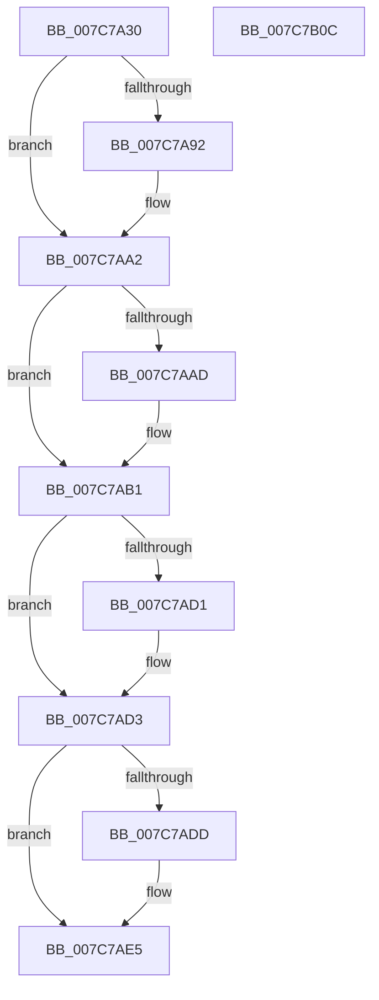

# ExGetLicenseTamperState

- RVA: `0x007C7A30`–`0x007C7B0D` (길이 `221` bytes)
- VA: `0x00000001407C7A30`
- 실행 섹션: `PAGE`
- PDB 이름 있음: `예`; PDB Function 태그: `아니요`
- unwind 정보 RVA: `0x000D5008`
- 디코드: `64`개 명령, `221/221` bytes 표시
- 미해석 바이트: `0` (있으면 어셈블리에 `.byte`로 보존)

> 이 문서는 커널 이미지의 기계어와 PDB 기호를 분석해 생성했습니다. 4번과 5번은 함수 원형과 자료형을 바이너리 사용 방식에서 추정한 C 해석이며 원본 소스 복구 결과는 아닙니다.

## 1. Dependencies

- 직접 호출 지점: **7**; 고유 호출 대상: **7**
- 직접 호출자로 확인된 함수: **0**
- RIP 상대 이미지 참조: **0**

### Outgoing calls
- `0x007C7A51` → [PsGetCurrentServerSiloGlobals](../../text/2F/PsGetCurrentServerSiloGlobals_function_002FE1F0.md) (function, `0x002FE1F0`)
- `0x007C7A7D` → [KeAbPreAcquire](../../text/21/KeAbPreAcquire_function_00210230.md) (function, `0x00210230`)
- `0x007C7A9D` → [ExfAcquirePushLockSharedEx](../../text/21/ExfAcquirePushLockSharedEx_function_0021044C.md) (function, `0x0021044C`)
- `0x007C7AB9` → [ExpGetLicenseTamperState](../../text/65/ExpGetLicenseTamperState_function_00657740.md) (function, `0x00657740`)
- `0x007C7AE0` → [ExfReleasePushLockShared](../../text/26/ExfReleasePushLockShared_function_00263440.md) (function, `0x00263440`)
- `0x007C7AE8` → [KeAbPostRelease](../../text/2E/KeAbPostRelease_function_002E1600.md) (function, `0x002E1600`)
- `0x007C7AED` → [KeLeaveCriticalRegion](../../text/25/KeLeaveCriticalRegion_function_0025D8B0.md) (function, `0x0025D8B0`)

### Direct callers
- 이 함수 시작 RVA로 연결되는 직접 call은 확인되지 않았습니다. 간접 호출은 완전히 역산할 수 없습니다.

### Static image references
- 디코드된 RIP-relative 메모리 참조가 없습니다.

## 2. Other-region calls and transfers

- 다른 실행 섹션으로 향하는 call: **7**
  - `0x007C7A51` → [PsGetCurrentServerSiloGlobals](../../text/2F/PsGetCurrentServerSiloGlobals_function_002FE1F0.md) (`PAGE` → `.text`)
  - `0x007C7A7D` → [KeAbPreAcquire](../../text/21/KeAbPreAcquire_function_00210230.md) (`PAGE` → `.text`)
  - `0x007C7A9D` → [ExfAcquirePushLockSharedEx](../../text/21/ExfAcquirePushLockSharedEx_function_0021044C.md) (`PAGE` → `.text`)
  - `0x007C7AB9` → [ExpGetLicenseTamperState](../../text/65/ExpGetLicenseTamperState_function_00657740.md) (`PAGE` → `.text`)
  - `0x007C7AE0` → [ExfReleasePushLockShared](../../text/26/ExfReleasePushLockShared_function_00263440.md) (`PAGE` → `.text`)
  - `0x007C7AE8` → [KeAbPostRelease](../../text/2E/KeAbPostRelease_function_002E1600.md) (`PAGE` → `.text`)
  - `0x007C7AED` → [KeLeaveCriticalRegion](../../text/25/KeLeaveCriticalRegion_function_0025D8B0.md) (`PAGE` → `.text`)
- 별도 외부 분기/꼬리 이동을 확인하지 못했습니다.

## 3. Assembly (complete function range)

```asm
007C7A30  48 89 5C 24 08                  mov qword ptr [rsp + 8], rbx
007C7A35  48 89 6C 24 20                  mov qword ptr [rsp + 0x20], rbp
007C7A3A  56                              push rsi
007C7A3B  57                              push rdi
007C7A3C  41 54                           push r12
007C7A3E  41 56                           push r14
007C7A40  41 57                           push r15
007C7A42  48 83 EC 20                     sub rsp, 0x20
007C7A46  45 33 F6                        xor r14d, r14d
007C7A49  48 8B F1                        mov rsi, rcx
007C7A4C  44 89 74 24 58                  mov dword ptr [rsp + 0x58], r14d
007C7A51  E8 9A 67 B3 FF                  call 0x1402fe1f0
007C7A56  45 33 C0                        xor r8d, r8d
007C7A59  33 D2                           xor edx, edx
007C7A5B  48 8B A8 68 03 00 00            mov rbp, qword ptr [rax + 0x368]
007C7A62  65 48 8B 04 25 88 01 00 00      mov rax, qword ptr gs:[0x188]
007C7A6B  48 8D 9D F8 B6 00 00            lea rbx, [rbp + 0xb6f8]
007C7A72  66 FF 88 E4 01 00 00            dec word ptr [rax + 0x1e4]
007C7A79  48 8B CB                        mov rcx, rbx
007C7A7C  90                              nop
007C7A7D  E8 AE 87 A4 FF                  call 0x140210230
007C7A82  48 8B F8                        mov rdi, rax
007C7A85  45 8D 66 11                     lea r12d, [r14 + 0x11]
007C7A89  33 C0                           xor eax, eax
007C7A8B  F0 4C 0F B1 23                  lock cmpxchg qword ptr [rbx], r12
007C7A90  74 10                           je 0x1407c7aa2
007C7A92  4C 8B CB                        mov r9, rbx
007C7A95  4C 8B C7                        mov r8, rdi
007C7A98  33 D2                           xor edx, edx
007C7A9A  48 8B CB                        mov rcx, rbx
007C7A9D  E8 AA 89 A4 FF                  call 0x14021044c
007C7AA2  41 BF 01 00 00 00               mov r15d, 1
007C7AA8  48 85 FF                        test rdi, rdi
007C7AAB  74 04                           je 0x1407c7ab1
007C7AAD  44 88 7F 0A                     mov byte ptr [rdi + 0xa], r15b
007C7AB1  48 8D 54 24 58                  lea rdx, [rsp + 0x58]
007C7AB6  48 8B CD                        mov rcx, rbp
007C7AB9  E8 82 FC E8 FF                  call 0x140657740
007C7ABE  8B 4C 24 58                     mov ecx, dword ptr [rsp + 0x58]
007C7AC2  85 C9                           test ecx, ecx
007C7AC4  41 0F B6 FE                     movzx edi, r14b
007C7AC8  41 0F 45 FF                     cmovne edi, r15d
007C7ACC  48 85 F6                        test rsi, rsi
007C7ACF  74 02                           je 0x1407c7ad3
007C7AD1  89 0E                           mov dword ptr [rsi], ecx
007C7AD3  49 8B C4                        mov rax, r12
007C7AD6  F0 4C 0F B1 33                  lock cmpxchg qword ptr [rbx], r14
007C7ADB  74 08                           je 0x1407c7ae5
007C7ADD  48 8B CB                        mov rcx, rbx
007C7AE0  E8 5B B9 A9 FF                  call 0x140263440
007C7AE5  48 8B CB                        mov rcx, rbx
007C7AE8  E8 13 9B B1 FF                  call 0x1402e1600
007C7AED  E8 BE 5D A9 FF                  call 0x14025d8b0
007C7AF2  48 8B 5C 24 50                  mov rbx, qword ptr [rsp + 0x50]
007C7AF7  40 8A C7                        mov al, dil
007C7AFA  48 8B 6C 24 68                  mov rbp, qword ptr [rsp + 0x68]
007C7AFF  48 83 C4 20                     add rsp, 0x20
007C7B03  41 5F                           pop r15
007C7B05  41 5E                           pop r14
007C7B07  41 5C                           pop r12
007C7B09  5F                              pop rdi
007C7B0A  5E                              pop rsi
007C7B0B  C3                              ret
007C7B0C  CC                              int3
```

## 4. C-style interpretation (structured pseudocode)

```c
__int64 __fastcall ExGetLicenseTamperState(__int64 a1, int a2, int a3)
{
    __int64 result;
    __int64 v_r14;
    __int64 v_rdi;
    __int64 v_rsp;
    unsigned int v_stack_p10;
    unsigned __int64 v_stack_p20;
    unsigned __int64 v_stack_p8;

    v_stack_p8 = v_rbx;
    v_stack_p20 = v_rbp;
    v_rsp = (v_rsp) - (32);
    v_r14 = 0;
    v_stack_p10 = 0;
    result = PsGetCurrentServerSiloGlobals(a1, a2, a3, a4);
    a3 = 0;
    a2 = 0;
    result = KeAbPreAcquire(*(unsigned __int64 *)(result + 872) + 46840, a2, a3, a4);
    result = 0;
    if (!(condition_is_equal)) {
        a4 = *(unsigned __int64 *)(result + 872) + 46840;
        a3 = 0;
        a2 = 0;
        a1 = *(unsigned __int64 *)(result + 872) + 46840;
        result = ExfAcquirePushLockSharedEx(a1, a2, a3, a4);
    }
    if (result != 0) {
        *(unsigned __int8 *)(result + 10) = 1;
    }
    result = ExpGetLicenseTamperState(*(unsigned __int64 *)(result + 872), v_stack_p10, a3, a4);
    v_rdi = 0;
    if ((unsigned int)((unsigned int)(v_stack_p10)) != 0) { v_rdi = 1; }
    if (a1 != 0) {
        *(unsigned int *)(a1) = (unsigned int)((unsigned int)(v_stack_p10));
    }
    result = v_r14 + 17;
    if (a1 != 0) {
        a1 = *(unsigned __int64 *)(result + 872) + 46840;
        result = ExfReleasePushLockShared(a1, v_stack_p10, a3, a4);
    }
    result = KeAbPostRelease(*(unsigned __int64 *)(result + 872) + 46840, v_stack_p10, a3, a4);
    result = KeLeaveCriticalRegion(*(unsigned __int64 *)(result + 872) + 46840, v_stack_p10, a3, a4);
    v_rsp = (v_rsp) + (32);
    return (unsigned __int8)(v_rdi);
}
```

## 5. (Beta) C Style

```c
int64_t ExGetLicenseTamperState(int64_t Arg1, int32_t Arg2, int32_t Arg3)
{
    int64_t result;
    int64_t local_r14;
    int64_t local_rdi;
    int64_t local_rsp;
    uint32_t v_stack_p10;
    uint64_t v_stack_p20;
    uint64_t v_stack_p8;

    v_stack_p8 = local_rbx;
    v_stack_p20 = local_rbp;
    local_rsp = (local_rsp) - (32);
    local_r14 = 0;
    v_stack_p10 = 0;
    result = PsGetCurrentServerSiloGlobals(Arg1, Arg2, Arg3, a4);
    Arg3 = 0;
    Arg2 = 0;
    result = KeAbPreAcquire(*(uint64_t *)(result + 0x368) + 46840, Arg2, Arg3, a4);
    result = 0;
    if (!(condition_is_equal)) {
        a4 = *(uint64_t *)(result + 0x368) + 46840;
        Arg3 = 0;
        Arg2 = 0;
        Arg1 = *(uint64_t *)(result + 0x368) + 46840;
        result = ExfAcquirePushLockSharedEx(Arg1, Arg2, Arg3, a4);
    }
    if (result != 0) {
        *(uint8_t *)(result + 0xA) = 1;
    }
    result = ExpGetLicenseTamperState(*(uint64_t *)(result + 0x368), v_stack_p10, Arg3, a4);
    local_rdi = 0;
    if ((uint32_t)((uint32_t)(v_stack_p10)) != 0) { local_rdi = 1; }
    if (Arg1 != 0) {
        *(uint32_t *)(Arg1) = (uint32_t)((uint32_t)(v_stack_p10));
    }
    result = local_r14 + 17;
    if (Arg1 != 0) {
        Arg1 = *(uint64_t *)(result + 0x368) + 46840;
        result = ExfReleasePushLockShared(Arg1, v_stack_p10, Arg3, a4);
    }
    result = KeAbPostRelease(*(uint64_t *)(result + 0x368) + 46840, v_stack_p10, Arg3, a4);
    result = KeLeaveCriticalRegion(*(uint64_t *)(result + 0x368) + 46840, v_stack_p10, Arg3, a4);
    local_rsp = (local_rsp) + (32);
    return (uint8_t)(local_rdi);
}
```

## 6. Execution-region graph

[열기: 2D/3D 그래프와 함수 탐색 컨트롤 패널](../../../control-panel.html?section=page&rva=0x007C7A30&view=graph)

- 2D 그래프는 위에서 아래로 흐르고, 3D 그래프는 빈 공간을 드래그해 회전합니다. Shift+드래그는 이동, 휠은 확대·축소, 함수 노드 선택은 대상 보고서 이동입니다.

### Static fallback


