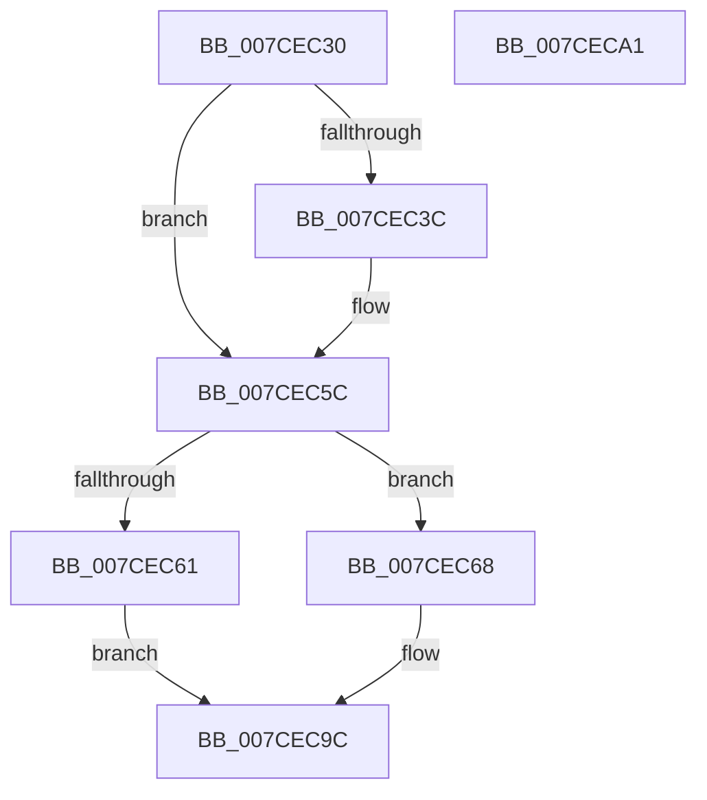

# ExGetPrmInterface

- RVA: `0x007CEC30`–`0x007CECA2` (길이 `114` bytes)
- VA: `0x00000001407CEC30`
- 실행 섹션: `PAGE`
- PDB 이름 있음: `예`; PDB Function 태그: `아니요`
- unwind 정보 RVA: `0x0005D2F4`
- 디코드: `30`개 명령, `114/114` bytes 표시
- 미해석 바이트: `0` (있으면 어셈블리에 `.byte`로 보존)

> 이 문서는 커널 이미지의 기계어와 PDB 기호를 분석해 생성했습니다. 4번과 5번은 함수 원형과 자료형을 바이너리 사용 방식에서 추정한 C 해석이며 원본 소스 복구 결과는 아닙니다.

## 1. Dependencies

- 직접 호출 지점: **1**; 고유 호출 대상: **1**
- 직접 호출자로 확인된 함수: **1**
- RIP 상대 이미지 참조: **4**

### Outgoing calls
- `0x007CEC56` → [KeBugCheckEx](../../text/4F/KeBugCheckEx_function_004FD660.md) (function, `0x004FD660`)

### Direct callers
- [WheaInitialize](../../init/C5/WheaInitialize_function_00C54C08.md) at `0x00C550E4`

### Static image references
- `0x007CEC6C` → RVA `0x00659890` (`PrmInvokeHandler`; read)
- `0x007CEC77` → RVA `0x00659960` (`PrmLockModule`; read)
- `0x007CEC82` → RVA `0x00659AD0` (`PrmUnlockModule`; read)
- `0x007CEC8D` → RVA `0x00659A10` (`PrmQueryHandler`; read)

## 2. Other-region calls and transfers

- 다른 실행 섹션으로 향하는 call: **1**
  - `0x007CEC56` → [KeBugCheckEx](../../text/4F/KeBugCheckEx_function_004FD660.md) (`PAGE` → `.text`)
- 별도 외부 분기/꼬리 이동을 확인하지 못했습니다.

## 3. Assembly (complete function range)

```asm
007CEC30  48 83 EC 38                     sub rsp, 0x38
007CEC34  44 0F 20 C0                     mov rax, cr8
007CEC38  84 C0                           test al, al
007CEC3A  74 20                           je 0x1407cec5c
007CEC3C  44 0F 20 C0                     mov rax, cr8
007CEC40  48 83 64 24 20 00               and qword ptr [rsp + 0x20], 0
007CEC46  45 33 C9                        xor r9d, r9d
007CEC49  44 0F B6 C0                     movzx r8d, al
007CEC4D  B9 21 01 00 00                  mov ecx, 0x121
007CEC52  41 8D 51 01                     lea edx, [r9 + 1]
007CEC56  E8 05 EA D2 FF                  call 0x1404fd660
007CEC5B  CC                              int3
007CEC5C  48 85 D2                        test rdx, rdx
007CEC5F  75 07                           jne 0x1407cec68
007CEC61  B8 F0 00 00 C0                  mov eax, 0xc00000f0
007CEC66  EB 34                           jmp 0x1407cec9c
007CEC68  83 62 04 00                     and dword ptr [rdx + 4], 0
007CEC6C  48 8D 05 1D AC E8 FF            lea rax, [rip - 0x1753e3]
007CEC73  48 89 42 18                     mov qword ptr [rdx + 0x18], rax
007CEC77  48 8D 05 E2 AC E8 FF            lea rax, [rip - 0x17531e]
007CEC7E  48 89 42 10                     mov qword ptr [rdx + 0x10], rax
007CEC82  48 8D 05 47 AE E8 FF            lea rax, [rip - 0x1751b9]
007CEC89  48 89 42 08                     mov qword ptr [rdx + 8], rax
007CEC8D  48 8D 05 7C AD E8 FF            lea rax, [rip - 0x175284]
007CEC94  48 89 42 20                     mov qword ptr [rdx + 0x20], rax
007CEC98  33 C0                           xor eax, eax
007CEC9A  89 0A                           mov dword ptr [rdx], ecx
007CEC9C  48 83 C4 38                     add rsp, 0x38
007CECA0  C3                              ret
007CECA1  CC                              int3
```

## 4. C-style interpretation (structured pseudocode)

```c
__int64 __fastcall ExGetPrmInterface(__int64 a1, __int64 a2, __int64 a3, int a4)
{
    __int64 result;
    __int64 v_rsp;
    unsigned __int64 v_stack_m18;

    v_rsp = (v_rsp) - (56);
    result = v_cr8;
    if ((unsigned __int8)(v_cr8) != 0) {
        result = v_cr8;
        a4 = 0;
        a3 = (unsigned __int8)(result);
        a1 = 289;
        a2 = a4 + 1;
        result = KeBugCheckEx(a1, a2, a3, a4);
    }
    if (a2 != 0) goto loc_007CEC68;
    goto loc_007CEC9C;
loc_007CEC68:
    *(unsigned __int64 *)(a2 + 24) = v_rip - 1528803;
    *(unsigned __int64 *)(a2 + 16) = v_rip - 1528606;
    *(unsigned __int64 *)(a2 + 8) = v_rip - 1528249;
    *(unsigned __int64 *)(a2 + 32) = v_rip - 1528452;
    result = 0;
    *(unsigned int *)(a2) = (unsigned int)(a1);
loc_007CEC9C:
    v_rsp = (v_rsp) + (56);
    return result;
}
```

## 5. (Beta) C Style

```c
int64_t ExGetPrmInterface(int64_t Arg1, int64_t Arg2, int64_t Arg3, int32_t Arg4)
{
    int64_t result;
    int64_t local_rsp;
    uint64_t v_stack_m18;

    local_rsp = (local_rsp) - (56);
    result = v_cr8;
    if ((uint8_t)(v_cr8) != 0) {
        result = v_cr8;
        Arg4 = 0;
        Arg3 = (uint8_t)(result);
        Arg1 = 289;
        Arg2 = Arg4 + 1;
        result = KeBugCheckEx(Arg1, Arg2, Arg3, Arg4);
    }
    if (Arg2 != 0) goto loc_007CEC68;
    goto loc_007CEC9C;
loc_007CEC68:
    *(uint64_t *)(Arg2 + 0x18) = v_rip - 1528803;
    *(uint64_t *)(Arg2 + 0x10) = v_rip - 1528606;
    *(uint64_t *)(Arg2 + 0x8) = v_rip - 1528249;
    *(uint64_t *)(Arg2 + 0x20) = v_rip - 1528452;
    result = 0;
    *(uint32_t *)(Arg2) = (uint32_t)(Arg1);
loc_007CEC9C:
    local_rsp = (local_rsp) + (56);
    return result;
}
```

## 6. Execution-region graph

[열기: 2D/3D 그래프와 함수 탐색 컨트롤 패널](../../../control-panel.html?section=page&rva=0x007CEC30&view=graph)

- 2D 그래프는 위에서 아래로 흐르고, 3D 그래프는 빈 공간을 드래그해 회전합니다. Shift+드래그는 이동, 휠은 확대·축소, 함수 노드 선택은 대상 보고서 이동입니다.

### Static fallback


