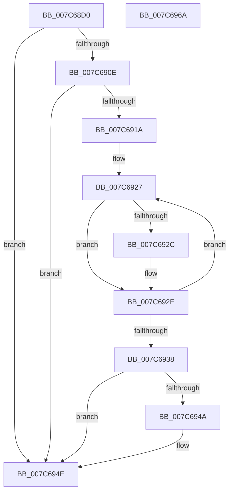

# ExGetSuiteMask

- RVA: `0x007C68D0`–`0x007C696B` (길이 `155` bytes)
- VA: `0x00000001407C68D0`
- 실행 섹션: `PAGE`
- PDB 이름 있음: `예`; PDB Function 태그: `아니요`
- unwind 정보 RVA: `0x00065960`
- 디코드: `47`개 명령, `155/155` bytes 표시
- 미해석 바이트: `0` (있으면 어셈블리에 `.byte`로 보존)

> 이 문서는 커널 이미지의 기계어와 PDB 기호를 분석해 생성했습니다. 4번과 5번은 함수 원형과 자료형을 바이너리 사용 방식에서 추정한 C 해석이며 원본 소스 복구 결과는 아닙니다.

## 1. Dependencies

- 직접 호출 지점: **3**; 고유 호출 대상: **3**
- 직접 호출자로 확인된 함수: **2**
- RIP 상대 이미지 참조: **1**

### Outgoing calls
- `0x007C68E9` → [ExpParseSuiteMask](ExpParseSuiteMask_function_007C6A78.md) (function, `0x007C6A78`)
- `0x007C6905` → [RtlGetProductInfo](../../text/5E/RtlGetProductInfo_function_005EC870.md) (function, `0x005EC870`)
- `0x007C6941` → [ExpGetProductInfoSuiteTypeMap](ExpGetProductInfoSuiteTypeMap_function_007C6A30.md) (function, `0x007C6A30`)

### Direct callers
- [PspSiloInitializeUserSharedData](../78/PspSiloInitializeUserSharedData_function_00780684.md) at `0x007807F9`
- [ExpInitSystemPhase0](../../init/C5/ExpInitSystemPhase0_function_00C5136C.md) at `0x00C5147C`

### Static image references
- `0x007C691C` → RVA `0x00B4F484` (`PAGE`; read)

## 2. Other-region calls and transfers

- 다른 실행 섹션으로 향하는 call: **1**
  - `0x007C6905` → [RtlGetProductInfo](../../text/5E/RtlGetProductInfo_function_005EC870.md) (`PAGE` → `.text`)
- 별도 외부 분기/꼬리 이동을 확인하지 못했습니다.

## 3. Assembly (complete function range)

```asm
007C68D0  48 89 5C 24 08                  mov qword ptr [rsp + 8], rbx
007C68D5  57                              push rdi
007C68D6  48 83 EC 40                     sub rsp, 0x40
007C68DA  83 64 24 58 00                  and dword ptr [rsp + 0x58], 0
007C68DF  33 C0                           xor eax, eax
007C68E1  48 89 44 24 30                  mov qword ptr [rsp + 0x30], rax
007C68E6  40 8A FA                        mov dil, dl
007C68E9  E8 8A 01 00 00                  call 0x1407c6a78
007C68EE  33 D2                           xor edx, edx
007C68F0  8B D8                           mov ebx, eax
007C68F2  48 8D 44 24 58                  lea rax, [rsp + 0x58]
007C68F7  45 33 C9                        xor r9d, r9d
007C68FA  45 33 C0                        xor r8d, r8d
007C68FD  48 89 44 24 20                  mov qword ptr [rsp + 0x20], rax
007C6902  8D 4A 06                        lea ecx, [rdx + 6]
007C6905  E8 66 5F E2 FF                  call 0x1405ec870
007C690A  84 C0                           test al, al
007C690C  74 40                           je 0x1407c694e
007C690E  8B 4C 24 58                     mov ecx, dword ptr [rsp + 0x58]
007C6912  81 F9 CD AB CD AB               cmp ecx, 0xabcdabcd
007C6918  74 34                           je 0x1407c694e
007C691A  33 C0                           xor eax, eax
007C691C  48 8D 15 61 8B 38 00            lea rdx, [rip + 0x388b61]
007C6923  44 8D 40 33                     lea r8d, [rax + 0x33]
007C6927  39 4A FC                        cmp dword ptr [rdx - 4], ecx
007C692A  74 02                           je 0x1407c692e
007C692C  0B 02                           or eax, dword ptr [rdx]
007C692E  48 83 C2 0C                     add rdx, 0xc
007C6932  49 83 E8 01                     sub r8, 1
007C6936  75 EF                           jne 0x1407c6927
007C6938  F7 D0                           not eax
007C693A  48 8D 54 24 30                  lea rdx, [rsp + 0x30]
007C693F  23 D8                           and ebx, eax
007C6941  E8 EA 00 00 00                  call 0x1407c6a30
007C6946  84 C0                           test al, al
007C6948  74 04                           je 0x1407c694e
007C694A  0B 5C 24 34                     or ebx, dword ptr [rsp + 0x34]
007C694E  40 F6 DF                        neg dil
007C6951  1B C0                           sbb eax, eax
007C6953  25 00 FF 01 00                  and eax, 0x1ff00
007C6958  05 10 01 00 00                  add eax, 0x110
007C695D  0B C3                           or eax, ebx
007C695F  48 8B 5C 24 50                  mov rbx, qword ptr [rsp + 0x50]
007C6964  48 83 C4 40                     add rsp, 0x40
007C6968  5F                              pop rdi
007C6969  C3                              ret
007C696A  CC                              int3
```

## 4. C-style interpretation (structured pseudocode)

```c
__int64 __fastcall ExGetSuiteMask(__int64 a1, int a2, int a3, int a4)
{
    __int64 result;
    __int64 v_rbx;
    __int64 v_rdi;
    __int64 v_rsp;
    unsigned int v_stack_m14;
    unsigned __int64 v_stack_m18;
    unsigned __int64 v_stack_m28;
    unsigned int v_stack_p10;
    unsigned __int64 v_stack_p8;

    v_stack_p8 = v_rbx;
    v_rsp = (v_rsp) - (64);
    result = 0;
    v_stack_m18 = 0;
    result = ExpParseSuiteMask(a1, a2, a3, a4);
    a2 = 0;
    a4 = 0;
    a3 = 0;
    v_stack_m28 = v_stack_p10;
    result = RtlGetProductInfo(a2 + 6, a2, a3, a4);
    if ((unsigned __int8)(result) == 0) goto loc_007C694E;
    if (((unsigned int)((unsigned int)(v_stack_p10))) == 0xABCDABCDULL) goto loc_007C694E;
    result = 0;
loc_007C6927:
    if ((*(unsigned int *)(v_rip + 3705697 - 4)) != ((unsigned int)((unsigned int)(v_stack_p10)))) {
        result = (unsigned int)((result) | (*(unsigned int *)(v_rip + 3705697)));
    }
    a2 = (v_rip + 3705697) + (12);
    a3 = (result + 51) - (1);
    if (condition_is_not_equal) goto loc_007C6927;
    result = (unsigned int)(~(result));
    v_rbx = (unsigned int)(((unsigned int)((unsigned int)(result))) & ((unsigned int)(result)));
    result = ExpGetProductInfoSuiteTypeMap((unsigned int)(v_stack_p10), v_stack_m18, a3, a4);
    if ((unsigned __int8)(result) != 0) {
        v_rbx = (unsigned int)((v_rbx) | (v_stack_m14));
    }
    v_rdi = (unsigned __int8)(-((unsigned __int8)(a2)));
    result = (unsigned int)((result) & (0x1FF00ULL));
    result = (unsigned int)((result) + (272));
    result = (unsigned int)((result) | ((unsigned int)(v_rbx)));
    v_rsp = (v_rsp) + (64);
    return result;
}
```

## 5. (Beta) C Style

```c
int64_t ExGetSuiteMask(int64_t Arg1, int32_t Arg2, int32_t Arg3, int32_t Arg4)
{
    int64_t result;
    int64_t local_rbx;
    int64_t local_rdi;
    int64_t local_rsp;
    uint32_t v_stack_m14;
    uint64_t v_stack_m18;
    uint64_t v_stack_m28;
    uint32_t v_stack_p10;
    uint64_t v_stack_p8;

    v_stack_p8 = local_rbx;
    local_rsp = (local_rsp) - (64);
    result = 0;
    v_stack_m18 = 0;
    result = ExpParseSuiteMask(Arg1, Arg2, Arg3, Arg4);
    Arg2 = 0;
    Arg4 = 0;
    Arg3 = 0;
    v_stack_m28 = v_stack_p10;
    result = RtlGetProductInfo(Arg2 + 6, Arg2, Arg3, Arg4);
    if ((uint8_t)(result) == 0) goto loc_007C694E;
    if (((uint32_t)((uint32_t)(v_stack_p10))) == 0xABCDABCDULL) goto loc_007C694E;
    result = 0;
loc_007C6927:
    if ((*(uint32_t *)(v_rip + 0x388B61 - 0x4)) != ((uint32_t)((uint32_t)(v_stack_p10)))) {
        result = (uint32_t)((result) | (*(uint32_t *)(v_rip + 0x388B61)));
    }
    Arg2 = (v_rip + 3705697) + (12);
    Arg3 = (result + 51) - (1);
    if (condition_is_not_equal) goto loc_007C6927;
    result = (uint32_t)(~(result));
    local_rbx = (uint32_t)(((uint32_t)((uint32_t)(result))) & ((uint32_t)(result)));
    result = ExpGetProductInfoSuiteTypeMap((uint32_t)(v_stack_p10), v_stack_m18, Arg3, Arg4);
    if ((uint8_t)(result) != 0) {
        local_rbx = (uint32_t)((local_rbx) | (v_stack_m14));
    }
    local_rdi = (uint8_t)(-((uint8_t)(Arg2)));
    result = (uint32_t)((result) & (0x1FF00ULL));
    result = (uint32_t)((result) + (272));
    result = (uint32_t)((result) | ((uint32_t)(local_rbx)));
    local_rsp = (local_rsp) + (64);
    return result;
}
```

## 6. Execution-region graph

[열기: 2D/3D 그래프와 함수 탐색 컨트롤 패널](../../../control-panel.html?section=page&rva=0x007C68D0&view=graph)

- 2D 그래프는 위에서 아래로 흐르고, 3D 그래프는 빈 공간을 드래그해 회전합니다. Shift+드래그는 이동, 휠은 확대·축소, 함수 노드 선택은 대상 보고서 이동입니다.

### Static fallback


