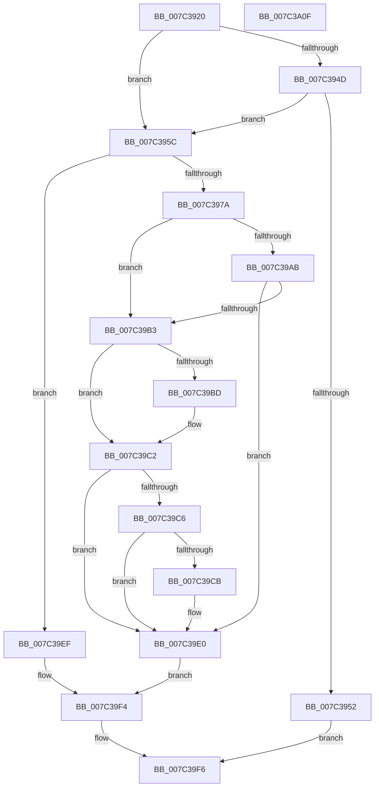

# ExGetSystemFirmwareTable

- RVA: `0x007C3920`–`0x007C3A10` (길이 `240` bytes)
- VA: `0x00000001407C3920`
- 실행 섹션: `PAGE`
- PDB 이름 있음: `예`; PDB Function 태그: `아니요`
- unwind 정보 RVA: `0x000BEF48`
- 디코드: `72`개 명령, `240/240` bytes 표시
- 미해석 바이트: `0` (있으면 어셈블리에 `.byte`로 보존)

> 이 문서는 커널 이미지의 기계어와 PDB 기호를 분석해 생성했습니다. 4번과 5번은 함수 원형과 자료형을 바이너리 사용 방식에서 추정한 C 해석이며 원본 소스 복구 결과는 아닙니다.

## 1. Dependencies

- 직접 호출 지점: **4**; 고유 호출 대상: **4**
- 직접 호출자로 확인된 함수: **2**
- RIP 상대 이미지 참조: **0**

### Outgoing calls
- `0x007C396D` → [ExAllocatePool2](../../poolcode/B8/ExAllocatePool2_function_00B820F0.md) (function, `0x00B820F0`)
- `0x007C3998` → [ExpGetSystemFirmwareTableInformation](../A3/ExpGetSystemFirmwareTableInformation_function_00A38A2C.md) (function, `0x00A38A2C`)
- `0x007C39DB` → [memcpy](../../text/6C/memcpy_function_006C6840.md) (function, `0x006C6840`)
- `0x007C39E8` → [ExFreePoolWithTag](../../poolcode/B8/ExFreePoolWithTag_function_00B82870.md) (function, `0x00B82870`)

### Direct callers
- [IpmiHwpReadSpmiConfiguration](../../text/6A/IpmiHwpReadSpmiConfiguration_function_006A672C.md) at `0x006A6759`
- [IpmiHwpReadSpmiConfiguration](../../text/6A/IpmiHwpReadSpmiConfiguration_function_006A672C.md) at `0x006A67A6`
- [IpmiLibReadSmbiosRecord38](../../text/6A/IpmiLibReadSmbiosRecord38_function_006A67E4.md) at `0x006A6818`
- [IpmiLibReadSmbiosRecord38](../../text/6A/IpmiLibReadSmbiosRecord38_function_006A67E4.md) at `0x006A6865`

### Static image references
- 디코드된 RIP-relative 메모리 참조가 없습니다.

## 2. Other-region calls and transfers

- 다른 실행 섹션으로 향하는 call: **3**
  - `0x007C396D` → [ExAllocatePool2](../../poolcode/B8/ExAllocatePool2_function_00B820F0.md) (`PAGE` → `POOLCODE`)
  - `0x007C39DB` → [memcpy](../../text/6C/memcpy_function_006C6840.md) (`PAGE` → `.text`)
  - `0x007C39E8` → [ExFreePoolWithTag](../../poolcode/B8/ExFreePoolWithTag_function_00B82870.md) (`PAGE` → `POOLCODE`)
- 별도 외부 분기/꼬리 이동을 확인하지 못했습니다.

## 3. Assembly (complete function range)

```asm
007C3920  48 8B C4                        mov rax, rsp
007C3923  48 89 58 08                     mov qword ptr [rax + 8], rbx
007C3927  48 89 68 10                     mov qword ptr [rax + 0x10], rbp
007C392B  48 89 70 20                     mov qword ptr [rax + 0x20], rsi
007C392F  57                              push rdi
007C3930  41 56                           push r14
007C3932  41 57                           push r15
007C3934  48 83 EC 20                     sub rsp, 0x20
007C3938  83 60 18 00                     and dword ptr [rax + 0x18], 0
007C393C  41 8B F9                        mov edi, r9d
007C393F  49 8B F0                        mov rsi, r8
007C3942  44 8B F2                        mov r14d, edx
007C3945  44 8B F9                        mov r15d, ecx
007C3948  4D 85 C0                        test r8, r8
007C394B  75 0F                           jne 0x1407c395c
007C394D  45 85 C9                        test r9d, r9d
007C3950  74 0A                           je 0x1407c395c
007C3952  B8 0D 00 00 C0                  mov eax, 0xc000000d
007C3957  E9 9A 00 00 00                  jmp 0x1407c39f6
007C395C  41 8D 69 10                     lea ebp, [r9 + 0x10]
007C3960  B9 00 01 00 00                  mov ecx, 0x100
007C3965  8B D5                           mov edx, ebp
007C3967  41 B8 41 52 46 54               mov r8d, 0x54465241
007C396D  E8 7E E7 3B 00                  call 0x140b820f0
007C3972  48 8B D8                        mov rbx, rax
007C3975  48 85 C0                        test rax, rax
007C3978  74 75                           je 0x1407c39ef
007C397A  4C 8D 4C 24 50                  lea r9, [rsp + 0x50]
007C397F  89 78 0C                        mov dword ptr [rax + 0xc], edi
007C3982  44 8B C5                        mov r8d, ebp
007C3985  44 89 38                        mov dword ptr [rax], r15d
007C3988  33 D2                           xor edx, edx
007C398A  C7 40 04 01 00 00 00            mov dword ptr [rax + 4], 1
007C3991  48 8B C8                        mov rcx, rax
007C3994  44 89 70 08                     mov dword ptr [rax + 8], r14d
007C3998  E8 8F 50 27 00                  call 0x140a38a2c
007C399D  8B F8                           mov edi, eax
007C399F  B8 00 00 00 80                  mov eax, 0x80000000
007C39A4  8D 0C 07                        lea ecx, [rdi + rax]
007C39A7  85 C8                           test eax, ecx
007C39A9  75 08                           jne 0x1407c39b3
007C39AB  81 FF 23 00 00 C0               cmp edi, 0xc0000023
007C39B1  75 2D                           jne 0x1407c39e0
007C39B3  48 8B 4C 24 60                  mov rcx, qword ptr [rsp + 0x60]
007C39B8  48 85 C9                        test rcx, rcx
007C39BB  74 05                           je 0x1407c39c2
007C39BD  8B 43 0C                        mov eax, dword ptr [rbx + 0xc]
007C39C0  89 01                           mov dword ptr [rcx], eax
007C39C2  85 FF                           test edi, edi
007C39C4  78 1A                           js 0x1407c39e0
007C39C6  48 85 F6                        test rsi, rsi
007C39C9  74 15                           je 0x1407c39e0
007C39CB  44 8B 44 24 50                  mov r8d, dword ptr [rsp + 0x50]
007C39D0  48 8D 53 10                     lea rdx, [rbx + 0x10]
007C39D4  41 83 C0 F0                     add r8d, -0x10
007C39D8  48 8B CE                        mov rcx, rsi
007C39DB  E8 60 2E F0 FF                  call 0x1406c6840
007C39E0  BA 41 52 46 54                  mov edx, 0x54465241
007C39E5  48 8B CB                        mov rcx, rbx
007C39E8  E8 83 EE 3B 00                  call 0x140b82870
007C39ED  EB 05                           jmp 0x1407c39f4
007C39EF  BF 9A 00 00 C0                  mov edi, 0xc000009a
007C39F4  8B C7                           mov eax, edi
007C39F6  48 8B 5C 24 40                  mov rbx, qword ptr [rsp + 0x40]
007C39FB  48 8B 6C 24 48                  mov rbp, qword ptr [rsp + 0x48]
007C3A00  48 8B 74 24 58                  mov rsi, qword ptr [rsp + 0x58]
007C3A05  48 83 C4 20                     add rsp, 0x20
007C3A09  41 5F                           pop r15
007C3A0B  41 5E                           pop r14
007C3A0D  5F                              pop rdi
007C3A0E  C3                              ret
007C3A0F  CC                              int3
```

## 4. C-style interpretation (structured pseudocode)

```c
__int64 __fastcall ExGetSystemFirmwareTable(int a1, int a2, __int64 a3, __int64 a4, __int64 a5)
{
    __int64 result;
    __int64 v_rsp;
    unsigned __int64 v_stack_p10;
    unsigned __int64 v_stack_p18;
    unsigned __int64 v_stack_p20;
    unsigned __int64 v_stack_p8;

    *(unsigned __int64 *)(v_rsp + 8) = v_rbx;
    *(unsigned __int64 *)(v_rsp + 16) = v_rbp;
    *(unsigned __int64 *)(v_rsp + 32) = v_rsi;
    v_rsp = (v_rsp) - (32);
    if (a3 != 0) goto loc_007C395C;
    if ((unsigned int)(a4) == 0) goto loc_007C395C;
    goto loc_007C39F6;
loc_007C395C:
    result = ExAllocatePool2(256, (unsigned int)((unsigned int)(a4 + 16)), (unsigned int)(0x54465241ULL), a4);
    if (result == 0) goto loc_007C39EF;
    *(unsigned int *)(result + 12) = (unsigned int)((unsigned int)((unsigned int)(a4)));
    *(unsigned int *)(result) = (unsigned int)((unsigned int)(a1));
    a2 = 0;
    *(unsigned int *)(result + 4) = 1;
    *(unsigned int *)(result + 8) = (unsigned int)((unsigned int)(a2));
    result = ExpGetSystemFirmwareTableInformation(result, a2, (unsigned int)((unsigned int)(a4 + 16)), v_stack_p18);
    if ((((unsigned int)((unsigned int)(0x80000000ULL))) & ((unsigned int)((unsigned int)((unsigned int)(result)) + (unsigned int)(0x80000000ULL) * 1))) != 0) goto loc_007C39B3;
    if (((unsigned int)((unsigned int)((unsigned int)(result)))) != 0xC0000023ULL) goto loc_007C39E0;
loc_007C39B3:
    result = (unsigned int)(0x80000000ULL);
    if (a5 != 0) {
        result = *(unsigned int *)(result + 12);
        *(unsigned int *)(a5) = (unsigned int)(result);
    }
    if (sign_flag) goto loc_007C39E0;
    if (a3 != 0) {
        a3 = v_stack_p18;
        a2 = result + 16;
        a3 = (unsigned int)((a3) + (-16));
        a1 = a3;
        result = memcpy(a1, a2, a3, v_stack_p18);
    }
    result = ExFreePoolWithTag(result, (unsigned int)(0x54465241ULL), a3, v_stack_p18);
    goto loc_007C39F4;
loc_007C39EF:
loc_007C39F4:
loc_007C39F6:
    v_rsp = (v_rsp) + (32);
    return (unsigned int)((unsigned int)((unsigned int)(0xC000009AULL)));
}
```

## 5. (Beta) C Style

```c
int64_t ExGetSystemFirmwareTable(int32_t Arg1, int32_t Arg2, int64_t Arg3, int64_t Arg4, int64_t Arg5)
{
    int64_t result;
    int64_t local_rsp;
    uint64_t v_stack_p10;
    uint64_t v_stack_p18;
    uint64_t v_stack_p20;
    uint64_t v_stack_p8;

    *(uint64_t *)(local_rsp + 0x8) = local_rbx;
    *(uint64_t *)(local_rsp + 0x10) = local_rbp;
    *(uint64_t *)(local_rsp + 0x20) = local_rsi;
    local_rsp = (local_rsp) - (32);
    if (Arg3 != 0) goto loc_007C395C;
    if ((uint32_t)(Arg4) == 0) goto loc_007C395C;
    goto loc_007C39F6;
loc_007C395C:
    result = ExAllocatePool2(256, (uint32_t)((uint32_t)(Arg4 + 16)), (uint32_t)(0x54465241ULL), Arg4);
    if (result == 0) goto loc_007C39EF;
    *(uint32_t *)(result + 0xC) = (uint32_t)((uint32_t)((uint32_t)(Arg4)));
    *(uint32_t *)(result) = (uint32_t)((uint32_t)(Arg1));
    Arg2 = 0;
    *(uint32_t *)(result + 0x4) = 1;
    *(uint32_t *)(result + 0x8) = (uint32_t)((uint32_t)(Arg2));
    result = ExpGetSystemFirmwareTableInformation(result, Arg2, (uint32_t)((uint32_t)(Arg4 + 16)), v_stack_p18);
    if ((((uint32_t)((uint32_t)(0x80000000ULL))) & ((uint32_t)((uint32_t)((uint32_t)(result)) + (uint32_t)(0x80000000ULL) * 1))) != 0) goto loc_007C39B3;
    if (((uint32_t)((uint32_t)((uint32_t)(result)))) != 0xC0000023ULL) goto loc_007C39E0;
loc_007C39B3:
    result = (uint32_t)(0x80000000ULL);
    if (Arg5 != 0) {
        result = *(uint32_t *)(result + 0xC);
        *(uint32_t *)(Arg5) = (uint32_t)(result);
    }
    if (sign_flag) goto loc_007C39E0;
    if (Arg3 != 0) {
        Arg3 = v_stack_p18;
        Arg2 = result + 16;
        Arg3 = (uint32_t)((Arg3) + (-16));
        Arg1 = Arg3;
        result = memcpy(Arg1, Arg2, Arg3, v_stack_p18);
    }
    result = ExFreePoolWithTag(result, (uint32_t)(0x54465241ULL), Arg3, v_stack_p18);
    goto loc_007C39F4;
loc_007C39EF:
loc_007C39F4:
loc_007C39F6:
    local_rsp = (local_rsp) + (32);
    return (uint32_t)((uint32_t)((uint32_t)(0xC000009AULL)));
}
```

## 6. Execution-region graph

[열기: 2D/3D 그래프와 함수 탐색 컨트롤 패널](../../../control-panel.html?section=page&rva=0x007C3920&view=graph)

- 2D 그래프는 위에서 아래로 흐르고, 3D 그래프는 빈 공간을 드래그해 회전합니다. Shift+드래그는 이동, 휠은 확대·축소, 함수 노드 선택은 대상 보고서 이동입니다.

### Static fallback


