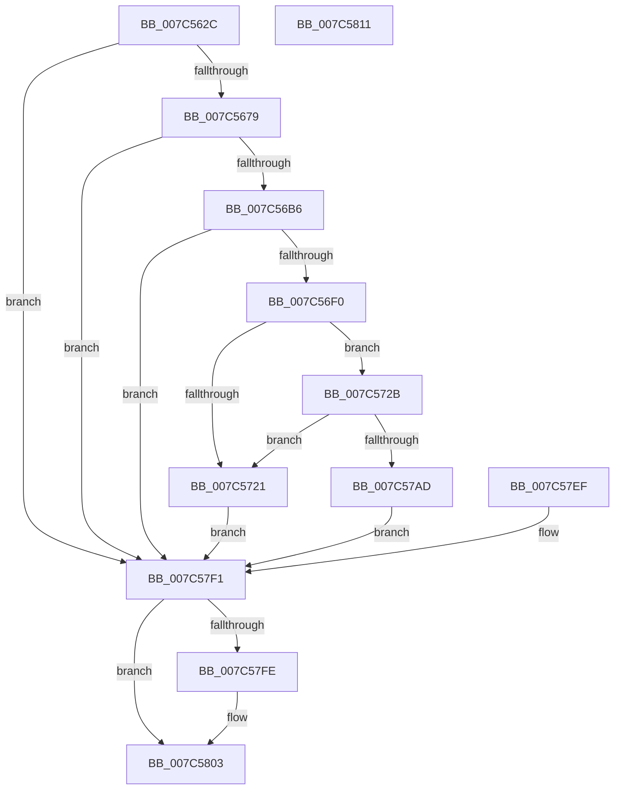

# ExInitializeLeapSecondData

- RVA: `0x007C562C`–`0x007C5812` (길이 `486` bytes)
- VA: `0x00000001407C562C`
- 실행 섹션: `PAGE`
- PDB 이름 있음: `예`; PDB Function 태그: `아니요`
- unwind 정보 RVA: `0x000D4A4C`
- 디코드: `119`개 명령, `486/486` bytes 표시
- 미해석 바이트: `0` (있으면 어셈블리에 `.byte`로 보존)

> 이 문서는 커널 이미지의 기계어와 PDB 기호를 분석해 생성했습니다. 4번과 5번은 함수 원형과 자료형을 바이너리 사용 방식에서 추정한 C 해석이며 원본 소스 복구 결과는 아닙니다.

## 1. Dependencies

- 직접 호출 지점: **11**; 고유 호출 대상: **11**
- 직접 호출자로 확인된 함수: **1**
- RIP 상대 이미지 참조: **4**

### Outgoing calls
- `0x007C566A` → [ZwCreateSection](../../text/6A/ZwCreateSection_function_006ADA10.md) (function, `0x006ADA10`)
- `0x007C56A7` → [ObReferenceObjectByHandle](../86/ObReferenceObjectByHandle_function_00868DB0.md) (function, `0x00868DB0`)
- `0x007C56E1` → [MmMapViewInSessionSpace](../98/MmMapViewInSessionSpace_function_00982480.md) (function, `0x00982480`)
- `0x007C5703` → [MmSizeOfMdl](../../text/46/MmSizeOfMdl_function_00460A10.md) (function, `0x00460A10`)
- `0x007C5714` → [ExAllocatePool2](../../poolcode/B8/ExAllocatePool2_function_00B820F0.md) (function, `0x00B820F0`)
- `0x007C577E` → [MmProbeAndLockPages](../../text/23/MmProbeAndLockPages_function_0023B990.md) (function, `0x0023B990`)
- `0x007C579C` → [MmMapLockedPagesSpecifyCache](../../text/31/MmMapLockedPagesSpecifyCache_function_00318800.md) (function, `0x00318800`)
- `0x007C57BA` → [MiRemoveFromSystemSpace](../../text/29/MiRemoveFromSystemSpace_function_002962FC.md) (function, `0x002962FC`)
- `0x007C57D7` → [memset](../../text/6C/memset_function_006C6C40.md) (function, `0x006C6C40`)
- `0x007C57E1` → [ExpReadLeapSecondData](ExpReadLeapSecondData_function_007C5EAC.md) (function, `0x007C5EAC`)
- `0x007C57FE` → [ZwClose](../../text/6A/ZwClose_function_006AD2B0.md) (function, `0x006AD2B0`)

### Direct callers
- [Phase1InitializationDiscard](../../init/C1/Phase1InitializationDiscard_function_00C1C728.md) at `0x00C1D3D2`

### Static image references
- `0x007C5679` → RVA `0x00FC6BD8` (`ALMOSTRO`; read)
- `0x007C57C1` → RVA `0x00FD9F28` (`PAGEDATA`; write)
- `0x007C57C8` → RVA `0x00FD9FF0` (`PAGEDATA`; write)
- `0x007C57E6` → RVA `0x00EFEE38` (`.data`; write)

## 2. Other-region calls and transfers

- 다른 실행 섹션으로 향하는 call: **8**
  - `0x007C566A` → [ZwCreateSection](../../text/6A/ZwCreateSection_function_006ADA10.md) (`PAGE` → `.text`)
  - `0x007C5703` → [MmSizeOfMdl](../../text/46/MmSizeOfMdl_function_00460A10.md) (`PAGE` → `.text`)
  - `0x007C5714` → [ExAllocatePool2](../../poolcode/B8/ExAllocatePool2_function_00B820F0.md) (`PAGE` → `POOLCODE`)
  - `0x007C577E` → [MmProbeAndLockPages](../../text/23/MmProbeAndLockPages_function_0023B990.md) (`PAGE` → `.text`)
  - `0x007C579C` → [MmMapLockedPagesSpecifyCache](../../text/31/MmMapLockedPagesSpecifyCache_function_00318800.md) (`PAGE` → `.text`)
  - `0x007C57BA` → [MiRemoveFromSystemSpace](../../text/29/MiRemoveFromSystemSpace_function_002962FC.md) (`PAGE` → `.text`)
  - `0x007C57D7` → [memset](../../text/6C/memset_function_006C6C40.md) (`PAGE` → `.text`)
  - `0x007C57FE` → [ZwClose](../../text/6A/ZwClose_function_006AD2B0.md) (`PAGE` → `.text`)
- 별도 외부 분기/꼬리 이동을 확인하지 못했습니다.

## 3. Assembly (complete function range)

```asm
007C562C  48 8B C4                        mov rax, rsp
007C562F  53                              push rbx
007C5630  56                              push rsi
007C5631  57                              push rdi
007C5632  41 54                           push r12
007C5634  41 56                           push r14
007C5636  48 83 EC 50                     sub rsp, 0x50
007C563A  33 DB                           xor ebx, ebx
007C563C  48 89 58 10                     mov qword ptr [rax + 0x10], rbx
007C5640  48 C7 40 C8 00 10 00 00         mov qword ptr [rax - 0x38], 0x1000
007C5648  48 89 58 B8                     mov qword ptr [rax - 0x48], rbx
007C564C  C7 40 B0 00 00 00 08            mov dword ptr [rax - 0x50], 0x8000000
007C5653  C7 40 A8 04 00 00 00            mov dword ptr [rax - 0x58], 4
007C565A  4C 8D 48 C8                     lea r9, [rax - 0x38]
007C565E  45 33 C0                        xor r8d, r8d
007C5661  8D 73 06                        lea esi, [rbx + 6]
007C5664  8B D6                           mov edx, esi
007C5666  48 8D 48 10                     lea rcx, [rax + 0x10]
007C566A  E8 A1 83 EE FF                  call 0x1406ada10
007C566F  8B F8                           mov edi, eax
007C5671  85 C0                           test eax, eax
007C5673  0F 88 78 01 00 00               js 0x1407c57f1
007C5679  4C 8B 05 58 15 80 00            mov r8, qword ptr [rip + 0x801558]
007C5680  48 89 9C 24 90 00 00 00         mov qword ptr [rsp + 0x90], rbx
007C5688  48 89 5C 24 28                  mov qword ptr [rsp + 0x28], rbx
007C568D  48 8D 84 24 90 00 00 00         lea rax, [rsp + 0x90]
007C5695  48 89 44 24 20                  mov qword ptr [rsp + 0x20], rax
007C569A  45 33 C9                        xor r9d, r9d
007C569D  8B D6                           mov edx, esi
007C569F  48 8B 8C 24 88 00 00 00         mov rcx, qword ptr [rsp + 0x88]
007C56A7  E8 04 37 0A 00                  call 0x140868db0
007C56AC  8B F8                           mov edi, eax
007C56AE  85 C0                           test eax, eax
007C56B0  0F 88 3B 01 00 00               js 0x1407c57f1
007C56B6  48 89 9C 24 80 00 00 00         mov qword ptr [rsp + 0x80], rbx
007C56BE  48 89 9C 24 98 00 00 00         mov qword ptr [rsp + 0x98], rbx
007C56C6  4C 8D 84 24 98 00 00 00         lea r8, [rsp + 0x98]
007C56CE  48 8D 94 24 80 00 00 00         lea rdx, [rsp + 0x80]
007C56D6  4C 8B A4 24 90 00 00 00         mov r12, qword ptr [rsp + 0x90]
007C56DE  49 8B CC                        mov rcx, r12
007C56E1  E8 9A CD 1B 00                  call 0x140982480
007C56E6  8B F8                           mov edi, eax
007C56E8  85 C0                           test eax, eax
007C56EA  0F 88 01 01 00 00               js 0x1407c57f1
007C56F0  4C 8B B4 24 98 00 00 00         mov r14, qword ptr [rsp + 0x98]
007C56F8  49 8B D6                        mov rdx, r14
007C56FB  48 8B 8C 24 80 00 00 00         mov rcx, qword ptr [rsp + 0x80]
007C5703  E8 08 B3 C9 FF                  call 0x140460a10
007C5708  48 8B D0                        mov rdx, rax
007C570B  8D 4B 40                        lea ecx, [rbx + 0x40]
007C570E  41 B8 4C 70 53 64               mov r8d, 0x6453704c
007C5714  E8 D7 C9 3B 00                  call 0x140b820f0
007C5719  48 8B F8                        mov rdi, rax
007C571C  48 85 C0                        test rax, rax
007C571F  75 0A                           jne 0x1407c572b
007C5721  BF 17 00 00 C0                  mov edi, 0xc0000017
007C5726  E9 C6 00 00 00                  jmp 0x1407c57f1
007C572B  48 89 18                        mov qword ptr [rax], rbx
007C572E  8B 94 24 80 00 00 00            mov edx, dword ptr [rsp + 0x80]
007C5735  8B CA                           mov ecx, edx
007C5737  41 B8 FF 0F 00 00               mov r8d, 0xfff
007C573D  49 23 C8                        and rcx, r8
007C5740  49 03 C8                        add rcx, r8
007C5743  49 03 CE                        add rcx, r14
007C5746  48 C1 E9 0C                     shr rcx, 0xc
007C574A  66 03 CE                        add cx, si
007C574D  66 C1 E1 03                     shl cx, 3
007C5751  66 89 48 08                     mov word ptr [rax + 8], cx
007C5755  66 89 58 0A                     mov word ptr [rax + 0xa], bx
007C5759  48 8B 84 24 80 00 00 00         mov rax, qword ptr [rsp + 0x80]
007C5761  48 25 00 F0 FF FF               and rax, 0xfffffffffffff000
007C5767  48 89 47 20                     mov qword ptr [rdi + 0x20], rax
007C576B  41 23 D0                        and edx, r8d
007C576E  89 57 2C                        mov dword ptr [rdi + 0x2c], edx
007C5771  44 89 77 28                     mov dword ptr [rdi + 0x28], r14d
007C5775  33 D2                           xor edx, edx
007C5777  44 8D 42 01                     lea r8d, [rdx + 1]
007C577B  48 8B CF                        mov rcx, rdi
007C577E  E8 0D 62 A7 FF                  call 0x14023b990
007C5783  90                              nop
007C5784  C7 44 24 28 10 00 00 40         mov dword ptr [rsp + 0x28], 0x40000010
007C578C  89 5C 24 20                     mov dword ptr [rsp + 0x20], ebx
007C5790  45 33 C9                        xor r9d, r9d
007C5793  33 D2                           xor edx, edx
007C5795  45 8D 41 01                     lea r8d, [r9 + 1]
007C5799  48 8B CF                        mov rcx, rdi
007C579C  E8 5F 30 B5 FF                  call 0x140318800
007C57A1  48 8B F0                        mov rsi, rax
007C57A4  48 85 C0                        test rax, rax
007C57A7  0F 84 74 FF FF FF               je 0x1407c5721
007C57AD  BA 01 00 00 00                  mov edx, 1
007C57B2  48 8B 8C 24 80 00 00 00         mov rcx, qword ptr [rsp + 0x80]
007C57BA  E8 3D 0B AD FF                  call 0x1402962fc
007C57BF  8B FB                           mov edi, ebx
007C57C1  48 89 1D 60 47 81 00            mov qword ptr [rip + 0x814760], rbx
007C57C8  4C 89 25 21 48 81 00            mov qword ptr [rip + 0x814821], r12
007C57CF  4D 8B C6                        mov r8, r14
007C57D2  33 D2                           xor edx, edx
007C57D4  48 8B CE                        mov rcx, rsi
007C57D7  E8 64 14 F0 FF                  call 0x1406c6c40
007C57DC  33 D2                           xor edx, edx
007C57DE  48 8B CE                        mov rcx, rsi
007C57E1  E8 C6 06 00 00                  call 0x1407c5eac
007C57E6  48 89 35 4B 96 73 00            mov qword ptr [rip + 0x73964b], rsi
007C57ED  EB 02                           jmp 0x1407c57f1
007C57EF  8B F8                           mov edi, eax
007C57F1  48 8B 8C 24 88 00 00 00         mov rcx, qword ptr [rsp + 0x88]
007C57F9  48 85 C9                        test rcx, rcx
007C57FC  74 05                           je 0x1407c5803
007C57FE  E8 AD 7A EE FF                  call 0x1406ad2b0
007C5803  8B C7                           mov eax, edi
007C5805  48 83 C4 50                     add rsp, 0x50
007C5809  41 5E                           pop r14
007C580B  41 5C                           pop r12
007C580D  5F                              pop rdi
007C580E  5E                              pop rsi
007C580F  5B                              pop rbx
007C5810  C3                              ret
007C5811  CC                              int3
```

## 4. C-style interpretation (structured pseudocode)

```c
__int64 __fastcall ExInitializeLeapSecondData(__int64 a1, __int64 a2, int a3)
{
    __int64 result;
    __int64 v_rbx;
    __int64 v_rsp;
    unsigned __int64 v_stack_m50;
    unsigned __int64 v_stack_m58;
    unsigned __int64 v_stack_p10;
    unsigned __int64 v_stack_p18;
    unsigned __int64 v_stack_p20;
    unsigned __int64 v_stack_p8;

    v_rsp = (v_rsp) - (80);
    v_rbx = 0;
    *(unsigned __int64 *)(v_rsp + 16) = 0;
    *(unsigned __int64 *)(v_rsp - 56) = 0x1000ULL;
    *(unsigned __int64 *)(v_rsp - 72) = 0;
    *(unsigned int *)(v_rsp - 80) = 0x8000000ULL;
    *(unsigned int *)(v_rsp - 88) = 4;
    a3 = 0;
    result = ZwCreateSection(v_rsp + 16, (unsigned int)((unsigned int)(v_rbx + 6)), a3, v_rsp - 56);
    if (sign_flag) goto loc_007C57F1;
    v_stack_p18 = 0;
    v_stack_m50 = 0;
    v_stack_m58 = v_stack_p18;
    a4 = 0;
    result = ObReferenceObjectByHandle(v_stack_p10, (unsigned int)((unsigned int)(v_rbx + 6)), *(unsigned __int64 *)(v_rip + 8394072), a4);
    if (sign_flag) goto loc_007C57F1;
    v_stack_p8 = 0;
    v_stack_p20 = 0;
    result = MmMapViewInSessionSpace(v_stack_p18, v_stack_p8, v_stack_p20, a4);
    if (sign_flag) goto loc_007C57F1;
    result = MmSizeOfMdl(v_stack_p8, v_stack_p20, v_stack_p20, a4);
    result = ExAllocatePool2(v_rbx + 64, result, (unsigned int)(0x6453704CULL), a4);
    if (result != 0) goto loc_007C572B;
loc_007C5721:
    goto loc_007C57F1;
loc_007C572B:
    *(unsigned __int64 *)(result) = 0;
    a1 = ((unsigned int)((unsigned int)((unsigned int)(v_stack_p8)))) & ((unsigned int)(0xFFFULL));
    a1 = (a1) + ((unsigned int)(0xFFFULL));
    a1 = (a1) + (v_stack_p20);
    a1 = (a1) >> (12);
    a1 = (unsigned __int16)((a1) + ((unsigned __int16)(v_rbx + 6)));
    a1 = (unsigned __int16)((a1) << (3));
    *(unsigned __int16 *)(result + 8) = (unsigned __int16)(a1);
    *(unsigned __int16 *)(result + 10) = 0;
    result = (v_stack_p8) & (0xFFFFFFFFFFFFF000ULL);
    *(unsigned __int64 *)((unsigned int)(0xC0000017ULL) + 32) = result;
    a2 = (unsigned int)(((unsigned int)(v_stack_p8)) & ((unsigned int)((unsigned int)(0xFFFULL))));
    *(unsigned int *)((unsigned int)(0xC0000017ULL) + 44) = (unsigned int)(a2);
    *(unsigned int *)((unsigned int)(0xC0000017ULL) + 40) = (unsigned int)(v_stack_p20);
    a2 = 0;
    result = MmProbeAndLockPages((unsigned int)(0xC0000017ULL), a2, a2 + 1, a4);
    v_stack_m50 = 0x40000010ULL;
    v_stack_m58 = 0;
    a4 = 0;
    a2 = 0;
    result = MmMapLockedPagesSpecifyCache((unsigned int)(0xC0000017ULL), a2, a4 + 1, a4);
    if (result == 0) goto loc_007C5721;
    result = MiRemoveFromSystemSpace(v_stack_p8, 1, a4 + 1, a4);
    *(unsigned __int64 *)(v_rip + 8472416) = 0;
    *(unsigned __int64 *)(v_rip + 8472609) = v_stack_p18;
    a2 = 0;
    result = memset(result, a2, v_stack_p20, a4);
    a2 = 0;
    result = ExpReadLeapSecondData(result, a2, v_stack_p20, a4);
    *(unsigned __int64 *)(v_rip + 7575115) = result;
    goto loc_007C57F1;
loc_007C57F1:
    if (v_stack_p10 != 0) {
        result = ZwClose(v_stack_p10, a2, v_stack_p20, a4);
    }
    v_rsp = (v_rsp) + (80);
    return 0;
}
```

## 5. (Beta) C Style

```c
int64_t ExInitializeLeapSecondData(int64_t Arg1, int64_t Arg2, int32_t Arg3)
{
    int64_t result;
    int64_t local_rbx;
    int64_t local_rsp;
    uint64_t v_stack_m50;
    uint64_t v_stack_m58;
    uint64_t v_stack_p10;
    uint64_t v_stack_p18;
    uint64_t v_stack_p20;
    uint64_t v_stack_p8;

    local_rsp = (local_rsp) - (80);
    local_rbx = 0;
    *(uint64_t *)(local_rsp + 0x10) = 0;
    *(uint64_t *)(local_rsp - 0x38) = 0x1000ULL;
    *(uint64_t *)(local_rsp - 0x48) = 0;
    *(uint32_t *)(local_rsp - 0x50) = 0x8000000ULL;
    *(uint32_t *)(local_rsp - 0x58) = 4;
    Arg3 = 0;
    result = ZwCreateSection(local_rsp + 16, (uint32_t)((uint32_t)(local_rbx + 6)), Arg3, local_rsp - 56);
    if (sign_flag) goto loc_007C57F1;
    v_stack_p18 = 0;
    v_stack_m50 = 0;
    v_stack_m58 = v_stack_p18;
    a4 = 0;
    result = ObReferenceObjectByHandle(v_stack_p10, (uint32_t)((uint32_t)(local_rbx + 6)), *(uint64_t *)(v_rip + 0x801558), a4);
    if (sign_flag) goto loc_007C57F1;
    v_stack_p8 = 0;
    v_stack_p20 = 0;
    result = MmMapViewInSessionSpace(v_stack_p18, v_stack_p8, v_stack_p20, a4);
    if (sign_flag) goto loc_007C57F1;
    result = MmSizeOfMdl(v_stack_p8, v_stack_p20, v_stack_p20, a4);
    result = ExAllocatePool2(local_rbx + 64, result, (uint32_t)(0x6453704CULL), a4);
    if (result != 0) goto loc_007C572B;
loc_007C5721:
    goto loc_007C57F1;
loc_007C572B:
    *(uint64_t *)(result) = 0;
    Arg1 = ((uint32_t)((uint32_t)((uint32_t)(v_stack_p8)))) & ((uint32_t)(0xFFFULL));
    Arg1 = (Arg1) + ((uint32_t)(0xFFFULL));
    Arg1 = (Arg1) + (v_stack_p20);
    Arg1 = (Arg1) >> (12);
    Arg1 = (uint16_t)((Arg1) + ((uint16_t)(local_rbx + 6)));
    Arg1 = (uint16_t)((Arg1) << (3));
    *(uint16_t *)(result + 0x8) = (uint16_t)(Arg1);
    *(uint16_t *)(result + 0xA) = 0;
    result = (v_stack_p8) & (0xFFFFFFFFFFFFF000ULL);
    *(uint64_t *)((uint32_t)(0xC0000017ULL) + 0x20) = result;
    Arg2 = (uint32_t)(((uint32_t)(v_stack_p8)) & ((uint32_t)((uint32_t)(0xFFFULL))));
    *(uint32_t *)((uint32_t)(0xC0000017ULL) + 0x2C) = (uint32_t)(Arg2);
    *(uint32_t *)((uint32_t)(0xC0000017ULL) + 0x28) = (uint32_t)(v_stack_p20);
    Arg2 = 0;
    result = MmProbeAndLockPages((uint32_t)(0xC0000017ULL), Arg2, Arg2 + 1, a4);
    v_stack_m50 = 0x40000010ULL;
    v_stack_m58 = 0;
    a4 = 0;
    Arg2 = 0;
    result = MmMapLockedPagesSpecifyCache((uint32_t)(0xC0000017ULL), Arg2, a4 + 1, a4);
    if (result == 0) goto loc_007C5721;
    result = MiRemoveFromSystemSpace(v_stack_p8, 1, a4 + 1, a4);
    *(uint64_t *)(v_rip + 0x814760) = 0;
    *(uint64_t *)(v_rip + 0x814821) = v_stack_p18;
    Arg2 = 0;
    result = memset(result, Arg2, v_stack_p20, a4);
    Arg2 = 0;
    result = ExpReadLeapSecondData(result, Arg2, v_stack_p20, a4);
    *(uint64_t *)(v_rip + 0x73964B) = result;
    goto loc_007C57F1;
loc_007C57F1:
    if (v_stack_p10 != 0) {
        result = ZwClose(v_stack_p10, Arg2, v_stack_p20, a4);
    }
    local_rsp = (local_rsp) + (80);
    return 0;
}
```

## 6. Execution-region graph

[열기: 2D/3D 그래프와 함수 탐색 컨트롤 패널](../../../control-panel.html?section=page&rva=0x007C562C&view=graph)

- 2D 그래프는 위에서 아래로 흐르고, 3D 그래프는 빈 공간을 드래그해 회전합니다. Shift+드래그는 이동, 휠은 확대·축소, 함수 노드 선택은 대상 보고서 이동입니다.

### Static fallback


