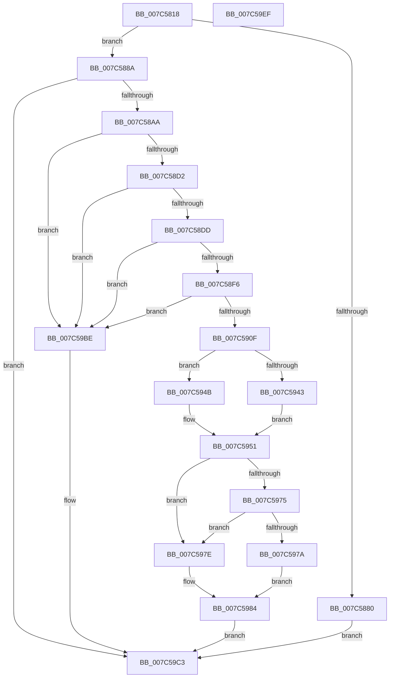

# ExInitializeUtcTimeZoneBias

- RVA: `0x007C5818`–`0x007C59F0` (길이 `472` bytes)
- VA: `0x00000001407C5818`
- 실행 섹션: `PAGE`
- PDB 이름 있음: `예`; PDB Function 태그: `아니요`
- unwind 정보 RVA: `0x000D4A24`
- 디코드: `118`개 명령, `472/472` bytes 표시
- 미해석 바이트: `0` (있으면 어셈블리에 `.byte`로 보존)

> 이 문서는 커널 이미지의 기계어와 PDB 기호를 분석해 생성했습니다. 4번과 5번은 함수 원형과 자료형을 바이너리 사용 방식에서 추정한 C 해석이며 원본 소스 복구 결과는 아닙니다.

## 1. Dependencies

- 직접 호출 지점: **8**; 고유 호출 대상: **7**
- 직접 호출자로 확인된 함수: **1**
- RIP 상대 이미지 참조: **3**

### Outgoing calls
- `0x007C586A` → [memset](../../text/6C/memset_function_006C6C40.md) (function, `0x006C6C40`)
- `0x007C588A` → [PsGetCurrentServerSiloGlobals](../../text/2F/PsGetCurrentServerSiloGlobals_function_002FE1F0.md) (function, `0x002FE1F0`)
- `0x007C589D` → [RtlpQueryTimeZoneInformationWorker](../A6/RtlpQueryTimeZoneInformationWorker_function_00A6BB6C.md) (function, `0x00A6BB6C`)
- `0x007C58C2` → [RtlTimeToTimeFields](../../text/42/RtlTimeToTimeFields_function_0042E0F0.md) (function, `0x0042E0F0`)
- `0x007C58E9` → [RtlCutoverTimeToSystemTime](../78/RtlCutoverTimeToSystemTime_function_0078B110.md) (function, `0x0078B110`)
- `0x007C5902` → [RtlCutoverTimeToSystemTime](../78/RtlCutoverTimeToSystemTime_function_0078B110.md) (function, `0x0078B110`)
- `0x007C59B5` → [ExpWriteTimeZoneBias](../A6/ExpWriteTimeZoneBias_function_00A6C028.md) (function, `0x00A6C028`)
- `0x007C59CD` → [_security_check_cookie](../../text/6A/_security_check_cookie_function_006AC640.md) (function, `0x006AC640`)

### Direct callers
- [Phase1InitializationDiscard](../../init/C1/Phase1InitializationDiscard_function_00C1C728.md) at `0x00C1D6B5`

### Static image references
- `0x007C583A` → RVA `0x00E0A740` (`.data`; read)
- `0x007C586F` → RVA `0x00E68570` (`.data`; read)
- `0x007C59A7` → RVA `0x00FC5008` (`ALMOSTRO`; read)

## 2. Other-region calls and transfers

- 다른 실행 섹션으로 향하는 call: **4**
  - `0x007C586A` → [memset](../../text/6C/memset_function_006C6C40.md) (`PAGE` → `.text`)
  - `0x007C588A` → [PsGetCurrentServerSiloGlobals](../../text/2F/PsGetCurrentServerSiloGlobals_function_002FE1F0.md) (`PAGE` → `.text`)
  - `0x007C58C2` → [RtlTimeToTimeFields](../../text/42/RtlTimeToTimeFields_function_0042E0F0.md) (`PAGE` → `.text`)
  - `0x007C59CD` → [_security_check_cookie](../../text/6A/_security_check_cookie_function_006AC640.md) (`PAGE` → `.text`)
- 별도 외부 분기/꼬리 이동을 확인하지 못했습니다.

## 3. Assembly (complete function range)

```asm
007C5818  48 8B C4                        mov rax, rsp
007C581B  48 89 58 10                     mov qword ptr [rax + 0x10], rbx
007C581F  48 89 70 18                     mov qword ptr [rax + 0x18], rsi
007C5823  48 89 78 20                     mov qword ptr [rax + 0x20], rdi
007C5827  55                              push rbp
007C5828  41 56                           push r14
007C582A  41 57                           push r15
007C582C  48 8D A8 E8 FE FF FF            lea rbp, [rax - 0x118]
007C5833  48 81 EC 00 02 00 00            sub rsp, 0x200
007C583A  48 8B 05 FF 4E 64 00            mov rax, qword ptr [rip + 0x644eff]
007C5841  48 33 C4                        xor rax, rsp
007C5844  48 89 85 F0 00 00 00            mov qword ptr [rbp + 0xf0], rax
007C584B  48 8B F9                        mov rdi, rcx
007C584E  45 33 FF                        xor r15d, r15d
007C5851  BB B0 01 00 00                  mov ebx, 0x1b0
007C5856  4C 89 7C 24 20                  mov qword ptr [rsp + 0x20], r15
007C585B  44 8B C3                        mov r8d, ebx
007C585E  4C 89 7C 24 28                  mov qword ptr [rsp + 0x28], r15
007C5863  33 D2                           xor edx, edx
007C5865  48 8D 4C 24 40                  lea rcx, [rsp + 0x40]
007C586A  E8 D1 13 F0 FF                  call 0x1406c6c40
007C586F  44 39 3D FA 2C 6A 00            cmp dword ptr [rip + 0x6a2cfa], r15d
007C5876  0F 57 C0                        xorps xmm0, xmm0
007C5879  0F 11 44 24 30                  movups xmmword ptr [rsp + 0x30], xmm0
007C587E  75 0A                           jne 0x1407c588a
007C5880  B8 BB 00 00 C0                  mov eax, 0xc00000bb
007C5885  E9 39 01 00 00                  jmp 0x1407c59c3
007C588A  E8 61 89 B3 FF                  call 0x1402fe1f0
007C588F  8B D3                           mov edx, ebx
007C5891  48 8D 4C 24 40                  lea rcx, [rsp + 0x40]
007C5896  48 8B B0 C8 04 00 00            mov rsi, qword ptr [rax + 0x4c8]
007C589D  E8 CA 62 2A 00                  call 0x140a6bb6c
007C58A2  85 C0                           test eax, eax
007C58A4  0F 88 19 01 00 00               js 0x1407c59c3
007C58AA  44 8B 75 E8                     mov r14d, dword ptr [rbp - 0x18]
007C58AE  48 8D 54 24 30                  lea rdx, [rsp + 0x30]
007C58B3  8B 5D 94                        mov ebx, dword ptr [rbp - 0x6c]
007C58B6  48 8B CF                        mov rcx, rdi
007C58B9  44 03 74 24 40                  add r14d, dword ptr [rsp + 0x40]
007C58BE  03 5C 24 40                     add ebx, dword ptr [rsp + 0x40]
007C58C2  E8 29 88 C6 FF                  call 0x14042e0f0
007C58C7  66 44 39 7D 86                  cmp word ptr [rbp - 0x7a], r15w
007C58CC  0F 84 EC 00 00 00               je 0x1407c59be
007C58D2  66 44 39 7D DA                  cmp word ptr [rbp - 0x26], r15w
007C58D7  0F 84 E1 00 00 00               je 0x1407c59be
007C58DD  4C 8B C7                        mov r8, rdi
007C58E0  48 8D 54 24 28                  lea rdx, [rsp + 0x28]
007C58E5  48 8D 4D 84                     lea rcx, [rbp - 0x7c]
007C58E9  E8 22 58 FC FF                  call 0x14078b110
007C58EE  84 C0                           test al, al
007C58F0  0F 84 C8 00 00 00               je 0x1407c59be
007C58F6  4C 8B C7                        mov r8, rdi
007C58F9  48 8D 54 24 20                  lea rdx, [rsp + 0x20]
007C58FE  48 8D 4D D8                     lea rcx, [rbp - 0x28]
007C5902  E8 09 58 FC FF                  call 0x14078b110
007C5907  84 C0                           test al, al
007C5909  0F 84 AF 00 00 00               je 0x1407c59be
007C590F  6B C3 3C                        imul eax, ebx, 0x3c
007C5912  48 63 C8                        movsxd rcx, eax
007C5915  4C 69 C1 80 96 98 00            imul r8, rcx, 0x989680
007C591C  41 6B C6 3C                     imul eax, r14d, 0x3c
007C5920  4C 03 44 24 20                  add r8, qword ptr [rsp + 0x20]
007C5925  4C 89 44 24 20                  mov qword ptr [rsp + 0x20], r8
007C592A  48 63 C8                        movsxd rcx, eax
007C592D  48 69 C9 80 96 98 00            imul rcx, rcx, 0x989680
007C5934  48 03 4C 24 28                  add rcx, qword ptr [rsp + 0x28]
007C5939  48 89 4C 24 28                  mov qword ptr [rsp + 0x28], rcx
007C593E  4C 3B C1                        cmp r8, rcx
007C5941  7D 08                           jge 0x1407c594b
007C5943  4D 8B D8                        mov r11, r8
007C5946  4C 8B C9                        mov r9, rcx
007C5949  EB 06                           jmp 0x1407c5951
007C594B  4C 8B D9                        mov r11, rcx
007C594E  4D 8B C8                        mov r9, r8
007C5951  41 8B D7                        mov edx, r15d
007C5954  41 8B C6                        mov eax, r14d
007C5957  0F 4D C3                        cmovge eax, ebx
007C595A  0F 9C C2                        setl dl
007C595D  FF C2                           inc edx
007C595F  45 8B D7                        mov r10d, r15d
007C5962  4C 3B C1                        cmp r8, rcx
007C5965  48 8B 0F                        mov rcx, qword ptr [rdi]
007C5968  41 0F 4D DE                     cmovge ebx, r14d
007C596C  41 0F 9D C2                     setge r10b
007C5970  49 3B CB                        cmp rcx, r11
007C5973  7C 09                           jl 0x1407c597e
007C5975  49 3B C9                        cmp rcx, r9
007C5978  7D 04                           jge 0x1407c597e
007C597A  8B D8                           mov ebx, eax
007C597C  EB 06                           jmp 0x1407c5984
007C597E  8B C3                           mov eax, ebx
007C5980  41 8D 52 01                     lea edx, [r10 + 1]
007C5984  89 96 B0 01 00 00               mov dword ptr [rsi + 0x1b0], edx
007C598A  48 8D 8E B8 01 00 00            lea rcx, [rsi + 0x1b8]
007C5991  6B C0 3C                        imul eax, eax, 0x3c
007C5994  89 9E B4 01 00 00               mov dword ptr [rsi + 0x1b4], ebx
007C599A  48 63 D0                        movsxd rdx, eax
007C599D  48 69 C2 80 96 98 00            imul rax, rdx, 0x989680
007C59A4  48 89 01                        mov qword ptr [rcx], rax
007C59A7  48 8B 05 5A F6 7F 00            mov rax, qword ptr [rip + 0x7ff65a]
007C59AE  44 89 B8 5C 02 00 00            mov dword ptr [rax + 0x25c], r15d
007C59B5  E8 6E 66 2A 00                  call 0x140a6c028
007C59BA  33 C0                           xor eax, eax
007C59BC  EB 05                           jmp 0x1407c59c3
007C59BE  B8 01 00 00 C0                  mov eax, 0xc0000001
007C59C3  48 8B 8D F0 00 00 00            mov rcx, qword ptr [rbp + 0xf0]
007C59CA  48 33 CC                        xor rcx, rsp
007C59CD  E8 6E 6C EE FF                  call 0x1406ac640
007C59D2  4C 8D 9C 24 00 02 00 00         lea r11, [rsp + 0x200]
007C59DA  49 8B 5B 28                     mov rbx, qword ptr [r11 + 0x28]
007C59DE  49 8B 73 30                     mov rsi, qword ptr [r11 + 0x30]
007C59E2  49 8B 7B 38                     mov rdi, qword ptr [r11 + 0x38]
007C59E6  49 8B E3                        mov rsp, r11
007C59E9  41 5F                           pop r15
007C59EB  41 5E                           pop r14
007C59ED  5D                              pop rbp
007C59EE  C3                              ret
007C59EF  CC                              int3
```

## 4. C-style interpretation (structured pseudocode)

```c
__int64 __fastcall ExInitializeUtcTimeZoneBias(__int64 a1, int a2)
{
    __int64 result;
    __int64 v_r10;
    __int64 v_r14;
    __int64 v_r15;
    __int64 v_rbx;
    __int64 v_rsp;
    unsigned __int64 v_stack_m18;
    unsigned __int64 v_stack_m1D8;
    unsigned __int64 v_stack_m1E8;
    unsigned __int64 v_stack_m1F0;
    unsigned __int64 v_stack_m1F8;

    *(unsigned __int64 *)(v_rsp + 16) = v_rbx;
    *(unsigned __int64 *)(v_rsp + 24) = v_rsi;
    *(unsigned __int64 *)(v_rsp + 32) = v_rdi;
    v_rsp = (v_rsp) - (512);
    result = (*(unsigned __int64 *)(v_rip + 6573823)) ^ (v_rsp);
    *(unsigned __int64 *)(v_rsp - 280 + 240) = result;
    v_r15 = 0;
    v_stack_m1F8 = 0;
    v_stack_m1F0 = 0;
    a2 = 0;
    result = memset(v_stack_m1D8, a2, 432, a4);
    v_stack_m1E8 = v_xmm0;
    if ((*(unsigned int *)(v_rip + 6958330)) != 0) goto loc_007C588A;
    goto loc_007C59C3;
loc_007C588A:
    result = PsGetCurrentServerSiloGlobals(v_stack_m1D8, a2, 432, a4);
    result = RtlpQueryTimeZoneInformationWorker(v_stack_m1D8, 432, 432, a4);
    if (sign_flag) goto loc_007C59C3;
    v_r14 = (unsigned int)(((unsigned int)(*(unsigned int *)(v_rsp - 280 - 24))) + (v_stack_m1D8));
    v_rbx = (unsigned int)(((unsigned int)(*(unsigned int *)(v_rsp - 280 - 108))) + (v_stack_m1D8));
    result = RtlTimeToTimeFields(a1, v_stack_m1E8, 432, a4);
    if ((*(unsigned __int16 *)(v_rsp - 280 - 122)) == 0) goto loc_007C59BE;
    if ((*(unsigned __int16 *)(v_rsp - 280 - 38)) == 0) goto loc_007C59BE;
    result = RtlCutoverTimeToSystemTime(v_rsp - 280 - 124, v_stack_m1F0, a1, a4);
    if ((unsigned __int8)(result) == 0) goto loc_007C59BE;
    result = RtlCutoverTimeToSystemTime(v_rsp - 280 - 40, v_stack_m1F8, a1, a4);
    if ((unsigned __int8)(result) == 0) goto loc_007C59BE;
    result = (unsigned int)((result) * ((unsigned int)(v_rbx)));
    a3 = (a1) * ((int)((unsigned int)(result)));
    result = (unsigned int)((result) * ((unsigned int)(v_r14)));
    a3 = (a3) + (v_stack_m1F8);
    v_stack_m1F8 = a3;
    a1 = ((int)((unsigned int)(result))) * ((int)((unsigned int)(result)));
    a1 = (a1) + (v_stack_m1F0);
    v_stack_m1F0 = a1;
    if (a3 >= a1) goto loc_007C594B;
    goto loc_007C5951;
loc_007C594B:
loc_007C5951:
    result = (unsigned int)((unsigned int)(v_r14));
    if (a3 >= a1) { result = (unsigned int)(v_rbx); }
    a2 = (a3 < a1) ? 1 : 0;
    a2 = (unsigned int)((a2) + 1);
    if (a3 >= a1) { v_rbx = (unsigned int)(v_r14); }
    v_r10 = (a3 >= a1) ? 1 : 0;
    if ((*(unsigned __int64 *)(a1)) < a1) goto loc_007C597E;
    if ((*(unsigned __int64 *)(a1)) >= a3) goto loc_007C597E;
    goto loc_007C5984;
loc_007C597E:
loc_007C5984:
    *(unsigned int *)(*(unsigned __int64 *)(result + 1224) + 432) = (unsigned int)(v_r10 + 1);
    result = (unsigned int)(((unsigned int)((unsigned int)((unsigned int)((unsigned int)(result))))) * ((unsigned int)((unsigned int)((unsigned int)((unsigned int)((unsigned int)(result)))))));
    *(unsigned int *)(*(unsigned __int64 *)(result + 1224) + 436) = (unsigned int)((unsigned int)((unsigned int)(result)));
    result = (result) * ((int)((unsigned int)(result)));
    *(unsigned __int64 *)(*(unsigned __int64 *)(result + 1224) + 440) = result;
    *(unsigned int *)(*(unsigned __int64 *)(v_rip + 8386138) + 604) = 0;
    result = ExpWriteTimeZoneBias(*(unsigned __int64 *)(result + 1224) + 440, (int)((unsigned int)(result)), a3, a3);
    result = 0;
    goto loc_007C59C3;
loc_007C59BE:
loc_007C59C3:
    a1 = (*(unsigned __int64 *)(v_rsp - 280 + 240)) ^ (v_rsp);
    result = _security_check_cookie(a1, (int)((unsigned int)(result)), a3, a3);
    return result;
}
```

## 5. (Beta) C Style

```c
int64_t ExInitializeUtcTimeZoneBias(void *UtcTimeZoneBias, int32_t Arg2)
{
    uint8_t *utcTimeZoneBias = (uint8_t *)UtcTimeZoneBias;

    int64_t result;
    int64_t local_r10;
    int64_t local_r14;
    int64_t local_r15;
    int64_t local_rbx;
    int64_t local_rsp;
    uint64_t v_stack_m18;
    uint64_t v_stack_m1D8;
    uint64_t v_stack_m1E8;
    uint64_t v_stack_m1F0;
    uint64_t v_stack_m1F8;

    *(uint64_t *)(local_rsp + 0x10) = local_rbx;
    *(uint64_t *)(local_rsp + 0x18) = local_rsi;
    *(uint64_t *)(local_rsp + 0x20) = local_rdi;
    local_rsp = (local_rsp) - (512);
    result = (*(uint64_t *)(v_rip + 0x644EFF)) ^ (local_rsp);
    *(uint64_t *)(local_rsp - 0x118 + 0xF0) = result;
    local_r15 = 0;
    v_stack_m1F8 = 0;
    v_stack_m1F0 = 0;
    Arg2 = 0;
    result = memset(v_stack_m1D8, Arg2, 432, a4);
    v_stack_m1E8 = v_xmm0;
    if ((*(uint32_t *)(v_rip + 0x6A2CFA)) != 0) goto loc_007C588A;
    goto loc_007C59C3;
loc_007C588A:
    result = PsGetCurrentServerSiloGlobals(v_stack_m1D8, Arg2, 432, a4);
    result = RtlpQueryTimeZoneInformationWorker(v_stack_m1D8, 432, 432, a4);
    if (sign_flag) goto loc_007C59C3;
    local_r14 = (uint32_t)(((uint32_t)(*(uint32_t *)(local_rsp - 0x118 - 0x18))) + (v_stack_m1D8));
    local_rbx = (uint32_t)(((uint32_t)(*(uint32_t *)(local_rsp - 0x118 - 0x6C))) + (v_stack_m1D8));
    result = RtlTimeToTimeFields(UtcTimeZoneBias, v_stack_m1E8, 432, a4);
    if ((*(uint16_t *)(local_rsp - 0x118 - 0x7A)) == 0) goto loc_007C59BE;
    if ((*(uint16_t *)(local_rsp - 0x118 - 0x26)) == 0) goto loc_007C59BE;
    result = RtlCutoverTimeToSystemTime(local_rsp - 280 - 124, v_stack_m1F0, UtcTimeZoneBias, a4);
    if ((uint8_t)(result) == 0) goto loc_007C59BE;
    result = RtlCutoverTimeToSystemTime(local_rsp - 280 - 40, v_stack_m1F8, UtcTimeZoneBias, a4);
    if ((uint8_t)(result) == 0) goto loc_007C59BE;
    result = (uint32_t)((result) * ((uint32_t)(local_rbx)));
    a3 = (UtcTimeZoneBias) * ((int32_t)((uint32_t)(result)));
    result = (uint32_t)((result) * ((uint32_t)(local_r14)));
    a3 = (a3) + (v_stack_m1F8);
    v_stack_m1F8 = a3;
    UtcTimeZoneBias = ((int32_t)((uint32_t)(result))) * ((int32_t)((uint32_t)(result)));
    UtcTimeZoneBias = (UtcTimeZoneBias) + (v_stack_m1F0);
    v_stack_m1F0 = UtcTimeZoneBias;
    if (a3 >= UtcTimeZoneBias) goto loc_007C594B;
    goto loc_007C5951;
loc_007C594B:
loc_007C5951:
    result = (uint32_t)((uint32_t)(local_r14));
    if (a3 >= UtcTimeZoneBias) { result = (uint32_t)(local_rbx); }
    Arg2 = (a3 < UtcTimeZoneBias) ? 1 : 0;
    Arg2 = (uint32_t)((Arg2) + 1);
    if (a3 >= UtcTimeZoneBias) { local_rbx = (uint32_t)(local_r14); }
    local_r10 = (a3 >= UtcTimeZoneBias) ? 1 : 0;
    if ((*(uint64_t *)(utcTimeZoneBias)) < UtcTimeZoneBias) goto loc_007C597E;
    if ((*(uint64_t *)(utcTimeZoneBias)) >= a3) goto loc_007C597E;
    goto loc_007C5984;
loc_007C597E:
loc_007C5984:
    *(uint32_t *)(*(uint64_t *)(result + 0x4C8) + 0x1B0) = (uint32_t)(local_r10 + 1);
    result = (uint32_t)(((uint32_t)((uint32_t)((uint32_t)((uint32_t)(result))))) * ((uint32_t)((uint32_t)((uint32_t)((uint32_t)((uint32_t)(result)))))));
    *(uint32_t *)(*(uint64_t *)(result + 0x4C8) + 0x1B4) = (uint32_t)((uint32_t)((uint32_t)(result)));
    result = (result) * ((int32_t)((uint32_t)(result)));
    *(uint64_t *)(*(uint64_t *)(result + 0x4C8) + 0x1B8) = result;
    *(uint32_t *)(*(uint64_t *)(v_rip + 0x7FF65A) + 0x25C) = 0;
    result = ExpWriteTimeZoneBias(*(uint64_t *)(result + 0x4C8) + 440, (int32_t)((uint32_t)(result)), a3, a3);
    result = 0;
    goto loc_007C59C3;
loc_007C59BE:
loc_007C59C3:
    UtcTimeZoneBias = (*(uint64_t *)(local_rsp - 0x118 + 0xF0)) ^ (local_rsp);
    result = _security_check_cookie(UtcTimeZoneBias, (int32_t)((uint32_t)(result)), a3, a3);
    return result;
}
```

### 관측된 메모리 오프셋

구조체 형식이 확인되지 않은 접근은 인자 기준의 오프셋으로만 기록했습니다.

| 기준 인자 | 오프셋 표현 | 폭 (bit) | 접근 |
|---|---:|---:|---|
| `UtcTimeZoneBias` | `+ 0x0` | `64` | `R` |

## 6. Execution-region graph

[열기: 2D/3D 그래프와 함수 탐색 컨트롤 패널](../../../control-panel.html?section=page&rva=0x007C5818&view=graph)

- 2D 그래프는 위에서 아래로 흐르고, 3D 그래프는 빈 공간을 드래그해 회전합니다. Shift+드래그는 이동, 휠은 확대·축소, 함수 노드 선택은 대상 보고서 이동입니다.

### Static fallback


