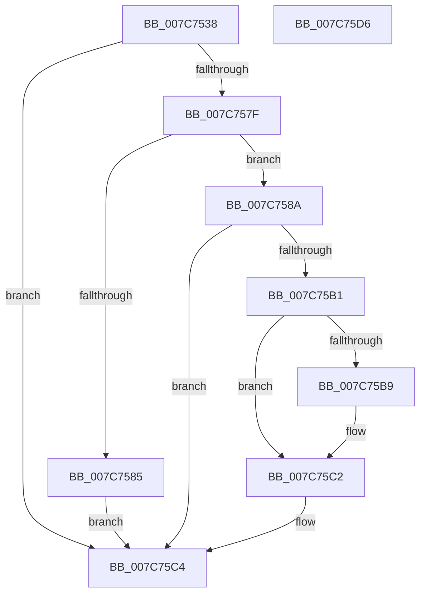

# ExIsMultiSessionSku

- RVA: `0x007C7538`–`0x007C75D7` (길이 `159` bytes)
- VA: `0x00000001407C7538`
- 실행 섹션: `PAGE`
- PDB 이름 있음: `예`; PDB Function 태그: `아니요`
- unwind 정보 RVA: `0x000D4C94`
- 디코드: `48`개 명령, `159/159` bytes 표시
- 미해석 바이트: `0` (있으면 어셈블리에 `.byte`로 보존)

> 이 문서는 커널 이미지의 기계어와 PDB 기호를 분석해 생성했습니다. 4번과 5번은 함수 원형과 자료형을 바이너리 사용 방식에서 추정한 C 해석이며 원본 소스 복구 결과는 아닙니다.

## 1. Dependencies

- 직접 호출 지점: **3**; 고유 호출 대상: **3**
- 직접 호출자로 확인된 함수: **2**
- RIP 상대 이미지 참조: **1**

### Outgoing calls
- `0x007C7574` → [ExpGetNumberOfInitialSessionsFromRegistry](ExpGetNumberOfInitialSessionsFromRegistry_function_007C7678.md) (function, `0x007C7678`)
- `0x007C758A` → [PsQueryCurrentApiSetSchema](../A2/PsQueryCurrentApiSetSchema_function_00A24300.md) (function, `0x00A24300`)
- `0x007C75A6` → [ApiSetResolveToHost](../../text/4C/ApiSetResolveToHost_function_004C8AA8.md) (function, `0x004C8AA8`)

### Direct callers
- [PspInitializeServerSiloDeferred](../77/PspInitializeServerSiloDeferred_function_0077FEE0.md) at `0x0077FF7B`
- [Phase1InitializationDiscard](../../init/C1/Phase1InitializationDiscard_function_00C1C728.md) at `0x00C1D3FE`

### Static image references
- `0x007C7558` → RVA `0x00B08630` (` ?? ::NNGAKEGL::`string'`; read)

## 2. Other-region calls and transfers

- 다른 실행 섹션으로 향하는 call: **1**
  - `0x007C75A6` → [ApiSetResolveToHost](../../text/4C/ApiSetResolveToHost_function_004C8AA8.md) (`PAGE` → `.text`)
- 별도 외부 분기/꼬리 이동을 확인하지 못했습니다.

## 3. Assembly (complete function range)

```asm
007C7538  48 89 5C 24 08                  mov qword ptr [rsp + 8], rbx
007C753D  48 89 7C 24 20                  mov qword ptr [rsp + 0x20], rdi
007C7542  55                              push rbp
007C7543  48 8B EC                        mov rbp, rsp
007C7546  48 83 EC 50                     sub rsp, 0x50
007C754A  48 8B D9                        mov rbx, rcx
007C754D  48 C7 45 E0 44 00 46 00         mov qword ptr [rbp - 0x20], 0x460044
007C7555  0F 57 C0                        xorps xmm0, xmm0
007C7558  48 8D 05 D1 10 34 00            lea rax, [rip + 0x3410d1]
007C755F  33 FF                           xor edi, edi
007C7561  48 89 45 E8                     mov qword ptr [rbp - 0x18], rax
007C7565  48 8D 4D 20                     lea rcx, [rbp + 0x20]
007C7569  40 88 7D 18                     mov byte ptr [rbp + 0x18], dil
007C756D  0F 11 45 F0                     movups xmmword ptr [rbp - 0x10], xmm0
007C7571  89 7D 20                        mov dword ptr [rbp + 0x20], edi
007C7574  E8 FF 00 00 00                  call 0x1407c7678
007C7579  8B C8                           mov ecx, eax
007C757B  85 C0                           test eax, eax
007C757D  78 45                           js 0x1407c75c4
007C757F  83 7D 20 01                     cmp dword ptr [rbp + 0x20], 1
007C7583  76 05                           jbe 0x1407c758a
007C7585  C6 03 01                        mov byte ptr [rbx], 1
007C7588  EB 3A                           jmp 0x1407c75c4
007C758A  E8 71 CD 25 00                  call 0x140a24300
007C758F  48 8B C8                        mov rcx, rax
007C7592  4C 8D 4D 18                     lea r9, [rbp + 0x18]
007C7596  48 8D 45 F0                     lea rax, [rbp - 0x10]
007C759A  45 33 C0                        xor r8d, r8d
007C759D  48 8D 55 E0                     lea rdx, [rbp - 0x20]
007C75A1  48 89 44 24 20                  mov qword ptr [rsp + 0x20], rax
007C75A6  E8 FD 14 D0 FF                  call 0x1404c8aa8
007C75AB  8B C8                           mov ecx, eax
007C75AD  85 C0                           test eax, eax
007C75AF  78 13                           js 0x1407c75c4
007C75B1  0F B6 45 18                     movzx eax, byte ptr [rbp + 0x18]
007C75B5  84 C0                           test al, al
007C75B7  74 09                           je 0x1407c75c2
007C75B9  33 D2                           xor edx, edx
007C75BB  66 3B 55 F0                     cmp dx, word ptr [rbp - 0x10]
007C75BF  0F 44 C7                        cmove eax, edi
007C75C2  88 03                           mov byte ptr [rbx], al
007C75C4  48 8B 5C 24 60                  mov rbx, qword ptr [rsp + 0x60]
007C75C9  8B C1                           mov eax, ecx
007C75CB  48 8B 7C 24 78                  mov rdi, qword ptr [rsp + 0x78]
007C75D0  48 83 C4 50                     add rsp, 0x50
007C75D4  5D                              pop rbp
007C75D5  C3                              ret
007C75D6  CC                              int3
```

## 4. C-style interpretation (structured pseudocode)

```c
__int64 __fastcall ExIsMultiSessionSku(__int64 a1, __int64 a2, int a3)
{
    __int64 result;
    __int64 v_rdi;
    __int64 v_rsp;
    unsigned __int64 v_stack_m18;
    unsigned __int64 v_stack_m20;
    unsigned __int64 v_stack_m28;
    unsigned __int64 v_stack_m38;
    unsigned __int8 v_stack_p10;
    unsigned __int64 v_stack_p18;
    unsigned __int64 v_stack_p20;
    unsigned __int64 v_stack_p8;

    v_stack_p8 = v_rbx;
    v_stack_p20 = v_rdi;
    v_rsp = (v_rsp) - (80);
    v_stack_m28 = 0x460044ULL;
    v_rdi = 0;
    v_stack_m20 = v_rip + 3412177;
    v_stack_p10 = 0;
    v_stack_m18 = v_xmm0;
    v_stack_p18 = 0;
    result = ExpGetNumberOfInitialSessionsFromRegistry(v_stack_p18, a2, a3, a4);
    if (sign_flag) goto loc_007C75C4;
    if (v_stack_p18 <= 1) goto loc_007C758A;
    *(unsigned __int8 *)(a1) = 1;
    goto loc_007C75C4;
loc_007C758A:
    result = PsQueryCurrentApiSetSchema((unsigned int)((unsigned int)(result)), a2, a3, a4);
    a3 = 0;
    v_stack_m38 = v_stack_m18;
    result = ApiSetResolveToHost(result, v_stack_m28, a3, v_stack_p10);
    if (sign_flag) goto loc_007C75C4;
    result = v_stack_p10;
    if ((unsigned __int8)(v_stack_p10) != 0) {
        a2 = 0;
        result = v_stack_p10;
        if (0 == v_stack_m18) { result = 0; }
    }
    *(unsigned __int8 *)(a1) = (unsigned __int8)(result);
loc_007C75C4:
    v_rsp = (v_rsp) + (80);
    return (unsigned int)((unsigned int)((unsigned int)((unsigned int)(result))));
}
```

## 5. (Beta) C Style

```c
int64_t ExIsMultiSessionSku(void *Arg1, int64_t Arg2, int32_t Arg3)
{
    uint8_t *arg1 = (uint8_t *)Arg1;

    int64_t result;
    int64_t local_rdi;
    int64_t local_rsp;
    uint64_t v_stack_m18;
    uint64_t v_stack_m20;
    uint64_t v_stack_m28;
    uint64_t v_stack_m38;
    uint8_t v_stack_p10;
    uint64_t v_stack_p18;
    uint64_t v_stack_p20;
    uint64_t v_stack_p8;

    v_stack_p8 = local_rbx;
    v_stack_p20 = local_rdi;
    local_rsp = (local_rsp) - (80);
    v_stack_m28 = 0x460044ULL;
    local_rdi = 0;
    v_stack_m20 = v_rip + 3412177;
    v_stack_p10 = 0;
    v_stack_m18 = v_xmm0;
    v_stack_p18 = 0;
    result = ExpGetNumberOfInitialSessionsFromRegistry(v_stack_p18, Arg2, Arg3, a4);
    if (sign_flag) goto loc_007C75C4;
    if (v_stack_p18 <= 1) goto loc_007C758A;
    *(uint8_t *)(arg1) = 1;
    goto loc_007C75C4;
loc_007C758A:
    result = PsQueryCurrentApiSetSchema((uint32_t)((uint32_t)(result)), Arg2, Arg3, a4);
    Arg3 = 0;
    v_stack_m38 = v_stack_m18;
    result = ApiSetResolveToHost(result, v_stack_m28, Arg3, v_stack_p10);
    if (sign_flag) goto loc_007C75C4;
    result = v_stack_p10;
    if ((uint8_t)(v_stack_p10) != 0) {
        Arg2 = 0;
        result = v_stack_p10;
        if (0 == v_stack_m18) { result = 0; }
    }
    *(uint8_t *)(arg1) = (uint8_t)(result);
loc_007C75C4:
    local_rsp = (local_rsp) + (80);
    return (uint32_t)((uint32_t)((uint32_t)((uint32_t)(result))));
}
```

### 관측된 메모리 오프셋

구조체 형식이 확인되지 않은 접근은 인자 기준의 오프셋으로만 기록했습니다.

| 기준 인자 | 오프셋 표현 | 폭 (bit) | 접근 |
|---|---:|---:|---|
| `Arg1` | `+ 0x0` | `8` | `W` |

## 6. Execution-region graph

[열기: 2D/3D 그래프와 함수 탐색 컨트롤 패널](../../../control-panel.html?section=page&rva=0x007C7538&view=graph)

- 2D 그래프는 위에서 아래로 흐르고, 3D 그래프는 빈 공간을 드래그해 회전합니다. Shift+드래그는 이동, 휠은 확대·축소, 함수 노드 선택은 대상 보고서 이동입니다.

### Static fallback


