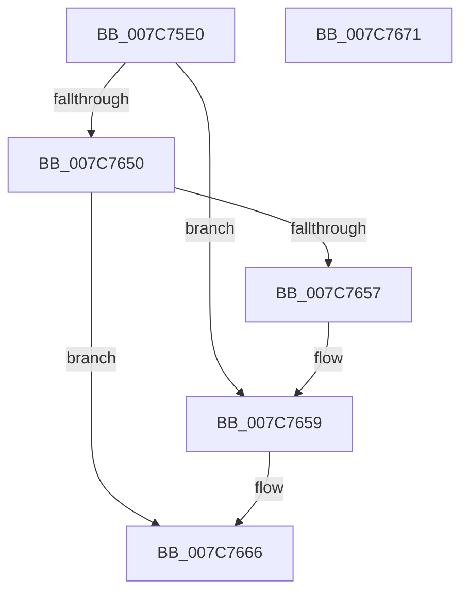

# ExIsStateSeparationEnabled

- RVA: `0x007C75E0`–`0x007C7672` (길이 `146` bytes)
- VA: `0x00000001407C75E0`
- 실행 섹션: `PAGE`
- PDB 이름 있음: `예`; PDB Function 태그: `아니요`
- unwind 정보 RVA: `0x000CE364`
- 디코드: `36`개 명령, `146/146` bytes 표시
- 미해석 바이트: `0` (있으면 어셈블리에 `.byte`로 보존)

> 이 문서는 커널 이미지의 기계어와 PDB 기호를 분석해 생성했습니다. 4번과 5번은 함수 원형과 자료형을 바이너리 사용 방식에서 추정한 C 해석이며 원본 소스 복구 결과는 아닙니다.

## 1. Dependencies

- 직접 호출 지점: **2**; 고유 호출 대상: **2**
- 직접 호출자로 확인된 함수: **1**
- RIP 상대 이미지 참조: **2**

### Outgoing calls
- `0x007C75FF` → [memset](../../text/6C/memset_function_006C6C40.md) (function, `0x006C6C40`)
- `0x007C7645` → [RtlpQueryRegistryValues](../8C/RtlpQueryRegistryValues_function_008C9050.md) (function, `0x008C9050`)

### Direct callers
- [PspInitializeServerSiloDeferred](../77/PspInitializeServerSiloDeferred_function_0077FEE0.md) at `0x0077FFBC`

### Static image references
- `0x007C760F` → RVA `0x00AFBEF0` (` ?? ::NNGAKEGL::`string'`; read)
- `0x007C763E` → RVA `0x00B08600` (` ?? ::NNGAKEGL::`string'`; read)

## 2. Other-region calls and transfers

- 다른 실행 섹션으로 향하는 call: **1**
  - `0x007C75FF` → [memset](../../text/6C/memset_function_006C6C40.md) (`PAGE` → `.text`)
- 별도 외부 분기/꼬리 이동을 확인하지 못했습니다.

## 3. Assembly (complete function range)

```asm
007C75E0  48 8B C4                        mov rax, rsp
007C75E3  53                              push rbx
007C75E4  48 81 EC A0 00 00 00            sub rsp, 0xa0
007C75EB  83 60 08 00                     and dword ptr [rax + 8], 0
007C75EF  33 D2                           xor edx, edx
007C75F1  48 8B D9                        mov rbx, rcx
007C75F4  C6 01 00                        mov byte ptr [rcx], 0
007C75F7  48 8D 48 88                     lea rcx, [rax - 0x78]
007C75FB  44 8D 42 70                     lea r8d, [rdx + 0x70]
007C75FF  E8 3C F6 EF FF                  call 0x1406c6c40
007C7604  45 33 C9                        xor r9d, r9d
007C7607  C7 44 24 38 24 01 00 00         mov dword ptr [rsp + 0x38], 0x124
007C760F  48 8D 05 DA 48 33 00            lea rax, [rip + 0x3348da]
007C7616  C7 44 24 50 04 00 00 04         mov dword ptr [rsp + 0x50], 0x4000004
007C761E  48 89 44 24 40                  mov qword ptr [rsp + 0x40], rax
007C7623  4C 8D 44 24 30                  lea r8, [rsp + 0x30]
007C7628  48 8D 84 24 B0 00 00 00         lea rax, [rsp + 0xb0]
007C7630  C6 44 24 28 01                  mov byte ptr [rsp + 0x28], 1
007C7635  41 8D 49 02                     lea ecx, [r9 + 2]
007C7639  48 89 44 24 48                  mov qword ptr [rsp + 0x48], rax
007C763E  48 8D 15 BB 0F 34 00            lea rdx, [rip + 0x340fbb]
007C7645  E8 06 1A 10 00                  call 0x1408c9050
007C764A  8B C8                           mov ecx, eax
007C764C  85 C0                           test eax, eax
007C764E  79 09                           jns 0x1407c7659
007C7650  3D 34 00 00 C0                  cmp eax, 0xc0000034
007C7655  75 0F                           jne 0x1407c7666
007C7657  33 C9                           xor ecx, ecx
007C7659  83 BC 24 B0 00 00 00 00         cmp dword ptr [rsp + 0xb0], 0
007C7661  0F 95 C0                        setne al
007C7664  88 03                           mov byte ptr [rbx], al
007C7666  8B C1                           mov eax, ecx
007C7668  48 81 C4 A0 00 00 00            add rsp, 0xa0
007C766F  5B                              pop rbx
007C7670  C3                              ret
007C7671  CC                              int3
```

## 4. C-style interpretation (structured pseudocode)

```c
__int64 __fastcall ExIsStateSeparationEnabled(__int64 a1, int a2, __int64 a3, int a4)
{
    __int64 result;
    __int64 v_rsp;
    unsigned int v_stack_m58;
    unsigned __int64 v_stack_m60;
    unsigned __int64 v_stack_m68;
    unsigned int v_stack_m70;
    unsigned __int64 v_stack_m78;
    unsigned __int8 v_stack_m80;
    unsigned __int64 v_stack_p8;

    v_rsp = (v_rsp) - (160);
    a2 = 0;
    *(unsigned __int8 *)(a1) = 0;
    result = memset(v_rsp - 120, a2, a2 + 112, a4);
    a4 = 0;
    v_stack_m70 = 292;
    v_stack_m58 = 0x4000004ULL;
    v_stack_m68 = v_rip + 3360986;
    v_stack_m80 = 1;
    v_stack_m60 = v_stack_p8;
    result = RtlpQueryRegistryValues(a4 + 2, v_rip + 3411899, v_stack_m78, a4);
    if (!sign_flag) goto loc_007C7659;
    if (((unsigned int)(result)) != 0xC0000034ULL) goto loc_007C7666;
    a1 = 0;
loc_007C7659:
    result = (v_stack_p8 != 0) ? 1 : 0;
    *(unsigned __int8 *)(a1) = (unsigned __int8)(result);
loc_007C7666:
    v_rsp = (v_rsp) + (160);
    return 0;
}
```

## 5. (Beta) C Style

```c
int64_t ExIsStateSeparationEnabled(void *Arg1, int32_t Arg2, int64_t Arg3, int32_t Arg4)
{
    uint8_t *arg1 = (uint8_t *)Arg1;

    int64_t result;
    int64_t local_rsp;
    uint32_t v_stack_m58;
    uint64_t v_stack_m60;
    uint64_t v_stack_m68;
    uint32_t v_stack_m70;
    uint64_t v_stack_m78;
    uint8_t v_stack_m80;
    uint64_t v_stack_p8;

    local_rsp = (local_rsp) - (160);
    Arg2 = 0;
    *(uint8_t *)(arg1) = 0;
    result = memset(local_rsp - 120, Arg2, Arg2 + 112, Arg4);
    Arg4 = 0;
    v_stack_m70 = 292;
    v_stack_m58 = 0x4000004ULL;
    v_stack_m68 = v_rip + 3360986;
    v_stack_m80 = 1;
    v_stack_m60 = v_stack_p8;
    result = RtlpQueryRegistryValues(Arg4 + 2, v_rip + 3411899, v_stack_m78, Arg4);
    if (!sign_flag) goto loc_007C7659;
    if (((uint32_t)(result)) != 0xC0000034ULL) goto loc_007C7666;
    Arg1 = 0;
loc_007C7659:
    result = (v_stack_p8 != 0) ? 1 : 0;
    *(uint8_t *)(arg1) = (uint8_t)(result);
loc_007C7666:
    local_rsp = (local_rsp) + (160);
    return 0;
}
```

### 관측된 메모리 오프셋

구조체 형식이 확인되지 않은 접근은 인자 기준의 오프셋으로만 기록했습니다.

| 기준 인자 | 오프셋 표현 | 폭 (bit) | 접근 |
|---|---:|---:|---|
| `Arg1` | `+ 0x0` | `8` | `W` |

## 6. Execution-region graph

[열기: 2D/3D 그래프와 함수 탐색 컨트롤 패널](../../../control-panel.html?section=page&rva=0x007C75E0&view=graph)

- 2D 그래프는 위에서 아래로 흐르고, 3D 그래프는 빈 공간을 드래그해 회전합니다. Shift+드래그는 이동, 휠은 확대·축소, 함수 노드 선택은 대상 보고서 이동입니다.

### Static fallback


