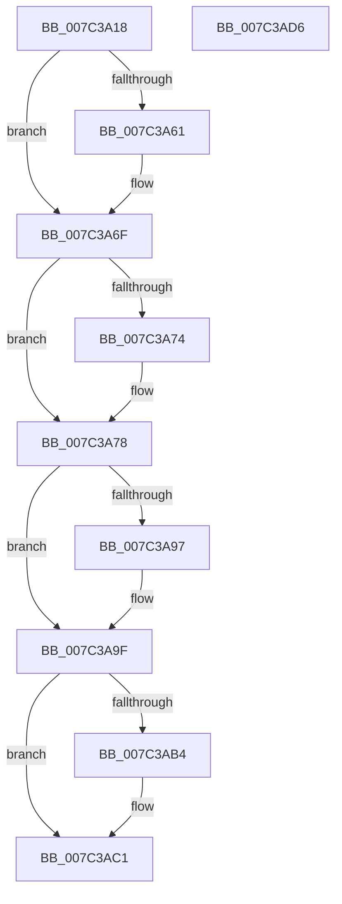

# ExNotifyPlatformBinaryExecuted

- RVA: `0x007C3A18`–`0x007C3AD7` (길이 `191` bytes)
- VA: `0x00000001407C3A18`
- 실행 섹션: `PAGE`
- PDB 이름 있음: `예`; PDB Function 태그: `아니요`
- unwind 정보 RVA: `0x0005C954`
- 디코드: `48`개 명령, `191/191` bytes 표시
- 미해석 바이트: `0` (있으면 어셈블리에 `.byte`로 보존)

> 이 문서는 커널 이미지의 기계어와 PDB 기호를 분석해 생성했습니다. 4번과 5번은 함수 원형과 자료형을 바이너리 사용 방식에서 추정한 C 해석이며 원본 소스 복구 결과는 아닙니다.

## 1. Dependencies

- 직접 호출 지점: **6**; 고유 호출 대상: **6**
- 직접 호출자로 확인된 함수: **1**
- RIP 상대 이미지 참조: **4**

### Outgoing calls
- `0x007C3A50` → [KeAbPreAcquire](../../text/21/KeAbPreAcquire_function_00210230.md) (function, `0x00210230`)
- `0x007C3A6A` → [ExfAcquirePushLockExclusiveEx](../../text/20/ExfAcquirePushLockExclusiveEx_function_0020FC90.md) (function, `0x0020FC90`)
- `0x007C3A9A` → [ExfTryToWakePushLock](../../text/26/ExfTryToWakePushLock_function_00265DD0.md) (function, `0x00265DD0`)
- `0x007C3AA2` → [KeAbPostRelease](../../text/2E/KeAbPostRelease_function_002E1600.md) (function, `0x002E1600`)
- `0x007C3AAA` → [KiLeaveCriticalRegionUnsafe](../../text/25/KiLeaveCriticalRegionUnsafe_function_0025F010.md) (function, `0x0025F010`)
- `0x007C3ABC` → [ExFreePoolWithTag](../../poolcode/B8/ExFreePoolWithTag_function_00B82870.md) (function, `0x00B82870`)

### Direct callers
- [CmCompleteRegistryInitialization](../7D/CmCompleteRegistryInitialization_function_007DF1EC.md) at `0x007DF388`

### Static image references
- `0x007C3A35` → RVA `0x00FD80B8` (`PAGEDATA`; read)
- `0x007C3A78` → RVA `0x00FD80E0` (`PAGEDATA`; read)
- `0x007C3A7F` → RVA `0x00FD80E0` (`PAGEDATA`; write)
- `0x007C3A86` → RVA `0x00FD80B8` (`PAGEDATA`; read/write)

## 2. Other-region calls and transfers

- 다른 실행 섹션으로 향하는 call: **6**
  - `0x007C3A50` → [KeAbPreAcquire](../../text/21/KeAbPreAcquire_function_00210230.md) (`PAGE` → `.text`)
  - `0x007C3A6A` → [ExfAcquirePushLockExclusiveEx](../../text/20/ExfAcquirePushLockExclusiveEx_function_0020FC90.md) (`PAGE` → `.text`)
  - `0x007C3A9A` → [ExfTryToWakePushLock](../../text/26/ExfTryToWakePushLock_function_00265DD0.md) (`PAGE` → `.text`)
  - `0x007C3AA2` → [KeAbPostRelease](../../text/2E/KeAbPostRelease_function_002E1600.md) (`PAGE` → `.text`)
  - `0x007C3AAA` → [KiLeaveCriticalRegionUnsafe](../../text/25/KiLeaveCriticalRegionUnsafe_function_0025F010.md) (`PAGE` → `.text`)
  - `0x007C3ABC` → [ExFreePoolWithTag](../../poolcode/B8/ExFreePoolWithTag_function_00B82870.md) (`PAGE` → `POOLCODE`)
- 별도 외부 분기/꼬리 이동을 확인하지 못했습니다.

## 3. Assembly (complete function range)

```asm
007C3A18  48 89 5C 24 08                  mov qword ptr [rsp + 8], rbx
007C3A1D  48 89 6C 24 10                  mov qword ptr [rsp + 0x10], rbp
007C3A22  48 89 74 24 18                  mov qword ptr [rsp + 0x18], rsi
007C3A27  57                              push rdi
007C3A28  48 83 EC 20                     sub rsp, 0x20
007C3A2C  65 48 8B 34 25 88 01 00 00      mov rsi, qword ptr gs:[0x188]
007C3A35  48 8D 2D 7C 46 81 00            lea rbp, [rip + 0x81467c]
007C3A3C  48 83 CB FF                     or rbx, 0xffffffffffffffff
007C3A40  45 33 C0                        xor r8d, r8d
007C3A43  33 D2                           xor edx, edx
007C3A45  48 8B CD                        mov rcx, rbp
007C3A48  66 01 9E E4 01 00 00            add word ptr [rsi + 0x1e4], bx
007C3A4F  90                              nop
007C3A50  E8 DB C7 A4 FF                  call 0x140210230
007C3A55  F0 48 0F BA 6D 00 00            lock bts qword ptr [rbp], 0
007C3A5C  48 8B F8                        mov rdi, rax
007C3A5F  73 0E                           jae 0x1407c3a6f
007C3A61  4C 8B C5                        mov r8, rbp
007C3A64  48 8B D0                        mov rdx, rax
007C3A67  48 8B CD                        mov rcx, rbp
007C3A6A  E8 21 C2 A4 FF                  call 0x14020fc90
007C3A6F  48 85 FF                        test rdi, rdi
007C3A72  74 04                           je 0x1407c3a78
007C3A74  C6 47 0A 01                     mov byte ptr [rdi + 0xa], 1
007C3A78  48 8B 3D 61 46 81 00            mov rdi, qword ptr [rip + 0x814661]
007C3A7F  48 89 1D 5A 46 81 00            mov qword ptr [rip + 0x81465a], rbx
007C3A86  F0 48 0F C1 1D 29 46 81 00      lock xadd qword ptr [rip + 0x814629], rbx
007C3A8F  80 E3 06                        and bl, 6
007C3A92  80 FB 02                        cmp bl, 2
007C3A95  75 08                           jne 0x1407c3a9f
007C3A97  48 8B CD                        mov rcx, rbp
007C3A9A  E8 31 23 AA FF                  call 0x140265dd0
007C3A9F  48 8B CD                        mov rcx, rbp
007C3AA2  E8 59 DB B1 FF                  call 0x1402e1600
007C3AA7  48 8B CE                        mov rcx, rsi
007C3AAA  E8 61 B5 A9 FF                  call 0x14025f010
007C3AAF  48 85 FF                        test rdi, rdi
007C3AB2  74 0D                           je 0x1407c3ac1
007C3AB4  BA 57 50 42 54                  mov edx, 0x54425057
007C3AB9  48 8B CF                        mov rcx, rdi
007C3ABC  E8 AF ED 3B 00                  call 0x140b82870
007C3AC1  48 8B 5C 24 30                  mov rbx, qword ptr [rsp + 0x30]
007C3AC6  48 8B 6C 24 38                  mov rbp, qword ptr [rsp + 0x38]
007C3ACB  48 8B 74 24 40                  mov rsi, qword ptr [rsp + 0x40]
007C3AD0  48 83 C4 20                     add rsp, 0x20
007C3AD4  5F                              pop rdi
007C3AD5  C3                              ret
007C3AD6  CC                              int3
```

## 4. C-style interpretation (structured pseudocode)

```c
__int64 __fastcall ExNotifyPlatformBinaryExecuted(__int64 a1, int a2, int a3)
{
    __int64 result;
    __int64 v_rbx;
    __int64 v_rsp;
    unsigned __int64 v_stack_p10;
    unsigned __int64 v_stack_p18;
    unsigned __int64 v_stack_p8;

    v_stack_p8 = v_rbx;
    v_stack_p10 = v_rbp;
    v_stack_p18 = v_rsi;
    v_rsp = (v_rsp) - (32);
    v_rbx = (v_rbx) | (-1);
    a3 = 0;
    a2 = 0;
    result = KeAbPreAcquire(v_rip + 8472188, a2, a3, a4);
    if (!(condition_is_above_or_equal)) {
        a3 = v_rip + 8472188;
        a2 = result;
        a1 = v_rip + 8472188;
        result = ExfAcquirePushLockExclusiveEx(a1, a2, a3, a4);
    }
    if (result != 0) {
        *(unsigned __int8 *)(result + 10) = 1;
    }
    *(unsigned __int64 *)(v_rip + 8472154) = v_rbx;
    v_rbx = (unsigned __int8)((v_rbx) & (6));
    if (((unsigned __int8)(v_rbx)) == 2) {
        a1 = v_rip + 8472188;
        result = ExfTryToWakePushLock(a1, a2, a3, a4);
    }
    result = KeAbPostRelease(v_rip + 8472188, a2, a3, a4);
    result = KiLeaveCriticalRegionUnsafe(*(unsigned __int64 *)(gs_base + (0 + 392)), a2, a3, a4);
    if (*(unsigned __int64 *)(v_rip + 8472161) != 0) {
        a2 = 0x54425057ULL;
        a1 = *(unsigned __int64 *)(v_rip + 8472161);
        result = ExFreePoolWithTag(a1, a2, a3, a4);
    }
    v_rsp = (v_rsp) + (32);
    return result;
}
```

## 5. (Beta) C Style

```c
int64_t ExNotifyPlatformBinaryExecuted(int64_t Arg1, int32_t Arg2, int32_t Arg3)
{
    int64_t result;
    int64_t local_rbx;
    int64_t local_rsp;
    uint64_t v_stack_p10;
    uint64_t v_stack_p18;
    uint64_t v_stack_p8;

    v_stack_p8 = local_rbx;
    v_stack_p10 = local_rbp;
    v_stack_p18 = local_rsi;
    local_rsp = (local_rsp) - (32);
    local_rbx = (local_rbx) | (-1);
    Arg3 = 0;
    Arg2 = 0;
    result = KeAbPreAcquire(v_rip + 8472188, Arg2, Arg3, a4);
    if (!(condition_is_above_or_equal)) {
        Arg3 = v_rip + 8472188;
        Arg2 = result;
        Arg1 = v_rip + 8472188;
        result = ExfAcquirePushLockExclusiveEx(Arg1, Arg2, Arg3, a4);
    }
    if (result != 0) {
        *(uint8_t *)(result + 0xA) = 1;
    }
    *(uint64_t *)(v_rip + 0x81465A) = local_rbx;
    local_rbx = (uint8_t)((local_rbx) & (6));
    if (((uint8_t)(local_rbx)) == 2) {
        Arg1 = v_rip + 8472188;
        result = ExfTryToWakePushLock(Arg1, Arg2, Arg3, a4);
    }
    result = KeAbPostRelease(v_rip + 8472188, Arg2, Arg3, a4);
    result = KiLeaveCriticalRegionUnsafe(*(uint64_t *)(gs_base + (0 + 0x188)), Arg2, Arg3, a4);
    if (*(uint64_t *)(v_rip + 0x814661) != 0) {
        Arg2 = 0x54425057ULL;
        Arg1 = *(uint64_t *)(v_rip + 0x814661);
        result = ExFreePoolWithTag(Arg1, Arg2, Arg3, a4);
    }
    local_rsp = (local_rsp) + (32);
    return result;
}
```

## 6. Execution-region graph

[열기: 2D/3D 그래프와 함수 탐색 컨트롤 패널](../../../control-panel.html?section=page&rva=0x007C3A18&view=graph)

- 2D 그래프는 위에서 아래로 흐르고, 3D 그래프는 빈 공간을 드래그해 회전합니다. Shift+드래그는 이동, 휠은 확대·축소, 함수 노드 선택은 대상 보고서 이동입니다.

### Static fallback


