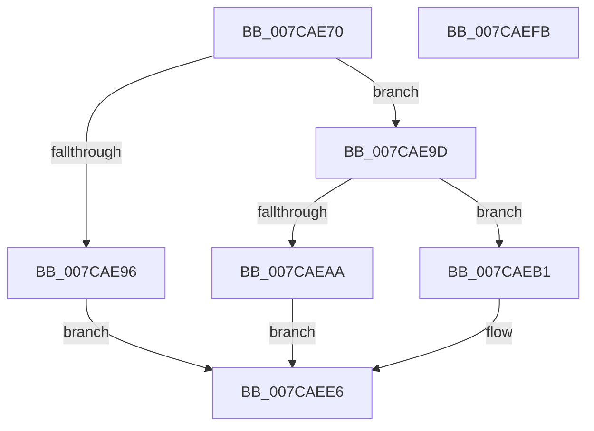

# ExSetFirmwareEnvironmentVariable

- RVA: `0x007CAE70`–`0x007CAEFC` (길이 `140` bytes)
- VA: `0x00000001407CAE70`
- 실행 섹션: `PAGE`
- PDB 이름 있음: `예`; PDB Function 태그: `아니요`
- unwind 정보 RVA: `0x00066400`
- 디코드: `41`개 명령, `140/140` bytes 표시
- 미해석 바이트: `0` (있으면 어셈블리에 `.byte`로 보존)

> 이 문서는 커널 이미지의 기계어와 PDB 기호를 분석해 생성했습니다. 4번과 5번은 함수 원형과 자료형을 바이너리 사용 방식에서 추정한 C 해석이며 원본 소스 복구 결과는 아닙니다.

## 1. Dependencies

- 직접 호출 지점: **3**; 고유 호출 대상: **3**
- 직접 호출자로 확인된 함수: **3**
- RIP 상대 이미지 참조: **1**

### Outgoing calls
- `0x007CAE9D` → [ExpUnicodeStringToNonpagedWStr](../95/ExpUnicodeStringToNonpagedWStr_function_0095210C.md) (function, `0x0095210C`)
- `0x007CAED3` → [ExpSetFirmwareEnvironmentVariable](ExpSetFirmwareEnvironmentVariable_function_007CC9A8.md) (function, `0x007CC9A8`)
- `0x007CAEDF` → [ExFreePoolWithTag](../../poolcode/B8/ExFreePoolWithTag_function_00B82870.md) (function, `0x00B82870`)

### Direct callers
- [NtSetSystemEnvironmentValueEx](NtSetSystemEnvironmentValueEx_function_007CE990.md) at `0x007CEA14`
- [PopClearSystemSleepCheckpoint](../AB/PopClearSystemSleepCheckpoint_function_00AB29B4.md) at `0x00AB2A0D`
- [PopCheckpointSystemSleepUnsafe](../../pagelk/B7/PopCheckpointSystemSleepUnsafe_function_00B71950.md) at `0x00B7197F`

### Static image references
- `0x007CAE84` → RVA `0x00EFF050` (`.data`; read)

## 2. Other-region calls and transfers

- 다른 실행 섹션으로 향하는 call: **1**
  - `0x007CAEDF` → [ExFreePoolWithTag](../../poolcode/B8/ExFreePoolWithTag_function_00B82870.md) (`PAGE` → `POOLCODE`)
- 별도 외부 분기/꼬리 이동을 확인하지 못했습니다.

## 3. Assembly (complete function range)

```asm
007CAE70  48 89 5C 24 08                  mov qword ptr [rsp + 8], rbx
007CAE75  48 89 6C 24 10                  mov qword ptr [rsp + 0x10], rbp
007CAE7A  48 89 74 24 18                  mov qword ptr [rsp + 0x18], rsi
007CAE7F  57                              push rdi
007CAE80  48 83 EC 30                     sub rsp, 0x30
007CAE84  83 3D C5 41 73 00 02            cmp dword ptr [rip + 0x7341c5], 2
007CAE8B  41 8B F1                        mov esi, r9d
007CAE8E  49 8B D8                        mov rbx, r8
007CAE91  48 8B EA                        mov rbp, rdx
007CAE94  74 07                           je 0x1407cae9d
007CAE96  B8 02 00 00 C0                  mov eax, 0xc0000002
007CAE9B  EB 49                           jmp 0x1407caee6
007CAE9D  E8 6A 72 18 00                  call 0x14095210c
007CAEA2  48 8B F8                        mov rdi, rax
007CAEA5  48 85 C0                        test rax, rax
007CAEA8  75 07                           jne 0x1407caeb1
007CAEAA  B8 9A 00 00 C0                  mov eax, 0xc000009a
007CAEAF  EB 35                           jmp 0x1407caee6
007CAEB1  48 8B C3                        mov rax, rbx
007CAEB4  C6 44 24 28 00                  mov byte ptr [rsp + 0x28], 0
007CAEB9  48 F7 D8                        neg rax
007CAEBC  4C 8B C3                        mov r8, rbx
007CAEBF  8B 44 24 60                     mov eax, dword ptr [rsp + 0x60]
007CAEC3  48 8B D5                        mov rdx, rbp
007CAEC6  45 1B C9                        sbb r9d, r9d
007CAEC9  89 44 24 20                     mov dword ptr [rsp + 0x20], eax
007CAECD  44 23 CE                        and r9d, esi
007CAED0  48 8B CF                        mov rcx, rdi
007CAED3  E8 D0 1A 00 00                  call 0x1407cc9a8
007CAED8  33 D2                           xor edx, edx
007CAEDA  48 8B CF                        mov rcx, rdi
007CAEDD  8B D8                           mov ebx, eax
007CAEDF  E8 8C 79 3B 00                  call 0x140b82870
007CAEE4  8B C3                           mov eax, ebx
007CAEE6  48 8B 5C 24 40                  mov rbx, qword ptr [rsp + 0x40]
007CAEEB  48 8B 6C 24 48                  mov rbp, qword ptr [rsp + 0x48]
007CAEF0  48 8B 74 24 50                  mov rsi, qword ptr [rsp + 0x50]
007CAEF5  48 83 C4 30                     add rsp, 0x30
007CAEF9  5F                              pop rdi
007CAEFA  C3                              ret
007CAEFB  CC                              int3
```

## 4. C-style interpretation (structured pseudocode)

```c
__int64 __fastcall ExSetFirmwareEnvironmentVariable(__int64 a1, __int64 a2, __int64 a3, int a4, unsigned int a5)
{
    __int64 result;
    __int64 v_rsp;
    unsigned __int8 v_stack_m10;
    unsigned int v_stack_m18;
    unsigned __int64 v_stack_p10;
    unsigned __int64 v_stack_p18;
    unsigned __int64 v_stack_p8;

    v_stack_p8 = v_rbx;
    v_stack_p10 = v_rbp;
    v_stack_p18 = v_rsi;
    v_rsp = (v_rsp) - (48);
    if ((*(unsigned int *)(v_rip + 7553477)) == 2) goto loc_007CAE9D;
    goto loc_007CAEE6;
loc_007CAE9D:
    result = ExpUnicodeStringToNonpagedWStr(a1, a2, a3, a4);
    if (result != 0) goto loc_007CAEB1;
    goto loc_007CAEE6;
loc_007CAEB1:
    v_stack_m10 = 0;
    result = -(a3);
    v_stack_m18 = (unsigned int)((unsigned int)(a5));
    a4 = (unsigned int)((a4) & ((unsigned int)((unsigned int)(a4))));
    result = ExpSetFirmwareEnvironmentVariable(result, a2, a3, a4);
    a2 = 0;
    result = ExFreePoolWithTag(result, a2, a3, a4);
loc_007CAEE6:
    v_rsp = (v_rsp) + (48);
    return (unsigned int)((unsigned int)((unsigned int)((unsigned int)(result))));
}
```

## 5. (Beta) C Style

```c
int64_t ExSetFirmwareEnvironmentVariable(int64_t Arg1, int64_t Arg2, int64_t Arg3, int32_t Arg4, uint32_t Arg5)
{
    int64_t result;
    int64_t local_rsp;
    uint8_t v_stack_m10;
    uint32_t v_stack_m18;
    uint64_t v_stack_p10;
    uint64_t v_stack_p18;
    uint64_t v_stack_p8;

    v_stack_p8 = local_rbx;
    v_stack_p10 = local_rbp;
    v_stack_p18 = local_rsi;
    local_rsp = (local_rsp) - (48);
    if ((*(uint32_t *)(v_rip + 0x7341C5)) == 2) goto loc_007CAE9D;
    goto loc_007CAEE6;
loc_007CAE9D:
    result = ExpUnicodeStringToNonpagedWStr(Arg1, Arg2, Arg3, Arg4);
    if (result != 0) goto loc_007CAEB1;
    goto loc_007CAEE6;
loc_007CAEB1:
    v_stack_m10 = 0;
    result = -(Arg3);
    v_stack_m18 = (uint32_t)((uint32_t)(Arg5));
    Arg4 = (uint32_t)((Arg4) & ((uint32_t)((uint32_t)(Arg4))));
    result = ExpSetFirmwareEnvironmentVariable(result, Arg2, Arg3, Arg4);
    Arg2 = 0;
    result = ExFreePoolWithTag(result, Arg2, Arg3, Arg4);
loc_007CAEE6:
    local_rsp = (local_rsp) + (48);
    return (uint32_t)((uint32_t)((uint32_t)((uint32_t)(result))));
}
```

## 6. Execution-region graph

[열기: 2D/3D 그래프와 함수 탐색 컨트롤 패널](../../../control-panel.html?section=page&rva=0x007CAE70&view=graph)

- 2D 그래프는 위에서 아래로 흐르고, 3D 그래프는 빈 공간을 드래그해 회전합니다. Shift+드래그는 이동, 휠은 확대·축소, 함수 노드 선택은 대상 보고서 이동입니다.

### Static fallback


