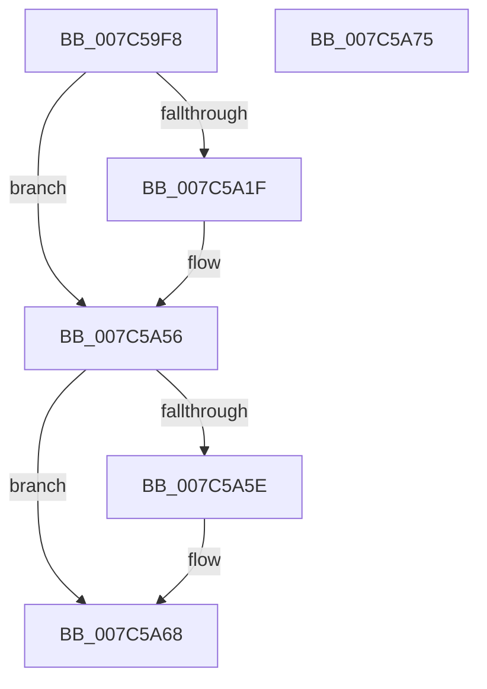

# ExSetLeapSecondEnabled

- RVA: `0x007C59F8`–`0x007C5A76` (길이 `126` bytes)
- VA: `0x00000001407C59F8`
- 실행 섹션: `PAGE`
- PDB 이름 있음: `예`; PDB Function 태그: `아니요`
- unwind 정보 RVA: `0x000D49AC`
- 디코드: `35`개 명령, `126/126` bytes 표시
- 미해석 바이트: `0` (있으면 어셈블리에 `.byte`로 보존)

> 이 문서는 커널 이미지의 기계어와 PDB 기호를 분석해 생성했습니다. 4번과 5번은 함수 원형과 자료형을 바이너리 사용 방식에서 추정한 C 해석이며 원본 소스 복구 결과는 아닙니다.

## 1. Dependencies

- 직접 호출 지점: **3**; 고유 호출 대상: **3**
- 직접 호출자로 확인된 함수: **1**
- RIP 상대 이미지 참조: **1**

### Outgoing calls
- `0x007C5A14` → [ExpGetLeapSecondDataRegistryKeyHandle](ExpGetLeapSecondDataRegistryKeyHandle_function_007C5B30.md) (function, `0x007C5B30`)
- `0x007C5A4F` → [ZwSetValueKey](../../text/6A/ZwSetValueKey_function_006ADCD0.md) (function, `0x006ADCD0`)
- `0x007C5A63` → [ZwClose](../../text/6A/ZwClose_function_006AD2B0.md) (function, `0x006AD2B0`)

### Direct callers
- [NtSetSystemInformation](../AF/NtSetSystemInformation_function_00AF4A60.md) at `0x00AF64ED`

### Static image references
- `0x007C5A24` → RVA `0x0000BD90` (`.rdata`; read)

## 2. Other-region calls and transfers

- 다른 실행 섹션으로 향하는 call: **2**
  - `0x007C5A4F` → [ZwSetValueKey](../../text/6A/ZwSetValueKey_function_006ADCD0.md) (`PAGE` → `.text`)
  - `0x007C5A63` → [ZwClose](../../text/6A/ZwClose_function_006AD2B0.md) (`PAGE` → `.text`)
- 별도 외부 분기/꼬리 이동을 확인하지 못했습니다.

## 3. Assembly (complete function range)

```asm
007C59F8  48 8B C4                        mov rax, rsp
007C59FB  48 89 70 08                     mov qword ptr [rax + 8], rsi
007C59FF  57                              push rdi
007C5A00  48 83 EC 30                     sub rsp, 0x30
007C5A04  83 60 10 00                     and dword ptr [rax + 0x10], 0
007C5A08  40 8A F1                        mov sil, cl
007C5A0B  48 83 60 18 00                  and qword ptr [rax + 0x18], 0
007C5A10  48 8D 48 18                     lea rcx, [rax + 0x18]
007C5A14  E8 17 01 00 00                  call 0x1407c5b30
007C5A19  8B F8                           mov edi, eax
007C5A1B  85 C0                           test eax, eax
007C5A1D  78 37                           js 0x1407c5a56
007C5A1F  48 8B 4C 24 50                  mov rcx, qword ptr [rsp + 0x50]
007C5A24  48 8D 15 65 63 84 FF            lea rdx, [rip - 0x7b9c9b]
007C5A2B  33 C0                           xor eax, eax
007C5A2D  41 B9 04 00 00 00               mov r9d, 4
007C5A33  40 84 F6                        test sil, sil
007C5A36  44 89 4C 24 28                  mov dword ptr [rsp + 0x28], r9d
007C5A3B  0F 95 C0                        setne al
007C5A3E  45 33 C0                        xor r8d, r8d
007C5A41  89 44 24 48                     mov dword ptr [rsp + 0x48], eax
007C5A45  48 8D 44 24 48                  lea rax, [rsp + 0x48]
007C5A4A  48 89 44 24 20                  mov qword ptr [rsp + 0x20], rax
007C5A4F  E8 7C 82 EE FF                  call 0x1406adcd0
007C5A54  8B F8                           mov edi, eax
007C5A56  48 83 7C 24 50 00               cmp qword ptr [rsp + 0x50], 0
007C5A5C  74 0A                           je 0x1407c5a68
007C5A5E  48 8B 4C 24 50                  mov rcx, qword ptr [rsp + 0x50]
007C5A63  E8 48 78 EE FF                  call 0x1406ad2b0
007C5A68  48 8B 74 24 40                  mov rsi, qword ptr [rsp + 0x40]
007C5A6D  8B C7                           mov eax, edi
007C5A6F  48 83 C4 30                     add rsp, 0x30
007C5A73  5F                              pop rdi
007C5A74  C3                              ret
007C5A75  CC                              int3
```

## 4. C-style interpretation (structured pseudocode)

```c
__int64 __fastcall ExSetLeapSecondEnabled(unsigned __int8 a1, __int64 a2, int a3)
{
    __int64 result;
    __int64 v_rdi;
    __int64 v_rsp;
    unsigned int v_stack_m10;
    unsigned __int64 v_stack_m18;
    unsigned int v_stack_p10;
    unsigned __int64 v_stack_p18;
    unsigned __int64 v_stack_p8;

    *(unsigned __int64 *)(v_rsp + 8) = v_rsi;
    v_rsp = (v_rsp) - (48);
    result = ExpGetLeapSecondDataRegistryKeyHandle(v_rsp + 24, a2, a3, a4);
    v_rdi = (unsigned int)((unsigned int)(result));
    if (!(sign_flag)) {
        a1 = v_stack_p18;
        a2 = v_rip - 8101019;
        result = 0;
        a4 = 4;
        v_stack_m10 = (unsigned int)(a4);
        result = (a1 != 0) ? 1 : 0;
        a3 = 0;
        v_stack_p10 = (unsigned int)(result);
        result = v_stack_p10;
        v_stack_m18 = result;
        result = ZwSetValueKey(a1, a2, a3, a4);
        v_rdi = (unsigned int)(result);
    }
    if (v_stack_p18 != 0) {
        a1 = v_stack_p18;
        result = ZwClose(a1, a2, a3, a4);
    }
    v_rsp = (v_rsp) + (48);
    return (unsigned int)((unsigned int)(v_rdi));
}
```

## 5. (Beta) C Style

```c
int64_t ExSetLeapSecondEnabled(uint8_t Arg1, int64_t Arg2, int32_t Arg3)
{
    int64_t result;
    int64_t local_rdi;
    int64_t local_rsp;
    uint32_t v_stack_m10;
    uint64_t v_stack_m18;
    uint32_t v_stack_p10;
    uint64_t v_stack_p18;
    uint64_t v_stack_p8;

    *(uint64_t *)(local_rsp + 0x8) = local_rsi;
    local_rsp = (local_rsp) - (48);
    result = ExpGetLeapSecondDataRegistryKeyHandle(local_rsp + 24, Arg2, Arg3, a4);
    local_rdi = (uint32_t)((uint32_t)(result));
    if (!(sign_flag)) {
        Arg1 = v_stack_p18;
        Arg2 = v_rip - 8101019;
        result = 0;
        a4 = 4;
        v_stack_m10 = (uint32_t)(a4);
        result = (Arg1 != 0) ? 1 : 0;
        Arg3 = 0;
        v_stack_p10 = (uint32_t)(result);
        result = v_stack_p10;
        v_stack_m18 = result;
        result = ZwSetValueKey(Arg1, Arg2, Arg3, a4);
        local_rdi = (uint32_t)(result);
    }
    if (v_stack_p18 != 0) {
        Arg1 = v_stack_p18;
        result = ZwClose(Arg1, Arg2, Arg3, a4);
    }
    local_rsp = (local_rsp) + (48);
    return (uint32_t)((uint32_t)(local_rdi));
}
```

## 6. Execution-region graph

[열기: 2D/3D 그래프와 함수 탐색 컨트롤 패널](../../../control-panel.html?section=page&rva=0x007C59F8&view=graph)

- 2D 그래프는 위에서 아래로 흐르고, 3D 그래프는 빈 공간을 드래그해 회전합니다. Shift+드래그는 이동, 휠은 확대·축소, 함수 노드 선택은 대상 보고서 이동입니다.

### Static fallback


