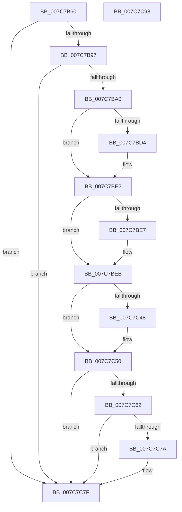

# ExSetLicenseTamperState

- RVA: `0x007C7B60`–`0x007C7C99` (길이 `313` bytes)
- VA: `0x00000001407C7B60`
- 실행 섹션: `PAGE`
- PDB 이름 있음: `예`; PDB Function 태그: `아니요`
- unwind 정보 RVA: `0x000C838C`
- 디코드: `84`개 명령, `313/313` bytes 표시
- 미해석 바이트: `0` (있으면 어셈블리에 `.byte`로 보존)

> 이 문서는 커널 이미지의 기계어와 PDB 기호를 분석해 생성했습니다. 4번과 5번은 함수 원형과 자료형을 바이너리 사용 방식에서 추정한 C 해석이며 원본 소스 복구 결과는 아닙니다.

## 1. Dependencies

- 직접 호출 지점: **11**; 고유 호출 대상: **10**
- 직접 호출자로 확인된 함수: **0**
- RIP 상대 이미지 참조: **1**

### Outgoing calls
- `0x007C7B83` → [PsGetCurrentServerSiloGlobals](../../text/2F/PsGetCurrentServerSiloGlobals_function_002FE1F0.md) (function, `0x002FE1F0`)
- `0x007C7BC4` → [KeAbPreAcquire](../../text/21/KeAbPreAcquire_function_00210230.md) (function, `0x00210230`)
- `0x007C7BDD` → [ExfAcquirePushLockExclusiveEx](../../text/20/ExfAcquirePushLockExclusiveEx_function_0020FC90.md) (function, `0x0020FC90`)
- `0x007C7BF6` → [ExpGetLicenseTamperState](../../text/65/ExpGetLicenseTamperState_function_00657740.md) (function, `0x00657740`)
- `0x007C7C10` → [ExpSetLicenseTamperState](../../text/65/ExpSetLicenseTamperState_function_00657AC4.md) (function, `0x00657AC4`)
- `0x007C7C36` → [sub_00966DF0](../96/Unknown_function_00966DF0.md) (function, `0x00966DF0`)
- `0x007C7C4B` → [ExfTryToWakePushLock](../../text/26/ExfTryToWakePushLock_function_00265DD0.md) (function, `0x00265DD0`)
- `0x007C7C53` → [KeAbPostRelease](../../text/2E/KeAbPostRelease_function_002E1600.md) (function, `0x002E1600`)
- `0x007C7C58` → [KeLeaveCriticalRegion](../../text/25/KeLeaveCriticalRegion_function_0025D8B0.md) (function, `0x0025D8B0`)
- `0x007C7C62` → [PsGetCurrentServerSiloGlobals](../../text/2F/PsGetCurrentServerSiloGlobals_function_002FE1F0.md) (function, `0x002FE1F0`)
- `0x007C7C7A` → [guard_dispatch_icall](../../text/6B/guard_dispatch_icall_function_006BAAD0.md) (function, `0x006BAAD0`)

### Direct callers
- 이 함수 시작 RVA로 연결되는 직접 call은 확인되지 않았습니다. 간접 호출은 완전히 역산할 수 없습니다.

### Static image references
- `0x007C7C6E` → RVA `0x00FD84A8` (`PAGEDATA`; read)

## 2. Other-region calls and transfers

- 다른 실행 섹션으로 향하는 call: **10**
  - `0x007C7B83` → [PsGetCurrentServerSiloGlobals](../../text/2F/PsGetCurrentServerSiloGlobals_function_002FE1F0.md) (`PAGE` → `.text`)
  - `0x007C7BC4` → [KeAbPreAcquire](../../text/21/KeAbPreAcquire_function_00210230.md) (`PAGE` → `.text`)
  - `0x007C7BDD` → [ExfAcquirePushLockExclusiveEx](../../text/20/ExfAcquirePushLockExclusiveEx_function_0020FC90.md) (`PAGE` → `.text`)
  - `0x007C7BF6` → [ExpGetLicenseTamperState](../../text/65/ExpGetLicenseTamperState_function_00657740.md) (`PAGE` → `.text`)
  - `0x007C7C10` → [ExpSetLicenseTamperState](../../text/65/ExpSetLicenseTamperState_function_00657AC4.md) (`PAGE` → `.text`)
  - `0x007C7C4B` → [ExfTryToWakePushLock](../../text/26/ExfTryToWakePushLock_function_00265DD0.md) (`PAGE` → `.text`)
  - `0x007C7C53` → [KeAbPostRelease](../../text/2E/KeAbPostRelease_function_002E1600.md) (`PAGE` → `.text`)
  - `0x007C7C58` → [KeLeaveCriticalRegion](../../text/25/KeLeaveCriticalRegion_function_0025D8B0.md) (`PAGE` → `.text`)
  - `0x007C7C62` → [PsGetCurrentServerSiloGlobals](../../text/2F/PsGetCurrentServerSiloGlobals_function_002FE1F0.md) (`PAGE` → `.text`)
  - `0x007C7C7A` → [guard_dispatch_icall](../../text/6B/guard_dispatch_icall_function_006BAAD0.md) (`PAGE` → `.text`)
- 별도 외부 분기/꼬리 이동을 확인하지 못했습니다.

## 3. Assembly (complete function range)

```asm
007C7B60  48 8B C4                        mov rax, rsp
007C7B63  48 89 58 10                     mov qword ptr [rax + 0x10], rbx
007C7B67  48 89 68 18                     mov qword ptr [rax + 0x18], rbp
007C7B6B  56                              push rsi
007C7B6C  57                              push rdi
007C7B6D  41 54                           push r12
007C7B6F  41 56                           push r14
007C7B71  41 57                           push r15
007C7B73  48 83 EC 50                     sub rsp, 0x50
007C7B77  45 33 FF                        xor r15d, r15d
007C7B7A  8B E9                           mov ebp, ecx
007C7B7C  44 89 78 08                     mov dword ptr [rax + 8], r15d
007C7B80  41 B4 01                        mov r12b, 1
007C7B83  E8 68 66 B3 FF                  call 0x1402fe1f0
007C7B88  4C 8B B0 68 03 00 00            mov r14, qword ptr [rax + 0x368]
007C7B8F  85 ED                           test ebp, ebp
007C7B91  0F 84 E8 00 00 00               je 0x1407c7c7f
007C7B97  83 FD 03                        cmp ebp, 3
007C7B9A  0F 84 DF 00 00 00               je 0x1407c7c7f
007C7BA0  65 48 8B 04 25 88 01 00 00      mov rax, qword ptr gs:[0x188]
007C7BA9  49 8D BE F8 B6 00 00            lea rdi, [r14 + 0xb6f8]
007C7BB0  48 83 CB FF                     or rbx, 0xffffffffffffffff
007C7BB4  45 33 C0                        xor r8d, r8d
007C7BB7  33 D2                           xor edx, edx
007C7BB9  48 8B CF                        mov rcx, rdi
007C7BBC  66 01 98 E4 01 00 00            add word ptr [rax + 0x1e4], bx
007C7BC3  90                              nop
007C7BC4  E8 67 86 A4 FF                  call 0x140210230
007C7BC9  F0 48 0F BA 2F 00               lock bts qword ptr [rdi], 0
007C7BCF  48 8B F0                        mov rsi, rax
007C7BD2  73 0E                           jae 0x1407c7be2
007C7BD4  4C 8B C7                        mov r8, rdi
007C7BD7  48 8B D0                        mov rdx, rax
007C7BDA  48 8B CF                        mov rcx, rdi
007C7BDD  E8 AE 80 A4 FF                  call 0x14020fc90
007C7BE2  48 85 F6                        test rsi, rsi
007C7BE5  74 04                           je 0x1407c7beb
007C7BE7  44 88 66 0A                     mov byte ptr [rsi + 0xa], r12b
007C7BEB  48 8D 94 24 80 00 00 00         lea rdx, [rsp + 0x80]
007C7BF3  49 8B CE                        mov rcx, r14
007C7BF6  E8 45 FB E8 FF                  call 0x140657740
007C7BFB  44 39 BC 24 80 00 00 00         cmp dword ptr [rsp + 0x80], r15d
007C7C03  8B D5                           mov edx, ebp
007C7C05  41 0F B6 F4                     movzx esi, r12b
007C7C09  49 8B CE                        mov rcx, r14
007C7C0C  41 0F 45 F7                     cmovne esi, r15d
007C7C10  E8 AF FE E8 FF                  call 0x140657ac4
007C7C15  0F 57 C0                        xorps xmm0, xmm0
007C7C18  48 8D 54 24 20                  lea rdx, [rsp + 0x20]
007C7C1D  45 33 C9                        xor r9d, r9d
007C7C20  49 8B CE                        mov rcx, r14
007C7C23  0F 11 44 24 20                  movups xmmword ptr [rsp + 0x20], xmm0
007C7C28  0F 11 44 24 30                  movups xmmword ptr [rsp + 0x30], xmm0
007C7C2D  45 8D 41 20                     lea r8d, [r9 + 0x20]
007C7C31  0F 11 44 24 40                  movups xmmword ptr [rsp + 0x40], xmm0
007C7C36  E8 B5 F1 19 00                  call 0x140966df0
007C7C3B  F0 48 0F C1 1F                  lock xadd qword ptr [rdi], rbx
007C7C40  80 E3 06                        and bl, 6
007C7C43  80 FB 02                        cmp bl, 2
007C7C46  75 08                           jne 0x1407c7c50
007C7C48  48 8B CF                        mov rcx, rdi
007C7C4B  E8 80 E1 A9 FF                  call 0x140265dd0
007C7C50  48 8B CF                        mov rcx, rdi
007C7C53  E8 A8 99 B1 FF                  call 0x1402e1600
007C7C58  E8 53 5C A9 FF                  call 0x14025d8b0
007C7C5D  40 84 F6                        test sil, sil
007C7C60  74 1D                           je 0x1407c7c7f
007C7C62  E8 89 65 B3 FF                  call 0x1402fe1f0
007C7C67  48 8B 88 68 03 00 00            mov rcx, qword ptr [rax + 0x368]
007C7C6E  48 8B 05 33 08 81 00            mov rax, qword ptr [rip + 0x810833]
007C7C75  48 85 C0                        test rax, rax
007C7C78  74 05                           je 0x1407c7c7f
007C7C7A  E8 51 2E EF FF                  call 0x1406baad0
007C7C7F  4C 8D 5C 24 50                  lea r11, [rsp + 0x50]
007C7C84  49 8B 5B 38                     mov rbx, qword ptr [r11 + 0x38]
007C7C88  49 8B 6B 40                     mov rbp, qword ptr [r11 + 0x40]
007C7C8C  49 8B E3                        mov rsp, r11
007C7C8F  41 5F                           pop r15
007C7C91  41 5E                           pop r14
007C7C93  41 5C                           pop r12
007C7C95  5F                              pop rdi
007C7C96  5E                              pop rsi
007C7C97  C3                              ret
007C7C98  CC                              int3
```

## 4. C-style interpretation (structured pseudocode)

```c
__int64 __fastcall ExSetLicenseTamperState(int a1, int a2, int a3, int a4)
{
    __int64 result;
    __int64 v_r15;
    __int64 v_rbx;
    __int64 v_rsi;
    __int64 v_rsp;
    unsigned __int64 v_stack_m28;
    unsigned __int64 v_stack_m38;
    unsigned __int64 v_stack_m48;
    unsigned __int64 v_stack_m58;
    unsigned __int64 v_stack_p8;

    *(unsigned __int64 *)(v_rsp + 16) = v_rbx;
    *(unsigned __int64 *)(v_rsp + 24) = v_rbp;
    v_rsp = (v_rsp) - (80);
    v_r15 = 0;
    *(unsigned int *)(v_rsp + 8) = 0;
    result = PsGetCurrentServerSiloGlobals(a1, a2, a3, a4);
    if ((unsigned int)((unsigned int)(a1)) == 0) goto loc_007C7C7F;
    if (((unsigned int)((unsigned int)(a1))) == 3) goto loc_007C7C7F;
    v_rbx = (v_rbx) | (-1);
    a3 = 0;
    a2 = 0;
    result = KeAbPreAcquire(*(unsigned __int64 *)(result + 872) + 46840, a2, a3, a4);
    if (!(condition_is_above_or_equal)) {
        a3 = *(unsigned __int64 *)(result + 872) + 46840;
        a2 = result;
        a1 = *(unsigned __int64 *)(result + 872) + 46840;
        result = ExfAcquirePushLockExclusiveEx(a1, a2, a3, a4);
    }
    if (result != 0) {
        *(unsigned __int8 *)(result + 10) = 1;
    }
    result = ExpGetLicenseTamperState(*(unsigned __int64 *)(result + 872), v_stack_p8, a3, a4);
    v_rsi = 1;
    if (v_stack_p8 != 0) { v_rsi = 0; }
    result = ExpSetLicenseTamperState(*(unsigned __int64 *)(result + 872), (unsigned int)((unsigned int)((unsigned int)(a1))), a3, a4);
    a4 = 0;
    v_stack_m58 = v_xmm0;
    v_stack_m48 = v_xmm0;
    v_stack_m38 = v_xmm0;
    result = sub_00966DF0(*(unsigned __int64 *)(result + 872), v_stack_m58, a4 + 32, a4);
    v_rbx = (unsigned __int8)((v_rbx) & (6));
    if (((unsigned __int8)(v_rbx)) == 2) {
        a1 = *(unsigned __int64 *)(result + 872) + 46840;
        result = ExfTryToWakePushLock(a1, v_stack_m58, a4 + 32, a4);
    }
    result = KeAbPostRelease(*(unsigned __int64 *)(result + 872) + 46840, v_stack_m58, a4 + 32, a4);
    result = KeLeaveCriticalRegion(*(unsigned __int64 *)(result + 872) + 46840, v_stack_m58, a4 + 32, a4);
    if ((unsigned __int8)(v_rsi) == 0) goto loc_007C7C7F;
    result = PsGetCurrentServerSiloGlobals(*(unsigned __int64 *)(result + 872) + 46840, v_stack_m58, a4 + 32, a4);
    result = *(unsigned __int64 *)(v_rip + 8456243);
    if (*(unsigned __int64 *)(v_rip + 8456243) != 0) {
        result = guard_dispatch_icall(*(unsigned __int64 *)(result + 872), v_stack_m58, a4 + 32, a4);
    }
    return result;
}
```

## 5. (Beta) C Style

```c
int64_t ExSetLicenseTamperState(int32_t Arg1, int32_t Arg2, int32_t Arg3, int32_t Arg4)
{
    int64_t result;
    int64_t local_r15;
    int64_t local_rbx;
    int64_t local_rsi;
    int64_t local_rsp;
    uint64_t v_stack_m28;
    uint64_t v_stack_m38;
    uint64_t v_stack_m48;
    uint64_t v_stack_m58;
    uint64_t v_stack_p8;

    *(uint64_t *)(local_rsp + 0x10) = local_rbx;
    *(uint64_t *)(local_rsp + 0x18) = local_rbp;
    local_rsp = (local_rsp) - (80);
    local_r15 = 0;
    *(uint32_t *)(local_rsp + 0x8) = 0;
    result = PsGetCurrentServerSiloGlobals(Arg1, Arg2, Arg3, Arg4);
    if ((uint32_t)((uint32_t)(Arg1)) == 0) goto loc_007C7C7F;
    if (((uint32_t)((uint32_t)(Arg1))) == 3) goto loc_007C7C7F;
    local_rbx = (local_rbx) | (-1);
    Arg3 = 0;
    Arg2 = 0;
    result = KeAbPreAcquire(*(uint64_t *)(result + 0x368) + 46840, Arg2, Arg3, Arg4);
    if (!(condition_is_above_or_equal)) {
        Arg3 = *(uint64_t *)(result + 0x368) + 46840;
        Arg2 = result;
        Arg1 = *(uint64_t *)(result + 0x368) + 46840;
        result = ExfAcquirePushLockExclusiveEx(Arg1, Arg2, Arg3, Arg4);
    }
    if (result != 0) {
        *(uint8_t *)(result + 0xA) = 1;
    }
    result = ExpGetLicenseTamperState(*(uint64_t *)(result + 0x368), v_stack_p8, Arg3, Arg4);
    local_rsi = 1;
    if (v_stack_p8 != 0) { local_rsi = 0; }
    result = ExpSetLicenseTamperState(*(uint64_t *)(result + 0x368), (uint32_t)((uint32_t)((uint32_t)(Arg1))), Arg3, Arg4);
    Arg4 = 0;
    v_stack_m58 = v_xmm0;
    v_stack_m48 = v_xmm0;
    v_stack_m38 = v_xmm0;
    result = sub_00966DF0(*(uint64_t *)(result + 0x368), v_stack_m58, Arg4 + 32, Arg4);
    local_rbx = (uint8_t)((local_rbx) & (6));
    if (((uint8_t)(local_rbx)) == 2) {
        Arg1 = *(uint64_t *)(result + 0x368) + 46840;
        result = ExfTryToWakePushLock(Arg1, v_stack_m58, Arg4 + 32, Arg4);
    }
    result = KeAbPostRelease(*(uint64_t *)(result + 0x368) + 46840, v_stack_m58, Arg4 + 32, Arg4);
    result = KeLeaveCriticalRegion(*(uint64_t *)(result + 0x368) + 46840, v_stack_m58, Arg4 + 32, Arg4);
    if ((uint8_t)(local_rsi) == 0) goto loc_007C7C7F;
    result = PsGetCurrentServerSiloGlobals(*(uint64_t *)(result + 0x368) + 46840, v_stack_m58, Arg4 + 32, Arg4);
    result = *(uint64_t *)(v_rip + 0x810833);
    if (*(uint64_t *)(v_rip + 0x810833) != 0) {
        result = guard_dispatch_icall(*(uint64_t *)(result + 0x368), v_stack_m58, Arg4 + 32, Arg4);
    }
    return result;
}
```

## 6. Execution-region graph

[열기: 2D/3D 그래프와 함수 탐색 컨트롤 패널](../../../control-panel.html?section=page&rva=0x007C7B60&view=graph)

- 2D 그래프는 위에서 아래로 흐르고, 3D 그래프는 빈 공간을 드래그해 회전합니다. Shift+드래그는 이동, 휠은 확대·축소, 함수 노드 선택은 대상 보고서 이동입니다.

### Static fallback


