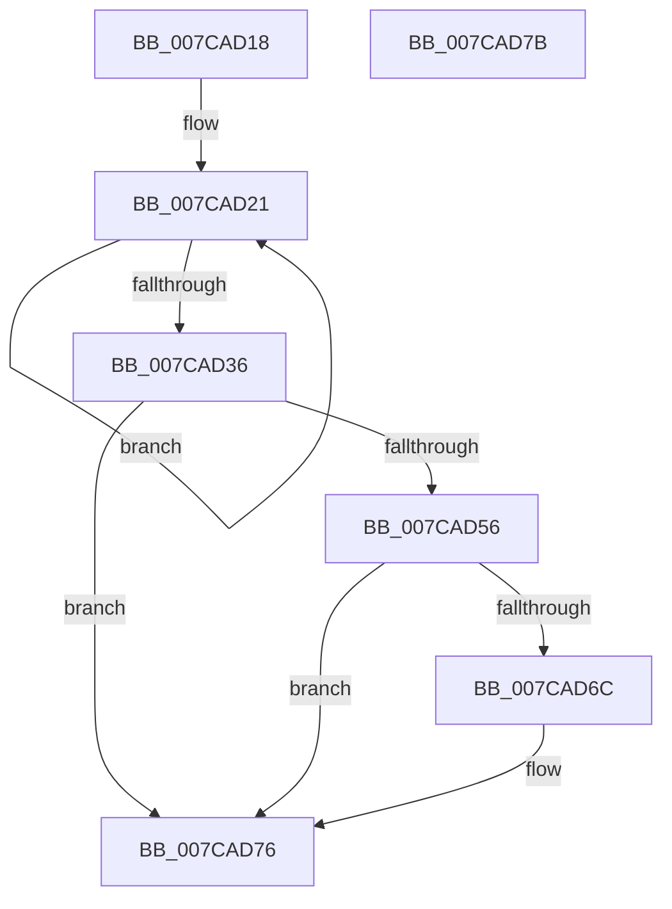

# ExStartRecordingIRTimerExpiries

- RVA: `0x007CAD18`–`0x007CAD7C` (길이 `100` bytes)
- VA: `0x00000001407CAD18`
- 실행 섹션: `PAGE`
- PDB 이름 있음: `예`; PDB Function 태그: `아니요`
- unwind 정보 RVA: `0x0005C788`
- 디코드: `26`개 명령, `100/100` bytes 표시
- 미해석 바이트: `0` (있으면 어셈블리에 `.byte`로 보존)

> 이 문서는 커널 이미지의 기계어와 PDB 기호를 분석해 생성했습니다. 4번과 5번은 함수 원형과 자료형을 바이너리 사용 방식에서 추정한 C 해석이며 원본 소스 복구 결과는 아닙니다.

## 1. Dependencies

- 직접 호출 지점: **3**; 고유 호출 대상: **3**
- 직접 호출자로 확인된 함수: **1**
- RIP 상대 이미지 참조: **1**

### Outgoing calls
- `0x007CAD23` → [ExpGetIRTimerDesc](../../text/4E/ExpGetIRTimerDesc_function_004E3D04.md) (function, `0x004E3D04`)
- `0x007CAD49` → [ExAllocatePool2](../../poolcode/B8/ExAllocatePool2_function_00B820F0.md) (function, `0x00B820F0`)
- `0x007CAD71` → [ExFreePoolWithTag](../../poolcode/B8/ExFreePoolWithTag_function_00B82870.md) (function, `0x00B82870`)

### Direct callers
- [PopCaptureSleepStudyStatistics](../../text/43/PopCaptureSleepStudyStatistics_function_004399F4.md) at `0x00439E95`

### Static image references
- `0x007CAD56` → RVA `0x00EFAB80` (`.data`; read/write)

## 2. Other-region calls and transfers

- 다른 실행 섹션으로 향하는 call: **3**
  - `0x007CAD23` → [ExpGetIRTimerDesc](../../text/4E/ExpGetIRTimerDesc_function_004E3D04.md) (`PAGE` → `.text`)
  - `0x007CAD49` → [ExAllocatePool2](../../poolcode/B8/ExAllocatePool2_function_00B820F0.md) (`PAGE` → `POOLCODE`)
  - `0x007CAD71` → [ExFreePoolWithTag](../../poolcode/B8/ExFreePoolWithTag_function_00B82870.md) (`PAGE` → `POOLCODE`)
- 별도 외부 분기/꼬리 이동을 확인하지 못했습니다.

## 3. Assembly (complete function range)

```asm
007CAD18  48 83 EC 28                     sub rsp, 0x28
007CAD1C  45 33 C0                        xor r8d, r8d
007CAD1F  33 D2                           xor edx, edx
007CAD21  8B CA                           mov ecx, edx
007CAD23  E8 DC 8F D1 FF                  call 0x1404e3d04
007CAD28  FF C2                           inc edx
007CAD2A  0F B6 48 10                     movzx ecx, byte ptr [rax + 0x10]
007CAD2E  44 03 C1                        add r8d, ecx
007CAD31  83 FA 14                        cmp edx, 0x14
007CAD34  72 EB                           jb 0x1407cad21
007CAD36  42 8D 14 85 00 00 00 00         lea edx, [r8*4]
007CAD3E  B9 40 00 00 00                  mov ecx, 0x40
007CAD43  41 B8 45 78 54 69               mov r8d, 0x69547845
007CAD49  E8 A2 73 3B 00                  call 0x140b820f0
007CAD4E  48 8B C8                        mov rcx, rax
007CAD51  48 85 C0                        test rax, rax
007CAD54  74 20                           je 0x1407cad76
007CAD56  48 87 0D 23 FE 72 00            xchg qword ptr [rip + 0x72fe23], rcx
007CAD5D  48 A1 08 00 00 00 80 F7 FF FF   movabs rax, qword ptr [0xfffff78000000008]
007CAD67  48 85 C9                        test rcx, rcx
007CAD6A  74 0A                           je 0x1407cad76
007CAD6C  BA 45 78 54 69                  mov edx, 0x69547845
007CAD71  E8 FA 7A 3B 00                  call 0x140b82870
007CAD76  48 83 C4 28                     add rsp, 0x28
007CAD7A  C3                              ret
007CAD7B  CC                              int3
```

## 4. C-style interpretation (structured pseudocode)

```c
__int64 __fastcall ExStartRecordingIRTimerExpiries(__int64 a1, int a2, int a3)
{
    __int64 result;
    __int64 v_rsp;

    v_rsp = (v_rsp) - (40);
    a3 = 0;
    a2 = 0;
loc_007CAD21:
    result = ExpGetIRTimerDesc(0, a2, a3, a4);
    a2 = (unsigned int)((a2) + 1);
    a3 = (unsigned int)((a3) + ((unsigned int)(*(unsigned __int8 *)(result + 16))));
    if (a2 < 20) goto loc_007CAD21;
    result = ExAllocatePool2(64, a3 * 4, (unsigned int)(0x69547845ULL), a4);
    if (result == 0) goto loc_007CAD76;
    if (result != 0) {
        a2 = 0x69547845ULL;
        result = ExFreePoolWithTag(result, a2, (unsigned int)(0x69547845ULL), a4);
    }
    v_rsp = (v_rsp) + (40);
    return result;
}
```

## 5. (Beta) C Style

```c
int64_t ExStartRecordingIRTimerExpiries(int64_t Arg1, int32_t Arg2, int32_t Arg3)
{
    int64_t result;
    int64_t local_rsp;

    local_rsp = (local_rsp) - (40);
    Arg3 = 0;
    Arg2 = 0;
loc_007CAD21:
    result = ExpGetIRTimerDesc(0, Arg2, Arg3, a4);
    Arg2 = (uint32_t)((Arg2) + 1);
    Arg3 = (uint32_t)((Arg3) + ((uint32_t)(*(uint8_t *)(result + 0x10))));
    if (Arg2 < 20) goto loc_007CAD21;
    result = ExAllocatePool2(64, Arg3 * 4, (uint32_t)(0x69547845ULL), a4);
    if (result == 0) goto loc_007CAD76;
    if (result != 0) {
        Arg2 = 0x69547845ULL;
        result = ExFreePoolWithTag(result, Arg2, (uint32_t)(0x69547845ULL), a4);
    }
    local_rsp = (local_rsp) + (40);
    return result;
}
```

## 6. Execution-region graph

[열기: 2D/3D 그래프와 함수 탐색 컨트롤 패널](../../../control-panel.html?section=page&rva=0x007CAD18&view=graph)

- 2D 그래프는 위에서 아래로 흐르고, 3D 그래프는 빈 공간을 드래그해 회전합니다. Shift+드래그는 이동, 휠은 확대·축소, 함수 노드 선택은 대상 보고서 이동입니다.

### Static fallback


