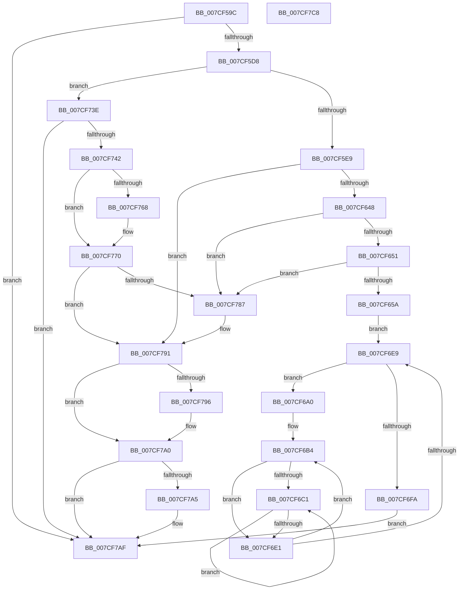

# ExStartStopWorkQueueProvider

- RVA: `0x007CF59C`–`0x007CF7C9` (길이 `557` bytes)
- VA: `0x00000001407CF59C`
- 실행 섹션: `PAGE`
- PDB 이름 있음: `예`; PDB Function 태그: `아니요`
- unwind 정보 RVA: `0x000D55A4`
- 디코드: `146`개 명령, `557/557` bytes 표시
- 미해석 바이트: `0` (있으면 어셈블리에 `.byte`로 보존)

> 이 문서는 커널 이미지의 기계어와 PDB 기호를 분석해 생성했습니다. 4번과 5번은 함수 원형과 자료형을 바이너리 사용 방식에서 추정한 C 해석이며 원본 소스 복구 결과는 아닙니다.

## 1. Dependencies

- 직접 호출 지점: **14**; 고유 호출 대상: **10**
- 직접 호출자로 확인된 함수: **1**
- RIP 상대 이미지 참조: **10**

### Outgoing calls
- `0x007CF5CB` → [Feature_WorkQueueShardingWithinNodes__private_IsEnabledDeviceUsageNoInline](../../text/65/Feature_WorkQueueShardingWithinNodes__private_IsEnabledDeviceUsageNoInline_function_0065AA34.md) (function, `0x0065AA34`)
- `0x007CF5F7` → [ExAllocatePool2](../../poolcode/B8/ExAllocatePool2_function_00B820F0.md) (function, `0x00B820F0`)
- `0x007CF60D` → [EtwGetWorkQueueHealthMetricsDataDescriptorCount](../../text/64/EtwGetWorkQueueHealthMetricsDataDescriptorCount_function_0064F554.md) (function, `0x0064F554`)
- `0x007CF620` → [ExAllocatePool2](../../poolcode/B8/ExAllocatePool2_function_00B820F0.md) (function, `0x00B820F0`)
- `0x007CF637` → [ExAllocatePool2](../../poolcode/B8/ExAllocatePool2_function_00B820F0.md) (function, `0x00B820F0`)
- `0x007CF699` → [ExpInitializeWorkSubQueueEnumeratorContext](../../text/65/ExpInitializeWorkSubQueueEnumeratorContext_function_0065A570.md) (function, `0x0065A570`)
- `0x007CF6F1` → [ExpEnumerateNextActiveWorkSubQueue](../../text/65/ExpEnumerateNextActiveWorkSubQueue_function_0065A3B4.md) (function, `0x0065A3B4`)
- `0x007CF70A` → [EtwTraceWorkQueueHealthMetricsBucketUpperBounds](../../text/65/EtwTraceWorkQueueHealthMetricsBucketUpperBounds_function_0065060C.md) (function, `0x0065060C`)
- `0x007CF737` → [KeSetTimer2](../../text/3A/KeSetTimer2_function_003A08E0.md) (function, `0x003A08E0`)
- `0x007CF74B` → [KeCancelTimer2](../../text/3A/KeCancelTimer2_function_003A01E0.md) (function, `0x003A01E0`)
- `0x007CF757` → [ExWaitForRundownProtectionRelease](../../text/2A/ExWaitForRundownProtectionRelease_function_002A4CB0.md) (function, `0x002A4CB0`)
- `0x007CF78C` → [ExFreePoolWithTag](../../poolcode/B8/ExFreePoolWithTag_function_00B82870.md) (function, `0x00B82870`)
- `0x007CF79B` → [ExFreePoolWithTag](../../poolcode/B8/ExFreePoolWithTag_function_00B82870.md) (function, `0x00B82870`)
- `0x007CF7AA` → [ExFreePoolWithTag](../../poolcode/B8/ExFreePoolWithTag_function_00B82870.md) (function, `0x00B82870`)

### Direct callers
- [EtwpWorkQueueProvEnableCallback](../../text/64/EtwpWorkQueueProvEnableCallback_function_0064F380.md) at `0x0064F386`

### Static image references
- `0x007CF5FC` → RVA `0x00E0EBDC` (`.data`; read)
- `0x007CF65E` → RVA `0x00FDAEC0` (`PAGEDATA`; read)
- `0x007CF665` → RVA `0x00FC6EA0` (`ALMOSTRO`; read)
- `0x007CF66F` → RVA `0x00FCF6C0` (`CACHEALI`; read)
- `0x007CF6FC` → RVA `0x00EFAAA0` (`.data`; write)
- `0x007CF703` → RVA `0x00E0EBC0` (`.data`; read/write)
- `0x007CF70F` → RVA `0x00E0EBD8` (`.data`; read)
- `0x007CF71E` → RVA `0x00EFA980` (`.data`; read)
- `0x007CF750` → RVA `0x00E0EBC0` (`.data`; read)
- `0x007CF75C` → RVA `0x00EFAAA0` (`.data`; read)

## 2. Other-region calls and transfers

- 다른 실행 섹션으로 향하는 call: **14**
  - `0x007CF5CB` → [Feature_WorkQueueShardingWithinNodes__private_IsEnabledDeviceUsageNoInline](../../text/65/Feature_WorkQueueShardingWithinNodes__private_IsEnabledDeviceUsageNoInline_function_0065AA34.md) (`PAGE` → `.text`)
  - `0x007CF5F7` → [ExAllocatePool2](../../poolcode/B8/ExAllocatePool2_function_00B820F0.md) (`PAGE` → `POOLCODE`)
  - `0x007CF60D` → [EtwGetWorkQueueHealthMetricsDataDescriptorCount](../../text/64/EtwGetWorkQueueHealthMetricsDataDescriptorCount_function_0064F554.md) (`PAGE` → `.text`)
  - `0x007CF620` → [ExAllocatePool2](../../poolcode/B8/ExAllocatePool2_function_00B820F0.md) (`PAGE` → `POOLCODE`)
  - `0x007CF637` → [ExAllocatePool2](../../poolcode/B8/ExAllocatePool2_function_00B820F0.md) (`PAGE` → `POOLCODE`)
  - `0x007CF699` → [ExpInitializeWorkSubQueueEnumeratorContext](../../text/65/ExpInitializeWorkSubQueueEnumeratorContext_function_0065A570.md) (`PAGE` → `.text`)
  - `0x007CF6F1` → [ExpEnumerateNextActiveWorkSubQueue](../../text/65/ExpEnumerateNextActiveWorkSubQueue_function_0065A3B4.md) (`PAGE` → `.text`)
  - `0x007CF70A` → [EtwTraceWorkQueueHealthMetricsBucketUpperBounds](../../text/65/EtwTraceWorkQueueHealthMetricsBucketUpperBounds_function_0065060C.md) (`PAGE` → `.text`)
  - `0x007CF737` → [KeSetTimer2](../../text/3A/KeSetTimer2_function_003A08E0.md) (`PAGE` → `.text`)
  - `0x007CF74B` → [KeCancelTimer2](../../text/3A/KeCancelTimer2_function_003A01E0.md) (`PAGE` → `.text`)
  - `0x007CF757` → [ExWaitForRundownProtectionRelease](../../text/2A/ExWaitForRundownProtectionRelease_function_002A4CB0.md) (`PAGE` → `.text`)
  - `0x007CF78C` → [ExFreePoolWithTag](../../poolcode/B8/ExFreePoolWithTag_function_00B82870.md) (`PAGE` → `POOLCODE`)
  - `0x007CF79B` → [ExFreePoolWithTag](../../poolcode/B8/ExFreePoolWithTag_function_00B82870.md) (`PAGE` → `POOLCODE`)
  - `0x007CF7AA` → [ExFreePoolWithTag](../../poolcode/B8/ExFreePoolWithTag_function_00B82870.md) (`PAGE` → `POOLCODE`)
- 별도 외부 분기/꼬리 이동을 확인하지 못했습니다.

## 3. Assembly (complete function range)

```asm
007CF59C  48 89 5C 24 08                  mov qword ptr [rsp + 8], rbx
007CF5A1  48 89 74 24 18                  mov qword ptr [rsp + 0x18], rsi
007CF5A6  55                              push rbp
007CF5A7  57                              push rdi
007CF5A8  41 54                           push r12
007CF5AA  41 56                           push r14
007CF5AC  41 57                           push r15
007CF5AE  48 8B EC                        mov rbp, rsp
007CF5B1  48 83 EC 70                     sub rsp, 0x70
007CF5B5  48 83 65 38 00                  and qword ptr [rbp + 0x38], 0
007CF5BA  0F 57 C0                        xorps xmm0, xmm0
007CF5BD  0F 11 45 D0                     movups xmmword ptr [rbp - 0x30], xmm0
007CF5C1  8B D9                           mov ebx, ecx
007CF5C3  0F 11 45 E0                     movups xmmword ptr [rbp - 0x20], xmm0
007CF5C7  0F 11 45 F0                     movups xmmword ptr [rbp - 0x10], xmm0
007CF5CB  E8 64 B4 E8 FF                  call 0x14065aa34
007CF5D0  85 C0                           test eax, eax
007CF5D2  0F 84 D7 01 00 00               je 0x1407cf7af
007CF5D8  33 F6                           xor esi, esi
007CF5DA  33 FF                           xor edi, edi
007CF5DC  44 8D 76 01                     lea r14d, [rsi + 1]
007CF5E0  41 3B DE                        cmp ebx, r14d
007CF5E3  0F 85 55 01 00 00               jne 0x1407cf73e
007CF5E9  8D 7E 40                        lea edi, [rsi + 0x40]
007CF5EC  41 B8 45 78 57 6C               mov r8d, 0x6c577845
007CF5F2  8B CF                           mov ecx, edi
007CF5F4  8D 56 18                        lea edx, [rsi + 0x18]
007CF5F7  E8 F4 2A 3B 00                  call 0x140b820f0
007CF5FC  8B 15 DA F5 63 00               mov edx, dword ptr [rip + 0x63f5da]
007CF602  48 8B D8                        mov rbx, rax
007CF605  44 8D 3C 95 10 00 00 00         lea r15d, [rdx*4 + 0x10]
007CF60D  E8 42 FF E7 FF                  call 0x14064f554
007CF612  41 8B D7                        mov edx, r15d
007CF615  41 B8 45 78 57 6C               mov r8d, 0x6c577845
007CF61B  8B CF                           mov ecx, edi
007CF61D  44 8B E0                        mov r12d, eax
007CF620  E8 CB 2A 3B 00                  call 0x140b820f0
007CF625  41 8B D4                        mov edx, r12d
007CF628  41 B8 45 78 57 6C               mov r8d, 0x6c577845
007CF62E  48 C1 E2 04                     shl rdx, 4
007CF632  8B CF                           mov ecx, edi
007CF634  48 8B F0                        mov rsi, rax
007CF637  E8 B4 2A 3B 00                  call 0x140b820f0
007CF63C  48 8B F8                        mov rdi, rax
007CF63F  48 85 DB                        test rbx, rbx
007CF642  0F 84 49 01 00 00               je 0x1407cf791
007CF648  48 85 F6                        test rsi, rsi
007CF64B  0F 84 36 01 00 00               je 0x1407cf787
007CF651  48 85 C0                        test rax, rax
007CF654  0F 84 2D 01 00 00               je 0x1407cf787
007CF65A  48 89 43 10                     mov qword ptr [rbx + 0x10], rax
007CF65E  48 8D 0D 5B B8 80 00            lea rcx, [rip + 0x80b85b]
007CF665  48 8B 05 34 78 7F 00            mov rax, qword ptr [rip + 0x7f7834]
007CF66C  45 33 C9                        xor r9d, r9d
007CF66F  48 39 0D 4A 00 80 00            cmp qword ptr [rip + 0x80004a], rcx
007CF676  45 8B C6                        mov r8d, r14d
007CF679  44 89 3B                        mov dword ptr [rbx], r15d
007CF67C  48 8D 4D D0                     lea rcx, [rbp - 0x30]
007CF680  4C 0F 45 0D 38 00 80 00         cmovne r9, qword ptr [rip + 0x800038]
007CF688  83 64 24 20 00                  and dword ptr [rsp + 0x20], 0
007CF68D  44 89 63 04                     mov dword ptr [rbx + 4], r12d
007CF691  48 89 73 08                     mov qword ptr [rbx + 8], rsi
007CF695  48 8B 50 10                     mov rdx, qword ptr [rax + 0x10]
007CF699  E8 D2 AE E8 FF                  call 0x14065a570
007CF69E  EB 49                           jmp 0x1407cf6e9
007CF6A0  48 8B 45 38                     mov rax, qword ptr [rbp + 0x38]
007CF6A4  33 D2                           xor edx, edx
007CF6A6  48 8B 88 E8 02 00 00            mov rcx, qword ptr [rax + 0x2e8]
007CF6AD  4C 8B 09                        mov r9, qword ptr [rcx]
007CF6B0  4C 8B 51 08                     mov r10, qword ptr [rcx + 8]
007CF6B4  8B 0D 22 F5 63 00               mov ecx, dword ptr [rip + 0x63f522]
007CF6BA  45 33 C0                        xor r8d, r8d
007CF6BD  85 C9                           test ecx, ecx
007CF6BF  74 20                           je 0x1407cf6e1
007CF6C1  8B C2                           mov eax, edx
007CF6C3  0F AF C1                        imul eax, ecx
007CF6C6  41 03 C0                        add eax, r8d
007CF6C9  45 03 C6                        add r8d, r14d
007CF6CC  8B C8                           mov ecx, eax
007CF6CE  49 8B 04 C1                     mov rax, qword ptr [r9 + rax*8]
007CF6D2  49 89 04 CA                     mov qword ptr [r10 + rcx*8], rax
007CF6D6  8B 0D 00 F5 63 00               mov ecx, dword ptr [rip + 0x63f500]
007CF6DC  44 3B C1                        cmp r8d, ecx
007CF6DF  72 E0                           jb 0x1407cf6c1
007CF6E1  41 03 D6                        add edx, r14d
007CF6E4  83 FA 20                        cmp edx, 0x20
007CF6E7  7C CB                           jl 0x1407cf6b4
007CF6E9  48 8D 55 38                     lea rdx, [rbp + 0x38]
007CF6ED  48 8D 4D D0                     lea rcx, [rbp - 0x30]
007CF6F1  E8 BE AC E8 FF                  call 0x14065a3b4
007CF6F6  85 C0                           test eax, eax
007CF6F8  74 A6                           je 0x1407cf6a0
007CF6FA  33 C0                           xor eax, eax
007CF6FC  48 89 1D 9D B3 72 00            mov qword ptr [rip + 0x72b39d], rbx
007CF703  48 87 05 B6 F4 63 00            xchg qword ptr [rip + 0x63f4b6], rax
007CF70A  E8 FD 0E E8 FF                  call 0x14065060c
007CF70F  8B 05 C3 F4 63 00               mov eax, dword ptr [rip + 0x63f4c3]
007CF715  4C 8D 4D C0                     lea r9, [rbp - 0x40]
007CF719  48 83 65 C0 00                  and qword ptr [rbp - 0x40], 0
007CF71E  48 8D 0D 5B B2 72 00            lea rcx, [rip + 0x72b25b]
007CF725  48 83 4D C8 FF                  or qword ptr [rbp - 0x38], 0xffffffffffffffff
007CF72A  4C 69 C0 10 27 00 00            imul r8, rax, 0x2710
007CF731  49 8B D0                        mov rdx, r8
007CF734  48 F7 DA                        neg rdx
007CF737  E8 A4 11 BD FF                  call 0x1403a08e0
007CF73C  EB 71                           jmp 0x1407cf7af
007CF73E  85 DB                           test ebx, ebx
007CF740  75 6D                           jne 0x1407cf7af
007CF742  33 D2                           xor edx, edx
007CF744  48 8D 0D 35 B2 72 00            lea rcx, [rip + 0x72b235]
007CF74B  E8 90 0A BD FF                  call 0x1403a01e0
007CF750  48 8D 0D 69 F4 63 00            lea rcx, [rip + 0x63f469]
007CF757  E8 54 55 AD FF                  call 0x1402a4cb0
007CF75C  48 8B 1D 3D B3 72 00            mov rbx, qword ptr [rip + 0x72b33d]
007CF763  48 85 DB                        test rbx, rbx
007CF766  74 08                           je 0x1407cf770
007CF768  48 8B 73 08                     mov rsi, qword ptr [rbx + 8]
007CF76C  48 8B 7B 10                     mov rdi, qword ptr [rbx + 0x10]
007CF770  48 C7 05 25 B3 72 00 00 00 00 00  mov qword ptr [rip + 0x72b325], 0
007CF77B  4C 87 35 3E F4 63 00            xchg qword ptr [rip + 0x63f43e], r14
007CF782  48 85 DB                        test rbx, rbx
007CF785  74 0A                           je 0x1407cf791
007CF787  33 D2                           xor edx, edx
007CF789  48 8B CB                        mov rcx, rbx
007CF78C  E8 DF 30 3B 00                  call 0x140b82870
007CF791  48 85 F6                        test rsi, rsi
007CF794  74 0A                           je 0x1407cf7a0
007CF796  33 D2                           xor edx, edx
007CF798  48 8B CE                        mov rcx, rsi
007CF79B  E8 D0 30 3B 00                  call 0x140b82870
007CF7A0  48 85 FF                        test rdi, rdi
007CF7A3  74 0A                           je 0x1407cf7af
007CF7A5  33 D2                           xor edx, edx
007CF7A7  48 8B CF                        mov rcx, rdi
007CF7AA  E8 C1 30 3B 00                  call 0x140b82870
007CF7AF  4C 8D 5C 24 70                  lea r11, [rsp + 0x70]
007CF7B4  49 8B 5B 30                     mov rbx, qword ptr [r11 + 0x30]
007CF7B8  49 8B 73 40                     mov rsi, qword ptr [r11 + 0x40]
007CF7BC  49 8B E3                        mov rsp, r11
007CF7BF  41 5F                           pop r15
007CF7C1  41 5E                           pop r14
007CF7C3  41 5C                           pop r12
007CF7C5  5F                              pop rdi
007CF7C6  5D                              pop rbp
007CF7C7  C3                              ret
007CF7C8  CC                              int3
```

## 4. C-style interpretation (structured pseudocode)

```c
__int64 __fastcall ExStartStopWorkQueueProvider(int a1, __int64 a2, __int64 a3, int a4)
{
    __int64 result;
    __int64 v_rdi;
    __int64 v_rsi;
    __int64 v_rsp;
    unsigned __int64 v_stack_m28;
    unsigned __int64 v_stack_m38;
    unsigned __int64 v_stack_m48;
    unsigned __int64 v_stack_m58;
    unsigned __int64 v_stack_m60;
    unsigned __int64 v_stack_m68;
    unsigned int v_stack_m78;
    unsigned __int64 v_stack_p10;
    unsigned __int64 v_stack_p18;
    unsigned __int64 v_stack_p8;

    v_stack_p8 = v_rbx;
    v_stack_p18 = v_rsi;
    v_rsp = (v_rsp) - (112);
    v_stack_m58 = v_xmm0;
    v_stack_m48 = v_xmm0;
    v_stack_m38 = v_xmm0;
    result = Feature_WorkQueueShardingWithinNodes__private_IsEnabledDeviceUsageNoInline(a1, a2, a3, a4);
    if ((unsigned int)(result) == 0) goto loc_007CF7AF;
    v_rsi = 0;
    v_rdi = 0;
    if (((unsigned int)((unsigned int)(a1))) != ((unsigned int)(v_rsi + 1))) goto loc_007CF73E;
    result = ExAllocatePool2((unsigned int)((unsigned int)(v_rsi + 64)), v_rsi + 24, (unsigned int)(0x6C577845ULL), a4);
    result = EtwGetWorkQueueHealthMetricsDataDescriptorCount((unsigned int)((unsigned int)(v_rsi + 64)), (unsigned int)(*(unsigned int *)(v_rip + 6551002)), (unsigned int)(0x6C577845ULL), a4);
    result = ExAllocatePool2((unsigned int)((unsigned int)(v_rsi + 64)), (unsigned int)((unsigned int)((unsigned int)(*(unsigned int *)(v_rip + 6551002)) * 4 + 16)), (unsigned int)(0x6C577845ULL), a4);
    a2 = ((unsigned int)((unsigned int)((unsigned int)((unsigned int)(result))))) << (4);
    result = ExAllocatePool2((unsigned int)((unsigned int)(v_rsi + 64)), a2, (unsigned int)(0x6C577845ULL), a4);
    if (result == 0) goto loc_007CF791;
    if (result == 0) goto loc_007CF787;
    if (result == 0) goto loc_007CF787;
    *(unsigned __int64 *)(result + 16) = result;
    a4 = 0;
    *(unsigned int *)(result) = (unsigned int)((unsigned int)(*(unsigned int *)(v_rip + 6551002)) * 4 + 16);
    if ((*(unsigned __int64 *)(v_rip + 8388682)) != (v_rip + 8435803)) { a4 = *(unsigned __int64 *)(v_rip + 8388664); }
    *(unsigned int *)(result + 4) = (unsigned int)((unsigned int)((unsigned int)(result)));
    *(unsigned __int64 *)(result + 8) = result;
    result = ExpInitializeWorkSubQueueEnumeratorContext(v_stack_m58, *(unsigned __int64 *)(*(unsigned __int64 *)(v_rip + 8353844) + 16), (unsigned int)((unsigned int)(v_rsi + 1)), a4);
    goto loc_007CF6E9;
loc_007CF6A0:
    a2 = 0;
loc_007CF6B4:
    a3 = 0;
    if ((unsigned int)((unsigned int)(*(unsigned int *)(v_rip + 6550818))) == 0) goto loc_007CF6E1;
loc_007CF6C1:
    result = (unsigned int)((0) * ((unsigned int)((unsigned int)(*(unsigned int *)(v_rip + 6550818)))));
    result = (unsigned int)((result) + (0));
    a3 = (unsigned int)((a3) + ((unsigned int)(v_rsi + 1)));
    *(unsigned __int64 *)(*(unsigned __int64 *)(*(unsigned __int64 *)(v_stack_p10 + 744) + 8) + (unsigned int)((unsigned int)(result)) * 8) = *(unsigned __int64 *)(*(unsigned __int64 *)(*(unsigned __int64 *)(v_stack_p10 + 744)) + result * 8);
    if (((unsigned int)(a3)) < ((unsigned int)((unsigned int)(*(unsigned int *)(v_rip + 6550784))))) goto loc_007CF6C1;
loc_007CF6E1:
    a2 = (unsigned int)((a2) + ((unsigned int)(v_rsi + 1)));
    if (((unsigned int)(a2)) < 32) goto loc_007CF6B4;
loc_007CF6E9:
    result = ExpEnumerateNextActiveWorkSubQueue(v_stack_m58, v_stack_p10, a3, *(unsigned __int64 *)(*(unsigned __int64 *)(v_stack_p10 + 744)));
    if ((unsigned int)(result) == 0) goto loc_007CF6A0;
    result = 0;
    *(unsigned __int64 *)(v_rip + 7517085) = 0;
    result = EtwTraceWorkQueueHealthMetricsBucketUpperBounds(v_stack_m58, v_stack_p10, a3, *(unsigned __int64 *)(*(unsigned __int64 *)(v_stack_p10 + 744)));
    a3 = (a3) * ((unsigned int)(*(unsigned int *)(v_rip + 6550723)));
    a2 = -(a3);
    result = KeSetTimer2(v_rip + 7516763, a2, a3, v_stack_m68);
    goto loc_007CF7AF;
loc_007CF73E:
    if ((unsigned int)(result) != 0) goto loc_007CF7AF;
    a2 = 0;
    result = KeCancelTimer2(v_rip + 7516725, a2, a3, v_stack_m68);
    result = ExWaitForRundownProtectionRelease(v_rip + 6550633, a2, a3, v_stack_m68);
    v_rsi = result;
    v_rdi = result;
    if (*(unsigned __int64 *)(v_rip + 7516989) != 0) {
        v_rsi = *(unsigned __int64 *)(*(unsigned __int64 *)(v_rip + 7516989) + 8);
        v_rdi = *(unsigned __int64 *)(*(unsigned __int64 *)(v_rip + 7516989) + 16);
    }
    *(unsigned __int64 *)(v_rip + 7516965) = 0;
    if (*(unsigned __int64 *)(v_rip + 7516989) != 0) {
        a2 = 0;
        a1 = *(unsigned __int64 *)(v_rip + 7516989);
        result = ExFreePoolWithTag(a1, a2, a3, v_stack_m68);
    }
    if (v_rsi != 0) {
        a2 = 0;
        a1 = v_rsi;
        result = ExFreePoolWithTag(a1, a2, a3, v_stack_m68);
    }
    if (v_rdi != 0) {
        a2 = 0;
        a1 = v_rdi;
        result = ExFreePoolWithTag(a1, a2, a3, v_stack_m68);
    }
    return result;
}
```

## 5. (Beta) C Style

```c
int64_t ExStartStopWorkQueueProvider(int32_t Arg1, int64_t Arg2, int64_t Arg3, int32_t Arg4)
{
    int64_t result;
    int64_t local_rdi;
    int64_t local_rsi;
    int64_t local_rsp;
    uint64_t v_stack_m28;
    uint64_t v_stack_m38;
    uint64_t v_stack_m48;
    uint64_t v_stack_m58;
    uint64_t v_stack_m60;
    uint64_t v_stack_m68;
    uint32_t v_stack_m78;
    uint64_t v_stack_p10;
    uint64_t v_stack_p18;
    uint64_t v_stack_p8;

    v_stack_p8 = local_rbx;
    v_stack_p18 = local_rsi;
    local_rsp = (local_rsp) - (112);
    v_stack_m58 = v_xmm0;
    v_stack_m48 = v_xmm0;
    v_stack_m38 = v_xmm0;
    result = Feature_WorkQueueShardingWithinNodes__private_IsEnabledDeviceUsageNoInline(Arg1, Arg2, Arg3, Arg4);
    if ((uint32_t)(result) == 0) goto loc_007CF7AF;
    local_rsi = 0;
    local_rdi = 0;
    if (((uint32_t)((uint32_t)(Arg1))) != ((uint32_t)(local_rsi + 1))) goto loc_007CF73E;
    result = ExAllocatePool2((uint32_t)((uint32_t)(local_rsi + 64)), local_rsi + 24, (uint32_t)(0x6C577845ULL), Arg4);
    result = EtwGetWorkQueueHealthMetricsDataDescriptorCount((uint32_t)((uint32_t)(local_rsi + 64)), (uint32_t)(*(uint32_t *)(v_rip + 0x63F5DA)), (uint32_t)(0x6C577845ULL), Arg4);
    result = ExAllocatePool2((uint32_t)((uint32_t)(local_rsi + 64)), (uint32_t)((uint32_t)((uint32_t)(*(uint32_t *)(v_rip + 0x63F5DA)) * 4 + 16)), (uint32_t)(0x6C577845ULL), Arg4);
    Arg2 = ((uint32_t)((uint32_t)((uint32_t)((uint32_t)(result))))) << (4);
    result = ExAllocatePool2((uint32_t)((uint32_t)(local_rsi + 64)), Arg2, (uint32_t)(0x6C577845ULL), Arg4);
    if (result == 0) goto loc_007CF791;
    if (result == 0) goto loc_007CF787;
    if (result == 0) goto loc_007CF787;
    *(uint64_t *)(result + 0x10) = result;
    Arg4 = 0;
    *(uint32_t *)(result) = (uint32_t)((uint32_t)(*(uint32_t *)(v_rip + 0x63F5DA)) * 4 + 16);
    if ((*(uint64_t *)(v_rip + 0x80004A)) != (v_rip + 8435803)) { Arg4 = *(uint64_t *)(v_rip + 0x800038); }
    *(uint32_t *)(result + 0x4) = (uint32_t)((uint32_t)((uint32_t)(result)));
    *(uint64_t *)(result + 0x8) = result;
    result = ExpInitializeWorkSubQueueEnumeratorContext(v_stack_m58, *(uint64_t *)(*(uint64_t *)(v_rip + 0x7F7834) + 0x10), (uint32_t)((uint32_t)(local_rsi + 1)), Arg4);
    goto loc_007CF6E9;
loc_007CF6A0:
    Arg2 = 0;
loc_007CF6B4:
    Arg3 = 0;
    if ((uint32_t)((uint32_t)(*(uint32_t *)(v_rip + 0x63F522))) == 0) goto loc_007CF6E1;
loc_007CF6C1:
    result = (uint32_t)((0) * ((uint32_t)((uint32_t)(*(uint32_t *)(v_rip + 0x63F522)))));
    result = (uint32_t)((result) + (0));
    Arg3 = (uint32_t)((Arg3) + ((uint32_t)(local_rsi + 1)));
    *(uint64_t *)(*(uint64_t *)(*(uint64_t *)(v_stack_p10 + 0x2E8) + 0x8) + (uint32_t)((uint32_t)(result)) * 8) = *(uint64_t *)(*(uint64_t *)(*(uint64_t *)(v_stack_p10 + 0x2E8)) + result * 8);
    if (((uint32_t)(Arg3)) < ((uint32_t)((uint32_t)(*(uint32_t *)(v_rip + 0x63F500))))) goto loc_007CF6C1;
loc_007CF6E1:
    Arg2 = (uint32_t)((Arg2) + ((uint32_t)(local_rsi + 1)));
    if (((uint32_t)(Arg2)) < 32) goto loc_007CF6B4;
loc_007CF6E9:
    result = ExpEnumerateNextActiveWorkSubQueue(v_stack_m58, v_stack_p10, Arg3, *(uint64_t *)(*(uint64_t *)(v_stack_p10 + 0x2E8)));
    if ((uint32_t)(result) == 0) goto loc_007CF6A0;
    result = 0;
    *(uint64_t *)(v_rip + 0x72B39D) = 0;
    result = EtwTraceWorkQueueHealthMetricsBucketUpperBounds(v_stack_m58, v_stack_p10, Arg3, *(uint64_t *)(*(uint64_t *)(v_stack_p10 + 0x2E8)));
    Arg3 = (Arg3) * ((uint32_t)(*(uint32_t *)(v_rip + 0x63F4C3)));
    Arg2 = -(Arg3);
    result = KeSetTimer2(v_rip + 7516763, Arg2, Arg3, v_stack_m68);
    goto loc_007CF7AF;
loc_007CF73E:
    if ((uint32_t)(result) != 0) goto loc_007CF7AF;
    Arg2 = 0;
    result = KeCancelTimer2(v_rip + 7516725, Arg2, Arg3, v_stack_m68);
    result = ExWaitForRundownProtectionRelease(v_rip + 6550633, Arg2, Arg3, v_stack_m68);
    local_rsi = result;
    local_rdi = result;
    if (*(uint64_t *)(v_rip + 0x72B33D) != 0) {
        local_rsi = *(uint64_t *)(*(uint64_t *)(v_rip + 0x72B33D) + 0x8);
        local_rdi = *(uint64_t *)(*(uint64_t *)(v_rip + 0x72B33D) + 0x10);
    }
    *(uint64_t *)(v_rip + 0x72B325) = 0;
    if (*(uint64_t *)(v_rip + 0x72B33D) != 0) {
        Arg2 = 0;
        Arg1 = *(uint64_t *)(v_rip + 0x72B33D);
        result = ExFreePoolWithTag(Arg1, Arg2, Arg3, v_stack_m68);
    }
    if (local_rsi != 0) {
        Arg2 = 0;
        Arg1 = local_rsi;
        result = ExFreePoolWithTag(Arg1, Arg2, Arg3, v_stack_m68);
    }
    if (local_rdi != 0) {
        Arg2 = 0;
        Arg1 = local_rdi;
        result = ExFreePoolWithTag(Arg1, Arg2, Arg3, v_stack_m68);
    }
    return result;
}
```

## 6. Execution-region graph

[열기: 2D/3D 그래프와 함수 탐색 컨트롤 패널](../../../control-panel.html?section=page&rva=0x007CF59C&view=graph)

- 2D 그래프는 위에서 아래로 흐르고, 3D 그래프는 빈 공간을 드래그해 회전합니다. Shift+드래그는 이동, 휠은 확대·축소, 함수 노드 선택은 대상 보고서 이동입니다.

### Static fallback


