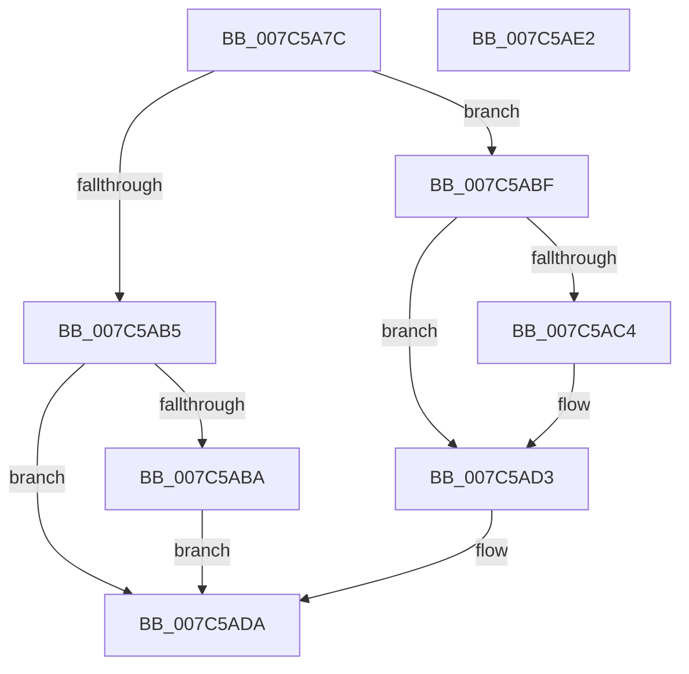

# ExTryAcquireTimeRefreshLockExclusive

- RVA: `0x007C5A7C`–`0x007C5AE3` (길이 `103` bytes)
- VA: `0x00000001407C5A7C`
- 실행 섹션: `PAGE`
- PDB 이름 있음: `예`; PDB Function 태그: `아니요`
- unwind 정보 RVA: `0x0005CF00`
- 디코드: `28`개 명령, `103/103` bytes 표시
- 미해석 바이트: `0` (있으면 어셈블리에 `.byte`로 보존)

> 이 문서는 커널 이미지의 기계어와 PDB 기호를 분석해 생성했습니다. 4번과 5번은 함수 원형과 자료형을 바이너리 사용 방식에서 추정한 C 해석이며 원본 소스 복구 결과는 아닙니다.

## 1. Dependencies

- 직접 호출 지점: **3**; 고유 호출 대상: **3**
- 직접 호출자로 확인된 함수: **1**
- RIP 상대 이미지 참조: **2**

### Outgoing calls
- `0x007C5AA4` → [KeAbPreAcquire](../../text/21/KeAbPreAcquire_function_00210230.md) (function, `0x00210230`)
- `0x007C5ACE` → [KeAbPostReleaseEx](../../text/26/KeAbPostReleaseEx_function_00262210.md) (function, `0x00262210`)
- `0x007C5AD5` → [KeLeaveCriticalRegion](../../text/25/KeLeaveCriticalRegion_function_0025D8B0.md) (function, `0x0025D8B0`)

### Direct callers
- [KdpTimeSlipWork](../../pagekd/B8/KdpTimeSlipWork_function_00B88650.md) at `0x00B88656`

### Static image references
- `0x007C5A8B` → RVA `0x00EFEFC8` (`.data`; read)
- `0x007C5AA9` → RVA `0x00EFEFC8` (`.data`; read/write)

## 2. Other-region calls and transfers

- 다른 실행 섹션으로 향하는 call: **3**
  - `0x007C5AA4` → [KeAbPreAcquire](../../text/21/KeAbPreAcquire_function_00210230.md) (`PAGE` → `.text`)
  - `0x007C5ACE` → [KeAbPostReleaseEx](../../text/26/KeAbPostReleaseEx_function_00262210.md) (`PAGE` → `.text`)
  - `0x007C5AD5` → [KeLeaveCriticalRegion](../../text/25/KeLeaveCriticalRegion_function_0025D8B0.md) (`PAGE` → `.text`)
- 별도 외부 분기/꼬리 이동을 확인하지 못했습니다.

## 3. Assembly (complete function range)

```asm
007C5A7C  40 53                           push rbx
007C5A7E  48 83 EC 20                     sub rsp, 0x20
007C5A82  65 48 8B 04 25 88 01 00 00      mov rax, qword ptr gs:[0x188]
007C5A8B  48 8D 0D 36 95 73 00            lea rcx, [rip + 0x739536]
007C5A92  BB 01 00 00 00                  mov ebx, 1
007C5A97  33 D2                           xor edx, edx
007C5A99  44 8B C3                        mov r8d, ebx
007C5A9C  66 FF 88 E4 01 00 00            dec word ptr [rax + 0x1e4]
007C5AA3  90                              nop
007C5AA4  E8 87 A7 A4 FF                  call 0x140210230
007C5AA9  F0 48 0F BA 2D 15 95 73 00 00   lock bts qword ptr [rip + 0x739515], 0
007C5AB3  72 0A                           jb 0x1407c5abf
007C5AB5  48 85 C0                        test rax, rax
007C5AB8  74 20                           je 0x1407c5ada
007C5ABA  88 58 0A                        mov byte ptr [rax + 0xa], bl
007C5ABD  EB 1B                           jmp 0x1407c5ada
007C5ABF  48 85 C0                        test rax, rax
007C5AC2  74 0F                           je 0x1407c5ad3
007C5AC4  48 8B D0                        mov rdx, rax
007C5AC7  48 8D 0D FA 94 73 00            lea rcx, [rip + 0x7394fa]
007C5ACE  E8 3D C7 A9 FF                  call 0x140262210
007C5AD3  32 DB                           xor bl, bl
007C5AD5  E8 D6 7D A9 FF                  call 0x14025d8b0
007C5ADA  8A C3                           mov al, bl
007C5ADC  48 83 C4 20                     add rsp, 0x20
007C5AE0  5B                              pop rbx
007C5AE1  C3                              ret
007C5AE2  CC                              int3
```

## 4. C-style interpretation (structured pseudocode)

```c
__int64 __fastcall ExTryAcquireTimeRefreshLockExclusive(__int64 a1, int a2)
{
    __int64 result;
    __int64 v_rbx;
    __int64 v_rsp;

    v_rsp = (v_rsp) - (32);
    a2 = 0;
    result = KeAbPreAcquire(v_rip + 7574838, a2, 1, a4);
    if (condition_is_below) goto loc_007C5ABF;
    if (result == 0) goto loc_007C5ADA;
    *(unsigned __int8 *)(result + 10) = 1;
    goto loc_007C5ADA;
loc_007C5ABF:
    if (result != 0) {
        a2 = result;
        a1 = v_rip + 7574778;
        result = KeAbPostReleaseEx(a1, a2, 1, a4);
    }
    v_rbx = 0;
    result = KeLeaveCriticalRegion(a1, a2, 1, a4);
loc_007C5ADA:
    v_rsp = (v_rsp) + (32);
    return 0;
}
```

## 5. (Beta) C Style

```c
int64_t ExTryAcquireTimeRefreshLockExclusive(int64_t Arg1, int32_t Arg2)
{
    int64_t result;
    int64_t local_rbx;
    int64_t local_rsp;

    local_rsp = (local_rsp) - (32);
    Arg2 = 0;
    result = KeAbPreAcquire(v_rip + 7574838, Arg2, 1, a4);
    if (condition_is_below) goto loc_007C5ABF;
    if (result == 0) goto loc_007C5ADA;
    *(uint8_t *)(result + 0xA) = 1;
    goto loc_007C5ADA;
loc_007C5ABF:
    if (result != 0) {
        Arg2 = result;
        Arg1 = v_rip + 7574778;
        result = KeAbPostReleaseEx(Arg1, Arg2, 1, a4);
    }
    local_rbx = 0;
    result = KeLeaveCriticalRegion(Arg1, Arg2, 1, a4);
loc_007C5ADA:
    local_rsp = (local_rsp) + (32);
    return 0;
}
```

## 6. Execution-region graph

[열기: 2D/3D 그래프와 함수 탐색 컨트롤 패널](../../../control-panel.html?section=page&rva=0x007C5A7C&view=graph)

- 2D 그래프는 위에서 아래로 흐르고, 3D 그래프는 빈 공간을 드래그해 회전합니다. Shift+드래그는 이동, 휠은 확대·축소, 함수 노드 선택은 대상 보고서 이동입니다.

### Static fallback


