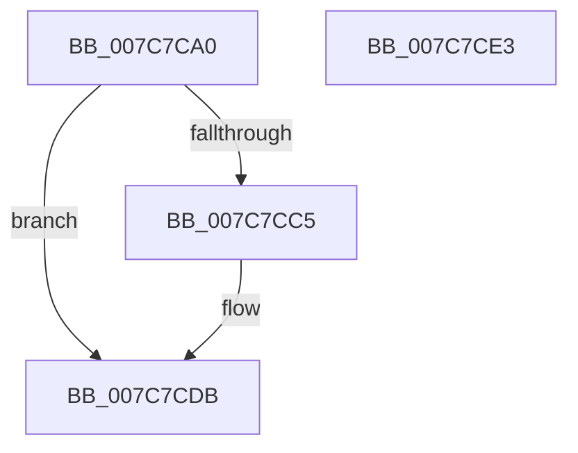

# ExUpdateOsPfnInRegistry

- RVA: `0x007C7CA0`–`0x007C7CE4` (길이 `68` bytes)
- VA: `0x00000001407C7CA0`
- 실행 섹션: `PAGE`
- PDB 이름 있음: `예`; PDB Function 태그: `아니요`
- unwind 정보 RVA: `0x0005D2F4`
- 디코드: `18`개 명령, `68/68` bytes 표시
- 미해석 바이트: `0` (있으면 어셈블리에 `.byte`로 보존)

> 이 문서는 커널 이미지의 기계어와 PDB 기호를 분석해 생성했습니다. 4번과 5번은 함수 원형과 자료형을 바이너리 사용 방식에서 추정한 C 해석이며 원본 소스 복구 결과는 아닙니다.

## 1. Dependencies

- 직접 호출 지점: **2**; 고유 호출 대상: **2**
- 직접 호출자로 확인된 함수: **0**
- RIP 상대 이미지 참조: **1**

### Outgoing calls
- `0x007C7CAD` → [PsGetCurrentServerSiloGlobals](../../text/2F/PsGetCurrentServerSiloGlobals_function_002FE1F0.md) (function, `0x002FE1F0`)
- `0x007C7CD3` → [guard_dispatch_icall](../../text/6B/guard_dispatch_icall_function_006BAAD0.md) (function, `0x006BAAD0`)

### Direct callers
- 이 함수 시작 RVA로 연결되는 직접 call은 확인되지 않았습니다. 간접 호출은 완전히 역산할 수 없습니다.

### Static image references
- `0x007C7CB9` → RVA `0x00FD8498` (`PAGEDATA`; read)

## 2. Other-region calls and transfers

- 다른 실행 섹션으로 향하는 call: **2**
  - `0x007C7CAD` → [PsGetCurrentServerSiloGlobals](../../text/2F/PsGetCurrentServerSiloGlobals_function_002FE1F0.md) (`PAGE` → `.text`)
  - `0x007C7CD3` → [guard_dispatch_icall](../../text/6B/guard_dispatch_icall_function_006BAAD0.md) (`PAGE` → `.text`)
- 별도 외부 분기/꼬리 이동을 확인하지 못했습니다.

## 3. Assembly (complete function range)

```asm
007C7CA0  48 83 EC 38                     sub rsp, 0x38
007C7CA4  44 8B D9                        mov r11d, ecx
007C7CA7  41 BA 02 00 00 C0               mov r10d, 0xc0000002
007C7CAD  E8 3E 65 B3 FF                  call 0x1402fe1f0
007C7CB2  48 8B 88 68 03 00 00            mov rcx, qword ptr [rax + 0x368]
007C7CB9  48 8B 05 D8 07 81 00            mov rax, qword ptr [rip + 0x8107d8]
007C7CC0  48 85 C0                        test rax, rax
007C7CC3  74 16                           je 0x1407c7cdb
007C7CC5  4C 89 4C 24 20                  mov qword ptr [rsp + 0x20], r9
007C7CCA  45 8B C8                        mov r9d, r8d
007C7CCD  4C 8B C2                        mov r8, rdx
007C7CD0  41 8B D3                        mov edx, r11d
007C7CD3  E8 F8 2D EF FF                  call 0x1406baad0
007C7CD8  44 8B D0                        mov r10d, eax
007C7CDB  41 8B C2                        mov eax, r10d
007C7CDE  48 83 C4 38                     add rsp, 0x38
007C7CE2  C3                              ret
007C7CE3  CC                              int3
```

## 4. C-style interpretation (structured pseudocode)

```c
__int64 __fastcall ExUpdateOsPfnInRegistry(int a1, __int64 a2, int a3, __int64 a4)
{
    __int64 result;
    __int64 v_r10;
    __int64 v_rsp;
    unsigned __int64 v_stack_m18;

    v_rsp = (v_rsp) - (56);
    result = PsGetCurrentServerSiloGlobals(a1, a2, a3, a4);
    result = *(unsigned __int64 *)(v_rip + 8456152);
    v_r10 = (unsigned int)(0xC0000002ULL);
    if (*(unsigned __int64 *)(v_rip + 8456152) != 0) {
        v_stack_m18 = a4;
        a4 = a3;
        a3 = a2;
        a2 = (unsigned int)((unsigned int)(a1));
        result = guard_dispatch_icall(*(unsigned __int64 *)(result + 872), a2, a3, a4);
        v_r10 = (unsigned int)(result);
    }
    v_rsp = (v_rsp) + (56);
    return (unsigned int)((unsigned int)(v_r10));
}
```

## 5. (Beta) C Style

```c
int64_t ExUpdateOsPfnInRegistry(int32_t Arg1, int64_t Arg2, int32_t Arg3, int64_t Arg4)
{
    int64_t result;
    int64_t local_r10;
    int64_t local_rsp;
    uint64_t v_stack_m18;

    local_rsp = (local_rsp) - (56);
    result = PsGetCurrentServerSiloGlobals(Arg1, Arg2, Arg3, Arg4);
    result = *(uint64_t *)(v_rip + 0x8107D8);
    local_r10 = (uint32_t)(0xC0000002ULL);
    if (*(uint64_t *)(v_rip + 0x8107D8) != 0) {
        v_stack_m18 = Arg4;
        Arg4 = Arg3;
        Arg3 = Arg2;
        Arg2 = (uint32_t)((uint32_t)(Arg1));
        result = guard_dispatch_icall(*(uint64_t *)(result + 0x368), Arg2, Arg3, Arg4);
        local_r10 = (uint32_t)(result);
    }
    local_rsp = (local_rsp) + (56);
    return (uint32_t)((uint32_t)(local_r10));
}
```

## 6. Execution-region graph

[열기: 2D/3D 그래프와 함수 탐색 컨트롤 패널](../../../control-panel.html?section=page&rva=0x007C7CA0&view=graph)

- 2D 그래프는 위에서 아래로 흐르고, 3D 그래프는 빈 공간을 드래그해 회전합니다. Shift+드래그는 이동, 휠은 확대·축소, 함수 노드 선택은 대상 보고서 이동입니다.

### Static fallback


