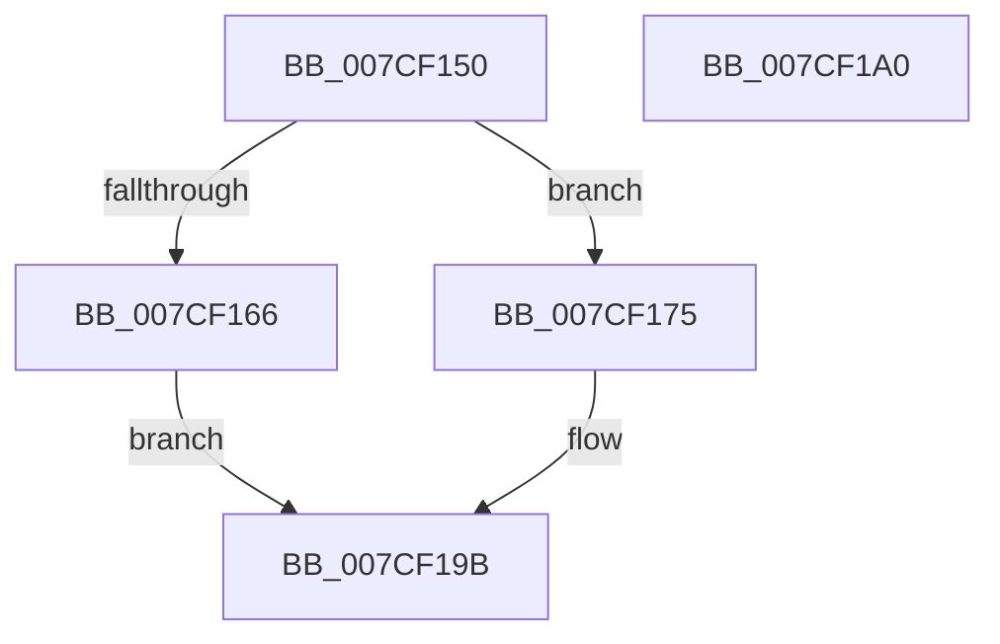

# ExWnfCrossVmCallback

- RVA: `0x007CF150`–`0x007CF1A1` (길이 `81` bytes)
- VA: `0x00000001407CF150`
- 실행 섹션: `PAGE`
- PDB 이름 있음: `예`; PDB Function 태그: `아니요`
- unwind 정보 RVA: `0x00063458`
- 디코드: `25`개 명령, `81/81` bytes 표시
- 미해석 바이트: `0` (있으면 어셈블리에 `.byte`로 보존)

> 이 문서는 커널 이미지의 기계어와 PDB 기호를 분석해 생성했습니다. 4번과 5번은 함수 원형과 자료형을 바이너리 사용 방식에서 추정한 C 해석이며 원본 소스 복구 결과는 아닙니다.

## 1. Dependencies

- 직접 호출 지점: **2**; 고유 호출 대상: **2**
- 직접 호출자로 확인된 함수: **0**
- RIP 상대 이미지 참조: **0**

### Outgoing calls
- `0x007CF16E` → [ExpNtDeleteWnfStateData](ExpNtDeleteWnfStateData_function_007CF1A8.md) (function, `0x007CF1A8`)
- `0x007CF196` → [ExpNtUpdateWnfStateData](../90/ExpNtUpdateWnfStateData_function_0090A7A0.md) (function, `0x0090A7A0`)

### Direct callers
- 이 함수 시작 RVA로 연결되는 직접 call은 확인되지 않았습니다. 간접 호출은 완전히 역산할 수 없습니다.

### Static image references
- 디코드된 RIP-relative 메모리 참조가 없습니다.

## 2. Other-region calls and transfers

- 다른 실행 섹션으로 향하는 call: **0**
- 별도 외부 분기/꼬리 이동을 확인하지 못했습니다.

## 3. Assembly (complete function range)

```asm
007CF150  48 83 EC 48                     sub rsp, 0x48
007CF154  33 C9                           xor ecx, ecx
007CF156  4D 8B D0                        mov r10, r8
007CF159  48 85 D2                        test rdx, rdx
007CF15C  8B C1                           mov eax, ecx
007CF15E  0F 95 C0                        setne al
007CF161  45 85 C9                        test r9d, r9d
007CF164  75 0F                           jne 0x1407cf175
007CF166  44 8B C0                        mov r8d, eax
007CF169  33 D2                           xor edx, edx
007CF16B  49 8B CA                        mov rcx, r10
007CF16E  E8 35 00 00 00                  call 0x1407cf1a8
007CF173  EB 26                           jmp 0x1407cf19b
007CF175  44 8B 44 24 78                  mov r8d, dword ptr [rsp + 0x78]
007CF17A  45 33 C9                        xor r9d, r9d
007CF17D  48 8B 54 24 70                  mov rdx, qword ptr [rsp + 0x70]
007CF182  89 44 24 38                     mov dword ptr [rsp + 0x38], eax
007CF186  89 4C 24 30                     mov dword ptr [rsp + 0x30], ecx
007CF18A  89 4C 24 28                     mov dword ptr [rsp + 0x28], ecx
007CF18E  48 89 4C 24 20                  mov qword ptr [rsp + 0x20], rcx
007CF193  49 8B CA                        mov rcx, r10
007CF196  E8 05 B6 13 00                  call 0x14090a7a0
007CF19B  48 83 C4 48                     add rsp, 0x48
007CF19F  C3                              ret
007CF1A0  CC                              int3
```

## 4. C-style interpretation (structured pseudocode)

```c
__int64 __fastcall ExWnfCrossVmCallback(int a1, __int64 a2, __int64 a3, int a4, __int64 a5, unsigned int a6)
{
    __int64 result;
    __int64 v_rsp;
    unsigned int v_stack_m10;
    unsigned int v_stack_m18;
    unsigned int v_stack_m20;
    unsigned __int64 v_stack_m28;

    v_rsp = (v_rsp) - (72);
    a1 = 0;
    result = (a2 != 0) ? 1 : 0;
    if (a4 != 0) goto loc_007CF175;
    a2 = 0;
    result = ExpNtDeleteWnfStateData(a3, a2, (unsigned int)((unsigned int)(result)), a4);
    goto loc_007CF19B;
loc_007CF175:
    a4 = 0;
    v_stack_m10 = (unsigned int)(result);
    v_stack_m18 = (unsigned int)(a3);
    v_stack_m20 = (unsigned int)(a3);
    v_stack_m28 = a3;
    result = ExpNtUpdateWnfStateData(a3, a5, (unsigned int)(a6), a4);
loc_007CF19B:
    v_rsp = (v_rsp) + (72);
    return result;
}
```

## 5. (Beta) C Style

```c
int64_t ExWnfCrossVmCallback(int32_t Arg1, int64_t Arg2, int64_t Arg3, int32_t Arg4, int64_t Arg5, uint32_t Arg6)
{
    int64_t result;
    int64_t local_rsp;
    uint32_t v_stack_m10;
    uint32_t v_stack_m18;
    uint32_t v_stack_m20;
    uint64_t v_stack_m28;

    local_rsp = (local_rsp) - (72);
    Arg1 = 0;
    result = (Arg2 != 0) ? 1 : 0;
    if (Arg4 != 0) goto loc_007CF175;
    Arg2 = 0;
    result = ExpNtDeleteWnfStateData(Arg3, Arg2, (uint32_t)((uint32_t)(result)), Arg4);
    goto loc_007CF19B;
loc_007CF175:
    Arg4 = 0;
    v_stack_m10 = (uint32_t)(result);
    v_stack_m18 = (uint32_t)(Arg3);
    v_stack_m20 = (uint32_t)(Arg3);
    v_stack_m28 = Arg3;
    result = ExpNtUpdateWnfStateData(Arg3, Arg5, (uint32_t)(Arg6), Arg4);
loc_007CF19B:
    local_rsp = (local_rsp) + (72);
    return result;
}
```

## 6. Execution-region graph

[열기: 2D/3D 그래프와 함수 탐색 컨트롤 패널](../../../control-panel.html?section=page&rva=0x007CF150&view=graph)

- 2D 그래프는 위에서 아래로 흐르고, 3D 그래프는 빈 공간을 드래그해 회전합니다. Shift+드래그는 이동, 휠은 확대·축소, 함수 노드 선택은 대상 보고서 이동입니다.

### Static fallback


