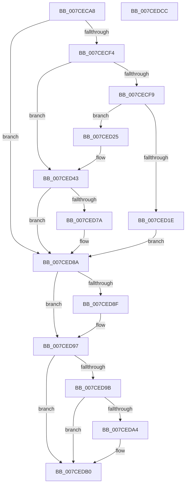

# ExpAcquirePrmInterface

- RVA: `0x007CECA8`–`0x007CEDCD` (길이 `293` bytes)
- VA: `0x00000001407CECA8`
- 실행 섹션: `PAGE`
- PDB 이름 있음: `예`; PDB Function 태그: `아니요`
- unwind 정보 RVA: `0x0007EE78`
- 디코드: `77`개 명령, `293/293` bytes 표시
- 미해석 바이트: `0` (있으면 어셈블리에 `.byte`로 보존)

> 이 문서는 커널 이미지의 기계어와 PDB 기호를 분석해 생성했습니다. 4번과 5번은 함수 원형과 자료형을 바이너리 사용 방식에서 추정한 C 해석이며 원본 소스 복구 결과는 아닙니다.

## 1. Dependencies

- 직접 호출 지점: **7**; 고유 호출 대상: **7**
- 직접 호출자로 확인된 함수: **2**
- RIP 상대 이미지 참조: **8**

### Outgoing calls
- `0x007CECDD` → [IoGetDeviceObjectPointer](../95/IoGetDeviceObjectPointer_function_00953220.md) (function, `0x00953220`)
- `0x007CED0D` → [ExAllocatePool2](../../poolcode/B8/ExAllocatePool2_function_00B820F0.md) (function, `0x00B820F0`)
- `0x007CED3E` → [RtlUnicodeStringCopy](../../text/3D/RtlUnicodeStringCopy_function_003D4130.md) (function, `0x003D4130`)
- `0x007CED6F` → [IoRegisterPlugPlayNotification](../95/IoRegisterPlugPlayNotification_function_009535A0.md) (function, `0x009535A0`)
- `0x007CED83` → [ExpQueryPrmInterface](ExpQueryPrmInterface_function_007CF018.md) (function, `0x007CF018`)
- `0x007CED92` → [ObfDereferenceObject](../../text/2F/ObfDereferenceObject_function_002F9350.md) (function, `0x002F9350`)
- `0x007CEDAB` → [RtlFreeAnsiString](../9C/RtlFreeAnsiString_function_009C0800.md) (function, `0x009C0800`)

### Direct callers
- [ExpPrmNotifyInterfaceChange](ExpPrmNotifyInterfaceChange_function_007CEDE0.md) at `0x007CEE22`
- [ExpPrmTargetDeviceChangeCallback](ExpPrmTargetDeviceChangeCallback_function_007CEED0.md) at `0x007CEFCF`

### Static image references
- `0x007CED12` → RVA `0x00EFAB20` (`.data`; write)
- `0x007CED28` → RVA `0x00EFAB18` (`.data`; write)
- `0x007CED30` → RVA `0x00EFAB18` (`.data`; read)
- `0x007CED37` → RVA `0x00EFAB1A` (`.data`; write)
- `0x007CED43` → RVA `0x00EFAB28` (`.data`; read)
- `0x007CED4A` → RVA `0x00EFAAC8` (`.data`; read)
- `0x007CED58` → RVA `0x007CEED0` (`ExpPrmTargetDeviceChangeCallback`; read)
- `0x007CED9B` → RVA `0x00EFAB20` (`.data`; read)

## 2. Other-region calls and transfers

- 다른 실행 섹션으로 향하는 call: **3**
  - `0x007CED0D` → [ExAllocatePool2](../../poolcode/B8/ExAllocatePool2_function_00B820F0.md) (`PAGE` → `POOLCODE`)
  - `0x007CED3E` → [RtlUnicodeStringCopy](../../text/3D/RtlUnicodeStringCopy_function_003D4130.md) (`PAGE` → `.text`)
  - `0x007CED92` → [ObfDereferenceObject](../../text/2F/ObfDereferenceObject_function_002F9350.md) (`PAGE` → `.text`)
- 별도 외부 분기/꼬리 이동을 확인하지 못했습니다.

## 3. Assembly (complete function range)

```asm
007CECA8  48 8B C4                        mov rax, rsp
007CECAB  48 89 58 08                     mov qword ptr [rax + 8], rbx
007CECAF  48 89 68 10                     mov qword ptr [rax + 0x10], rbp
007CECB3  48 89 70 18                     mov qword ptr [rax + 0x18], rsi
007CECB7  57                              push rdi
007CECB8  41 56                           push r14
007CECBA  41 57                           push r15
007CECBC  48 83 EC 50                     sub rsp, 0x50
007CECC0  4D 8B F0                        mov r14, r8
007CECC3  4C 8D 48 D8                     lea r9, [rax - 0x28]
007CECC7  40 8A EA                        mov bpl, dl
007CECCA  4C 8D 40 20                     lea r8, [rax + 0x20]
007CECCE  45 33 FF                        xor r15d, r15d
007CECD1  BA 00 00 1F 00                  mov edx, 0x1f0000
007CECD6  4C 89 78 20                     mov qword ptr [rax + 0x20], r15
007CECDA  48 8B F1                        mov rsi, rcx
007CECDD  E8 3E 45 18 00                  call 0x140953220
007CECE2  48 8B BC 24 88 00 00 00         mov rdi, qword ptr [rsp + 0x88]
007CECEA  8B D8                           mov ebx, eax
007CECEC  85 C0                           test eax, eax
007CECEE  0F 88 96 00 00 00               js 0x1407ced8a
007CECF4  40 84 ED                        test bpl, bpl
007CECF7  74 4A                           je 0x1407ced43
007CECF9  0F B7 1E                        movzx ebx, word ptr [rsi]
007CECFC  41 8D 4F 40                     lea ecx, [r15 + 0x40]
007CED00  66 83 C3 02                     add bx, 2
007CED04  41 B8 50 72 6D 49               mov r8d, 0x496d7250
007CED0A  0F B7 D3                        movzx edx, bx
007CED0D  E8 DE 33 3B 00                  call 0x140b820f0
007CED12  48 89 05 07 BE 72 00            mov qword ptr [rip + 0x72be07], rax
007CED19  48 85 C0                        test rax, rax
007CED1C  75 07                           jne 0x1407ced25
007CED1E  BB 9A 00 00 C0                  mov ebx, 0xc000009a
007CED23  EB 65                           jmp 0x1407ced8a
007CED25  48 8B D6                        mov rdx, rsi
007CED28  66 44 89 3D E8 BD 72 00         mov word ptr [rip + 0x72bde8], r15w
007CED30  48 8D 0D E1 BD 72 00            lea rcx, [rip + 0x72bde1]
007CED37  66 89 1D DC BD 72 00            mov word ptr [rip + 0x72bddc], bx
007CED3E  E8 ED 53 C0 FF                  call 0x1403d4130
007CED43  4C 8B 0D DE BD 72 00            mov r9, qword ptr [rip + 0x72bdde]
007CED4A  48 8D 05 77 BD 72 00            lea rax, [rip + 0x72bd77]
007CED51  48 89 44 24 30                  mov qword ptr [rsp + 0x30], rax
007CED56  33 D2                           xor edx, edx
007CED58  48 8D 05 71 01 00 00            lea rax, [rip + 0x171]
007CED5F  4C 89 7C 24 28                  mov qword ptr [rsp + 0x28], r15
007CED64  4C 8B C7                        mov r8, rdi
007CED67  48 89 44 24 20                  mov qword ptr [rsp + 0x20], rax
007CED6C  8D 4A 03                        lea ecx, [rdx + 3]
007CED6F  E8 2C 48 18 00                  call 0x1409535a0
007CED74  8B D8                           mov ebx, eax
007CED76  85 C0                           test eax, eax
007CED78  78 10                           js 0x1407ced8a
007CED7A  48 8B 4F 08                     mov rcx, qword ptr [rdi + 8]
007CED7E  4C 89 74 24 20                  mov qword ptr [rsp + 0x20], r14
007CED83  E8 90 02 00 00                  call 0x1407cf018
007CED88  8B D8                           mov ebx, eax
007CED8A  48 85 FF                        test rdi, rdi
007CED8D  74 08                           je 0x1407ced97
007CED8F  48 8B CF                        mov rcx, rdi
007CED92  E8 B9 A5 B2 FF                  call 0x1402f9350
007CED97  85 DB                           test ebx, ebx
007CED99  79 15                           jns 0x1407cedb0
007CED9B  4C 39 3D 7E BD 72 00            cmp qword ptr [rip + 0x72bd7e], r15
007CEDA2  74 0C                           je 0x1407cedb0
007CEDA4  48 8D 0D 6D BD 72 00            lea rcx, [rip + 0x72bd6d]
007CEDAB  E8 50 1A 1F 00                  call 0x1409c0800
007CEDB0  4C 8D 5C 24 50                  lea r11, [rsp + 0x50]
007CEDB5  8B C3                           mov eax, ebx
007CEDB7  49 8B 5B 20                     mov rbx, qword ptr [r11 + 0x20]
007CEDBB  49 8B 6B 28                     mov rbp, qword ptr [r11 + 0x28]
007CEDBF  49 8B 73 30                     mov rsi, qword ptr [r11 + 0x30]
007CEDC3  49 8B E3                        mov rsp, r11
007CEDC6  41 5F                           pop r15
007CEDC8  41 5E                           pop r14
007CEDCA  5F                              pop rdi
007CEDCB  C3                              ret
007CEDCC  CC                              int3
```

## 4. C-style interpretation (structured pseudocode)

```c
__int64 __fastcall ExpAcquirePrmInterface(__int64 a1, unsigned __int8 a2, __int64 a3)
{
    __int64 result;
    __int64 v_r15;
    __int64 v_rbx;
    __int64 v_rsp;
    unsigned __int64 v_stack_m18;
    unsigned __int64 v_stack_m38;
    unsigned __int64 v_stack_m40;
    unsigned __int64 v_stack_m48;
    unsigned __int64 v_stack_p20;

    *(unsigned __int64 *)(v_rsp + 8) = v_rbx;
    *(unsigned __int64 *)(v_rsp + 16) = v_rbp;
    *(unsigned __int64 *)(v_rsp + 24) = v_rsi;
    v_rsp = (v_rsp) - (80);
    v_r15 = 0;
    *(unsigned __int64 *)(v_rsp + 32) = 0;
    result = IoGetDeviceObjectPointer(a1, (unsigned int)(0x1F0000ULL), v_rsp + 32, v_rsp - 40);
    if (sign_flag) goto loc_007CED8A;
    if (a2 == 0) goto loc_007CED43;
    v_rbx = (unsigned __int16)((*(unsigned __int16 *)(a1)) + (2));
    result = ExAllocatePool2(v_r15 + 64, (unsigned __int16)(v_rbx), (unsigned int)(0x496D7250ULL), v_rsp - 40);
    *(unsigned __int64 *)(v_rip + 7519751) = result;
    if (result != 0) goto loc_007CED25;
    goto loc_007CED8A;
loc_007CED25:
    *(unsigned __int16 *)(v_rip + 7519720) = 0;
    *(unsigned __int16 *)(v_rip + 7519708) = (unsigned __int16)((unsigned int)(0xC000009AULL));
    result = RtlUnicodeStringCopy(v_rip + 7519713, a1, (unsigned int)(0x496D7250ULL), v_rsp - 40);
loc_007CED43:
    v_stack_m38 = v_rip + 7519607;
    a2 = 0;
    v_stack_m40 = 0;
    v_stack_m48 = v_rip + 369;
    result = IoRegisterPlugPlayNotification(a2 + 3, a2, v_stack_p20, *(unsigned __int64 *)(v_rip + 7519710));
    v_rbx = (unsigned int)((unsigned int)(result));
    if (!(sign_flag)) {
        a1 = *(unsigned __int64 *)(v_stack_p20 + 8);
        v_stack_m48 = a3;
        result = ExpQueryPrmInterface(a1, a2, v_stack_p20, *(unsigned __int64 *)(v_rip + 7519710));
        v_rbx = (unsigned int)(result);
    }
    if (v_stack_p20 != 0) {
        a1 = v_stack_p20;
        result = ObfDereferenceObject(a1, a2, v_stack_p20, *(unsigned __int64 *)(v_rip + 7519710));
    }
    if (!sign_flag) goto loc_007CEDB0;
    if ((*(unsigned __int64 *)(v_rip + 7519614)) != 0) {
        a1 = v_rip + 7519597;
        result = RtlFreeAnsiString(a1, a2, v_stack_p20, *(unsigned __int64 *)(v_rip + 7519710));
    }
    return (unsigned int)((unsigned int)(v_rbx));
}
```

## 5. (Beta) C Style

```c
int64_t ExpAcquirePrmInterface(void *Arg1, uint8_t Arg2, int64_t Arg3)
{
    uint8_t *arg1 = (uint8_t *)Arg1;

    int64_t result;
    int64_t local_r15;
    int64_t local_rbx;
    int64_t local_rsp;
    uint64_t v_stack_m18;
    uint64_t v_stack_m38;
    uint64_t v_stack_m40;
    uint64_t v_stack_m48;
    uint64_t v_stack_p20;

    *(uint64_t *)(local_rsp + 0x8) = local_rbx;
    *(uint64_t *)(local_rsp + 0x10) = local_rbp;
    *(uint64_t *)(local_rsp + 0x18) = local_rsi;
    local_rsp = (local_rsp) - (80);
    local_r15 = 0;
    *(uint64_t *)(local_rsp + 0x20) = 0;
    result = IoGetDeviceObjectPointer(Arg1, (uint32_t)(0x1F0000ULL), local_rsp + 32, local_rsp - 40);
    if (sign_flag) goto loc_007CED8A;
    if (Arg2 == 0) goto loc_007CED43;
    local_rbx = (uint16_t)((*(uint16_t *)(arg1)) + (2));
    result = ExAllocatePool2(local_r15 + 64, (uint16_t)(local_rbx), (uint32_t)(0x496D7250ULL), local_rsp - 40);
    *(uint64_t *)(v_rip + 0x72BE07) = result;
    if (result != 0) goto loc_007CED25;
    goto loc_007CED8A;
loc_007CED25:
    *(uint16_t *)(v_rip + 0x72BDE8) = 0;
    *(uint16_t *)(v_rip + 0x72BDDC) = (uint16_t)((uint32_t)(0xC000009AULL));
    result = RtlUnicodeStringCopy(v_rip + 7519713, Arg1, (uint32_t)(0x496D7250ULL), local_rsp - 40);
loc_007CED43:
    v_stack_m38 = v_rip + 7519607;
    Arg2 = 0;
    v_stack_m40 = 0;
    v_stack_m48 = v_rip + 369;
    result = IoRegisterPlugPlayNotification(Arg2 + 3, Arg2, v_stack_p20, *(uint64_t *)(v_rip + 0x72BDDE));
    local_rbx = (uint32_t)((uint32_t)(result));
    if (!(sign_flag)) {
        Arg1 = *(uint64_t *)(v_stack_p20 + 0x8);
        v_stack_m48 = Arg3;
        result = ExpQueryPrmInterface(Arg1, Arg2, v_stack_p20, *(uint64_t *)(v_rip + 0x72BDDE));
        local_rbx = (uint32_t)(result);
    }
    if (v_stack_p20 != 0) {
        Arg1 = v_stack_p20;
        result = ObfDereferenceObject(Arg1, Arg2, v_stack_p20, *(uint64_t *)(v_rip + 0x72BDDE));
    }
    if (!sign_flag) goto loc_007CEDB0;
    if ((*(uint64_t *)(v_rip + 0x72BD7E)) != 0) {
        Arg1 = v_rip + 7519597;
        result = RtlFreeAnsiString(Arg1, Arg2, v_stack_p20, *(uint64_t *)(v_rip + 0x72BDDE));
    }
    return (uint32_t)((uint32_t)(local_rbx));
}
```

### 관측된 메모리 오프셋

구조체 형식이 확인되지 않은 접근은 인자 기준의 오프셋으로만 기록했습니다.

| 기준 인자 | 오프셋 표현 | 폭 (bit) | 접근 |
|---|---:|---:|---|
| `Arg1` | `+ 0x0` | `16` | `R` |

## 6. Execution-region graph

[열기: 2D/3D 그래프와 함수 탐색 컨트롤 패널](../../../control-panel.html?section=page&rva=0x007CECA8&view=graph)

- 2D 그래프는 위에서 아래로 흐르고, 3D 그래프는 빈 공간을 드래그해 회전합니다. Shift+드래그는 이동, 휠은 확대·축소, 함수 노드 선택은 대상 보고서 이동입니다.

### Static fallback


