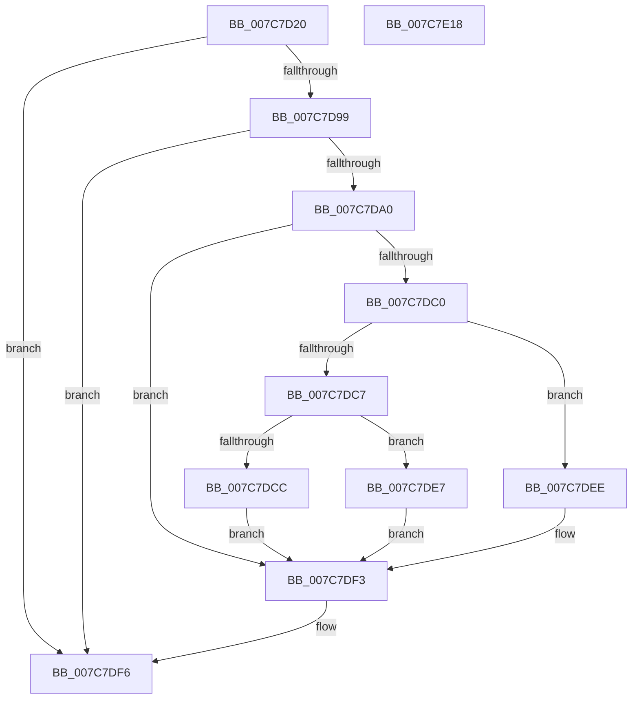

# ExpCloudbookHardwareIDProvider

- RVA: `0x007C7D20`–`0x007C7E19` (길이 `249` bytes)
- VA: `0x00000001407C7D20`
- 실행 섹션: `PAGE`
- PDB 이름 있음: `예`; PDB Function 태그: `아니요`
- unwind 정보 RVA: `0x000D4E1C`
- 디코드: `68`개 명령, `249/249` bytes 표시
- 미해석 바이트: `0` (있으면 어셈블리에 `.byte`로 보존)

> 이 문서는 커널 이미지의 기계어와 PDB 기호를 분석해 생성했습니다. 4번과 5번은 함수 원형과 자료형을 바이너리 사용 방식에서 추정한 C 해석이며 원본 소스 복구 결과는 아닙니다.

## 1. Dependencies

- 직접 호출 지점: **4**; 고유 호출 대상: **4**
- 직접 호출자로 확인된 함수: **0**
- RIP 상대 이미지 참조: **2**

### Outgoing calls
- `0x007C7D88` → [ExpOsProductCacheProviderHelper](ExpOsProductCacheProviderHelper_function_007C8A58.md) (function, `0x007C8A58`)
- `0x007C7DB7` → [ZwQuerySystemInformation](../../text/6A/ZwQuerySystemInformation_function_006AD790.md) (function, `0x006AD790`)
- `0x007C7DDE` → [memcpy](../../text/6C/memcpy_function_006C6840.md) (function, `0x006C6840`)
- `0x007C7DFE` → [_security_check_cookie](../../text/6A/_security_check_cookie_function_006AC640.md) (function, `0x006AC640`)

### Direct callers
- 이 함수 시작 RVA로 연결되는 직접 call은 확인되지 않았습니다. 간접 호출은 완전히 역산할 수 없습니다.

### Static image references
- `0x007C7D33` → RVA `0x00E0A740` (`.data`; read)
- `0x007C7D77` → RVA `0x00B4BDE8` (`PAGE`; read)

## 2. Other-region calls and transfers

- 다른 실행 섹션으로 향하는 call: **3**
  - `0x007C7DB7` → [ZwQuerySystemInformation](../../text/6A/ZwQuerySystemInformation_function_006AD790.md) (`PAGE` → `.text`)
  - `0x007C7DDE` → [memcpy](../../text/6C/memcpy_function_006C6840.md) (`PAGE` → `.text`)
  - `0x007C7DFE` → [_security_check_cookie](../../text/6A/_security_check_cookie_function_006AC640.md) (`PAGE` → `.text`)
- 별도 외부 분기/꼬리 이동을 확인하지 못했습니다.

## 3. Assembly (complete function range)

```asm
007C7D20  4C 8B DC                        mov r11, rsp
007C7D23  49 89 5B 08                     mov qword ptr [r11 + 8], rbx
007C7D27  49 89 6B 20                     mov qword ptr [r11 + 0x20], rbp
007C7D2B  56                              push rsi
007C7D2C  57                              push rdi
007C7D2D  41 56                           push r14
007C7D2F  48 83 EC 70                     sub rsp, 0x70
007C7D33  48 8B 05 06 2A 64 00            mov rax, qword ptr [rip + 0x642a06]
007C7D3A  48 33 C4                        xor rax, rsp
007C7D3D  48 89 44 24 68                  mov qword ptr [rsp + 0x68], rax
007C7D42  48 8B BC 24 B8 00 00 00         mov rdi, qword ptr [rsp + 0xb8]
007C7D4A  0F 57 C0                        xorps xmm0, xmm0
007C7D4D  48 8B 9C 24 B0 00 00 00         mov rbx, qword ptr [rsp + 0xb0]
007C7D55  41 8B F1                        mov esi, r9d
007C7D58  49 89 7B A8                     mov qword ptr [r11 - 0x58], rdi
007C7D5C  49 8B E8                        mov rbp, r8
007C7D5F  49 89 5B A0                     mov qword ptr [r11 - 0x60], rbx
007C7D63  4C 8B F2                        mov r14, rdx
007C7D66  44 89 4C 24 20                  mov dword ptr [rsp + 0x20], r9d
007C7D6B  33 C0                           xor eax, eax
007C7D6D  4D 8B C8                        mov r9, r8
007C7D70  89 44 24 60                     mov dword ptr [rsp + 0x60], eax
007C7D74  4C 8B C2                        mov r8, rdx
007C7D77  48 8D 15 6A 40 38 00            lea rdx, [rip + 0x38406a]
007C7D7E  0F 11 44 24 40                  movups xmmword ptr [rsp + 0x40], xmm0
007C7D83  0F 11 44 24 50                  movups xmmword ptr [rsp + 0x50], xmm0
007C7D88  E8 CB 0C 00 00                  call 0x1407c8a58
007C7D8D  BA 00 00 00 80                  mov edx, 0x80000000
007C7D92  8D 0C 10                        lea ecx, [rax + rdx]
007C7D95  85 CA                           test edx, ecx
007C7D97  75 5D                           jne 0x1407c7df6
007C7D99  3D 23 00 00 C0                  cmp eax, 0xc0000023
007C7D9E  74 56                           je 0x1407c7df6
007C7DA0  45 33 C9                        xor r9d, r9d
007C7DA3  C7 03 20 00 00 00               mov dword ptr [rbx], 0x20
007C7DA9  48 8D 54 24 40                  lea rdx, [rsp + 0x40]
007C7DAE  B9 BE 00 00 00                  mov ecx, 0xbe
007C7DB3  45 8D 41 24                     lea r8d, [r9 + 0x24]
007C7DB7  E8 D4 59 EE FF                  call 0x1406ad790
007C7DBC  85 C0                           test eax, eax
007C7DBE  78 33                           js 0x1407c7df3
007C7DC0  F6 44 24 40 04                  test byte ptr [rsp + 0x40], 4
007C7DC5  74 27                           je 0x1407c7dee
007C7DC7  83 FE 20                        cmp esi, 0x20
007C7DCA  72 1B                           jb 0x1407c7de7
007C7DCC  41 C7 06 03 00 00 00            mov dword ptr [r14], 3
007C7DD3  48 8D 54 24 44                  lea rdx, [rsp + 0x44]
007C7DD8  44 8B 03                        mov r8d, dword ptr [rbx]
007C7DDB  48 8B CD                        mov rcx, rbp
007C7DDE  E8 5D EA EF FF                  call 0x1406c6840
007C7DE3  33 C0                           xor eax, eax
007C7DE5  EB 0C                           jmp 0x1407c7df3
007C7DE7  B8 23 00 00 C0                  mov eax, 0xc0000023
007C7DEC  EB 05                           jmp 0x1407c7df3
007C7DEE  B8 34 00 00 C0                  mov eax, 0xc0000034
007C7DF3  C6 07 01                        mov byte ptr [rdi], 1
007C7DF6  48 8B 4C 24 68                  mov rcx, qword ptr [rsp + 0x68]
007C7DFB  48 33 CC                        xor rcx, rsp
007C7DFE  E8 3D 48 EE FF                  call 0x1406ac640
007C7E03  4C 8D 5C 24 70                  lea r11, [rsp + 0x70]
007C7E08  49 8B 5B 20                     mov rbx, qword ptr [r11 + 0x20]
007C7E0C  49 8B 6B 38                     mov rbp, qword ptr [r11 + 0x38]
007C7E10  49 8B E3                        mov rsp, r11
007C7E13  41 5E                           pop r14
007C7E15  5F                              pop rdi
007C7E16  5E                              pop rsi
007C7E17  C3                              ret
007C7E18  CC                              int3
```

## 4. C-style interpretation (structured pseudocode)

```c
__int64 __fastcall ExpCloudbookHardwareIDProvider(__int64 a1, __int64 a2, __int64 a3, int a4, __int64 a5, __int64 a6)
{
    __int64 result;
    __int64 v_rsp;
    unsigned __int64 v_stack_m18;
    unsigned __int64 v_stack_m20;
    unsigned int v_stack_m28;
    unsigned __int64 v_stack_m38;
    unsigned __int64 v_stack_m44;
    unsigned __int64 v_stack_m48;
    unsigned int v_stack_m68;

    *(unsigned __int64 *)(v_rsp + 8) = v_rbx;
    *(unsigned __int64 *)(v_rsp + 32) = v_rbp;
    v_rsp = (v_rsp) - (112);
    result = (*(unsigned __int64 *)(v_rip + 6564358)) ^ (v_rsp);
    v_stack_m20 = result;
    *(unsigned __int64 *)(v_rsp - 88) = a6;
    *(unsigned __int64 *)(v_rsp - 96) = a5;
    v_stack_m68 = a4;
    result = 0;
    v_stack_m28 = 0;
    v_stack_m48 = v_xmm0;
    v_stack_m38 = v_xmm0;
    result = ExpOsProductCacheProviderHelper(a1, v_rip + 3686506, a2, a3);
    if ((((unsigned int)((unsigned int)(0x80000000ULL))) & ((unsigned int)(result + (unsigned int)(0x80000000ULL) * 1))) != 0) goto loc_007C7DF6;
    if (((unsigned int)(result)) == 0xC0000023ULL) goto loc_007C7DF6;
    a4 = 0;
    *(unsigned int *)(a5) = 32;
    result = ZwQuerySystemInformation(190, v_stack_m48, a4 + 36, a4);
    if (sign_flag) goto loc_007C7DF3;
    if (((v_stack_m48) & (4)) == 0) goto loc_007C7DEE;
    if (((unsigned int)((unsigned int)(a4))) < 32) goto loc_007C7DE7;
    *(unsigned int *)(a2) = 3;
    result = memcpy(a3, v_stack_m44, (unsigned int)(*(unsigned int *)(a5)), a4);
    result = 0;
    goto loc_007C7DF3;
loc_007C7DE7:
    goto loc_007C7DF3;
loc_007C7DEE:
loc_007C7DF3:
    *(unsigned __int8 *)(a6) = 1;
loc_007C7DF6:
    a1 = (v_stack_m20) ^ (v_rsp);
    result = _security_check_cookie(a1, v_stack_m44, (unsigned int)(*(unsigned int *)(a5)), a4);
    return result;
}
```

## 5. (Beta) C Style

```c
int64_t ExpCloudbookHardwareIDProvider(int64_t Arg1, void *Arg2, int64_t Arg3, int32_t Arg4, void *Arg5, void *Arg6)
{
    uint8_t *arg2 = (uint8_t *)Arg2;
    uint8_t *arg5 = (uint8_t *)Arg5;
    uint8_t *arg6 = (uint8_t *)Arg6;

    int64_t result;
    int64_t local_rsp;
    uint64_t v_stack_m18;
    uint64_t v_stack_m20;
    uint32_t v_stack_m28;
    uint64_t v_stack_m38;
    uint64_t v_stack_m44;
    uint64_t v_stack_m48;
    uint32_t v_stack_m68;

    *(uint64_t *)(local_rsp + 0x8) = local_rbx;
    *(uint64_t *)(local_rsp + 0x20) = local_rbp;
    local_rsp = (local_rsp) - (112);
    result = (*(uint64_t *)(v_rip + 0x642A06)) ^ (local_rsp);
    v_stack_m20 = result;
    *(void **)(local_rsp - 0x58) = Arg6;
    *(void **)(local_rsp - 0x60) = Arg5;
    v_stack_m68 = Arg4;
    result = 0;
    v_stack_m28 = 0;
    v_stack_m48 = v_xmm0;
    v_stack_m38 = v_xmm0;
    result = ExpOsProductCacheProviderHelper(Arg1, v_rip + 3686506, Arg2, Arg3);
    if ((((uint32_t)((uint32_t)(0x80000000ULL))) & ((uint32_t)(result + (uint32_t)(0x80000000ULL) * 1))) != 0) goto loc_007C7DF6;
    if (((uint32_t)(result)) == 0xC0000023ULL) goto loc_007C7DF6;
    Arg4 = 0;
    *(uint32_t *)(arg5) = 32;
    result = ZwQuerySystemInformation(190, v_stack_m48, Arg4 + 36, Arg4);
    if (sign_flag) goto loc_007C7DF3;
    if (((v_stack_m48) & (4)) == 0) goto loc_007C7DEE;
    if (((uint32_t)((uint32_t)(Arg4))) < 32) goto loc_007C7DE7;
    *(uint32_t *)(arg2) = 3;
    result = memcpy(Arg3, v_stack_m44, (uint32_t)(*(uint32_t *)(arg5)), Arg4);
    result = 0;
    goto loc_007C7DF3;
loc_007C7DE7:
    goto loc_007C7DF3;
loc_007C7DEE:
loc_007C7DF3:
    *(uint8_t *)(arg6) = 1;
loc_007C7DF6:
    Arg1 = (v_stack_m20) ^ (local_rsp);
    result = _security_check_cookie(Arg1, v_stack_m44, (uint32_t)(*(uint32_t *)(arg5)), Arg4);
    return result;
}
```

### 관측된 메모리 오프셋

구조체 형식이 확인되지 않은 접근은 인자 기준의 오프셋으로만 기록했습니다.

| 기준 인자 | 오프셋 표현 | 폭 (bit) | 접근 |
|---|---:|---:|---|
| `Arg2` | `+ 0x0` | `32` | `W` |
| `Arg5` | `+ 0x0` | `32` | `R` |
| `Arg5` | `+ 0x0` | `32` | `W` |
| `Arg6` | `+ 0x0` | `8` | `W` |

## 6. Execution-region graph

[열기: 2D/3D 그래프와 함수 탐색 컨트롤 패널](../../../control-panel.html?section=page&rva=0x007C7D20&view=graph)

- 2D 그래프는 위에서 아래로 흐르고, 3D 그래프는 빈 공간을 드래그해 회전합니다. Shift+드래그는 이동, 휠은 확대·축소, 함수 노드 선택은 대상 보고서 이동입니다.

### Static fallback


