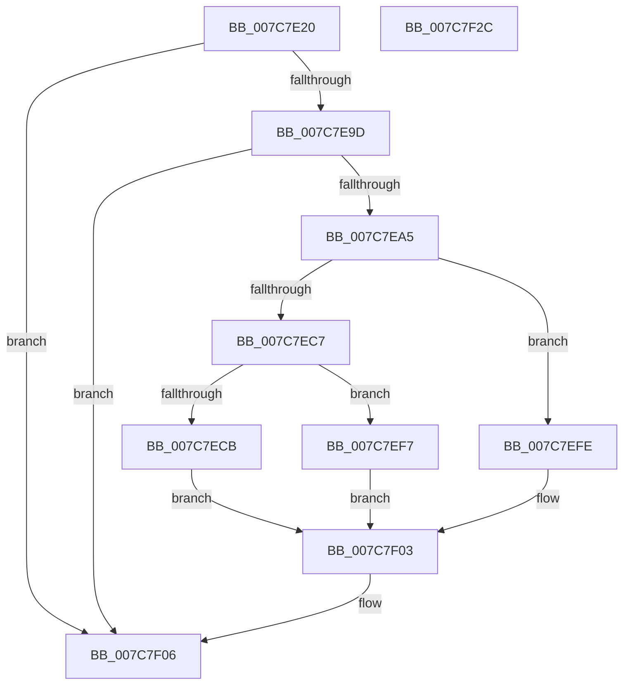

# ExpCloudbookHardwareLockedProvider

- RVA: `0x007C7E20`–`0x007C7F2D` (길이 `269` bytes)
- VA: `0x00000001407C7E20`
- 실행 섹션: `PAGE`
- PDB 이름 있음: `예`; PDB Function 태그: `아니요`
- unwind 정보 RVA: `0x000D4DFC`
- 디코드: `74`개 명령, `269/269` bytes 표시
- 미해석 바이트: `0` (있으면 어셈블리에 `.byte`로 보존)

> 이 문서는 커널 이미지의 기계어와 PDB 기호를 분석해 생성했습니다. 4번과 5번은 함수 원형과 자료형을 바이너리 사용 방식에서 추정한 C 해석이며 원본 소스 복구 결과는 아닙니다.

## 1. Dependencies

- 직접 호출 지점: **4**; 고유 호출 대상: **4**
- 직접 호출자로 확인된 함수: **0**
- RIP 상대 이미지 참조: **2**

### Outgoing calls
- `0x007C7E8A` → [ExpOsProductCacheProviderHelper](ExpOsProductCacheProviderHelper_function_007C8A58.md) (function, `0x007C8A58`)
- `0x007C7EBC` → [ZwQuerySystemInformation](../../text/6A/ZwQuerySystemInformation_function_006AD790.md) (function, `0x006AD790`)
- `0x007C7EF0` → [memcpy](../../text/6C/memcpy_function_006C6840.md) (function, `0x006C6840`)
- `0x007C7F10` → [_security_check_cookie](../../text/6A/_security_check_cookie_function_006AC640.md) (function, `0x006AC640`)

### Direct callers
- 이 함수 시작 RVA로 연결되는 직접 call은 확인되지 않았습니다. 간접 호출은 완전히 역산할 수 없습니다.

### Static image references
- `0x007C7E33` → RVA `0x00E0A740` (`.data`; read)
- `0x007C7E79` → RVA `0x00B4BDD8` (`PAGE`; read)

## 2. Other-region calls and transfers

- 다른 실행 섹션으로 향하는 call: **3**
  - `0x007C7EBC` → [ZwQuerySystemInformation](../../text/6A/ZwQuerySystemInformation_function_006AD790.md) (`PAGE` → `.text`)
  - `0x007C7EF0` → [memcpy](../../text/6C/memcpy_function_006C6840.md) (`PAGE` → `.text`)
  - `0x007C7F10` → [_security_check_cookie](../../text/6A/_security_check_cookie_function_006AC640.md) (`PAGE` → `.text`)
- 별도 외부 분기/꼬리 이동을 확인하지 못했습니다.

## 3. Assembly (complete function range)

```asm
007C7E20  48 89 5C 24 08                  mov qword ptr [rsp + 8], rbx
007C7E25  55                              push rbp
007C7E26  56                              push rsi
007C7E27  57                              push rdi
007C7E28  41 56                           push r14
007C7E2A  41 57                           push r15
007C7E2C  48 81 EC 80 00 00 00            sub rsp, 0x80
007C7E33  48 8B 05 06 29 64 00            mov rax, qword ptr [rip + 0x642906]
007C7E3A  48 33 C4                        xor rax, rsp
007C7E3D  48 89 44 24 70                  mov qword ptr [rsp + 0x70], rax
007C7E42  48 8B B4 24 D8 00 00 00         mov rsi, qword ptr [rsp + 0xd8]
007C7E4A  0F 57 C0                        xorps xmm0, xmm0
007C7E4D  48 8B BC 24 D0 00 00 00         mov rdi, qword ptr [rsp + 0xd0]
007C7E55  41 8B E9                        mov ebp, r9d
007C7E58  48 89 74 24 30                  mov qword ptr [rsp + 0x30], rsi
007C7E5D  4D 8B F8                        mov r15, r8
007C7E60  4C 8B F2                        mov r14, rdx
007C7E63  48 89 7C 24 28                  mov qword ptr [rsp + 0x28], rdi
007C7E68  44 89 4C 24 20                  mov dword ptr [rsp + 0x20], r9d
007C7E6D  33 C0                           xor eax, eax
007C7E6F  4D 8B C8                        mov r9, r8
007C7E72  89 44 24 68                     mov dword ptr [rsp + 0x68], eax
007C7E76  4C 8B C2                        mov r8, rdx
007C7E79  48 8D 15 58 3F 38 00            lea rdx, [rip + 0x383f58]
007C7E80  0F 11 44 24 48                  movups xmmword ptr [rsp + 0x48], xmm0
007C7E85  0F 11 44 24 58                  movups xmmword ptr [rsp + 0x58], xmm0
007C7E8A  E8 C9 0B 00 00                  call 0x1407c8a58
007C7E8F  8B D8                           mov ebx, eax
007C7E91  B8 00 00 00 80                  mov eax, 0x80000000
007C7E96  8D 0C 03                        lea ecx, [rbx + rax]
007C7E99  85 C8                           test eax, ecx
007C7E9B  75 69                           jne 0x1407c7f06
007C7E9D  81 FB 23 00 00 C0               cmp ebx, 0xc0000023
007C7EA3  74 61                           je 0x1407c7f06
007C7EA5  45 33 C9                        xor r9d, r9d
007C7EA8  C7 07 04 00 00 00               mov dword ptr [rdi], 4
007C7EAE  48 8D 54 24 48                  lea rdx, [rsp + 0x48]
007C7EB3  B9 BE 00 00 00                  mov ecx, 0xbe
007C7EB8  45 8D 41 24                     lea r8d, [r9 + 0x24]
007C7EBC  E8 CF 58 EE FF                  call 0x1406ad790
007C7EC1  33 DB                           xor ebx, ebx
007C7EC3  85 C0                           test eax, eax
007C7EC5  78 37                           js 0x1407c7efe
007C7EC7  3B 2F                           cmp ebp, dword ptr [rdi]
007C7EC9  72 2C                           jb 0x1407c7ef7
007C7ECB  8B 54 24 48                     mov edx, dword ptr [rsp + 0x48]
007C7ECF  8B C3                           mov eax, ebx
007C7ED1  83 E2 05                        and edx, 5
007C7ED4  41 C7 06 04 00 00 00            mov dword ptr [r14], 4
007C7EDB  44 8B 07                        mov r8d, dword ptr [rdi]
007C7EDE  80 FA 05                        cmp dl, 5
007C7EE1  48 8D 54 24 40                  lea rdx, [rsp + 0x40]
007C7EE6  49 8B CF                        mov rcx, r15
007C7EE9  0F 94 C0                        sete al
007C7EEC  89 44 24 40                     mov dword ptr [rsp + 0x40], eax
007C7EF0  E8 4B E9 EF FF                  call 0x1406c6840
007C7EF5  EB 0C                           jmp 0x1407c7f03
007C7EF7  BB 23 00 00 C0                  mov ebx, 0xc0000023
007C7EFC  EB 05                           jmp 0x1407c7f03
007C7EFE  BB 34 00 00 C0                  mov ebx, 0xc0000034
007C7F03  C6 06 01                        mov byte ptr [rsi], 1
007C7F06  8B C3                           mov eax, ebx
007C7F08  48 8B 4C 24 70                  mov rcx, qword ptr [rsp + 0x70]
007C7F0D  48 33 CC                        xor rcx, rsp
007C7F10  E8 2B 47 EE FF                  call 0x1406ac640
007C7F15  48 8B 9C 24 B0 00 00 00         mov rbx, qword ptr [rsp + 0xb0]
007C7F1D  48 81 C4 80 00 00 00            add rsp, 0x80
007C7F24  41 5F                           pop r15
007C7F26  41 5E                           pop r14
007C7F28  5F                              pop rdi
007C7F29  5E                              pop rsi
007C7F2A  5D                              pop rbp
007C7F2B  C3                              ret
007C7F2C  CC                              int3
```

## 4. C-style interpretation (structured pseudocode)

```c
__int64 __fastcall ExpCloudbookHardwareLockedProvider(__int64 a1, __int64 a2, __int64 a3, int a4, __int64 a5, __int64 a6)
{
    __int64 result;
    __int64 v_rbx;
    __int64 v_rsp;
    unsigned __int64 v_stack_m38;
    unsigned int v_stack_m40;
    unsigned __int64 v_stack_m50;
    unsigned __int64 v_stack_m60;
    unsigned __int64 v_stack_m68;
    unsigned __int64 v_stack_m78;
    unsigned __int64 v_stack_m80;
    unsigned int v_stack_m88;
    unsigned __int64 v_stack_p8;

    v_stack_p8 = v_rbx;
    v_rsp = (v_rsp) - (128);
    result = (*(unsigned __int64 *)(v_rip + 6564102)) ^ (v_rsp);
    v_stack_m38 = result;
    v_stack_m78 = a6;
    v_stack_m80 = a5;
    v_stack_m88 = a4;
    result = 0;
    v_stack_m40 = 0;
    v_stack_m60 = v_xmm0;
    v_stack_m50 = v_xmm0;
    result = ExpOsProductCacheProviderHelper(a1, v_rip + 3686232, a2, a3);
    if ((((unsigned int)((unsigned int)(0x80000000ULL))) & ((unsigned int)((unsigned int)((unsigned int)(result)) + (unsigned int)(0x80000000ULL) * 1))) != 0) goto loc_007C7F06;
    if (((unsigned int)((unsigned int)((unsigned int)(result)))) == 0xC0000023ULL) goto loc_007C7F06;
    a4 = 0;
    *(unsigned int *)(a5) = 4;
    result = ZwQuerySystemInformation(190, v_stack_m60, a4 + 36, a4);
    v_rbx = 0;
    if (sign_flag) goto loc_007C7EFE;
    if (((unsigned int)((unsigned int)(a4))) < (*(unsigned int *)(a5))) goto loc_007C7EF7;
    a2 = (unsigned int)(((unsigned int)(v_stack_m60)) & (5));
    *(unsigned int *)(a2) = 4;
    result = (((unsigned __int8)(a2)) == 5) ? 1 : 0;
    v_stack_m68 = (unsigned int)(result);
    result = memcpy(a3, v_stack_m68, (unsigned int)(*(unsigned int *)(a5)), a4);
    goto loc_007C7F03;
loc_007C7EF7:
    goto loc_007C7F03;
loc_007C7EFE:
loc_007C7F03:
    *(unsigned __int8 *)(a6) = 1;
loc_007C7F06:
    a1 = (v_stack_m38) ^ (v_rsp);
    result = _security_check_cookie(a1, v_stack_m68, (unsigned int)(*(unsigned int *)(a5)), a4);
    v_rsp = (v_rsp) + (128);
    return result;
}
```

## 5. (Beta) C Style

```c
int64_t ExpCloudbookHardwareLockedProvider(int64_t Arg1, void *Arg2, int64_t Arg3, int32_t Arg4, void *Arg5, void *Arg6)
{
    uint8_t *arg2 = (uint8_t *)Arg2;
    uint8_t *arg5 = (uint8_t *)Arg5;
    uint8_t *arg6 = (uint8_t *)Arg6;

    int64_t result;
    int64_t local_rbx;
    int64_t local_rsp;
    uint64_t v_stack_m38;
    uint32_t v_stack_m40;
    uint64_t v_stack_m50;
    uint64_t v_stack_m60;
    uint64_t v_stack_m68;
    uint64_t v_stack_m78;
    uint64_t v_stack_m80;
    uint32_t v_stack_m88;
    uint64_t v_stack_p8;

    v_stack_p8 = local_rbx;
    local_rsp = (local_rsp) - (128);
    result = (*(uint64_t *)(v_rip + 0x642906)) ^ (local_rsp);
    v_stack_m38 = result;
    v_stack_m78 = Arg6;
    v_stack_m80 = Arg5;
    v_stack_m88 = Arg4;
    result = 0;
    v_stack_m40 = 0;
    v_stack_m60 = v_xmm0;
    v_stack_m50 = v_xmm0;
    result = ExpOsProductCacheProviderHelper(Arg1, v_rip + 3686232, Arg2, Arg3);
    if ((((uint32_t)((uint32_t)(0x80000000ULL))) & ((uint32_t)((uint32_t)((uint32_t)(result)) + (uint32_t)(0x80000000ULL) * 1))) != 0) goto loc_007C7F06;
    if (((uint32_t)((uint32_t)((uint32_t)(result)))) == 0xC0000023ULL) goto loc_007C7F06;
    Arg4 = 0;
    *(uint32_t *)(arg5) = 4;
    result = ZwQuerySystemInformation(190, v_stack_m60, Arg4 + 36, Arg4);
    local_rbx = 0;
    if (sign_flag) goto loc_007C7EFE;
    if (((uint32_t)((uint32_t)(Arg4))) < (*(uint32_t *)(arg5))) goto loc_007C7EF7;
    Arg2 = (uint32_t)(((uint32_t)(v_stack_m60)) & (5));
    *(uint32_t *)(arg2) = 4;
    result = (((uint8_t)(Arg2)) == 5) ? 1 : 0;
    v_stack_m68 = (uint32_t)(result);
    result = memcpy(Arg3, v_stack_m68, (uint32_t)(*(uint32_t *)(arg5)), Arg4);
    goto loc_007C7F03;
loc_007C7EF7:
    goto loc_007C7F03;
loc_007C7EFE:
loc_007C7F03:
    *(uint8_t *)(arg6) = 1;
loc_007C7F06:
    Arg1 = (v_stack_m38) ^ (local_rsp);
    result = _security_check_cookie(Arg1, v_stack_m68, (uint32_t)(*(uint32_t *)(arg5)), Arg4);
    local_rsp = (local_rsp) + (128);
    return result;
}
```

### 관측된 메모리 오프셋

구조체 형식이 확인되지 않은 접근은 인자 기준의 오프셋으로만 기록했습니다.

| 기준 인자 | 오프셋 표현 | 폭 (bit) | 접근 |
|---|---:|---:|---|
| `Arg2` | `+ 0x0` | `32` | `W` |
| `Arg5` | `+ 0x0` | `32` | `R` |
| `Arg5` | `+ 0x0` | `32` | `W` |
| `Arg6` | `+ 0x0` | `8` | `W` |

## 6. Execution-region graph

[열기: 2D/3D 그래프와 함수 탐색 컨트롤 패널](../../../control-panel.html?section=page&rva=0x007C7E20&view=graph)

- 2D 그래프는 위에서 아래로 흐르고, 3D 그래프는 빈 공간을 드래그해 회전합니다. Shift+드래그는 이동, 휠은 확대·축소, 함수 노드 선택은 대상 보고서 이동입니다.

### Static fallback


