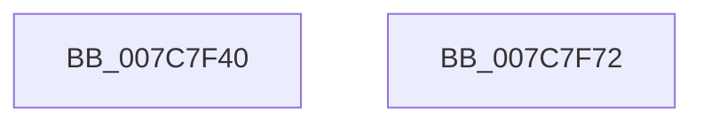

# ExpConsumeAddonPolicySetCacheProvider

- RVA: `0x007C7F40`–`0x007C7F73` (길이 `51` bytes)
- VA: `0x00000001407C7F40`
- 실행 섹션: `PAGE`
- PDB 이름 있음: `예`; PDB Function 태그: `아니요`
- unwind 정보 RVA: `0x0005D2F4`
- 디코드: `13`개 명령, `51/51` bytes 표시
- 미해석 바이트: `0` (있으면 어셈블리에 `.byte`로 보존)

> 이 문서는 커널 이미지의 기계어와 PDB 기호를 분석해 생성했습니다. 4번과 5번은 함수 원형과 자료형을 바이너리 사용 방식에서 추정한 C 해석이며 원본 소스 복구 결과는 아닙니다.

## 1. Dependencies

- 직접 호출 지점: **1**; 고유 호출 대상: **1**
- 직접 호출자로 확인된 함수: **0**
- RIP 상대 이미지 참조: **1**

### Outgoing calls
- `0x007C7F68` → [sub_004BA83C](../../text/4B/Unknown_function_004BA83C.md) (function, `0x004BA83C`)

### Direct callers
- 이 함수 시작 RVA로 연결되는 직접 call은 확인되지 않았습니다. 간접 호출은 완전히 역산할 수 없습니다.

### Static image references
- `0x007C7F61` → RVA `0x00B4B510` (`PAGE`; read)

## 2. Other-region calls and transfers

- 다른 실행 섹션으로 향하는 call: **1**
  - `0x007C7F68` → [sub_004BA83C](../../text/4B/Unknown_function_004BA83C.md) (`PAGE` → `.text`)
- 별도 외부 분기/꼬리 이동을 확인하지 못했습니다.

## 3. Assembly (complete function range)

```asm
007C7F40  48 83 EC 38                     sub rsp, 0x38
007C7F44  48 8B 44 24 68                  mov rax, qword ptr [rsp + 0x68]
007C7F49  C6 00 01                        mov byte ptr [rax], 1
007C7F4C  48 8B 44 24 60                  mov rax, qword ptr [rsp + 0x60]
007C7F51  48 89 44 24 28                  mov qword ptr [rsp + 0x28], rax
007C7F56  44 89 4C 24 20                  mov dword ptr [rsp + 0x20], r9d
007C7F5B  4D 8B C8                        mov r9, r8
007C7F5E  4C 8B C2                        mov r8, rdx
007C7F61  48 8D 15 A8 35 38 00            lea rdx, [rip + 0x3835a8]
007C7F68  E8 CF 28 CF FF                  call 0x1404ba83c
007C7F6D  48 83 C4 38                     add rsp, 0x38
007C7F71  C3                              ret
007C7F72  CC                              int3
```

## 4. C-style interpretation (structured pseudocode)

```c
__int64 __fastcall ExpConsumeAddonPolicySetCacheProvider(__int64 a1, __int64 a2, __int64 a3, int a4, __int64 a5, __int64 a6)
{
    __int64 result;
    __int64 v_rsp;
    unsigned __int64 v_stack_m10;
    unsigned int v_stack_m18;

    v_rsp = (v_rsp) - (56);
    *(unsigned __int8 *)(a6) = 1;
    v_stack_m10 = a5;
    v_stack_m18 = a4;
    result = sub_004BA83C(a1, v_rip + 3683752, a2, a3);
    v_rsp = (v_rsp) + (56);
    return result;
}
```

## 5. (Beta) C Style

```c
int64_t ExpConsumeAddonPolicySetCacheProvider(int64_t Arg1, int64_t Arg2, int64_t Arg3, int32_t Arg4, int64_t Arg5, void *Arg6)
{
    uint8_t *arg6 = (uint8_t *)Arg6;

    int64_t result;
    int64_t local_rsp;
    uint64_t v_stack_m10;
    uint32_t v_stack_m18;

    local_rsp = (local_rsp) - (56);
    *(uint8_t *)(arg6) = 1;
    v_stack_m10 = Arg5;
    v_stack_m18 = Arg4;
    result = sub_004BA83C(Arg1, v_rip + 3683752, Arg2, Arg3);
    local_rsp = (local_rsp) + (56);
    return result;
}
```

### 관측된 메모리 오프셋

구조체 형식이 확인되지 않은 접근은 인자 기준의 오프셋으로만 기록했습니다.

| 기준 인자 | 오프셋 표현 | 폭 (bit) | 접근 |
|---|---:|---:|---|
| `Arg6` | `+ 0x0` | `8` | `W` |

## 6. Execution-region graph

[열기: 2D/3D 그래프와 함수 탐색 컨트롤 패널](../../../control-panel.html?section=page&rva=0x007C7F40&view=graph)

- 2D 그래프는 위에서 아래로 흐르고, 3D 그래프는 빈 공간을 드래그해 회전합니다. Shift+드래그는 이동, 휠은 확대·축소, 함수 노드 선택은 대상 보고서 이동입니다.

### Static fallback


