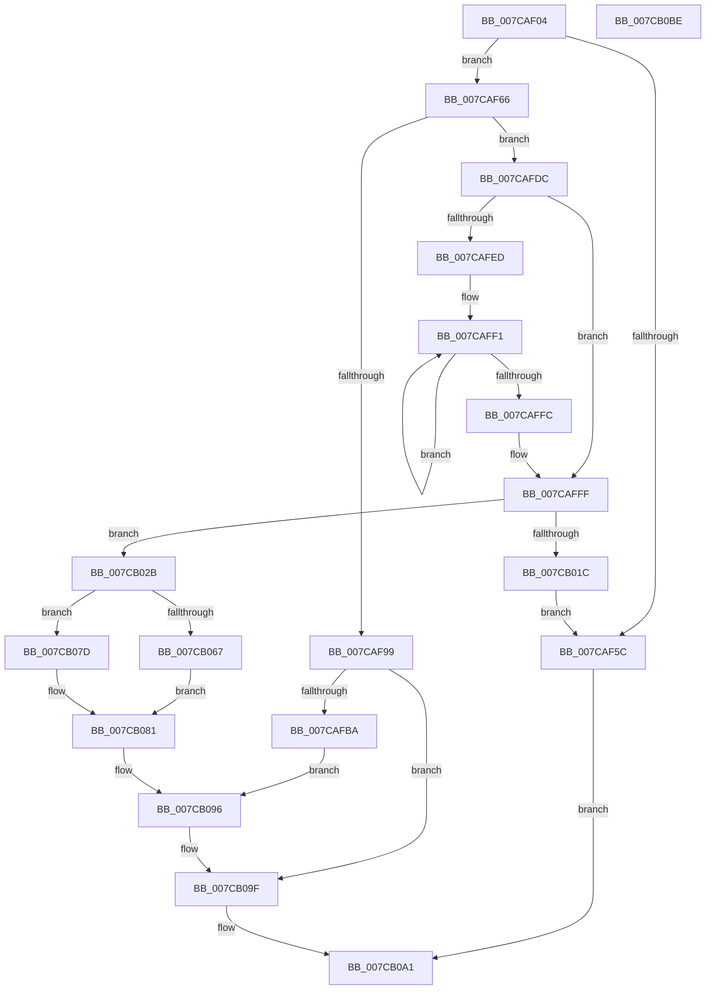

# ExpConvertArcName

- RVA: `0x007CAF04`–`0x007CB0BF` (길이 `443` bytes)
- VA: `0x00000001407CAF04`
- 실행 섹션: `PAGE`
- PDB 이름 있음: `예`; PDB Function 태그: `아니요`
- unwind 정보 RVA: `0x000CA550`
- 디코드: `125`개 명령, `443/443` bytes 표시
- 미해석 바이트: `0` (있으면 어셈블리에 `.byte`로 보존)

> 이 문서는 커널 이미지의 기계어와 PDB 기호를 분석해 생성했습니다. 4번과 5번은 함수 원형과 자료형을 바이너리 사용 방식에서 추정한 C 해석이며 원본 소스 복구 결과는 아닙니다.

## 1. Dependencies

- 직접 호출 지점: **13**; 고유 호출 대상: **7**
- 직접 호출자로 확인된 함수: **1**
- RIP 상대 이미지 참조: **1**

### Outgoing calls
- `0x007CAF4F` → [ExAllocatePool2](../../poolcode/B8/ExAllocatePool2_function_00B820F0.md) (function, `0x00B820F0`)
- `0x007CAF72` → [wcscpy_s](../../text/50/wcscpy_s_function_005064B0.md) (function, `0x005064B0`)
- `0x007CAF82` → [wcsncat_s](../../text/50/wcsncat_s_function_00506540.md) (function, `0x00506540`)
- `0x007CAFA1` → [ExpTranslateSymbolicLink](../A7/ExpTranslateSymbolicLink_function_00A7B38C.md) (function, `0x00A7B38C`)
- `0x007CAFAD` → [ExFreePoolWithTag](../../poolcode/B8/ExFreePoolWithTag_function_00B82870.md) (function, `0x00B82870`)
- `0x007CAFCD` → [ExpCreateOutputNT](../A7/ExpCreateOutputNT_function_00A7B53C.md) (function, `0x00A7B53C`)
- `0x007CB00F` → [ExAllocatePool2](../../poolcode/B8/ExAllocatePool2_function_00B820F0.md) (function, `0x00B820F0`)
- `0x007CB021` → [ExFreePoolWithTag](../../poolcode/B8/ExFreePoolWithTag_function_00B82870.md) (function, `0x00B82870`)
- `0x007CB04B` → [wcscpy_s](../../text/50/wcscpy_s_function_005064B0.md) (function, `0x005064B0`)
- `0x007CB05B` → [ExFreePoolWithTag](../../poolcode/B8/ExFreePoolWithTag_function_00B82870.md) (function, `0x00B82870`)
- `0x007CB076` → [wcscpy_s](../../text/50/wcscpy_s_function_005064B0.md) (function, `0x005064B0`)
- `0x007CB08E` → [ExpTranslateNtPath](ExpTranslateNtPath_function_007CCEF4.md) (function, `0x007CCEF4`)
- `0x007CB09A` → [ExFreePoolWithTag](../../poolcode/B8/ExFreePoolWithTag_function_00B82870.md) (function, `0x00B82870`)

### Direct callers
- [ExpTranslateArcPath](ExpTranslateArcPath_function_007CCA6C.md) at `0x007CCAEC`

### Static image references
- `0x007CAF66` → RVA `0x00B08870` (` ?? ::NNGAKEGL::`string'`; read)

## 2. Other-region calls and transfers

- 다른 실행 섹션으로 향하는 call: **10**
  - `0x007CAF4F` → [ExAllocatePool2](../../poolcode/B8/ExAllocatePool2_function_00B820F0.md) (`PAGE` → `POOLCODE`)
  - `0x007CAF72` → [wcscpy_s](../../text/50/wcscpy_s_function_005064B0.md) (`PAGE` → `.text`)
  - `0x007CAF82` → [wcsncat_s](../../text/50/wcsncat_s_function_00506540.md) (`PAGE` → `.text`)
  - `0x007CAFAD` → [ExFreePoolWithTag](../../poolcode/B8/ExFreePoolWithTag_function_00B82870.md) (`PAGE` → `POOLCODE`)
  - `0x007CB00F` → [ExAllocatePool2](../../poolcode/B8/ExAllocatePool2_function_00B820F0.md) (`PAGE` → `POOLCODE`)
  - `0x007CB021` → [ExFreePoolWithTag](../../poolcode/B8/ExFreePoolWithTag_function_00B82870.md) (`PAGE` → `POOLCODE`)
  - `0x007CB04B` → [wcscpy_s](../../text/50/wcscpy_s_function_005064B0.md) (`PAGE` → `.text`)
  - `0x007CB05B` → [ExFreePoolWithTag](../../poolcode/B8/ExFreePoolWithTag_function_00B82870.md) (`PAGE` → `POOLCODE`)
  - `0x007CB076` → [wcscpy_s](../../text/50/wcscpy_s_function_005064B0.md) (`PAGE` → `.text`)
  - `0x007CB09A` → [ExFreePoolWithTag](../../poolcode/B8/ExFreePoolWithTag_function_00B82870.md) (`PAGE` → `POOLCODE`)
- 별도 외부 분기/꼬리 이동을 확인하지 못했습니다.

## 3. Assembly (complete function range)

```asm
007CAF04  48 8B C4                        mov rax, rsp
007CAF07  48 89 58 10                     mov qword ptr [rax + 0x10], rbx
007CAF0B  48 89 68 18                     mov qword ptr [rax + 0x18], rbp
007CAF0F  48 89 70 20                     mov qword ptr [rax + 0x20], rsi
007CAF13  89 48 08                        mov dword ptr [rax + 8], ecx
007CAF16  57                              push rdi
007CAF17  41 54                           push r12
007CAF19  41 55                           push r13
007CAF1B  41 56                           push r14
007CAF1D  41 57                           push r15
007CAF1F  48 83 EC 30                     sub rsp, 0x30
007CAF23  8B AC 24 88 00 00 00            mov ebp, dword ptr [rsp + 0x88]
007CAF2A  4D 8B E0                        mov r12, r8
007CAF2D  4C 8B EA                        mov r13, rdx
007CAF30  0F 57 C0                        xorps xmm0, xmm0
007CAF33  B9 40 00 00 00                  mov ecx, 0x40
007CAF38  41 B8 45 6E 76 72               mov r8d, 0x72766e45
007CAF3E  4D 8B F1                        mov r14, r9
007CAF41  8D 75 0A                        lea esi, [rbp + 0xa]
007CAF44  44 8D 3C 36                     lea r15d, [rsi + rsi]
007CAF48  41 8B D7                        mov edx, r15d
007CAF4B  0F 11 40 C8                     movups xmmword ptr [rax - 0x38], xmm0
007CAF4F  E8 9C 71 3B 00                  call 0x140b820f0
007CAF54  48 8B F8                        mov rdi, rax
007CAF57  48 85 C0                        test rax, rax
007CAF5A  75 0A                           jne 0x1407caf66
007CAF5C  B8 9A 00 00 C0                  mov eax, 0xc000009a
007CAF61  E9 3B 01 00 00                  jmp 0x1407cb0a1
007CAF66  4C 8D 05 03 D9 33 00            lea r8, [rip + 0x33d903]
007CAF6D  8B D6                           mov edx, esi
007CAF6F  48 8B CF                        mov rcx, rdi
007CAF72  E8 39 B5 D3 FF                  call 0x1405064b0
007CAF77  4C 8B CD                        mov r9, rbp
007CAF7A  8B D6                           mov edx, esi
007CAF7C  4D 8B C6                        mov r8, r14
007CAF7F  48 8B CF                        mov rcx, rdi
007CAF82  E8 B9 B5 D3 FF                  call 0x140506540
007CAF87  45 33 F6                        xor r14d, r14d
007CAF8A  8D 46 FF                        lea eax, [rsi - 1]
007CAF8D  83 7C 24 60 03                  cmp dword ptr [rsp + 0x60], 3
007CAF92  66 44 89 34 47                  mov word ptr [rdi + rax*2], r14w
007CAF97  75 43                           jne 0x1407cafdc
007CAF99  48 8D 54 24 20                  lea rdx, [rsp + 0x20]
007CAF9E  48 8B CF                        mov rcx, rdi
007CAFA1  E8 E6 03 2B 00                  call 0x140a7b38c
007CAFA6  33 D2                           xor edx, edx
007CAFA8  48 8B CF                        mov rcx, rdi
007CAFAB  8B D8                           mov ebx, eax
007CAFAD  E8 BE 78 3B 00                  call 0x140b82870
007CAFB2  85 DB                           test ebx, ebx
007CAFB4  0F 88 E5 00 00 00               js 0x1407cb09f
007CAFBA  4C 8B 8C 24 80 00 00 00         mov r9, qword ptr [rsp + 0x80]
007CAFC2  4C 8D 44 24 20                  lea r8, [rsp + 0x20]
007CAFC7  49 8B D4                        mov rdx, r12
007CAFCA  49 8B CD                        mov rcx, r13
007CAFCD  E8 6A 05 2B 00                  call 0x140a7b53c
007CAFD2  48 8B 4C 24 28                  mov rcx, qword ptr [rsp + 0x28]
007CAFD7  E9 BA 00 00 00                  jmp 0x1407cb096
007CAFDC  48 8B AC 24 80 00 00 00         mov rbp, qword ptr [rsp + 0x80]
007CAFE4  41 8D 5F 0C                     lea ebx, [r15 + 0xc]
007CAFE8  48 85 ED                        test rbp, rbp
007CAFEB  74 12                           je 0x1407cafff
007CAFED  48 83 C8 FF                     or rax, 0xffffffffffffffff
007CAFF1  48 FF C0                        inc rax
007CAFF4  66 44 39 74 45 00               cmp word ptr [rbp + rax*2], r14w
007CAFFA  75 F5                           jne 0x1407caff1
007CAFFC  8D 1C 43                        lea ebx, [rbx + rax*2]
007CAFFF  83 C3 02                        add ebx, 2
007CB002  B9 40 00 00 00                  mov ecx, 0x40
007CB007  8B D3                           mov edx, ebx
007CB009  41 B8 45 6E 76 72               mov r8d, 0x72766e45
007CB00F  E8 DC 70 3B 00                  call 0x140b820f0
007CB014  48 8B F0                        mov rsi, rax
007CB017  48 85 C0                        test rax, rax
007CB01A  75 0F                           jne 0x1407cb02b
007CB01C  33 D2                           xor edx, edx
007CB01E  48 8B CF                        mov rcx, rdi
007CB021  E8 4A 78 3B 00                  call 0x140b82870
007CB026  E9 31 FF FF FF                  jmp 0x1407caf5c
007CB02B  4C 8D 70 0C                     lea r14, [rax + 0xc]
007CB02F  C7 00 01 00 00 00               mov dword ptr [rax], 1
007CB035  8D 53 F4                        lea edx, [rbx - 0xc]
007CB038  89 58 04                        mov dword ptr [rax + 4], ebx
007CB03B  48 D1 EA                        shr rdx, 1
007CB03E  49 8B CE                        mov rcx, r14
007CB041  4C 8B C7                        mov r8, rdi
007CB044  C7 40 08 03 00 00 00            mov dword ptr [rax + 8], 3
007CB04B  E8 60 B4 D3 FF                  call 0x1405064b0
007CB050  41 8B C7                        mov eax, r15d
007CB053  33 D2                           xor edx, edx
007CB055  48 8B CF                        mov rcx, rdi
007CB058  4C 03 F0                        add r14, rax
007CB05B  E8 10 78 3B 00                  call 0x140b82870
007CB060  33 C0                           xor eax, eax
007CB062  48 85 ED                        test rbp, rbp
007CB065  74 16                           je 0x1407cb07d
007CB067  41 2B DF                        sub ebx, r15d
007CB06A  4C 8B C5                        mov r8, rbp
007CB06D  49 8B CE                        mov rcx, r14
007CB070  8D 53 F4                        lea edx, [rbx - 0xc]
007CB073  48 D1 EA                        shr rdx, 1
007CB076  E8 35 B4 D3 FF                  call 0x1405064b0
007CB07B  EB 04                           jmp 0x1407cb081
007CB07D  66 41 89 06                     mov word ptr [r14], ax
007CB081  8B 54 24 60                     mov edx, dword ptr [rsp + 0x60]
007CB085  4D 8B CC                        mov r9, r12
007CB088  4D 8B C5                        mov r8, r13
007CB08B  48 8B CE                        mov rcx, rsi
007CB08E  E8 61 1E 00 00                  call 0x1407ccef4
007CB093  48 8B CE                        mov rcx, rsi
007CB096  33 D2                           xor edx, edx
007CB098  8B D8                           mov ebx, eax
007CB09A  E8 D1 77 3B 00                  call 0x140b82870
007CB09F  8B C3                           mov eax, ebx
007CB0A1  48 8B 5C 24 68                  mov rbx, qword ptr [rsp + 0x68]
007CB0A6  48 8B 6C 24 70                  mov rbp, qword ptr [rsp + 0x70]
007CB0AB  48 8B 74 24 78                  mov rsi, qword ptr [rsp + 0x78]
007CB0B0  48 83 C4 30                     add rsp, 0x30
007CB0B4  41 5F                           pop r15
007CB0B6  41 5E                           pop r14
007CB0B8  41 5D                           pop r13
007CB0BA  41 5C                           pop r12
007CB0BC  5F                              pop rdi
007CB0BD  C3                              ret
007CB0BE  CC                              int3
```

## 4. C-style interpretation (structured pseudocode)

```c
__int64 __fastcall ExpConvertArcName(int a1, __int64 a2, __int64 a3, __int64 a4, __int64 a5, unsigned int a6)
{
    __int64 result;
    __int64 v_r14;
    __int64 v_rbx;
    __int64 v_rsp;
    unsigned __int64 v_stack_m30;
    unsigned __int64 v_stack_m38;
    unsigned __int64 v_stack_p10;
    unsigned __int64 v_stack_p18;
    unsigned __int64 v_stack_p20;
    unsigned int v_stack_p8;

    *(unsigned __int64 *)(v_rsp + 16) = v_rbx;
    *(unsigned __int64 *)(v_rsp + 24) = v_rbp;
    *(unsigned __int64 *)(v_rsp + 32) = v_rsi;
    *(unsigned int *)(v_rsp + 8) = a1;
    v_rsp = (v_rsp) - (48);
    *(unsigned __int64 *)(v_rsp - 56) = v_xmm0;
    result = ExAllocatePool2(64, (unsigned int)((unsigned int)((unsigned int)(a6) + 10 + (unsigned int)(a6) + 10 * 1)), (unsigned int)(0x72766E45ULL), a4);
    if (result != 0) goto loc_007CAF66;
loc_007CAF5C:
    goto loc_007CB0A1;
loc_007CAF66:
    result = wcscpy_s(result, (unsigned int)((unsigned int)((unsigned int)(a6) + 10)), v_rip + 3397891, a4);
    result = wcsncat_s(result, (unsigned int)((unsigned int)((unsigned int)(a6) + 10)), a4, (unsigned int)(a6));
    v_r14 = 0;
    *(unsigned __int16 *)(result + (unsigned int)(a6) + 10 - 1 * 2) = 0;
    if (v_stack_p8 != 3) goto loc_007CAFDC;
    result = ExpTranslateSymbolicLink(result, v_stack_m38, a4, (unsigned int)(a6));
    a2 = 0;
    result = ExFreePoolWithTag(result, a2, a4, (unsigned int)(a6));
    if (sign_flag) goto loc_007CB09F;
    result = ExpCreateOutputNT(0, a3, v_stack_m38, a5);
    goto loc_007CB096;
loc_007CAFDC:
    if (a5 == 0) goto loc_007CAFFF;
    result = (result) | (-1);
loc_007CAFF1:
    result = (result) + 1;
    if ((*(unsigned __int16 *)(a5 + result * 2)) != 0) goto loc_007CAFF1;
loc_007CAFFF:
    v_rbx = (unsigned int)(((unsigned int)(a6) + 10 + (unsigned int)(a6) + 10 * 1 + 12 + result * 2) + (2));
    result = ExAllocatePool2(64, (unsigned int)((unsigned int)(v_rbx)), (unsigned int)(0x72766E45ULL), a5);
    if (result != 0) goto loc_007CB02B;
    a2 = 0;
    result = ExFreePoolWithTag(result, a2, (unsigned int)(0x72766E45ULL), a5);
    goto loc_007CAF5C;
loc_007CB02B:
    *(unsigned int *)(result) = 1;
    *(unsigned int *)(result + 4) = (unsigned int)(v_rbx);
    a2 = (v_rbx - 12) >> (1);
    *(unsigned int *)(result + 8) = 3;
    result = wcscpy_s(result + 12, a2, result, a5);
    a2 = 0;
    v_r14 = (result + 12) + ((unsigned int)((unsigned int)((unsigned int)(a6) + 10 + (unsigned int)(a6) + 10 * 1)));
    result = ExFreePoolWithTag(result, a2, result, a5);
    result = 0;
    if (a5 == 0) goto loc_007CB07D;
    v_rbx = (unsigned int)((v_rbx) - ((unsigned int)((unsigned int)(a6) + 10 + (unsigned int)(a6) + 10 * 1)));
    a2 = (v_rbx - 12) >> (1);
    result = wcscpy_s(v_r14, a2, a5, a5);
    goto loc_007CB081;
loc_007CB07D:
    *(unsigned __int16 *)(v_r14) = (unsigned __int16)(result);
loc_007CB081:
    result = ExpTranslateNtPath(result, (unsigned int)(v_stack_p8), a2, a3);
loc_007CB096:
    a2 = 0;
    result = ExFreePoolWithTag(result, a2, a2, a3);
loc_007CB09F:
loc_007CB0A1:
    v_rsp = (v_rsp) + (48);
    return (unsigned int)((unsigned int)((unsigned int)((unsigned int)(result))));
}
```

## 5. (Beta) C Style

```c
int64_t ExpConvertArcName(int32_t Arg1, int64_t Arg2, int64_t Arg3, int64_t Arg4, int64_t Arg5, void *Arg6)
{
    uint8_t *arg6 = (uint8_t *)Arg6;

    int64_t result;
    int64_t local_r14;
    int64_t local_rbx;
    int64_t local_rsp;
    uint64_t v_stack_m30;
    uint64_t v_stack_m38;
    uint64_t v_stack_p10;
    uint64_t v_stack_p18;
    uint64_t v_stack_p20;
    uint32_t v_stack_p8;

    *(uint64_t *)(local_rsp + 0x10) = local_rbx;
    *(uint64_t *)(local_rsp + 0x18) = local_rbp;
    *(uint64_t *)(local_rsp + 0x20) = local_rsi;
    *(uint32_t *)(local_rsp + 0x8) = Arg1;
    local_rsp = (local_rsp) - (48);
    *(uint64_t *)(local_rsp - 0x38) = v_xmm0;
    result = ExAllocatePool2(64, (uint32_t)((uint32_t)((uint32_t)(Arg6) + 10 + (uint32_t)(Arg6) + 10 * 1)), (uint32_t)(0x72766E45ULL), Arg4);
    if (result != 0) goto loc_007CAF66;
loc_007CAF5C:
    goto loc_007CB0A1;
loc_007CAF66:
    result = wcscpy_s(result, (uint32_t)((uint32_t)((uint32_t)(Arg6) + 10)), v_rip + 3397891, Arg4);
    result = wcsncat_s(result, (uint32_t)((uint32_t)((uint32_t)(Arg6) + 10)), Arg4, (uint32_t)(Arg6));
    local_r14 = 0;
    *(uint16_t *)(result + (uint32_t)(arg6) + 0xA - 0x1 * 2) = 0;
    if (v_stack_p8 != 3) goto loc_007CAFDC;
    result = ExpTranslateSymbolicLink(result, v_stack_m38, Arg4, (uint32_t)(Arg6));
    Arg2 = 0;
    result = ExFreePoolWithTag(result, Arg2, Arg4, (uint32_t)(Arg6));
    if (sign_flag) goto loc_007CB09F;
    result = ExpCreateOutputNT(0, Arg3, v_stack_m38, Arg5);
    goto loc_007CB096;
loc_007CAFDC:
    if (Arg5 == 0) goto loc_007CAFFF;
    result = (result) | (-1);
loc_007CAFF1:
    result = (result) + 1;
    if ((*(uint16_t *)(Arg5 + result * 2)) != 0) goto loc_007CAFF1;
loc_007CAFFF:
    local_rbx = (uint32_t)(((uint32_t)(Arg6) + 10 + (uint32_t)(Arg6) + 10 * 1 + 12 + result * 2) + (2));
    result = ExAllocatePool2(64, (uint32_t)((uint32_t)(local_rbx)), (uint32_t)(0x72766E45ULL), Arg5);
    if (result != 0) goto loc_007CB02B;
    Arg2 = 0;
    result = ExFreePoolWithTag(result, Arg2, (uint32_t)(0x72766E45ULL), Arg5);
    goto loc_007CAF5C;
loc_007CB02B:
    *(uint32_t *)(result) = 1;
    *(uint32_t *)(result + 0x4) = (uint32_t)(local_rbx);
    Arg2 = (local_rbx - 12) >> (1);
    *(uint32_t *)(result + 0x8) = 3;
    result = wcscpy_s(result + 12, Arg2, result, Arg5);
    Arg2 = 0;
    local_r14 = (result + 12) + ((uint32_t)((uint32_t)((uint32_t)(Arg6) + 10 + (uint32_t)(Arg6) + 10 * 1)));
    result = ExFreePoolWithTag(result, Arg2, result, Arg5);
    result = 0;
    if (Arg5 == 0) goto loc_007CB07D;
    local_rbx = (uint32_t)((local_rbx) - ((uint32_t)((uint32_t)(Arg6) + 10 + (uint32_t)(Arg6) + 10 * 1)));
    Arg2 = (local_rbx - 12) >> (1);
    result = wcscpy_s(local_r14, Arg2, Arg5, Arg5);
    goto loc_007CB081;
loc_007CB07D:
    *(uint16_t *)(local_r14) = (uint16_t)(result);
loc_007CB081:
    result = ExpTranslateNtPath(result, (uint32_t)(v_stack_p8), Arg2, Arg3);
loc_007CB096:
    Arg2 = 0;
    result = ExFreePoolWithTag(result, Arg2, Arg2, Arg3);
loc_007CB09F:
loc_007CB0A1:
    local_rsp = (local_rsp) + (48);
    return (uint32_t)((uint32_t)((uint32_t)((uint32_t)(result))));
}
```

### 관측된 메모리 오프셋

구조체 형식이 확인되지 않은 접근은 인자 기준의 오프셋으로만 기록했습니다.

| 기준 인자 | 오프셋 표현 | 폭 (bit) | 접근 |
|---|---:|---:|---|
| `Arg6` | `- 0xC` | `32` | `R` |
| `Arg6` | `- 0x1` | `32` | `R` |
| `Arg6` | `+ 0x0 + rax*2` | `32` | `R` |
| `Arg6` | `+ 0x0 + rsi*1` | `32` | `R` |
| `Arg6` | `+ 0xA` | `32` | `R` |
| `Arg6` | `+ 0xC` | `32` | `R` |

## 6. Execution-region graph

[열기: 2D/3D 그래프와 함수 탐색 컨트롤 패널](../../../control-panel.html?section=page&rva=0x007CAF04&view=graph)

- 2D 그래프는 위에서 아래로 흐르고, 3D 그래프는 빈 공간을 드래그해 회전합니다. Shift+드래그는 이동, 휠은 확대·축소, 함수 노드 선택은 대상 보고서 이동입니다.

### Static fallback


