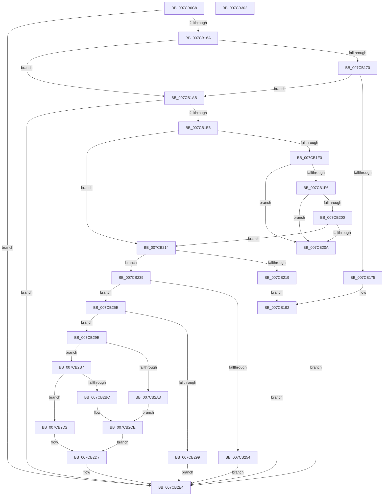

# ExpConvertSignatureName

- RVA: `0x007CB0C8`–`0x007CB303` (길이 `571` bytes)
- VA: `0x00000001407CB0C8`
- 실행 섹션: `PAGE`
- PDB 이름 있음: `예`; PDB Function 태그: `아니요`
- unwind 정보 RVA: `0x000D5130`
- 디코드: `158`개 명령, `571/571` bytes 표시
- 미해석 바이트: `0` (있으면 어셈블리에 `.byte`로 보존)

> 이 문서는 커널 이미지의 기계어와 PDB 기호를 분석해 생성했습니다. 4번과 5번은 함수 원형과 자료형을 바이너리 사용 방식에서 추정한 C 해석이며 원본 소스 복구 결과는 아닙니다.

## 1. Dependencies

- 직접 호출 지점: **11**; 고유 호출 대상: **10**
- 직접 호출자로 확인된 함수: **1**
- RIP 상대 이미지 참조: **2**

### Outgoing calls
- `0x007CB15D` → [ExpParseSignatureName](ExpParseSignatureName_function_007CBA30.md) (function, `0x007CBA30`)
- `0x007CB1A1` → [ExpCreateOutputEFI](../A7/ExpCreateOutputEFI_function_00A7BE84.md) (function, `0x00A7BE84`)
- `0x007CB1D9` → [ExpFindDiskSignature](../A7/ExpFindDiskSignature_function_00A7B608.md) (function, `0x00A7B608`)
- `0x007CB247` → [ExAllocatePool2](../../poolcode/B8/ExAllocatePool2_function_00B820F0.md) (function, `0x00B820F0`)
- `0x007CB276` → [swprintf_s](../../text/50/swprintf_s_function_00504B20.md) (function, `0x00504B20`)
- `0x007CB282` → [ExpTranslateSymbolicLink](../A7/ExpTranslateSymbolicLink_function_00A7B38C.md) (function, `0x00A7B38C`)
- `0x007CB28F` → [ExFreePoolWithTag](../../poolcode/B8/ExFreePoolWithTag_function_00B82870.md) (function, `0x00B82870`)
- `0x007CB2B0` → [ExpCreateOutputNT](../A7/ExpCreateOutputNT_function_00A7B53C.md) (function, `0x00A7B53C`)
- `0x007CB2C9` → [ExpCreateOutputARC](ExpCreateOutputARC_function_007CB30C.md) (function, `0x007CB30C`)
- `0x007CB2DD` → [ExFreePoolWithTag](../../poolcode/B8/ExFreePoolWithTag_function_00B82870.md) (function, `0x00B82870`)
- `0x007CB2EB` → [_security_check_cookie](../../text/6A/_security_check_cookie_function_006AC640.md) (function, `0x006AC640`)

### Direct callers
- [ExpTranslateArcPath](ExpTranslateArcPath_function_007CCA6C.md) at `0x007CCB1C`

### Static image references
- `0x007CB0DF` → RVA `0x00E0A740` (`.data`; read)
- `0x007CB262` → RVA `0x00B08940` (` ?? ::NNGAKEGL::`string'`; read)

## 2. Other-region calls and transfers

- 다른 실행 섹션으로 향하는 call: **5**
  - `0x007CB247` → [ExAllocatePool2](../../poolcode/B8/ExAllocatePool2_function_00B820F0.md) (`PAGE` → `POOLCODE`)
  - `0x007CB276` → [swprintf_s](../../text/50/swprintf_s_function_00504B20.md) (`PAGE` → `.text`)
  - `0x007CB28F` → [ExFreePoolWithTag](../../poolcode/B8/ExFreePoolWithTag_function_00B82870.md) (`PAGE` → `POOLCODE`)
  - `0x007CB2DD` → [ExFreePoolWithTag](../../poolcode/B8/ExFreePoolWithTag_function_00B82870.md) (`PAGE` → `POOLCODE`)
  - `0x007CB2EB` → [_security_check_cookie](../../text/6A/_security_check_cookie_function_006AC640.md) (`PAGE` → `.text`)
- 별도 외부 분기/꼬리 이동을 확인하지 못했습니다.

## 3. Assembly (complete function range)

```asm
007CB0C8  40 55                           push rbp
007CB0CA  53                              push rbx
007CB0CB  56                              push rsi
007CB0CC  57                              push rdi
007CB0CD  41 54                           push r12
007CB0CF  41 56                           push r14
007CB0D1  41 57                           push r15
007CB0D3  48 8D 6C 24 E9                  lea rbp, [rsp - 0x17]
007CB0D8  48 81 EC A0 00 00 00            sub rsp, 0xa0
007CB0DF  48 8B 05 5A F6 63 00            mov rax, qword ptr [rip + 0x63f65a]
007CB0E6  48 33 C4                        xor rax, rsp
007CB0E9  48 89 45 07                     mov qword ptr [rbp + 7], rax
007CB0ED  4C 8B 7D 77                     mov r15, qword ptr [rbp + 0x77]
007CB0F1  8B D9                           mov ebx, ecx
007CB0F3  83 65 BB 00                     and dword ptr [rbp - 0x45], 0
007CB0F7  48 8D 4D B8                     lea rcx, [rbp - 0x48]
007CB0FB  83 65 C3 00                     and dword ptr [rbp - 0x3d], 0
007CB0FF  49 8B C1                        mov rax, r9
007CB102  48 83 65 C7 00                  and qword ptr [rbp - 0x39], 0
007CB107  4C 8D 4D BB                     lea r9, [rbp - 0x45]
007CB10B  48 83 65 DF 00                  and qword ptr [rbp - 0x21], 0
007CB110  0F 57 C0                        xorps xmm0, xmm0
007CB113  48 83 65 CF 00                  and qword ptr [rbp - 0x31], 0
007CB118  4D 8B F0                        mov r14, r8
007CB11B  48 83 65 D7 00                  and qword ptr [rbp - 0x29], 0
007CB120  4C 8D 45 F7                     lea r8, [rbp - 9]
007CB124  48 89 4C 24 38                  mov qword ptr [rsp + 0x38], rcx
007CB129  48 8B F2                        mov rsi, rdx
007CB12C  8B 55 7F                        mov edx, dword ptr [rbp + 0x7f]
007CB12F  48 8D 4D B7                     lea rcx, [rbp - 0x49]
007CB133  48 89 4C 24 30                  mov qword ptr [rsp + 0x30], rcx
007CB138  48 8D 4D CF                     lea rcx, [rbp - 0x31]
007CB13C  48 89 4C 24 28                  mov qword ptr [rsp + 0x28], rcx
007CB141  48 8D 4D C7                     lea rcx, [rbp - 0x39]
007CB145  48 89 4C 24 20                  mov qword ptr [rsp + 0x20], rcx
007CB14A  48 8B C8                        mov rcx, rax
007CB14D  0F 11 45 F7                     movups xmmword ptr [rbp - 9], xmm0
007CB151  C6 45 B7 00                     mov byte ptr [rbp - 0x49], 0
007CB155  C6 45 B8 00                     mov byte ptr [rbp - 0x48], 0
007CB159  0F 11 45 E7                     movups xmmword ptr [rbp - 0x19], xmm0
007CB15D  E8 CE 08 00 00                  call 0x1407cba30
007CB162  85 C0                           test eax, eax
007CB164  0F 88 7A 01 00 00               js 0x1407cb2e4
007CB16A  80 7D B8 01                     cmp byte ptr [rbp - 0x48], 1
007CB16E  75 3B                           jne 0x1407cb1ab
007CB170  83 FB 04                        cmp ebx, 4
007CB173  75 36                           jne 0x1407cb1ab
007CB175  8A 45 B7                        mov al, byte ptr [rbp - 0x49]
007CB178  4C 8D 4D BB                     lea r9, [rbp - 0x45]
007CB17C  88 44 24 38                     mov byte ptr [rsp + 0x38], al
007CB180  48 8D 45 CF                     lea rax, [rbp - 0x31]
007CB184  4C 89 7C 24 30                  mov qword ptr [rsp + 0x30], r15
007CB189  48 89 44 24 28                  mov qword ptr [rsp + 0x28], rax
007CB18E  48 8D 45 C7                     lea rax, [rbp - 0x39]
007CB192  4C 8D 45 F7                     lea r8, [rbp - 9]
007CB196  48 89 44 24 20                  mov qword ptr [rsp + 0x20], rax
007CB19B  49 8B D6                        mov rdx, r14
007CB19E  48 8B CE                        mov rcx, rsi
007CB1A1  E8 DE 0C 2B 00                  call 0x140a7be84
007CB1A6  E9 39 01 00 00                  jmp 0x1407cb2e4
007CB1AB  40 8A 7D B7                     mov dil, byte ptr [rbp - 0x49]
007CB1AF  4C 8D 4D DF                     lea r9, [rbp - 0x21]
007CB1B3  33 C0                           xor eax, eax
007CB1B5  40 88 7C 24 28                  mov byte ptr [rsp + 0x28], dil
007CB1BA  40 84 FF                        test dil, dil
007CB1BD  4C 8D 45 C3                     lea r8, [rbp - 0x3d]
007CB1C1  48 8D 55 BF                     lea rdx, [rbp - 0x41]
007CB1C5  0F 44 45 BB                     cmove eax, dword ptr [rbp - 0x45]
007CB1C9  48 8D 4D F7                     lea rcx, [rbp - 9]
007CB1CD  89 45 BF                        mov dword ptr [rbp - 0x41], eax
007CB1D0  48 8D 45 D7                     lea rax, [rbp - 0x29]
007CB1D4  48 89 44 24 20                  mov qword ptr [rsp + 0x20], rax
007CB1D9  E8 2A 04 2B 00                  call 0x140a7b608
007CB1DE  85 C0                           test eax, eax
007CB1E0  0F 88 FE 00 00 00               js 0x1407cb2e4
007CB1E6  80 7D B8 01                     cmp byte ptr [rbp - 0x48], 1
007CB1EA  44 8B 65 BF                     mov r12d, dword ptr [rbp - 0x41]
007CB1EE  75 24                           jne 0x1407cb214
007CB1F0  44 39 65 BB                     cmp dword ptr [rbp - 0x45], r12d
007CB1F4  75 14                           jne 0x1407cb20a
007CB1F6  48 8B 45 DF                     mov rax, qword ptr [rbp - 0x21]
007CB1FA  48 39 45 C7                     cmp qword ptr [rbp - 0x39], rax
007CB1FE  75 0A                           jne 0x1407cb20a
007CB200  48 8B 45 D7                     mov rax, qword ptr [rbp - 0x29]
007CB204  48 39 45 CF                     cmp qword ptr [rbp - 0x31], rax
007CB208  74 0A                           je 0x1407cb214
007CB20A  B8 0D 00 00 C0                  mov eax, 0xc000000d
007CB20F  E9 D0 00 00 00                  jmp 0x1407cb2e4
007CB214  83 FB 04                        cmp ebx, 4
007CB217  75 20                           jne 0x1407cb239
007CB219  40 88 7C 24 38                  mov byte ptr [rsp + 0x38], dil
007CB21E  48 8D 45 D7                     lea rax, [rbp - 0x29]
007CB222  4C 89 7C 24 30                  mov qword ptr [rsp + 0x30], r15
007CB227  4C 8D 4D BF                     lea r9, [rbp - 0x41]
007CB22B  48 89 44 24 28                  mov qword ptr [rsp + 0x28], rax
007CB230  48 8D 45 DF                     lea rax, [rbp - 0x21]
007CB234  E9 59 FF FF FF                  jmp 0x1407cb192
007CB239  BA 5E 00 00 00                  mov edx, 0x5e
007CB23E  41 B8 45 6E 76 72               mov r8d, 0x72766e45
007CB244  8D 4A E2                        lea ecx, [rdx - 0x1e]
007CB247  E8 A4 6E 3B 00                  call 0x140b820f0
007CB24C  48 8B F8                        mov rdi, rax
007CB24F  48 85 C0                        test rax, rax
007CB252  75 0A                           jne 0x1407cb25e
007CB254  B8 9A 00 00 C0                  mov eax, 0xc000009a
007CB259  E9 86 00 00 00                  jmp 0x1407cb2e4
007CB25E  44 8B 4D C3                     mov r9d, dword ptr [rbp - 0x3d]
007CB262  4C 8D 05 D7 D6 33 00            lea r8, [rip + 0x33d6d7]
007CB269  BA 2F 00 00 00                  mov edx, 0x2f
007CB26E  44 89 64 24 20                  mov dword ptr [rsp + 0x20], r12d
007CB273  48 8B CF                        mov rcx, rdi
007CB276  E8 A5 98 D3 FF                  call 0x140504b20
007CB27B  48 8D 55 E7                     lea rdx, [rbp - 0x19]
007CB27F  48 8B CF                        mov rcx, rdi
007CB282  E8 05 01 2B 00                  call 0x140a7b38c
007CB287  33 D2                           xor edx, edx
007CB289  48 8B CF                        mov rcx, rdi
007CB28C  44 8B E0                        mov r12d, eax
007CB28F  E8 DC 75 3B 00                  call 0x140b82870
007CB294  45 85 E4                        test r12d, r12d
007CB297  79 05                           jns 0x1407cb29e
007CB299  41 8B C4                        mov eax, r12d
007CB29C  EB 46                           jmp 0x1407cb2e4
007CB29E  83 FB 03                        cmp ebx, 3
007CB2A1  75 14                           jne 0x1407cb2b7
007CB2A3  4D 8B CF                        mov r9, r15
007CB2A6  4C 8D 45 E7                     lea r8, [rbp - 0x19]
007CB2AA  49 8B D6                        mov rdx, r14
007CB2AD  48 8B CE                        mov rcx, rsi
007CB2B0  E8 87 02 2B 00                  call 0x140a7b53c
007CB2B5  EB 17                           jmp 0x1407cb2ce
007CB2B7  83 FB 01                        cmp ebx, 1
007CB2BA  75 16                           jne 0x1407cb2d2
007CB2BC  4D 8B CF                        mov r9, r15
007CB2BF  4C 8D 45 E7                     lea r8, [rbp - 0x19]
007CB2C3  49 8B D6                        mov rdx, r14
007CB2C6  48 8B CE                        mov rcx, rsi
007CB2C9  E8 3E 00 00 00                  call 0x1407cb30c
007CB2CE  8B D8                           mov ebx, eax
007CB2D0  EB 05                           jmp 0x1407cb2d7
007CB2D2  BB 0D 00 00 C0                  mov ebx, 0xc000000d
007CB2D7  48 8B 4D EF                     mov rcx, qword ptr [rbp - 0x11]
007CB2DB  33 D2                           xor edx, edx
007CB2DD  E8 8E 75 3B 00                  call 0x140b82870
007CB2E2  8B C3                           mov eax, ebx
007CB2E4  48 8B 4D 07                     mov rcx, qword ptr [rbp + 7]
007CB2E8  48 33 CC                        xor rcx, rsp
007CB2EB  E8 50 13 EE FF                  call 0x1406ac640
007CB2F0  48 81 C4 A0 00 00 00            add rsp, 0xa0
007CB2F7  41 5F                           pop r15
007CB2F9  41 5E                           pop r14
007CB2FB  41 5C                           pop r12
007CB2FD  5F                              pop rdi
007CB2FE  5E                              pop rsi
007CB2FF  5B                              pop rbx
007CB300  5D                              pop rbp
007CB301  C3                              ret
007CB302  CC                              int3
```

## 4. C-style interpretation (structured pseudocode)

```c
__int64 __fastcall ExpConvertSignatureName(int a1, __int64 a2, __int64 a3, __int64 a4, __int64 a5, unsigned int a6)
{
    __int64 result;
    __int64 v_rsp;
    unsigned __int64 v_stack_m48;
    unsigned __int64 v_stack_m4F;
    unsigned __int64 v_stack_m58;
    unsigned __int64 v_stack_m60;
    unsigned __int64 v_stack_m68;
    unsigned __int64 v_stack_m70;
    unsigned __int64 v_stack_m78;
    unsigned __int64 v_stack_m80;
    unsigned __int64 v_stack_m88;
    unsigned int v_stack_m8C;
    unsigned __int64 v_stack_m90;
    unsigned int v_stack_m94;
    unsigned __int64 v_stack_m97;
    unsigned __int64 v_stack_m98;
    unsigned __int64 v_stack_mA0;
    unsigned __int64 v_stack_mA8;
    unsigned __int64 v_stack_mB0;
    unsigned __int64 v_stack_mB8;

    v_rsp = (v_rsp) - (160);
    result = (*(unsigned __int64 *)(v_rip + 6551130)) ^ (v_rsp);
    v_stack_m48 = result;
    v_stack_mA0 = v_stack_m97;
    v_stack_mA8 = v_stack_m98;
    v_stack_mB0 = v_stack_m80;
    v_stack_mB8 = v_stack_m88;
    v_stack_m58 = v_xmm0;
    v_stack_m98 = 0;
    v_stack_m97 = 0;
    v_stack_m68 = v_xmm0;
    result = ExpParseSignatureName(a4, (unsigned int)(a6), v_stack_m58, v_stack_m94);
    if (sign_flag) goto loc_007CB2E4;
    if (v_stack_m97 != 1) goto loc_007CB1AB;
    if (((unsigned int)((unsigned int)(a1))) != 4) goto loc_007CB1AB;
    v_stack_mA0 = (unsigned __int8)(v_stack_m98);
    v_stack_mA8 = a5;
    v_stack_mB0 = v_stack_m80;
loc_007CB192:
    v_stack_mB8 = v_stack_m88;
    result = ExpCreateOutputEFI(a2, a3, v_stack_m58, v_stack_m94);
    goto loc_007CB2E4;
loc_007CB1AB:
    result = 0;
    v_stack_mB0 = (unsigned __int8)(v_stack_m98);
    if ((unsigned __int8)(v_stack_m98) == 0) { result = v_stack_m94; }
    v_stack_m90 = (unsigned int)(result);
    v_stack_mB8 = v_stack_m78;
    result = ExpFindDiskSignature(v_stack_m58, v_stack_m90, v_stack_m8C, v_stack_m70);
    if (sign_flag) goto loc_007CB2E4;
    if (v_stack_m97 != 1) goto loc_007CB214;
    if (v_stack_m94 != ((unsigned int)((unsigned int)(v_stack_m90)))) goto loc_007CB20A;
    if (v_stack_m88 != v_stack_m70) goto loc_007CB20A;
    if (v_stack_m80 == v_stack_m78) goto loc_007CB214;
loc_007CB20A:
    goto loc_007CB2E4;
loc_007CB214:
    if (((unsigned int)((unsigned int)(a1))) != 4) goto loc_007CB239;
    v_stack_mA0 = (unsigned __int8)(v_stack_m98);
    v_stack_mA8 = a5;
    v_stack_mB0 = v_stack_m78;
    goto loc_007CB192;
loc_007CB239:
    result = ExAllocatePool2(94 - 30, 94, (unsigned int)(0x72766E45ULL), v_stack_m90);
    if (result != 0) goto loc_007CB25E;
    goto loc_007CB2E4;
loc_007CB25E:
    v_stack_mB8 = (unsigned int)((unsigned int)(v_stack_m90));
    result = swprintf_s(result, 47, v_rip + 3397335, (unsigned int)(v_stack_m8C));
    result = ExpTranslateSymbolicLink(result, v_stack_m68, v_rip + 3397335, (unsigned int)(v_stack_m8C));
    a2 = 0;
    result = ExFreePoolWithTag(result, a2, v_rip + 3397335, (unsigned int)(v_stack_m8C));
    if (!sign_flag) goto loc_007CB29E;
    goto loc_007CB2E4;
loc_007CB29E:
    if (((unsigned int)((unsigned int)(a1))) != 3) goto loc_007CB2B7;
    result = ExpCreateOutputNT(0, a3, v_stack_m68, a5);
    goto loc_007CB2CE;
loc_007CB2B7:
    if (((unsigned int)((unsigned int)(a1))) != 1) goto loc_007CB2D2;
    result = ExpCreateOutputARC(0, a3, v_stack_m68, a5);
loc_007CB2CE:
    goto loc_007CB2D7;
loc_007CB2D2:
loc_007CB2D7:
    a2 = 0;
    result = ExFreePoolWithTag(v_stack_m60, a2, v_stack_m68, a5);
loc_007CB2E4:
    a1 = (v_stack_m48) ^ (v_rsp);
    result = _security_check_cookie(a1, a2, v_stack_m68, a5);
    v_rsp = (v_rsp) + (160);
    return result;
}
```

## 5. (Beta) C Style

```c
int64_t ExpConvertSignatureName(int32_t Arg1, int64_t Arg2, int64_t Arg3, int64_t Arg4, int64_t Arg5, uint32_t Arg6)
{
    int64_t result;
    int64_t local_rsp;
    uint64_t v_stack_m48;
    uint64_t v_stack_m4F;
    uint64_t v_stack_m58;
    uint64_t v_stack_m60;
    uint64_t v_stack_m68;
    uint64_t v_stack_m70;
    uint64_t v_stack_m78;
    uint64_t v_stack_m80;
    uint64_t v_stack_m88;
    uint32_t v_stack_m8C;
    uint64_t v_stack_m90;
    uint32_t v_stack_m94;
    uint64_t v_stack_m97;
    uint64_t v_stack_m98;
    uint64_t v_stack_mA0;
    uint64_t v_stack_mA8;
    uint64_t v_stack_mB0;
    uint64_t v_stack_mB8;

    local_rsp = (local_rsp) - (160);
    result = (*(uint64_t *)(v_rip + 0x63F65A)) ^ (local_rsp);
    v_stack_m48 = result;
    v_stack_mA0 = v_stack_m97;
    v_stack_mA8 = v_stack_m98;
    v_stack_mB0 = v_stack_m80;
    v_stack_mB8 = v_stack_m88;
    v_stack_m58 = v_xmm0;
    v_stack_m98 = 0;
    v_stack_m97 = 0;
    v_stack_m68 = v_xmm0;
    result = ExpParseSignatureName(Arg4, (uint32_t)(Arg6), v_stack_m58, v_stack_m94);
    if (sign_flag) goto loc_007CB2E4;
    if (v_stack_m97 != 1) goto loc_007CB1AB;
    if (((uint32_t)((uint32_t)(Arg1))) != 4) goto loc_007CB1AB;
    v_stack_mA0 = (uint8_t)(v_stack_m98);
    v_stack_mA8 = Arg5;
    v_stack_mB0 = v_stack_m80;
loc_007CB192:
    v_stack_mB8 = v_stack_m88;
    result = ExpCreateOutputEFI(Arg2, Arg3, v_stack_m58, v_stack_m94);
    goto loc_007CB2E4;
loc_007CB1AB:
    result = 0;
    v_stack_mB0 = (uint8_t)(v_stack_m98);
    if ((uint8_t)(v_stack_m98) == 0) { result = v_stack_m94; }
    v_stack_m90 = (uint32_t)(result);
    v_stack_mB8 = v_stack_m78;
    result = ExpFindDiskSignature(v_stack_m58, v_stack_m90, v_stack_m8C, v_stack_m70);
    if (sign_flag) goto loc_007CB2E4;
    if (v_stack_m97 != 1) goto loc_007CB214;
    if (v_stack_m94 != ((uint32_t)((uint32_t)(v_stack_m90)))) goto loc_007CB20A;
    if (v_stack_m88 != v_stack_m70) goto loc_007CB20A;
    if (v_stack_m80 == v_stack_m78) goto loc_007CB214;
loc_007CB20A:
    goto loc_007CB2E4;
loc_007CB214:
    if (((uint32_t)((uint32_t)(Arg1))) != 4) goto loc_007CB239;
    v_stack_mA0 = (uint8_t)(v_stack_m98);
    v_stack_mA8 = Arg5;
    v_stack_mB0 = v_stack_m78;
    goto loc_007CB192;
loc_007CB239:
    result = ExAllocatePool2(94 - 30, 94, (uint32_t)(0x72766E45ULL), v_stack_m90);
    if (result != 0) goto loc_007CB25E;
    goto loc_007CB2E4;
loc_007CB25E:
    v_stack_mB8 = (uint32_t)((uint32_t)(v_stack_m90));
    result = swprintf_s(result, 47, v_rip + 3397335, (uint32_t)(v_stack_m8C));
    result = ExpTranslateSymbolicLink(result, v_stack_m68, v_rip + 3397335, (uint32_t)(v_stack_m8C));
    Arg2 = 0;
    result = ExFreePoolWithTag(result, Arg2, v_rip + 3397335, (uint32_t)(v_stack_m8C));
    if (!sign_flag) goto loc_007CB29E;
    goto loc_007CB2E4;
loc_007CB29E:
    if (((uint32_t)((uint32_t)(Arg1))) != 3) goto loc_007CB2B7;
    result = ExpCreateOutputNT(0, Arg3, v_stack_m68, Arg5);
    goto loc_007CB2CE;
loc_007CB2B7:
    if (((uint32_t)((uint32_t)(Arg1))) != 1) goto loc_007CB2D2;
    result = ExpCreateOutputARC(0, Arg3, v_stack_m68, Arg5);
loc_007CB2CE:
    goto loc_007CB2D7;
loc_007CB2D2:
loc_007CB2D7:
    Arg2 = 0;
    result = ExFreePoolWithTag(v_stack_m60, Arg2, v_stack_m68, Arg5);
loc_007CB2E4:
    Arg1 = (v_stack_m48) ^ (local_rsp);
    result = _security_check_cookie(Arg1, Arg2, v_stack_m68, Arg5);
    local_rsp = (local_rsp) + (160);
    return result;
}
```

## 6. Execution-region graph

[열기: 2D/3D 그래프와 함수 탐색 컨트롤 패널](../../../control-panel.html?section=page&rva=0x007CB0C8&view=graph)

- 2D 그래프는 위에서 아래로 흐르고, 3D 그래프는 빈 공간을 드래그해 회전합니다. Shift+드래그는 이동, 휠은 확대·축소, 함수 노드 선택은 대상 보고서 이동입니다.

### Static fallback


