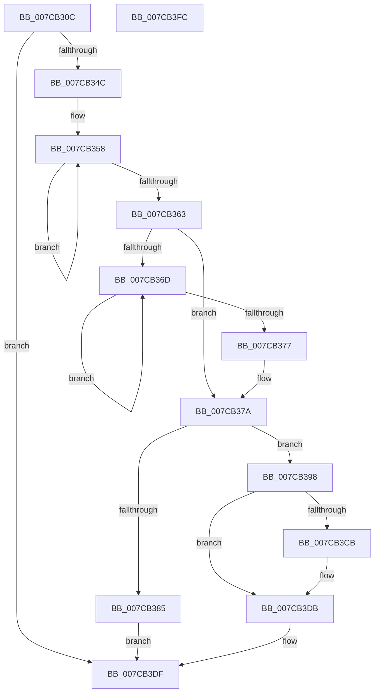

# ExpCreateOutputARC

- RVA: `0x007CB30C`–`0x007CB3FD` (길이 `241` bytes)
- VA: `0x00000001407CB30C`
- 실행 섹션: `PAGE`
- PDB 이름 있음: `예`; PDB Function 태그: `아니요`
- unwind 정보 RVA: `0x0008C20C`
- 디코드: `78`개 명령, `241/241` bytes 표시
- 미해석 바이트: `0` (있으면 어셈블리에 `.byte`로 보존)

> 이 문서는 커널 이미지의 기계어와 PDB 기호를 분석해 생성했습니다. 4번과 5번은 함수 원형과 자료형을 바이너리 사용 방식에서 추정한 C 해석이며 원본 소스 복구 결과는 아닙니다.

## 1. Dependencies

- 직접 호출 지점: **5**; 고유 호출 대상: **3**
- 직접 호출자로 확인된 함수: **3**
- RIP 상대 이미지 참조: **0**

### Outgoing calls
- `0x007CB33F` → [ExpFindArcName](ExpFindArcName_function_007CB5CC.md) (function, `0x007CB5CC`)
- `0x007CB38C` → [ExFreePoolWithTag](../../poolcode/B8/ExFreePoolWithTag_function_00B82870.md) (function, `0x00B82870`)
- `0x007CB3B7` → [wcscpy_s](../../text/50/wcscpy_s_function_005064B0.md) (function, `0x005064B0`)
- `0x007CB3C1` → [ExFreePoolWithTag](../../poolcode/B8/ExFreePoolWithTag_function_00B82870.md) (function, `0x00B82870`)
- `0x007CB3D6` → [wcscpy_s](../../text/50/wcscpy_s_function_005064B0.md) (function, `0x005064B0`)

### Direct callers
- [ExpConvertSignatureName](ExpConvertSignatureName_function_007CB0C8.md) at `0x007CB2C9`
- [ExpTranslateNtPath](ExpTranslateNtPath_function_007CCEF4.md) at `0x007CCFF8`
- [sub_00B42460](../B4/Unknown_function_00B42460.md) at `0x00B42579`

### Static image references
- 디코드된 RIP-relative 메모리 참조가 없습니다.

## 2. Other-region calls and transfers

- 다른 실행 섹션으로 향하는 call: **4**
  - `0x007CB38C` → [ExFreePoolWithTag](../../poolcode/B8/ExFreePoolWithTag_function_00B82870.md) (`PAGE` → `POOLCODE`)
  - `0x007CB3B7` → [wcscpy_s](../../text/50/wcscpy_s_function_005064B0.md) (`PAGE` → `.text`)
  - `0x007CB3C1` → [ExFreePoolWithTag](../../poolcode/B8/ExFreePoolWithTag_function_00B82870.md) (`PAGE` → `POOLCODE`)
  - `0x007CB3D6` → [wcscpy_s](../../text/50/wcscpy_s_function_005064B0.md) (`PAGE` → `.text`)
- 별도 외부 분기/꼬리 이동을 확인하지 못했습니다.

## 3. Assembly (complete function range)

```asm
007CB30C  48 8B C4                        mov rax, rsp
007CB30F  48 89 58 08                     mov qword ptr [rax + 8], rbx
007CB313  48 89 68 10                     mov qword ptr [rax + 0x10], rbp
007CB317  48 89 70 18                     mov qword ptr [rax + 0x18], rsi
007CB31B  57                              push rdi
007CB31C  41 54                           push r12
007CB31E  41 55                           push r13
007CB320  41 56                           push r14
007CB322  41 57                           push r15
007CB324  48 83 EC 30                     sub rsp, 0x30
007CB328  48 8B F2                        mov rsi, rdx
007CB32B  4C 8B F9                        mov r15, rcx
007CB32E  45 33 ED                        xor r13d, r13d
007CB331  48 8D 50 C8                     lea rdx, [rax - 0x38]
007CB335  49 8B C8                        mov rcx, r8
007CB338  4C 89 68 C8                     mov qword ptr [rax - 0x38], r13
007CB33C  4D 8B F1                        mov r14, r9
007CB33F  E8 88 02 00 00                  call 0x1407cb5cc
007CB344  85 C0                           test eax, eax
007CB346  0F 88 93 00 00 00               js 0x1407cb3df
007CB34C  48 8B 6C 24 20                  mov rbp, qword ptr [rsp + 0x20]
007CB351  48 83 C8 FF                     or rax, 0xffffffffffffffff
007CB355  48 8B F8                        mov rdi, rax
007CB358  48 FF C7                        inc rdi
007CB35B  66 44 39 6C 7D 00               cmp word ptr [rbp + rdi*2], r13w
007CB361  75 F5                           jne 0x1407cb358
007CB363  03 FF                           add edi, edi
007CB365  8D 5F 02                        lea ebx, [rdi + 2]
007CB368  4D 85 F6                        test r14, r14
007CB36B  74 0D                           je 0x1407cb37a
007CB36D  48 FF C0                        inc rax
007CB370  66 45 39 2C 46                  cmp word ptr [r14 + rax*2], r13w
007CB375  75 F6                           jne 0x1407cb36d
007CB377  8D 1C 43                        lea ebx, [rbx + rax*2]
007CB37A  8B C3                           mov eax, ebx
007CB37C  83 C3 0C                        add ebx, 0xc
007CB37F  D1 E8                           shr eax, 1
007CB381  39 1E                           cmp dword ptr [rsi], ebx
007CB383  73 13                           jae 0x1407cb398
007CB385  33 D2                           xor edx, edx
007CB387  89 1E                           mov dword ptr [rsi], ebx
007CB389  48 8B CD                        mov rcx, rbp
007CB38C  E8 DF 74 3B 00                  call 0x140b82870
007CB391  B8 23 00 00 C0                  mov eax, 0xc0000023
007CB396  EB 47                           jmp 0x1407cb3df
007CB398  B9 01 00 00 00                  mov ecx, 1
007CB39D  41 89 5F 04                     mov dword ptr [r15 + 4], ebx
007CB3A1  41 89 0F                        mov dword ptr [r15], ecx
007CB3A4  4C 8B C5                        mov r8, rbp
007CB3A7  41 89 4F 08                     mov dword ptr [r15 + 8], ecx
007CB3AB  49 83 C7 0C                     add r15, 0xc
007CB3AF  49 8B CF                        mov rcx, r15
007CB3B2  8B D0                           mov edx, eax
007CB3B4  44 8B E0                        mov r12d, eax
007CB3B7  E8 F4 B0 D3 FF                  call 0x1405064b0
007CB3BC  33 D2                           xor edx, edx
007CB3BE  48 8B CD                        mov rcx, rbp
007CB3C1  E8 AA 74 3B 00                  call 0x140b82870
007CB3C6  4D 85 F6                        test r14, r14
007CB3C9  74 10                           je 0x1407cb3db
007CB3CB  8B CF                           mov ecx, edi
007CB3CD  4D 8B C6                        mov r8, r14
007CB3D0  49 03 CF                        add rcx, r15
007CB3D3  41 8B D4                        mov edx, r12d
007CB3D6  E8 D5 B0 D3 FF                  call 0x1405064b0
007CB3DB  89 1E                           mov dword ptr [rsi], ebx
007CB3DD  33 C0                           xor eax, eax
007CB3DF  48 8B 5C 24 60                  mov rbx, qword ptr [rsp + 0x60]
007CB3E4  48 8B 6C 24 68                  mov rbp, qword ptr [rsp + 0x68]
007CB3E9  48 8B 74 24 70                  mov rsi, qword ptr [rsp + 0x70]
007CB3EE  48 83 C4 30                     add rsp, 0x30
007CB3F2  41 5F                           pop r15
007CB3F4  41 5E                           pop r14
007CB3F6  41 5D                           pop r13
007CB3F8  41 5C                           pop r12
007CB3FA  5F                              pop rdi
007CB3FB  C3                              ret
007CB3FC  CC                              int3
```

## 4. C-style interpretation (structured pseudocode)

```c
__int64 __fastcall ExpCreateOutputARC(__int64 a1, __int64 a2, __int64 a3, __int64 a4)
{
    __int64 result;
    __int64 v_r13;
    __int64 v_r15;
    __int64 v_rbx;
    __int64 v_rdi;
    __int64 v_rsp;
    unsigned __int64 v_stack_m38;
    unsigned __int64 v_stack_p10;
    unsigned __int64 v_stack_p18;
    unsigned __int64 v_stack_p8;

    *(unsigned __int64 *)(v_rsp + 8) = v_rbx;
    *(unsigned __int64 *)(v_rsp + 16) = v_rbp;
    *(unsigned __int64 *)(v_rsp + 24) = v_rsi;
    v_rsp = (v_rsp) - (48);
    v_r13 = 0;
    *(unsigned __int64 *)(v_rsp - 56) = 0;
    result = ExpFindArcName(a3, v_rsp - 56, a3, a4);
    if (sign_flag) goto loc_007CB3DF;
    result = (result) | (-1);
loc_007CB358:
    v_rdi = (result) + 1;
    if ((*(unsigned __int16 *)(v_stack_m38 + v_rdi * 2)) != 0) goto loc_007CB358;
    v_rdi = (unsigned int)((v_rdi) + ((unsigned int)(v_rdi)));
    if (a4 == 0) goto loc_007CB37A;
loc_007CB36D:
    result = (result) + 1;
    if ((*(unsigned __int16 *)(a4 + result * 2)) != 0) goto loc_007CB36D;
loc_007CB37A:
    v_rbx = (unsigned int)((v_rdi + 2 + result * 2) + (12));
    result = (unsigned int)(((unsigned int)((unsigned int)(v_rdi + 2 + result * 2))) >> (1));
    if ((*(unsigned int *)(a2)) >= ((unsigned int)(v_rbx))) goto loc_007CB398;
    a2 = 0;
    *(unsigned int *)(a2) = (unsigned int)(v_rbx);
    result = ExFreePoolWithTag(v_stack_m38, a2, a3, a4);
    goto loc_007CB3DF;
loc_007CB398:
    *(unsigned int *)(a1 + 4) = (unsigned int)(v_rbx);
    *(unsigned int *)(a1) = 1;
    *(unsigned int *)(a1 + 8) = 1;
    v_r15 = (a1) + (12);
    result = wcscpy_s(v_r15, (unsigned int)((unsigned int)((unsigned int)(0xC0000023ULL))), v_stack_m38, a4);
    a2 = 0;
    result = ExFreePoolWithTag(v_stack_m38, a2, v_stack_m38, a4);
    if (a4 != 0) {
        a1 = (unsigned int)(v_rdi);
        a3 = a4;
        a1 = (a1) + (v_r15);
        a2 = (unsigned int)((unsigned int)((unsigned int)((unsigned int)(0xC0000023ULL))));
        result = wcscpy_s(a1, a2, a3, a4);
    }
    *(unsigned int *)(a2) = (unsigned int)(v_rbx);
    result = 0;
loc_007CB3DF:
    v_rsp = (v_rsp) + (48);
    return result;
}
```

## 5. (Beta) C Style

```c
int64_t ExpCreateOutputARC(void *Arg1, void *Arg2, int64_t Arg3, int64_t Arg4)
{
    uint8_t *arg1 = (uint8_t *)Arg1;
    uint8_t *arg2 = (uint8_t *)Arg2;

    int64_t result;
    int64_t local_r13;
    int64_t local_r15;
    int64_t local_rbx;
    int64_t local_rdi;
    int64_t local_rsp;
    uint64_t v_stack_m38;
    uint64_t v_stack_p10;
    uint64_t v_stack_p18;
    uint64_t v_stack_p8;

    *(uint64_t *)(local_rsp + 0x8) = local_rbx;
    *(uint64_t *)(local_rsp + 0x10) = local_rbp;
    *(uint64_t *)(local_rsp + 0x18) = local_rsi;
    local_rsp = (local_rsp) - (48);
    local_r13 = 0;
    *(uint64_t *)(local_rsp - 0x38) = 0;
    result = ExpFindArcName(Arg3, local_rsp - 56, Arg3, Arg4);
    if (sign_flag) goto loc_007CB3DF;
    result = (result) | (-1);
loc_007CB358:
    local_rdi = (result) + 1;
    if ((*(uint16_t *)(v_stack_m38 + local_rdi * 2)) != 0) goto loc_007CB358;
    local_rdi = (uint32_t)((local_rdi) + ((uint32_t)(local_rdi)));
    if (Arg4 == 0) goto loc_007CB37A;
loc_007CB36D:
    result = (result) + 1;
    if ((*(uint16_t *)(Arg4 + result * 2)) != 0) goto loc_007CB36D;
loc_007CB37A:
    local_rbx = (uint32_t)((local_rdi + 2 + result * 2) + (12));
    result = (uint32_t)(((uint32_t)((uint32_t)(local_rdi + 2 + result * 2))) >> (1));
    if ((*(uint32_t *)(arg2)) >= ((uint32_t)(local_rbx))) goto loc_007CB398;
    Arg2 = 0;
    *(uint32_t *)(arg2) = (uint32_t)(local_rbx);
    result = ExFreePoolWithTag(v_stack_m38, Arg2, Arg3, Arg4);
    goto loc_007CB3DF;
loc_007CB398:
    *(uint32_t *)(arg1 + 0x4) = (uint32_t)(local_rbx);
    *(uint32_t *)(arg1) = 1;
    *(uint32_t *)(arg1 + 0x8) = 1;
    local_r15 = (Arg1) + (12);
    result = wcscpy_s(local_r15, (uint32_t)((uint32_t)((uint32_t)(0xC0000023ULL))), v_stack_m38, Arg4);
    Arg2 = 0;
    result = ExFreePoolWithTag(v_stack_m38, Arg2, v_stack_m38, Arg4);
    if (Arg4 != 0) {
        Arg1 = (uint32_t)(local_rdi);
        Arg3 = Arg4;
        Arg1 = (Arg1) + (local_r15);
        Arg2 = (uint32_t)((uint32_t)((uint32_t)((uint32_t)(0xC0000023ULL))));
        result = wcscpy_s(Arg1, Arg2, Arg3, Arg4);
    }
    *(uint32_t *)(arg2) = (uint32_t)(local_rbx);
    result = 0;
loc_007CB3DF:
    local_rsp = (local_rsp) + (48);
    return result;
}
```

### 관측된 메모리 오프셋

구조체 형식이 확인되지 않은 접근은 인자 기준의 오프셋으로만 기록했습니다.

| 기준 인자 | 오프셋 표현 | 폭 (bit) | 접근 |
|---|---:|---:|---|
| `Arg1` | `+ 0x0` | `32` | `W` |
| `Arg1` | `+ 0x4` | `32` | `W` |
| `Arg1` | `+ 0x8` | `32` | `W` |
| `Arg2` | `+ 0x0` | `32` | `R` |
| `Arg2` | `+ 0x0` | `32` | `W` |

## 6. Execution-region graph

[열기: 2D/3D 그래프와 함수 탐색 컨트롤 패널](../../../control-panel.html?section=page&rva=0x007CB30C&view=graph)

- 2D 그래프는 위에서 아래로 흐르고, 3D 그래프는 빈 공간을 드래그해 회전합니다. Shift+드래그는 이동, 휠은 확대·축소, 함수 노드 선택은 대상 보고서 이동입니다.

### Static fallback


