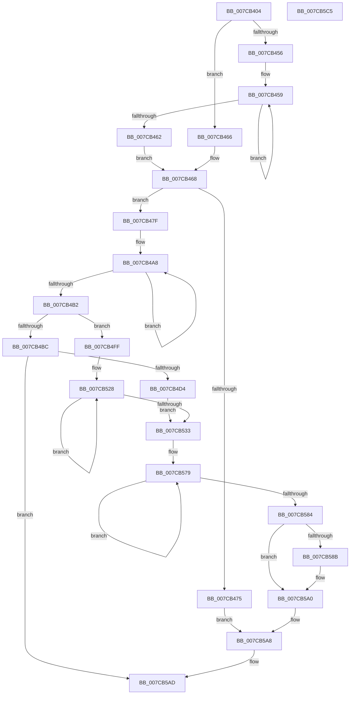

# ExpCreateOutputSIGNATURE

- RVA: `0x007CB404`–`0x007CB5C6` (길이 `450` bytes)
- VA: `0x00000001407CB404`
- 실행 섹션: `PAGE`
- PDB 이름 있음: `예`; PDB Function 태그: `아니요`
- unwind 정보 RVA: `0x000D2368`
- 디코드: `122`개 명령, `450/450` bytes 표시
- 미해석 바이트: `0` (있으면 어셈블리에 `.byte`로 보존)

> 이 문서는 커널 이미지의 기계어와 PDB 기호를 분석해 생성했습니다. 4번과 5번은 함수 원형과 자료형을 바이너리 사용 방식에서 추정한 C 해석이며 원본 소스 복구 결과는 아닙니다.

## 1. Dependencies

- 직접 호출 지점: **7**; 고유 호출 대상: **5**
- 직접 호출자로 확인된 함수: **2**
- RIP 상대 이미지 참조: **3**

### Outgoing calls
- `0x007CB4A0` → [wcscpy_s](../../text/50/wcscpy_s_function_005064B0.md) (function, `0x005064B0`)
- `0x007CB4C7` → [RtlStringFromGUIDEx](../91/RtlStringFromGUIDEx_function_00915450.md) (function, `0x00915450`)
- `0x007CB4E5` → [wcscat_s](../../text/50/wcscat_s_function_00506410.md) (function, `0x00506410`)
- `0x007CB4F1` → [ExFreePoolWithTag](../../poolcode/B8/ExFreePoolWithTag_function_00B82870.md) (function, `0x00B82870`)
- `0x007CB520` → [swprintf_s](../../text/50/swprintf_s_function_00504B20.md) (function, `0x00504B20`)
- `0x007CB574` → [swprintf_s](../../text/50/swprintf_s_function_00504B20.md) (function, `0x00504B20`)
- `0x007CB59B` → [wcscpy_s](../../text/50/wcscpy_s_function_005064B0.md) (function, `0x005064B0`)

### Direct callers
- [ExpTranslateNtPath](ExpTranslateNtPath_function_007CCEF4.md) at `0x007CD214`
- [sub_00B42460](../B4/Unknown_function_00B42460.md) at `0x00B4255F`

### Static image references
- `0x007CB48D` → RVA `0x00B08890` (` ?? ::NNGAKEGL::`string'`; read)
- `0x007CB507` → RVA `0x00B088F0` (` ?? ::NNGAKEGL::`string'`; read)
- `0x007CB53B` → RVA `0x00B088B0` (` ?? ::NNGAKEGL::`string'`; read)

## 2. Other-region calls and transfers

- 다른 실행 섹션으로 향하는 call: **6**
  - `0x007CB4A0` → [wcscpy_s](../../text/50/wcscpy_s_function_005064B0.md) (`PAGE` → `.text`)
  - `0x007CB4E5` → [wcscat_s](../../text/50/wcscat_s_function_00506410.md) (`PAGE` → `.text`)
  - `0x007CB4F1` → [ExFreePoolWithTag](../../poolcode/B8/ExFreePoolWithTag_function_00B82870.md) (`PAGE` → `POOLCODE`)
  - `0x007CB520` → [swprintf_s](../../text/50/swprintf_s_function_00504B20.md) (`PAGE` → `.text`)
  - `0x007CB574` → [swprintf_s](../../text/50/swprintf_s_function_00504B20.md) (`PAGE` → `.text`)
  - `0x007CB59B` → [wcscpy_s](../../text/50/wcscpy_s_function_005064B0.md) (`PAGE` → `.text`)
- 별도 외부 분기/꼬리 이동을 확인하지 못했습니다.

## 3. Assembly (complete function range)

```asm
007CB404  48 8B C4                        mov rax, rsp
007CB407  48 89 58 08                     mov qword ptr [rax + 8], rbx
007CB40B  4C 89 48 20                     mov qword ptr [rax + 0x20], r9
007CB40F  4C 89 40 18                     mov qword ptr [rax + 0x18], r8
007CB413  48 89 50 10                     mov qword ptr [rax + 0x10], rdx
007CB417  55                              push rbp
007CB418  56                              push rsi
007CB419  57                              push rdi
007CB41A  41 54                           push r12
007CB41C  41 55                           push r13
007CB41E  41 56                           push r14
007CB420  41 57                           push r15
007CB422  48 83 EC 40                     sub rsp, 0x40
007CB426  80 BC 24 B8 00 00 00 01         cmp byte ptr [rsp + 0xb8], 1
007CB42E  BF 5D 00 00 00                  mov edi, 0x5d
007CB433  0F 57 C0                        xorps xmm0, xmm0
007CB436  4D 8B E8                        mov r13, r8
007CB439  0F 11 40 B8                     movups xmmword ptr [rax - 0x48], xmm0
007CB43D  8D 47 E2                        lea eax, [rdi - 0x1e]
007CB440  0F 45 F8                        cmovne edi, eax
007CB443  48 8B 84 24 B0 00 00 00         mov rax, qword ptr [rsp + 0xb0]
007CB44B  48 83 CE FF                     or rsi, 0xffffffffffffffff
007CB44F  33 DB                           xor ebx, ebx
007CB451  48 85 C0                        test rax, rax
007CB454  74 10                           je 0x1407cb466
007CB456  48 8B EE                        mov rbp, rsi
007CB459  48 FF C5                        inc rbp
007CB45C  66 39 1C 68                     cmp word ptr [rax + rbp*2], bx
007CB460  75 F7                           jne 0x1407cb459
007CB462  03 FD                           add edi, ebp
007CB464  EB 02                           jmp 0x1407cb468
007CB466  8B EB                           mov ebp, ebx
007CB468  44 8D 24 7D 0C 00 00 00         lea r12d, [rdi*2 + 0xc]
007CB470  44 39 22                        cmp dword ptr [rdx], r12d
007CB473  73 0A                           jae 0x1407cb47f
007CB475  BB 23 00 00 C0                  mov ebx, 0xc0000023
007CB47A  E9 29 01 00 00                  jmp 0x1407cb5a8
007CB47F  4C 8D 79 0C                     lea r15, [rcx + 0xc]
007CB483  C7 01 01 00 00 00               mov dword ptr [rcx], 1
007CB489  44 89 61 04                     mov dword ptr [rcx + 4], r12d
007CB48D  4C 8D 05 FC D3 33 00            lea r8, [rip + 0x33d3fc]
007CB494  C7 41 08 02 00 00 00            mov dword ptr [rcx + 8], 2
007CB49B  49 8B CF                        mov rcx, r15
007CB49E  8B D7                           mov edx, edi
007CB4A0  E8 0B B0 D3 FF                  call 0x1405064b0
007CB4A5  4C 8B F6                        mov r14, rsi
007CB4A8  49 FF C6                        inc r14
007CB4AB  66 43 39 1C 77                  cmp word ptr [r15 + r14*2], bx
007CB4B0  75 F6                           jne 0x1407cb4a8
007CB4B2  80 BC 24 B8 00 00 00 01         cmp byte ptr [rsp + 0xb8], 1
007CB4BA  75 43                           jne 0x1407cb4ff
007CB4BC  41 B0 01                        mov r8b, 1
007CB4BF  48 8D 54 24 30                  lea rdx, [rsp + 0x30]
007CB4C4  49 8B CD                        mov rcx, r13
007CB4C7  E8 84 9F 14 00                  call 0x140915450
007CB4CC  85 C0                           test eax, eax
007CB4CE  0F 88 D9 00 00 00               js 0x1407cb5ad
007CB4D4  4C 8B 44 24 38                  mov r8, qword ptr [rsp + 0x38]
007CB4D9  8B D7                           mov edx, edi
007CB4DB  41 8B C6                        mov eax, r14d
007CB4DE  41 2B D6                        sub edx, r14d
007CB4E1  49 8D 0C 47                     lea rcx, [r15 + rax*2]
007CB4E5  E8 26 AF D3 FF                  call 0x140506410
007CB4EA  48 8B 4C 24 38                  mov rcx, qword ptr [rsp + 0x38]
007CB4EF  33 D2                           xor edx, edx
007CB4F1  E8 7A 73 3B 00                  call 0x140b82870
007CB4F6  0F B7 44 24 30                  movzx eax, word ptr [rsp + 0x30]
007CB4FB  D1 E8                           shr eax, 1
007CB4FD  EB 34                           jmp 0x1407cb533
007CB4FF  4C 8B 8C 24 90 00 00 00         mov r9, qword ptr [rsp + 0x90]
007CB507  4C 8D 05 E2 D3 33 00            lea r8, [rip + 0x33d3e2]
007CB50E  41 8B C6                        mov eax, r14d
007CB511  8B D7                           mov edx, edi
007CB513  41 2B D6                        sub edx, r14d
007CB516  45 8B 09                        mov r9d, dword ptr [r9]
007CB519  4D 8D 2C 47                     lea r13, [r15 + rax*2]
007CB51D  49 8B CD                        mov rcx, r13
007CB520  E8 FB 95 D3 FF                  call 0x140504b20
007CB525  48 8B C6                        mov rax, rsi
007CB528  48 FF C0                        inc rax
007CB52B  66 41 39 5C 45 00               cmp word ptr [r13 + rax*2], bx
007CB531  75 F5                           jne 0x1407cb528
007CB533  4C 8B 8C 24 98 00 00 00         mov r9, qword ptr [rsp + 0x98]
007CB53B  4C 8D 05 6E D3 33 00            lea r8, [rip + 0x33d36e]
007CB542  44 03 F0                        add r14d, eax
007CB545  8B D7                           mov edx, edi
007CB547  48 8B 84 24 A8 00 00 00         mov rax, qword ptr [rsp + 0xa8]
007CB54F  41 2B D6                        sub edx, r14d
007CB552  45 8B 09                        mov r9d, dword ptr [r9]
007CB555  4F 8D 2C 77                     lea r13, [r15 + r14*2]
007CB559  48 8B 08                        mov rcx, qword ptr [rax]
007CB55C  48 8B 84 24 A0 00 00 00         mov rax, qword ptr [rsp + 0xa0]
007CB564  48 89 4C 24 28                  mov qword ptr [rsp + 0x28], rcx
007CB569  48 8B 08                        mov rcx, qword ptr [rax]
007CB56C  48 89 4C 24 20                  mov qword ptr [rsp + 0x20], rcx
007CB571  49 8B CD                        mov rcx, r13
007CB574  E8 A7 95 D3 FF                  call 0x140504b20
007CB579  48 FF C6                        inc rsi
007CB57C  66 41 39 5C 75 00               cmp word ptr [r13 + rsi*2], bx
007CB582  75 F5                           jne 0x1407cb579
007CB584  41 03 F6                        add esi, r14d
007CB587  85 ED                           test ebp, ebp
007CB589  74 15                           je 0x1407cb5a0
007CB58B  4C 8B 84 24 B0 00 00 00         mov r8, qword ptr [rsp + 0xb0]
007CB593  49 8D 0C 77                     lea rcx, [r15 + rsi*2]
007CB597  2B FE                           sub edi, esi
007CB599  8B D7                           mov edx, edi
007CB59B  E8 10 AF D3 FF                  call 0x1405064b0
007CB5A0  48 8B 94 24 88 00 00 00         mov rdx, qword ptr [rsp + 0x88]
007CB5A8  44 89 22                        mov dword ptr [rdx], r12d
007CB5AB  8B C3                           mov eax, ebx
007CB5AD  48 8B 9C 24 80 00 00 00         mov rbx, qword ptr [rsp + 0x80]
007CB5B5  48 83 C4 40                     add rsp, 0x40
007CB5B9  41 5F                           pop r15
007CB5BB  41 5E                           pop r14
007CB5BD  41 5D                           pop r13
007CB5BF  41 5C                           pop r12
007CB5C1  5F                              pop rdi
007CB5C2  5E                              pop rsi
007CB5C3  5D                              pop rbp
007CB5C4  C3                              ret
007CB5C5  CC                              int3
```

## 4. C-style interpretation (structured pseudocode)

```c
__int64 __fastcall ExpCreateOutputSIGNATURE(__int64 a1, __int64 a2, __int64 a3, __int64 a4, __int64 a5, __int64 a6, __int64 a7, unsigned __int8 a8)
{
    __int64 result;
    __int64 v_r14;
    __int64 v_rbp;
    __int64 v_rbx;
    __int64 v_rdi;
    __int64 v_rsi;
    __int64 v_rsp;
    unsigned __int64 v_stack_m40;
    unsigned __int64 v_stack_m48;
    unsigned __int64 v_stack_m50;
    unsigned __int64 v_stack_m58;
    unsigned __int64 v_stack_p10;
    unsigned __int64 v_stack_p18;
    unsigned __int64 v_stack_p20;
    unsigned __int64 v_stack_p8;

    *(unsigned __int64 *)(v_rsp + 8) = v_rbx;
    *(unsigned __int64 *)(v_rsp + 32) = a4;
    *(unsigned __int64 *)(v_rsp + 24) = a3;
    *(unsigned __int64 *)(v_rsp + 16) = a2;
    v_rsp = (v_rsp) - (64);
    *(unsigned __int64 *)(v_rsp - 72) = v_xmm0;
    v_rdi = 93;
    if (a8 != 1) { v_rdi = (unsigned int)(93 - 30); }
    v_rsi = (v_rsi) | (-1);
    v_rbx = 0;
    if (a7 == 0) goto loc_007CB466;
loc_007CB459:
    v_rbp = (v_rsi) + 1;
    if ((*(unsigned __int16 *)(a7 + v_rbp * 2)) != 0) goto loc_007CB459;
    v_rdi = (unsigned int)((v_rdi) + ((unsigned int)(v_rbp)));
    goto loc_007CB468;
loc_007CB466:
loc_007CB468:
    if ((*(unsigned int *)(a2)) >= ((unsigned int)(v_rdi * 2 + 12))) goto loc_007CB47F;
    goto loc_007CB5A8;
loc_007CB47F:
    *(unsigned int *)(a1) = 1;
    *(unsigned int *)(a1 + 4) = (unsigned int)(v_rdi * 2 + 12);
    *(unsigned int *)(a1 + 8) = 2;
    result = wcscpy_s(a1 + 12, (unsigned int)((unsigned int)(v_rdi)), v_rip + 3396604, a4);
loc_007CB4A8:
    v_r14 = (v_rsi) + 1;
    if ((*(unsigned __int16 *)(a1 + 12 + v_r14 * 2)) != ((unsigned __int16)((unsigned int)(0xC0000023ULL)))) goto loc_007CB4A8;
    if (a8 != 1) goto loc_007CB4FF;
    result = RtlStringFromGUIDEx(a3, v_stack_m48, 1, a4);
    if (sign_flag) goto loc_007CB5AD;
    a2 = (unsigned int)(((unsigned int)((unsigned int)(v_rdi))) - ((unsigned int)(v_r14)));
    result = wcscat_s(a1 + 12 + (unsigned int)((unsigned int)(v_r14)) * 2, a2, v_stack_m40, a4);
    a2 = 0;
    result = ExFreePoolWithTag(v_stack_m40, a2, v_stack_m40, a4);
    result = (unsigned int)((v_stack_m48) >> (1));
    goto loc_007CB533;
loc_007CB4FF:
    a2 = (unsigned int)(((unsigned int)((unsigned int)(v_rdi))) - ((unsigned int)(v_r14)));
    result = swprintf_s(a1 + 12 + (unsigned int)((unsigned int)(v_r14)) * 2, a2, v_rip + 3396578, (unsigned int)(*(unsigned int *)(v_stack_p18)));
loc_007CB528:
    result = (v_rsi) + 1;
    if ((*(unsigned __int16 *)(a1 + 12 + (unsigned int)((unsigned int)(v_r14)) * 2 + result * 2)) != ((unsigned __int16)((unsigned int)(0xC0000023ULL)))) goto loc_007CB528;
loc_007CB533:
    v_r14 = (unsigned int)((v_r14) + ((unsigned int)(result)));
    a2 = (unsigned int)(((unsigned int)((unsigned int)(v_rdi))) - ((unsigned int)(v_r14)));
    v_stack_m50 = *(unsigned __int64 *)(a6);
    v_stack_m58 = *(unsigned __int64 *)(a5);
    result = swprintf_s(a1 + 12 + v_r14 * 2, a2, v_rip + 3396462, (unsigned int)(*(unsigned int *)(v_stack_p20)));
loc_007CB579:
    v_rsi = (v_rsi) + 1;
    if ((*(unsigned __int16 *)(a1 + 12 + v_r14 * 2 + v_rsi * 2)) != ((unsigned __int16)((unsigned int)(0xC0000023ULL)))) goto loc_007CB579;
    v_rsi = (unsigned int)((v_rsi) + ((unsigned int)(v_r14)));
    if (0 != 0) {
        a3 = a7;
        a1 = a1 + 12 + v_rsi * 2;
        v_rdi = (unsigned int)((v_rdi) - ((unsigned int)(v_rsi)));
        a2 = (unsigned int)(v_rdi);
        result = wcscpy_s(a1, a2, a3, (unsigned int)(*(unsigned int *)(v_stack_p20)));
    }
loc_007CB5A8:
    *(unsigned int *)(v_stack_p10) = (unsigned int)(v_rdi * 2 + 12);
loc_007CB5AD:
    v_rsp = (v_rsp) + (64);
    return (unsigned int)((unsigned int)((unsigned int)(0xC0000023ULL)));
}
```

## 5. (Beta) C Style

```c
int64_t ExpCreateOutputSIGNATURE(void *Arg1, void *Arg2, int64_t Arg3, int64_t Arg4, void *Arg5, void *Arg6, int64_t Arg7, uint8_t Arg8)
{
    uint8_t *arg1 = (uint8_t *)Arg1;
    uint8_t *arg2 = (uint8_t *)Arg2;
    uint8_t *arg5 = (uint8_t *)Arg5;
    uint8_t *arg6 = (uint8_t *)Arg6;

    int64_t result;
    int64_t local_r14;
    int64_t local_rbp;
    int64_t local_rbx;
    int64_t local_rdi;
    int64_t local_rsi;
    int64_t local_rsp;
    uint64_t v_stack_m40;
    uint64_t v_stack_m48;
    uint64_t v_stack_m50;
    uint64_t v_stack_m58;
    uint64_t v_stack_p10;
    uint64_t v_stack_p18;
    uint64_t v_stack_p20;
    uint64_t v_stack_p8;

    *(uint64_t *)(local_rsp + 0x8) = local_rbx;
    *(uint64_t *)(local_rsp + 0x20) = Arg4;
    *(uint64_t *)(local_rsp + 0x18) = Arg3;
    *(void **)(local_rsp + 0x10) = Arg2;
    local_rsp = (local_rsp) - (64);
    *(uint64_t *)(local_rsp - 0x48) = v_xmm0;
    local_rdi = 93;
    if (Arg8 != 1) { local_rdi = (uint32_t)(93 - 30); }
    local_rsi = (local_rsi) | (-1);
    local_rbx = 0;
    if (Arg7 == 0) goto loc_007CB466;
loc_007CB459:
    local_rbp = (local_rsi) + 1;
    if ((*(uint16_t *)(Arg7 + local_rbp * 2)) != 0) goto loc_007CB459;
    local_rdi = (uint32_t)((local_rdi) + ((uint32_t)(local_rbp)));
    goto loc_007CB468;
loc_007CB466:
loc_007CB468:
    if ((*(uint32_t *)(arg2)) >= ((uint32_t)(local_rdi * 2 + 12))) goto loc_007CB47F;
    goto loc_007CB5A8;
loc_007CB47F:
    *(uint32_t *)(arg1) = 1;
    *(uint32_t *)(arg1 + 0x4) = (uint32_t)(local_rdi * 2 + 12);
    *(uint32_t *)(arg1 + 0x8) = 2;
    result = wcscpy_s(Arg1 + 12, (uint32_t)((uint32_t)(local_rdi)), v_rip + 3396604, Arg4);
loc_007CB4A8:
    local_r14 = (local_rsi) + 1;
    if ((*(uint16_t *)(arg1 + 0xC + local_r14 * 2)) != ((uint16_t)((uint32_t)(0xC0000023ULL)))) goto loc_007CB4A8;
    if (Arg8 != 1) goto loc_007CB4FF;
    result = RtlStringFromGUIDEx(Arg3, v_stack_m48, 1, Arg4);
    if (sign_flag) goto loc_007CB5AD;
    Arg2 = (uint32_t)(((uint32_t)((uint32_t)(local_rdi))) - ((uint32_t)(local_r14)));
    result = wcscat_s(Arg1 + 12 + (uint32_t)((uint32_t)(local_r14)) * 2, Arg2, v_stack_m40, Arg4);
    Arg2 = 0;
    result = ExFreePoolWithTag(v_stack_m40, Arg2, v_stack_m40, Arg4);
    result = (uint32_t)((v_stack_m48) >> (1));
    goto loc_007CB533;
loc_007CB4FF:
    Arg2 = (uint32_t)(((uint32_t)((uint32_t)(local_rdi))) - ((uint32_t)(local_r14)));
    result = swprintf_s(Arg1 + 12 + (uint32_t)((uint32_t)(local_r14)) * 2, Arg2, v_rip + 3396578, (uint32_t)(*(uint32_t *)(v_stack_p18)));
loc_007CB528:
    result = (local_rsi) + 1;
    if ((*(uint16_t *)(arg1 + 0xC + (uint32_t)((uint32_t)(local_r14)) * 2 + result * 2)) != ((uint16_t)((uint32_t)(0xC0000023ULL)))) goto loc_007CB528;
loc_007CB533:
    local_r14 = (uint32_t)((local_r14) + ((uint32_t)(result)));
    Arg2 = (uint32_t)(((uint32_t)((uint32_t)(local_rdi))) - ((uint32_t)(local_r14)));
    v_stack_m50 = *(uint64_t *)(arg6);
    v_stack_m58 = *(uint64_t *)(arg5);
    result = swprintf_s(Arg1 + 12 + local_r14 * 2, Arg2, v_rip + 3396462, (uint32_t)(*(uint32_t *)(v_stack_p20)));
loc_007CB579:
    local_rsi = (local_rsi) + 1;
    if ((*(uint16_t *)(arg1 + 0xC + local_r14 * 2 + local_rsi * 2)) != ((uint16_t)((uint32_t)(0xC0000023ULL)))) goto loc_007CB579;
    local_rsi = (uint32_t)((local_rsi) + ((uint32_t)(local_r14)));
    if (0 != 0) {
        Arg3 = Arg7;
        Arg1 = Arg1 + 12 + local_rsi * 2;
        local_rdi = (uint32_t)((local_rdi) - ((uint32_t)(local_rsi)));
        Arg2 = (uint32_t)(local_rdi);
        result = wcscpy_s(Arg1, Arg2, Arg3, (uint32_t)(*(uint32_t *)(v_stack_p20)));
    }
loc_007CB5A8:
    *(uint32_t *)(v_stack_p10) = (uint32_t)(local_rdi * 2 + 12);
loc_007CB5AD:
    local_rsp = (local_rsp) + (64);
    return (uint32_t)((uint32_t)((uint32_t)(0xC0000023ULL)));
}
```

### 관측된 메모리 오프셋

구조체 형식이 확인되지 않은 접근은 인자 기준의 오프셋으로만 기록했습니다.

| 기준 인자 | 오프셋 표현 | 폭 (bit) | 접근 |
|---|---:|---:|---|
| `Arg1` | `+ 0x0` | `32` | `W` |
| `Arg1` | `+ 0x0 + r14*2` | `16` | `R` |
| `Arg1` | `+ 0x0 + r14*2` | `64` | `R` |
| `Arg1` | `+ 0x0 + rax*2` | `16` | `R` |
| `Arg1` | `+ 0x0 + rax*2` | `64` | `R` |
| `Arg1` | `+ 0x0 + rsi*2` | `16` | `R` |
| `Arg1` | `+ 0x0 + rsi*2` | `64` | `R` |
| `Arg1` | `+ 0x4` | `32` | `W` |
| `Arg1` | `+ 0x8` | `32` | `W` |
| `Arg1` | `+ 0xC` | `64` | `R` |
| `Arg2` | `+ 0x0` | `32` | `R` |
| `Arg5` | `+ 0x0` | `64` | `R` |
| `Arg6` | `+ 0x0` | `64` | `R` |

## 6. Execution-region graph

[열기: 2D/3D 그래프와 함수 탐색 컨트롤 패널](../../../control-panel.html?section=page&rva=0x007CB404&view=graph)

- 2D 그래프는 위에서 아래로 흐르고, 3D 그래프는 빈 공간을 드래그해 회전합니다. Shift+드래그는 이동, 휠은 확대·축소, 함수 노드 선택은 대상 보고서 이동입니다.

### Static fallback


