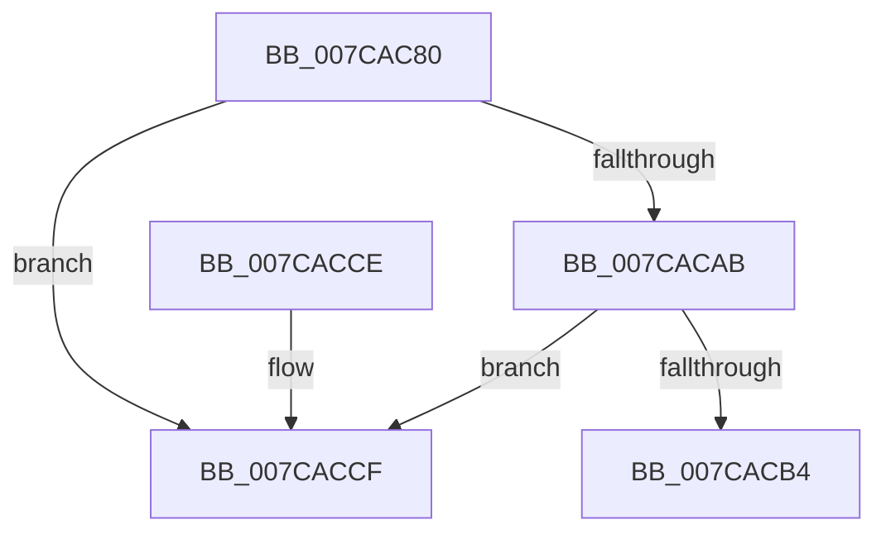

# ExpDeleteCallback

- RVA: `0x007CAC80`–`0x007CACD6` (길이 `86` bytes)
- VA: `0x00000001407CAC80`
- 실행 섹션: `PAGE`
- PDB 이름 있음: `예`; PDB Function 태그: `아니요`
- unwind 정보 RVA: `0x0006CF28`
- 디코드: `25`개 명령, `86/86` bytes 표시
- 미해석 바이트: `0` (있으면 어셈블리에 `.byte`로 보존)

> 이 문서는 커널 이미지의 기계어와 PDB 기호를 분석해 생성했습니다. 4번과 5번은 함수 원형과 자료형을 바이너리 사용 방식에서 추정한 C 해석이며 원본 소스 복구 결과는 아닙니다.

## 1. Dependencies

- 직접 호출 지점: **2**; 고유 호출 대상: **2**
- 직접 호출자로 확인된 함수: **0**
- RIP 상대 이미지 참조: **0**

### Outgoing calls
- `0x007CAC99` → [ExpLockCallbackListExclusive](../../text/4D/ExpLockCallbackListExclusive_function_004D7060.md) (function, `0x004D7060`)
- `0x007CACBE` → [ExpUnlockCallbackListExclusive](../../text/4D/ExpUnlockCallbackListExclusive_function_004D643C.md) (function, `0x004D643C`)

### Direct callers
- 이 함수 시작 RVA로 연결되는 직접 call은 확인되지 않았습니다. 간접 호출은 완전히 역산할 수 없습니다.

### Static image references
- 디코드된 RIP-relative 메모리 참조가 없습니다.

## 2. Other-region calls and transfers

- 다른 실행 섹션으로 향하는 call: **2**
  - `0x007CAC99` → [ExpLockCallbackListExclusive](../../text/4D/ExpLockCallbackListExclusive_function_004D7060.md) (`PAGE` → `.text`)
  - `0x007CACBE` → [ExpUnlockCallbackListExclusive](../../text/4D/ExpUnlockCallbackListExclusive_function_004D643C.md) (`PAGE` → `.text`)
- 별도 외부 분기/꼬리 이동을 확인하지 못했습니다.

## 3. Assembly (complete function range)

```asm
007CAC80  48 89 5C 24 08                  mov qword ptr [rsp + 8], rbx
007CAC85  57                              push rdi
007CAC86  48 83 EC 20                     sub rsp, 0x20
007CAC8A  65 48 8B 3C 25 88 01 00 00      mov rdi, qword ptr gs:[0x188]
007CAC93  48 8B D9                        mov rbx, rcx
007CAC96  48 8B CF                        mov rcx, rdi
007CAC99  E8 C2 C3 D0 FF                  call 0x1404d7060
007CAC9E  48 83 C3 28                     add rbx, 0x28
007CACA2  48 8B 13                        mov rdx, qword ptr [rbx]
007CACA5  48 39 5A 08                     cmp qword ptr [rdx + 8], rbx
007CACA9  75 24                           jne 0x1407caccf
007CACAB  48 8B 43 08                     mov rax, qword ptr [rbx + 8]
007CACAF  48 39 18                        cmp qword ptr [rax], rbx
007CACB2  75 1B                           jne 0x1407caccf
007CACB4  48 89 10                        mov qword ptr [rax], rdx
007CACB7  48 8B CF                        mov rcx, rdi
007CACBA  48 89 42 08                     mov qword ptr [rdx + 8], rax
007CACBE  E8 79 B7 D0 FF                  call 0x1404d643c
007CACC3  48 8B 5C 24 30                  mov rbx, qword ptr [rsp + 0x30]
007CACC8  48 83 C4 20                     add rsp, 0x20
007CACCC  5F                              pop rdi
007CACCD  C3                              ret
007CACCE  CC                              int3
007CACCF  B9 03 00 00 00                  mov ecx, 3
007CACD4  CD 29                           int 0x29
```

## 4. C-style interpretation (structured pseudocode)

```c
__int64 __fastcall ExpDeleteCallback(__int64 a1)
{
    __int64 result;
    __int64 v_rbx;
    __int64 v_rsp;
    unsigned __int64 v_stack_p8;

    v_stack_p8 = v_rbx;
    v_rsp = (v_rsp) - (32);
    result = ExpLockCallbackListExclusive(*(unsigned __int64 *)(gs_base + (0 + 392)), a2, a3, a4);
    v_rbx = (a1) + (40);
    if ((*(unsigned __int64 *)(*(unsigned __int64 *)(v_rbx) + 8)) != v_rbx) goto loc_007CACCF;
    if ((*(unsigned __int64 *)(*(unsigned __int64 *)(v_rbx + 8))) != v_rbx) goto loc_007CACCF;
    *(unsigned __int64 *)(*(unsigned __int64 *)(v_rbx + 8)) = *(unsigned __int64 *)(v_rbx);
    *(unsigned __int64 *)(*(unsigned __int64 *)(v_rbx) + 8) = *(unsigned __int64 *)(v_rbx + 8);
    result = ExpUnlockCallbackListExclusive(*(unsigned __int64 *)(gs_base + (0 + 392)), *(unsigned __int64 *)(v_rbx), a3, a4);
    v_rsp = (v_rsp) + (32);
    return result;
loc_007CACCF:
    return result;
}
```

## 5. (Beta) C Style

```c
int64_t ExpDeleteCallback(void *Arg1)
{
    uint8_t *arg1 = (uint8_t *)Arg1;

    int64_t result;
    int64_t local_rbx;
    int64_t local_rsp;
    uint64_t v_stack_p8;

    v_stack_p8 = local_rbx;
    local_rsp = (local_rsp) - (32);
    result = ExpLockCallbackListExclusive(*(uint64_t *)(gs_base + (0 + 0x188)), a2, a3, a4);
    local_rbx = (Arg1) + (40);
    if ((*(uint64_t *)(*(uint64_t *)(local_rbx) + 0x8)) != local_rbx) goto loc_007CACCF;
    if ((*(uint64_t *)(*(uint64_t *)(local_rbx + 0x8))) != local_rbx) goto loc_007CACCF;
    *(uint64_t *)(*(uint64_t *)(local_rbx + 0x8)) = *(uint64_t *)(local_rbx);
    *(uint64_t *)(*(uint64_t *)(local_rbx) + 0x8) = *(uint64_t *)(local_rbx + 0x8);
    result = ExpUnlockCallbackListExclusive(*(uint64_t *)(gs_base + (0 + 0x188)), *(uint64_t *)(local_rbx), a3, a4);
    local_rsp = (local_rsp) + (32);
    return result;
loc_007CACCF:
    return result;
}
```

### 관측된 메모리 오프셋

구조체 형식이 확인되지 않은 접근은 인자 기준의 오프셋으로만 기록했습니다.

| 기준 인자 | 오프셋 표현 | 폭 (bit) | 접근 |
|---|---:|---:|---|
| `Arg1` | `+ 0x0` | `64` | `R` |
| `Arg1` | `+ 0x8` | `64` | `R` |

## 6. Execution-region graph

[열기: 2D/3D 그래프와 함수 탐색 컨트롤 패널](../../../control-panel.html?section=page&rva=0x007CAC80&view=graph)

- 2D 그래프는 위에서 아래로 흐르고, 3D 그래프는 빈 공간을 드래그해 회전합니다. Shift+드래그는 이동, 휠은 확대·축소, 함수 노드 선택은 대상 보고서 이동입니다.

### Static fallback


