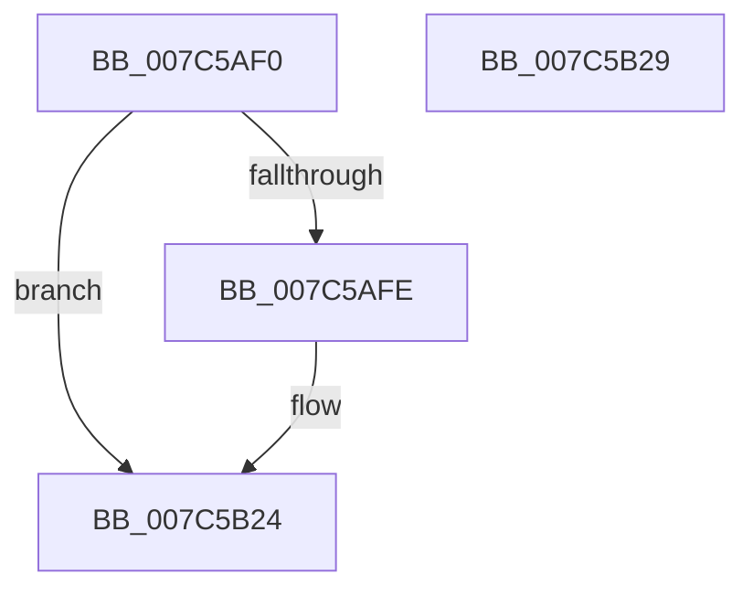

# ExpExpirationThread

- RVA: `0x007C5AF0`–`0x007C5B2A` (길이 `58` bytes)
- VA: `0x00000001407C5AF0`
- 실행 섹션: `PAGE`
- PDB 이름 있음: `예`; PDB Function 태그: `아니요`
- unwind 정보 RVA: `0x0005D2F4`
- 디코드: `16`개 명령, `58/58` bytes 표시
- 미해석 바이트: `0` (있으면 어셈블리에 `.byte`로 보존)

> 이 문서는 커널 이미지의 기계어와 PDB 기호를 분석해 생성했습니다. 4번과 5번은 함수 원형과 자료형을 바이너리 사용 방식에서 추정한 C 해석이며 원본 소스 복구 결과는 아닙니다.

## 1. Dependencies

- 직접 호출 지점: **2**; 고유 호출 대상: **2**
- 직접 호출자로 확인된 함수: **0**
- RIP 상대 이미지 참조: **0**

### Outgoing calls
- `0x007C5B18` → [ExRaiseHardError](../A6/ExRaiseHardError_function_00A64520.md) (function, `0x00A64520`)
- `0x007C5B1F` → [PsTerminateSystemThread](../9B/PsTerminateSystemThread_function_009BCE50.md) (function, `0x009BCE50`)

### Direct callers
- 이 함수 시작 RVA로 연결되는 직접 call은 확인되지 않았습니다. 간접 호출은 완전히 역산할 수 없습니다.

### Static image references
- 디코드된 RIP-relative 메모리 참조가 없습니다.

## 2. Other-region calls and transfers

- 다른 실행 섹션으로 향하는 call: **0**
- 별도 외부 분기/꼬리 이동을 확인하지 못했습니다.

## 3. Assembly (complete function range)

```asm
007C5AF0  48 83 EC 38                     sub rsp, 0x38
007C5AF4  83 64 24 40 00                  and dword ptr [rsp + 0x40], 0
007C5AF9  48 85 C9                        test rcx, rcx
007C5AFC  74 26                           je 0x1407c5b24
007C5AFE  48 8D 44 24 40                  lea rax, [rsp + 0x40]
007C5B03  45 33 C9                        xor r9d, r9d
007C5B06  48 89 44 24 28                  mov qword ptr [rsp + 0x28], rax
007C5B0B  45 33 C0                        xor r8d, r8d
007C5B0E  33 D2                           xor edx, edx
007C5B10  C7 44 24 20 01 00 00 00         mov dword ptr [rsp + 0x20], 1
007C5B18  E8 03 EA 29 00                  call 0x140a64520
007C5B1D  8B C8                           mov ecx, eax
007C5B1F  E8 2C 73 1F 00                  call 0x1409bce50
007C5B24  48 83 C4 38                     add rsp, 0x38
007C5B28  C3                              ret
007C5B29  CC                              int3
```

## 4. C-style interpretation (structured pseudocode)

```c
__int64 __fastcall ExpExpirationThread(__int64 a1, int a2, int a3, int a4)
{
    __int64 result;
    __int64 v_rsp;
    unsigned __int64 v_stack_m10;
    unsigned int v_stack_m18;
    unsigned int v_stack_p8;

    v_rsp = (v_rsp) - (56);
    if (a1 != 0) {
        result = v_stack_p8;
        a4 = 0;
        v_stack_m10 = result;
        a3 = 0;
        a2 = 0;
        v_stack_m18 = 1;
        result = ExRaiseHardError(a1, a2, a3, a4);
        a1 = (unsigned int)(result);
        result = PsTerminateSystemThread(a1, a2, a3, a4);
    }
    v_rsp = (v_rsp) + (56);
    return result;
}
```

## 5. (Beta) C Style

```c
int64_t ExpExpirationThread(int64_t Arg1, int32_t Arg2, int32_t Arg3, int32_t Arg4)
{
    int64_t result;
    int64_t local_rsp;
    uint64_t v_stack_m10;
    uint32_t v_stack_m18;
    uint32_t v_stack_p8;

    local_rsp = (local_rsp) - (56);
    if (Arg1 != 0) {
        result = v_stack_p8;
        Arg4 = 0;
        v_stack_m10 = result;
        Arg3 = 0;
        Arg2 = 0;
        v_stack_m18 = 1;
        result = ExRaiseHardError(Arg1, Arg2, Arg3, Arg4);
        Arg1 = (uint32_t)(result);
        result = PsTerminateSystemThread(Arg1, Arg2, Arg3, Arg4);
    }
    local_rsp = (local_rsp) + (56);
    return result;
}
```

## 6. Execution-region graph

[열기: 2D/3D 그래프와 함수 탐색 컨트롤 패널](../../../control-panel.html?section=page&rva=0x007C5AF0&view=graph)

- 2D 그래프는 위에서 아래로 흐르고, 3D 그래프는 빈 공간을 드래그해 회전합니다. Shift+드래그는 이동, 휠은 확대·축소, 함수 노드 선택은 대상 보고서 이동입니다.

### Static fallback


