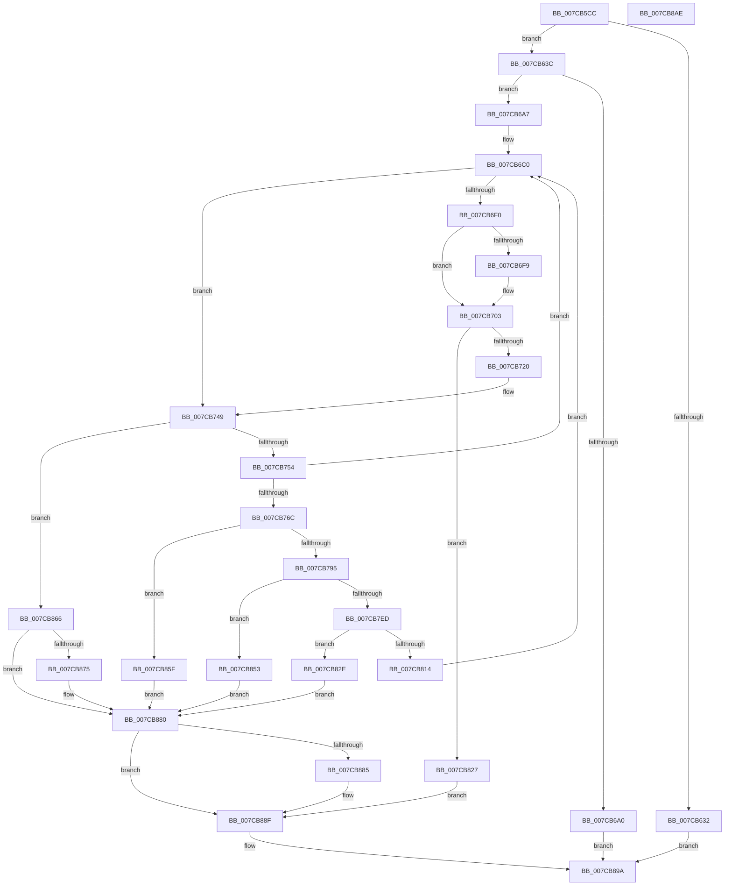

# ExpFindArcName

- RVA: `0x007CB5CC`–`0x007CB8AF` (길이 `739` bytes)
- VA: `0x00000001407CB5CC`
- 실행 섹션: `PAGE`
- PDB 이름 있음: `예`; PDB Function 태그: `아니요`
- unwind 정보 RVA: `0x000D5114`
- 디코드: `208`개 명령, `739/739` bytes 표시
- 미해석 바이트: `0` (있으면 어셈블리에 `.byte`로 보존)

> 이 문서는 커널 이미지의 기계어와 PDB 기호를 분석해 생성했습니다. 4번과 5번은 함수 원형과 자료형을 바이너리 사용 방식에서 추정한 C 해석이며 원본 소스 복구 결과는 아닙니다.

## 1. Dependencies

- 직접 호출 지점: **22**; 고유 호출 대상: **11**
- 직접 호출자로 확인된 함수: **1**
- RIP 상대 이미지 참조: **3**

### Outgoing calls
- `0x007CB625` → [ExAllocatePool2](../../poolcode/B8/ExAllocatePool2_function_00B820F0.md) (function, `0x00B820F0`)
- `0x007CB64B` → [wcscpy_s](../../text/50/wcscpy_s_function_005064B0.md) (function, `0x005064B0`)
- `0x007CB657` → [RtlInitUnicodeString](../../text/42/RtlInitUnicodeString_function_0042A780.md) (function, `0x0042A780`)
- `0x007CB68B` → [ZwOpenDirectoryObject](../../text/6A/ZwOpenDirectoryObject_function_006ADBD0.md) (function, `0x006ADBD0`)
- `0x007CB697` → [ExFreePoolWithTag](../../poolcode/B8/ExFreePoolWithTag_function_00B82870.md) (function, `0x00B82870`)
- `0x007CB6BB` → [RtlInitUnicodeString](../../text/42/RtlInitUnicodeString_function_0042A780.md) (function, `0x0042A780`)
- `0x007CB6E4` → [ZwQueryDirectoryObject](../../text/6A/ZwQueryDirectoryObject_function_006AFAB0.md) (function, `0x006AFAB0`)
- `0x007CB6FE` → [ExFreePoolWithTag](../../poolcode/B8/ExFreePoolWithTag_function_00B82870.md) (function, `0x00B82870`)
- `0x007CB70F` → [ExAllocatePool2](../../poolcode/B8/ExAllocatePool2_function_00B820F0.md) (function, `0x00B820F0`)
- `0x007CB744` → [ZwQueryDirectoryObject](../../text/6A/ZwQueryDirectoryObject_function_006AFAB0.md) (function, `0x006AFAB0`)
- `0x007CB75F` → [RtlEqualUnicodeString](../93/RtlEqualUnicodeString_function_00932A20.md) (function, `0x00932A20`)
- `0x007CB784` → [ExAllocatePool2](../../poolcode/B8/ExAllocatePool2_function_00B820F0.md) (function, `0x00B820F0`)
- `0x007CB7AD` → [wcscpy_s](../../text/50/wcscpy_s_function_005064B0.md) (function, `0x005064B0`)
- `0x007CB7C8` → [wcsncat_s](../../text/50/wcsncat_s_function_00506540.md) (function, `0x00506540`)
- `0x007CB7E2` → [ExpTranslateSymbolicLink](../A7/ExpTranslateSymbolicLink_function_00A7B38C.md) (function, `0x00A7B38C`)
- `0x007CB7F8` → [RtlEqualUnicodeString](../93/RtlEqualUnicodeString_function_00932A20.md) (function, `0x00932A20`)
- `0x007CB806` → [ExFreePoolWithTag](../../poolcode/B8/ExFreePoolWithTag_function_00B82870.md) (function, `0x00B82870`)
- `0x007CB816` → [ExFreePoolWithTag](../../poolcode/B8/ExFreePoolWithTag_function_00B82870.md) (function, `0x00B82870`)
- `0x007CB83E` → [wcsncpy_s](../../text/50/wcsncpy_s_function_00506650.md) (function, `0x00506650`)
- `0x007CB858` → [ExFreePoolWithTag](../../poolcode/B8/ExFreePoolWithTag_function_00B82870.md) (function, `0x00B82870`)
- `0x007CB88A` → [ExFreePoolWithTag](../../poolcode/B8/ExFreePoolWithTag_function_00B82870.md) (function, `0x00B82870`)
- `0x007CB893` → [ZwClose](../../text/6A/ZwClose_function_006AD2B0.md) (function, `0x006AD2B0`)

### Direct callers
- [ExpCreateOutputARC](ExpCreateOutputARC_function_007CB30C.md) at `0x007CB33F`

### Static image references
- `0x007CB63C` → RVA `0x00B08850` (` ?? ::NNGAKEGL::`string'`; read)
- `0x007CB6A7` → RVA `0x00B06100` (` ?? ::NNGAKEGL::`string'`; read)
- `0x007CB798` → RVA `0x00B08870` (` ?? ::NNGAKEGL::`string'`; read)

## 2. Other-region calls and transfers

- 다른 실행 섹션으로 향하는 call: **19**
  - `0x007CB625` → [ExAllocatePool2](../../poolcode/B8/ExAllocatePool2_function_00B820F0.md) (`PAGE` → `POOLCODE`)
  - `0x007CB64B` → [wcscpy_s](../../text/50/wcscpy_s_function_005064B0.md) (`PAGE` → `.text`)
  - `0x007CB657` → [RtlInitUnicodeString](../../text/42/RtlInitUnicodeString_function_0042A780.md) (`PAGE` → `.text`)
  - `0x007CB68B` → [ZwOpenDirectoryObject](../../text/6A/ZwOpenDirectoryObject_function_006ADBD0.md) (`PAGE` → `.text`)
  - `0x007CB697` → [ExFreePoolWithTag](../../poolcode/B8/ExFreePoolWithTag_function_00B82870.md) (`PAGE` → `POOLCODE`)
  - `0x007CB6BB` → [RtlInitUnicodeString](../../text/42/RtlInitUnicodeString_function_0042A780.md) (`PAGE` → `.text`)
  - `0x007CB6E4` → [ZwQueryDirectoryObject](../../text/6A/ZwQueryDirectoryObject_function_006AFAB0.md) (`PAGE` → `.text`)
  - `0x007CB6FE` → [ExFreePoolWithTag](../../poolcode/B8/ExFreePoolWithTag_function_00B82870.md) (`PAGE` → `POOLCODE`)
  - `0x007CB70F` → [ExAllocatePool2](../../poolcode/B8/ExAllocatePool2_function_00B820F0.md) (`PAGE` → `POOLCODE`)
  - `0x007CB744` → [ZwQueryDirectoryObject](../../text/6A/ZwQueryDirectoryObject_function_006AFAB0.md) (`PAGE` → `.text`)
  - `0x007CB784` → [ExAllocatePool2](../../poolcode/B8/ExAllocatePool2_function_00B820F0.md) (`PAGE` → `POOLCODE`)
  - `0x007CB7AD` → [wcscpy_s](../../text/50/wcscpy_s_function_005064B0.md) (`PAGE` → `.text`)
  - `0x007CB7C8` → [wcsncat_s](../../text/50/wcsncat_s_function_00506540.md) (`PAGE` → `.text`)
  - `0x007CB806` → [ExFreePoolWithTag](../../poolcode/B8/ExFreePoolWithTag_function_00B82870.md) (`PAGE` → `POOLCODE`)
  - `0x007CB816` → [ExFreePoolWithTag](../../poolcode/B8/ExFreePoolWithTag_function_00B82870.md) (`PAGE` → `POOLCODE`)
  - `0x007CB83E` → [wcsncpy_s](../../text/50/wcsncpy_s_function_00506650.md) (`PAGE` → `.text`)
  - `0x007CB858` → [ExFreePoolWithTag](../../poolcode/B8/ExFreePoolWithTag_function_00B82870.md) (`PAGE` → `POOLCODE`)
  - `0x007CB88A` → [ExFreePoolWithTag](../../poolcode/B8/ExFreePoolWithTag_function_00B82870.md) (`PAGE` → `POOLCODE`)
  - `0x007CB893` → [ZwClose](../../text/6A/ZwClose_function_006AD2B0.md) (`PAGE` → `.text`)
- 별도 외부 분기/꼬리 이동을 확인하지 못했습니다.

## 3. Assembly (complete function range)

```asm
007CB5CC  48 89 54 24 10                  mov qword ptr [rsp + 0x10], rdx
007CB5D1  48 89 4C 24 08                  mov qword ptr [rsp + 8], rcx
007CB5D6  55                              push rbp
007CB5D7  53                              push rbx
007CB5D8  56                              push rsi
007CB5D9  57                              push rdi
007CB5DA  41 54                           push r12
007CB5DC  41 55                           push r13
007CB5DE  41 56                           push r14
007CB5E0  41 57                           push r15
007CB5E2  48 8D 6C 24 E1                  lea rbp, [rsp - 0x1f]
007CB5E7  48 81 EC A8 00 00 00            sub rsp, 0xa8
007CB5EE  45 33 ED                        xor r13d, r13d
007CB5F1  0F 57 C0                        xorps xmm0, xmm0
007CB5F4  0F 57 C9                        xorps xmm1, xmm1
007CB5F7  44 89 6D EB                     mov dword ptr [rbp - 0x15], r13d
007CB5FB  41 B8 45 6E 76 72               mov r8d, 0x72766e45
007CB601  44 89 6D 03                     mov dword ptr [rbp + 3], r13d
007CB605  0F 11 45 C7                     movups xmmword ptr [rbp - 0x39], xmm0
007CB609  41 8D 55 12                     lea edx, [r13 + 0x12]
007CB60D  4C 89 6D BF                     mov qword ptr [rbp - 0x41], r13
007CB611  8D 72 2E                        lea esi, [rdx + 0x2e]
007CB614  44 89 6D 77                     mov dword ptr [rbp + 0x77], r13d
007CB618  8B CE                           mov ecx, esi
007CB61A  44 89 6D 7F                     mov dword ptr [rbp + 0x7f], r13d
007CB61E  0F 11 4D D7                     movups xmmword ptr [rbp - 0x29], xmm1
007CB622  45 8A E5                        mov r12b, r13b
007CB625  E8 C6 6A 3B 00                  call 0x140b820f0
007CB62A  48 8B D8                        mov rbx, rax
007CB62D  48 85 C0                        test rax, rax
007CB630  75 0A                           jne 0x1407cb63c
007CB632  B8 9A 00 00 C0                  mov eax, 0xc000009a
007CB637  E9 5E 02 00 00                  jmp 0x1407cb89a
007CB63C  4C 8D 05 0D D2 33 00            lea r8, [rip + 0x33d20d]
007CB643  BA 09 00 00 00                  mov edx, 9
007CB648  48 8B CB                        mov rcx, rbx
007CB64B  E8 60 AE D3 FF                  call 0x1405064b0
007CB650  48 8B D3                        mov rdx, rbx
007CB653  48 8D 4D C7                     lea rcx, [rbp - 0x39]
007CB657  E8 24 F1 C5 FF                  call 0x14042a780
007CB65C  48 8D 45 C7                     lea rax, [rbp - 0x39]
007CB660  C7 45 E7 30 00 00 00            mov dword ptr [rbp - 0x19], 0x30
007CB667  0F 57 C0                        xorps xmm0, xmm0
007CB66A  48 89 45 F7                     mov qword ptr [rbp - 9], rax
007CB66E  4C 8D 45 E7                     lea r8, [rbp - 0x19]
007CB672  4C 89 6D EF                     mov qword ptr [rbp - 0x11], r13
007CB676  BA 01 00 00 00                  mov edx, 1
007CB67B  C7 45 FF 40 02 00 00            mov dword ptr [rbp - 1], 0x240
007CB682  48 8D 4D BF                     lea rcx, [rbp - 0x41]
007CB686  F3 0F 7F 45 07                  movdqu xmmword ptr [rbp + 7], xmm0
007CB68B  E8 40 25 EE FF                  call 0x1406adbd0
007CB690  33 D2                           xor edx, edx
007CB692  48 8B CB                        mov rcx, rbx
007CB695  8B F8                           mov edi, eax
007CB697  E8 D4 71 3B 00                  call 0x140b82870
007CB69C  85 FF                           test edi, edi
007CB69E  79 07                           jns 0x1407cb6a7
007CB6A0  8B C7                           mov eax, edi
007CB6A2  E9 F3 01 00 00                  jmp 0x1407cb89a
007CB6A7  48 8D 15 52 AA 33 00            lea rdx, [rip + 0x33aa52]
007CB6AE  49 8B FD                        mov rdi, r13
007CB6B1  48 8D 4D D7                     lea rcx, [rbp - 0x29]
007CB6B5  45 8B F5                        mov r14d, r13d
007CB6B8  41 B7 01                        mov r15b, 1
007CB6BB  E8 C0 F0 C5 FF                  call 0x14042a780
007CB6C0  48 8B 4D BF                     mov rcx, qword ptr [rbp - 0x41]
007CB6C4  48 8D 45 77                     lea rax, [rbp + 0x77]
007CB6C8  48 89 44 24 30                  mov qword ptr [rsp + 0x30], rax
007CB6CD  41 B1 01                        mov r9b, 1
007CB6D0  48 8D 45 7F                     lea rax, [rbp + 0x7f]
007CB6D4  45 8B C6                        mov r8d, r14d
007CB6D7  48 89 44 24 28                  mov qword ptr [rsp + 0x28], rax
007CB6DC  48 8B D7                        mov rdx, rdi
007CB6DF  44 88 7C 24 20                  mov byte ptr [rsp + 0x20], r15b
007CB6E4  E8 C7 43 EE FF                  call 0x1406afab0
007CB6E9  3D 23 00 00 C0                  cmp eax, 0xc0000023
007CB6EE  75 59                           jne 0x1407cb749
007CB6F0  44 8B 75 77                     mov r14d, dword ptr [rbp + 0x77]
007CB6F4  48 85 FF                        test rdi, rdi
007CB6F7  74 0A                           je 0x1407cb703
007CB6F9  33 D2                           xor edx, edx
007CB6FB  48 8B CF                        mov rcx, rdi
007CB6FE  E8 6D 71 3B 00                  call 0x140b82870
007CB703  49 8B D6                        mov rdx, r14
007CB706  41 B8 45 6E 76 72               mov r8d, 0x72766e45
007CB70C  48 8B CE                        mov rcx, rsi
007CB70F  E8 DC 69 3B 00                  call 0x140b820f0
007CB714  48 8B F8                        mov rdi, rax
007CB717  48 85 C0                        test rax, rax
007CB71A  0F 84 07 01 00 00               je 0x1407cb827
007CB720  48 8B 4D BF                     mov rcx, qword ptr [rbp - 0x41]
007CB724  48 8D 45 77                     lea rax, [rbp + 0x77]
007CB728  48 89 44 24 30                  mov qword ptr [rsp + 0x30], rax
007CB72D  41 B1 01                        mov r9b, 1
007CB730  48 8D 45 7F                     lea rax, [rbp + 0x7f]
007CB734  45 8B C6                        mov r8d, r14d
007CB737  48 89 44 24 28                  mov qword ptr [rsp + 0x28], rax
007CB73C  48 8B D7                        mov rdx, rdi
007CB73F  44 88 7C 24 20                  mov byte ptr [rsp + 0x20], r15b
007CB744  E8 67 43 EE FF                  call 0x1406afab0
007CB749  45 8A FD                        mov r15b, r13b
007CB74C  85 C0                           test eax, eax
007CB74E  0F 88 12 01 00 00               js 0x1407cb866
007CB754  48 8D 4F 10                     lea rcx, [rdi + 0x10]
007CB758  45 33 C0                        xor r8d, r8d
007CB75B  48 8D 55 D7                     lea rdx, [rbp - 0x29]
007CB75F  E8 BC 72 16 00                  call 0x140932a20
007CB764  84 C0                           test al, al
007CB766  0F 84 54 FF FF FF               je 0x1407cb6c0
007CB76C  0F B7 07                        movzx eax, word ptr [rdi]
007CB76F  41 B8 45 6E 76 72               mov r8d, 0x72766e45
007CB775  83 C0 12                        add eax, 0x12
007CB778  48 8B CE                        mov rcx, rsi
007CB77B  8B D0                           mov edx, eax
007CB77D  48 83 C2 02                     add rdx, 2
007CB781  89 45 77                        mov dword ptr [rbp + 0x77], eax
007CB784  E8 67 69 3B 00                  call 0x140b820f0
007CB789  48 8B F0                        mov rsi, rax
007CB78C  48 85 C0                        test rax, rax
007CB78F  0F 84 CA 00 00 00               je 0x1407cb85f
007CB795  8B 55 77                        mov edx, dword ptr [rbp + 0x77]
007CB798  4C 8D 05 D1 D0 33 00            lea r8, [rip + 0x33d0d1]
007CB79F  0F B7 1F                        movzx ebx, word ptr [rdi]
007CB7A2  48 8B C8                        mov rcx, rax
007CB7A5  48 D1 EA                        shr rdx, 1
007CB7A8  48 FF C2                        inc rdx
007CB7AB  D1 EB                           shr ebx, 1
007CB7AD  E8 FE AC D3 FF                  call 0x1405064b0
007CB7B2  8B 55 77                        mov edx, dword ptr [rbp + 0x77]
007CB7B5  48 8B CE                        mov rcx, rsi
007CB7B8  4C 8B 47 08                     mov r8, qword ptr [rdi + 8]
007CB7BC  48 D1 EA                        shr rdx, 1
007CB7BF  48 FF C2                        inc rdx
007CB7C2  44 8B CB                        mov r9d, ebx
007CB7C5  44 8B EB                        mov r13d, ebx
007CB7C8  E8 73 AD D3 FF                  call 0x140506540
007CB7CD  8B 45 77                        mov eax, dword ptr [rbp + 0x77]
007CB7D0  48 8D 55 C7                     lea rdx, [rbp - 0x39]
007CB7D4  48 D1 E8                        shr rax, 1
007CB7D7  45 33 E4                        xor r12d, r12d
007CB7DA  48 8B CE                        mov rcx, rsi
007CB7DD  66 44 89 24 46                  mov word ptr [rsi + rax*2], r12w
007CB7E2  E8 A5 FB 2A 00                  call 0x140a7b38c
007CB7E7  8B D8                           mov ebx, eax
007CB7E9  85 C0                           test eax, eax
007CB7EB  78 66                           js 0x1407cb853
007CB7ED  48 8B 55 67                     mov rdx, qword ptr [rbp + 0x67]
007CB7F1  48 8D 4D C7                     lea rcx, [rbp - 0x39]
007CB7F5  41 B0 01                        mov r8b, 1
007CB7F8  E8 23 72 16 00                  call 0x140932a20
007CB7FD  48 8B 4D CF                     mov rcx, qword ptr [rbp - 0x31]
007CB801  33 D2                           xor edx, edx
007CB803  44 8A E0                        mov r12b, al
007CB806  E8 65 70 3B 00                  call 0x140b82870
007CB80B  48 8B CE                        mov rcx, rsi
007CB80E  41 80 FC 01                     cmp r12b, 1
007CB812  74 1A                           je 0x1407cb82e
007CB814  33 D2                           xor edx, edx
007CB816  E8 55 70 3B 00                  call 0x140b82870
007CB81B  45 33 ED                        xor r13d, r13d
007CB81E  41 8D 75 40                     lea esi, [r13 + 0x40]
007CB822  E9 99 FE FF FF                  jmp 0x1407cb6c0
007CB827  BB 9A 00 00 C0                  mov ebx, 0xc000009a
007CB82C  EB 61                           jmp 0x1407cb88f
007CB82E  8B 55 77                        mov edx, dword ptr [rbp + 0x77]
007CB831  4D 8B CD                        mov r9, r13
007CB834  4C 8B 47 08                     mov r8, qword ptr [rdi + 8]
007CB838  48 D1 EA                        shr rdx, 1
007CB83B  48 FF C2                        inc rdx
007CB83E  E8 0D AE D3 FF                  call 0x140506650
007CB843  33 C0                           xor eax, eax
007CB845  66 42 89 04 6E                  mov word ptr [rsi + r13*2], ax
007CB84A  48 8B 45 6F                     mov rax, qword ptr [rbp + 0x6f]
007CB84E  48 89 30                        mov qword ptr [rax], rsi
007CB851  EB 2D                           jmp 0x1407cb880
007CB853  33 D2                           xor edx, edx
007CB855  48 8B CE                        mov rcx, rsi
007CB858  E8 13 70 3B 00                  call 0x140b82870
007CB85D  EB 21                           jmp 0x1407cb880
007CB85F  BB 9A 00 00 C0                  mov ebx, 0xc000009a
007CB864  EB 1A                           jmp 0x1407cb880
007CB866  3D 1A 00 00 80                  cmp eax, 0x8000001a
007CB86B  41 8B DD                        mov ebx, r13d
007CB86E  0F 45 D8                        cmovne ebx, eax
007CB871  85 DB                           test ebx, ebx
007CB873  78 0B                           js 0x1407cb880
007CB875  45 84 E4                        test r12b, r12b
007CB878  B8 3A 00 00 C0                  mov eax, 0xc000003a
007CB87D  0F 44 D8                        cmove ebx, eax
007CB880  48 85 FF                        test rdi, rdi
007CB883  74 0A                           je 0x1407cb88f
007CB885  33 D2                           xor edx, edx
007CB887  48 8B CF                        mov rcx, rdi
007CB88A  E8 E1 6F 3B 00                  call 0x140b82870
007CB88F  48 8B 4D BF                     mov rcx, qword ptr [rbp - 0x41]
007CB893  E8 18 1A EE FF                  call 0x1406ad2b0
007CB898  8B C3                           mov eax, ebx
007CB89A  48 81 C4 A8 00 00 00            add rsp, 0xa8
007CB8A1  41 5F                           pop r15
007CB8A3  41 5E                           pop r14
007CB8A5  41 5D                           pop r13
007CB8A7  41 5C                           pop r12
007CB8A9  5F                              pop rdi
007CB8AA  5E                              pop rsi
007CB8AB  5B                              pop rbx
007CB8AC  5D                              pop rbp
007CB8AD  C3                              ret
007CB8AE  CC                              int3
```

## 4. C-style interpretation (structured pseudocode)

```c
__int64 __fastcall ExpFindArcName(__int64 a1, __int64 a2)
{
    __int64 result;
    __int64 v_r12;
    __int64 v_r13;
    __int64 v_rbx;
    __int64 v_rsp;
    unsigned __int64 v_stack_m58;
    unsigned int v_stack_m5C;
    unsigned __int64 v_stack_m5F;
    unsigned int v_stack_m60;
    unsigned __int64 v_stack_m68;
    unsigned __int64 v_stack_m70;
    unsigned int v_stack_m74;
    unsigned int v_stack_m78;
    unsigned __int64 v_stack_m88;
    unsigned __int64 v_stack_m90;
    unsigned __int64 v_stack_m98;
    unsigned __int64 v_stack_mA0;
    unsigned __int64 v_stack_mB8;
    unsigned __int64 v_stack_mC0;
    unsigned __int8 v_stack_mC8;
    unsigned __int64 v_stack_p10;
    unsigned int v_stack_p18;
    unsigned int v_stack_p20;
    unsigned __int64 v_stack_p8;

    v_stack_p10 = a2;
    v_stack_p8 = a1;
    v_rsp = (v_rsp) - (168);
    v_r13 = 0;
    v_stack_m74 = 0;
    v_stack_m5C = 0;
    v_stack_m98 = v_xmm0;
    v_stack_mA0 = 0;
    v_stack_p18 = 0;
    v_stack_p20 = 0;
    v_stack_m88 = v_xmm1;
    result = ExAllocatePool2((unsigned int)((unsigned int)(v_r13 + 18 + 46)), v_r13 + 18, (unsigned int)(0x72766E45ULL), a4);
    if (result != 0) goto loc_007CB63C;
    goto loc_007CB89A;
loc_007CB63C:
    result = wcscpy_s(result, 9, v_rip + 3396109, a4);
    result = RtlInitUnicodeString(v_stack_m98, result, v_rip + 3396109, a4);
    v_stack_m78 = 48;
    v_stack_m68 = v_stack_m98;
    v_stack_m70 = 0;
    v_stack_m60 = 576;
    v_stack_m58 = v_xmm0;
    result = ZwOpenDirectoryObject(v_stack_mA0, 1, v_stack_m78, a4);
    a2 = 0;
    result = ExFreePoolWithTag(result, a2, v_stack_m78, a4);
    if (!sign_flag) goto loc_007CB6A7;
    goto loc_007CB89A;
loc_007CB6A7:
    result = RtlInitUnicodeString(v_stack_m88, v_rip + 3385938, v_stack_m78, a4);
loc_007CB6C0:
    v_stack_mB8 = v_stack_p18;
    v_stack_mC0 = v_stack_p20;
    v_stack_mC8 = 1;
    result = ZwQueryDirectoryObject(v_stack_mA0, 0, 0, 1);
    if (((unsigned int)(result)) != 0xC0000023ULL) goto loc_007CB749;
    if (0 != 0) {
        a2 = 0;
        a1 = 0;
        result = ExFreePoolWithTag(a1, a2, 0, 1);
    }
    result = ExAllocatePool2(v_r13 + 18 + 46, (unsigned int)(v_stack_p18), (unsigned int)(0x72766E45ULL), 1);
    if (result == 0) goto loc_007CB827;
    v_stack_mB8 = v_stack_p18;
    v_stack_mC0 = v_stack_p20;
    v_stack_mC8 = 1;
    result = ZwQueryDirectoryObject(v_stack_mA0, result, (unsigned int)((unsigned int)((unsigned int)(v_stack_p18))), 1);
loc_007CB749:
    if (sign_flag) goto loc_007CB866;
    a3 = 0;
    result = RtlEqualUnicodeString(result + 16, v_stack_m88, a3, 1);
    if ((unsigned __int8)(result) == 0) goto loc_007CB6C0;
    result = (unsigned int)((*(unsigned __int16 *)(result)) + (18));
    a2 = ((unsigned int)((unsigned int)(result))) + (2);
    v_stack_p18 = (unsigned int)(result);
    result = ExAllocatePool2(v_r13 + 18 + 46, a2, (unsigned int)(0x72766E45ULL), 1);
    if (result == 0) goto loc_007CB85F;
    a2 = ((unsigned int)(v_stack_p18)) >> (1);
    a2 = (a2) + 1;
    v_rbx = (unsigned int)((*(unsigned __int16 *)(result)) >> (1));
    result = wcscpy_s(result, a2, v_rip + 3395793, 1);
    a2 = ((unsigned int)(v_stack_p18)) >> (1);
    a2 = (a2) + 1;
    result = wcsncat_s(result, a2, *(unsigned __int64 *)(result + 8), (unsigned int)((unsigned int)(v_rbx)));
    result = ((unsigned int)(v_stack_p18)) >> (1);
    v_r12 = 0;
    *(unsigned __int16 *)(result + result * 2) = 0;
    result = ExpTranslateSymbolicLink(result, v_stack_m98, *(unsigned __int64 *)(result + 8), (unsigned int)((unsigned int)(v_rbx)));
    if (sign_flag) goto loc_007CB853;
    result = RtlEqualUnicodeString(v_stack_m98, v_stack_p8, 1, (unsigned int)((unsigned int)(v_rbx)));
    a2 = 0;
    result = ExFreePoolWithTag(v_stack_m90, a2, 1, (unsigned int)((unsigned int)(v_rbx)));
    if (((unsigned __int8)((unsigned __int8)(result))) == 1) goto loc_007CB82E;
    a2 = 0;
    result = ExFreePoolWithTag(result, a2, 1, (unsigned int)((unsigned int)(v_rbx)));
    v_r13 = 0;
    goto loc_007CB6C0;
loc_007CB827:
    goto loc_007CB88F;
loc_007CB82E:
    a2 = ((unsigned int)(v_stack_p18)) >> (1);
    a2 = (a2) + 1;
    result = wcsncpy_s(result, a2, *(unsigned __int64 *)(result + 8), 0);
    result = 0;
    *(unsigned __int16 *)(v_r13 + 64 + v_r13 * 2) = 0;
    *(unsigned __int64 *)(v_stack_p10) = v_r13 + 64;
    goto loc_007CB880;
loc_007CB853:
    a2 = 0;
    result = ExFreePoolWithTag(v_r13 + 64, a2, *(unsigned __int64 *)(result + 8), 0);
    goto loc_007CB880;
loc_007CB85F:
    goto loc_007CB880;
loc_007CB866:
    v_rbx = 0;
    if (((unsigned int)(result)) != 0x8000001AULL) { v_rbx = (unsigned int)(result); }
    if (!(sign_flag)) {
        result = 0xC000003AULL;
        if ((unsigned __int8)((unsigned __int8)(result)) == 0) { v_rbx = (unsigned int)(result); }
    }
    if (result != 0) {
        a2 = 0;
        a1 = result;
        result = ExFreePoolWithTag(a1, a2, *(unsigned __int64 *)(result + 8), 0);
    }
    result = ZwClose(v_stack_mA0, a2, *(unsigned __int64 *)(result + 8), 0);
loc_007CB89A:
    v_rsp = (v_rsp) + (168);
    return (unsigned int)((unsigned int)(v_rbx));
}
```

## 5. (Beta) C Style

```c
int64_t ExpFindArcName(int64_t Arg1, int64_t Arg2)
{
    int64_t result;
    int64_t local_r12;
    int64_t local_r13;
    int64_t local_rbx;
    int64_t local_rsp;
    uint64_t v_stack_m58;
    uint32_t v_stack_m5C;
    uint64_t v_stack_m5F;
    uint32_t v_stack_m60;
    uint64_t v_stack_m68;
    uint64_t v_stack_m70;
    uint32_t v_stack_m74;
    uint32_t v_stack_m78;
    uint64_t v_stack_m88;
    uint64_t v_stack_m90;
    uint64_t v_stack_m98;
    uint64_t v_stack_mA0;
    uint64_t v_stack_mB8;
    uint64_t v_stack_mC0;
    uint8_t v_stack_mC8;
    uint64_t v_stack_p10;
    uint32_t v_stack_p18;
    uint32_t v_stack_p20;
    uint64_t v_stack_p8;

    v_stack_p10 = Arg2;
    v_stack_p8 = Arg1;
    local_rsp = (local_rsp) - (168);
    local_r13 = 0;
    v_stack_m74 = 0;
    v_stack_m5C = 0;
    v_stack_m98 = v_xmm0;
    v_stack_mA0 = 0;
    v_stack_p18 = 0;
    v_stack_p20 = 0;
    v_stack_m88 = v_xmm1;
    result = ExAllocatePool2((uint32_t)((uint32_t)(local_r13 + 18 + 46)), local_r13 + 18, (uint32_t)(0x72766E45ULL), a4);
    if (result != 0) goto loc_007CB63C;
    goto loc_007CB89A;
loc_007CB63C:
    result = wcscpy_s(result, 9, v_rip + 3396109, a4);
    result = RtlInitUnicodeString(v_stack_m98, result, v_rip + 3396109, a4);
    v_stack_m78 = 48;
    v_stack_m68 = v_stack_m98;
    v_stack_m70 = 0;
    v_stack_m60 = 576;
    v_stack_m58 = v_xmm0;
    result = ZwOpenDirectoryObject(v_stack_mA0, 1, v_stack_m78, a4);
    Arg2 = 0;
    result = ExFreePoolWithTag(result, Arg2, v_stack_m78, a4);
    if (!sign_flag) goto loc_007CB6A7;
    goto loc_007CB89A;
loc_007CB6A7:
    result = RtlInitUnicodeString(v_stack_m88, v_rip + 3385938, v_stack_m78, a4);
loc_007CB6C0:
    v_stack_mB8 = v_stack_p18;
    v_stack_mC0 = v_stack_p20;
    v_stack_mC8 = 1;
    result = ZwQueryDirectoryObject(v_stack_mA0, 0, 0, 1);
    if (((uint32_t)(result)) != 0xC0000023ULL) goto loc_007CB749;
    if (0 != 0) {
        Arg2 = 0;
        Arg1 = 0;
        result = ExFreePoolWithTag(Arg1, Arg2, 0, 1);
    }
    result = ExAllocatePool2(local_r13 + 18 + 46, (uint32_t)(v_stack_p18), (uint32_t)(0x72766E45ULL), 1);
    if (result == 0) goto loc_007CB827;
    v_stack_mB8 = v_stack_p18;
    v_stack_mC0 = v_stack_p20;
    v_stack_mC8 = 1;
    result = ZwQueryDirectoryObject(v_stack_mA0, result, (uint32_t)((uint32_t)((uint32_t)(v_stack_p18))), 1);
loc_007CB749:
    if (sign_flag) goto loc_007CB866;
    a3 = 0;
    result = RtlEqualUnicodeString(result + 16, v_stack_m88, a3, 1);
    if ((uint8_t)(result) == 0) goto loc_007CB6C0;
    result = (uint32_t)((*(uint16_t *)(result)) + (18));
    Arg2 = ((uint32_t)((uint32_t)(result))) + (2);
    v_stack_p18 = (uint32_t)(result);
    result = ExAllocatePool2(local_r13 + 18 + 46, Arg2, (uint32_t)(0x72766E45ULL), 1);
    if (result == 0) goto loc_007CB85F;
    Arg2 = ((uint32_t)(v_stack_p18)) >> (1);
    Arg2 = (Arg2) + 1;
    local_rbx = (uint32_t)((*(uint16_t *)(result)) >> (1));
    result = wcscpy_s(result, Arg2, v_rip + 3395793, 1);
    Arg2 = ((uint32_t)(v_stack_p18)) >> (1);
    Arg2 = (Arg2) + 1;
    result = wcsncat_s(result, Arg2, *(uint64_t *)(result + 0x8), (uint32_t)((uint32_t)(local_rbx)));
    result = ((uint32_t)(v_stack_p18)) >> (1);
    local_r12 = 0;
    *(uint16_t *)(result + result * 2) = 0;
    result = ExpTranslateSymbolicLink(result, v_stack_m98, *(uint64_t *)(result + 0x8), (uint32_t)((uint32_t)(local_rbx)));
    if (sign_flag) goto loc_007CB853;
    result = RtlEqualUnicodeString(v_stack_m98, v_stack_p8, 1, (uint32_t)((uint32_t)(local_rbx)));
    Arg2 = 0;
    result = ExFreePoolWithTag(v_stack_m90, Arg2, 1, (uint32_t)((uint32_t)(local_rbx)));
    if (((uint8_t)((uint8_t)(result))) == 1) goto loc_007CB82E;
    Arg2 = 0;
    result = ExFreePoolWithTag(result, Arg2, 1, (uint32_t)((uint32_t)(local_rbx)));
    local_r13 = 0;
    goto loc_007CB6C0;
loc_007CB827:
    goto loc_007CB88F;
loc_007CB82E:
    Arg2 = ((uint32_t)(v_stack_p18)) >> (1);
    Arg2 = (Arg2) + 1;
    result = wcsncpy_s(result, Arg2, *(uint64_t *)(result + 0x8), 0);
    result = 0;
    *(uint16_t *)(local_r13 + 0x40 + local_r13 * 2) = 0;
    *(uint64_t *)(v_stack_p10) = local_r13 + 64;
    goto loc_007CB880;
loc_007CB853:
    Arg2 = 0;
    result = ExFreePoolWithTag(local_r13 + 64, Arg2, *(uint64_t *)(result + 0x8), 0);
    goto loc_007CB880;
loc_007CB85F:
    goto loc_007CB880;
loc_007CB866:
    local_rbx = 0;
    if (((uint32_t)(result)) != 0x8000001AULL) { local_rbx = (uint32_t)(result); }
    if (!(sign_flag)) {
        result = 0xC000003AULL;
        if ((uint8_t)((uint8_t)(result)) == 0) { local_rbx = (uint32_t)(result); }
    }
    if (result != 0) {
        Arg2 = 0;
        Arg1 = result;
        result = ExFreePoolWithTag(Arg1, Arg2, *(uint64_t *)(result + 0x8), 0);
    }
    result = ZwClose(v_stack_mA0, Arg2, *(uint64_t *)(result + 0x8), 0);
loc_007CB89A:
    local_rsp = (local_rsp) + (168);
    return (uint32_t)((uint32_t)(local_rbx));
}
```

## 6. Execution-region graph

[열기: 2D/3D 그래프와 함수 탐색 컨트롤 패널](../../../control-panel.html?section=page&rva=0x007CB5CC&view=graph)

- 2D 그래프는 위에서 아래로 흐르고, 3D 그래프는 빈 공간을 드래그해 회전합니다. Shift+드래그는 이동, 휠은 확대·축소, 함수 노드 선택은 대상 보고서 이동입니다.

### Static fallback


