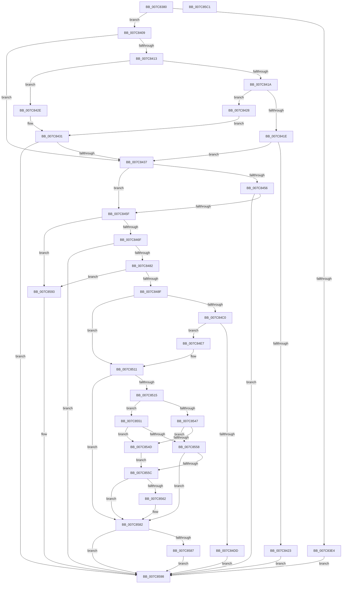

# ExpGenuinePolicyPostProcess

- RVA: `0x007C8380`–`0x007C85C2` (길이 `578` bytes)
- VA: `0x00000001407C8380`
- 실행 섹션: `PAGE`
- PDB 이름 있음: `예`; PDB Function 태그: `아니요`
- unwind 정보 RVA: `0x000D4DB0`
- 디코드: `163`개 명령, `578/578` bytes 표시
- 미해석 바이트: `0` (있으면 어셈블리에 `.byte`로 보존)

> 이 문서는 커널 이미지의 기계어와 PDB 기호를 분석해 생성했습니다. 4번과 5번은 함수 원형과 자료형을 바이너리 사용 방식에서 추정한 C 해석이며 원본 소스 복구 결과는 아닙니다.

## 1. Dependencies

- 직접 호출 지점: **10**; 고유 호출 대상: **7**
- 직접 호출자로 확인된 함수: **0**
- RIP 상대 이미지 참조: **5**

### Outgoing calls
- `0x007C83F8` → [sub_007C7CEC](Unknown_function_007C7CEC.md) (function, `0x007C7CEC`)
- `0x007C844B` → [ZwQueryLicenseValue](../../text/6A/ZwQueryLicenseValue_function_006AFCF0.md) (function, `0x006AFCF0`)
- `0x007C8473` → [guard_dispatch_icall](../../text/6B/guard_dispatch_icall_function_006BAAD0.md) (function, `0x006BAAD0`)
- `0x007C84B2` → [ExpOsProductCacheProviderHelper](ExpOsProductCacheProviderHelper_function_007C8A58.md) (function, `0x007C8A58`)
- `0x007C84D0` → [ExAllocatePool2](../../poolcode/B8/ExAllocatePool2_function_00B820F0.md) (function, `0x00B820F0`)
- `0x007C850A` → [ExpOsProductCacheProviderHelper](ExpOsProductCacheProviderHelper_function_007C8A58.md) (function, `0x007C8A58`)
- `0x007C853C` → [guard_dispatch_icall](../../text/6B/guard_dispatch_icall_function_006BAAD0.md) (function, `0x006BAAD0`)
- `0x007C8577` → [sub_007C7CEC](Unknown_function_007C7CEC.md) (function, `0x007C7CEC`)
- `0x007C858C` → [ExFreePoolWithTag](../../poolcode/B8/ExFreePoolWithTag_function_00B82870.md) (function, `0x00B82870`)
- `0x007C85A1` → [_security_check_cookie](../../text/6A/_security_check_cookie_function_006AC640.md) (function, `0x006AC640`)

### Direct callers
- 이 함수 시작 RVA로 연결되는 직접 call은 확인되지 않았습니다. 간접 호출은 완전히 역산할 수 없습니다.

### Static image references
- `0x007C839A` → RVA `0x00E0A740` (`.data`; read)
- `0x007C8444` → RVA `0x00B4BDB8` (`PAGE`; read)
- `0x007C845F` → RVA `0x00FD83C8` (`PAGEDATA`; read)
- `0x007C8482` → RVA `0x00FD8388` (`PAGEDATA`; read)
- `0x007C849B` → RVA `0x00B4B080` (`PAGE`; read)

## 2. Other-region calls and transfers

- 다른 실행 섹션으로 향하는 call: **6**
  - `0x007C844B` → [ZwQueryLicenseValue](../../text/6A/ZwQueryLicenseValue_function_006AFCF0.md) (`PAGE` → `.text`)
  - `0x007C8473` → [guard_dispatch_icall](../../text/6B/guard_dispatch_icall_function_006BAAD0.md) (`PAGE` → `.text`)
  - `0x007C84D0` → [ExAllocatePool2](../../poolcode/B8/ExAllocatePool2_function_00B820F0.md) (`PAGE` → `POOLCODE`)
  - `0x007C853C` → [guard_dispatch_icall](../../text/6B/guard_dispatch_icall_function_006BAAD0.md) (`PAGE` → `.text`)
  - `0x007C858C` → [ExFreePoolWithTag](../../poolcode/B8/ExFreePoolWithTag_function_00B82870.md) (`PAGE` → `POOLCODE`)
  - `0x007C85A1` → [_security_check_cookie](../../text/6A/_security_check_cookie_function_006AC640.md) (`PAGE` → `.text`)
- 별도 외부 분기/꼬리 이동을 확인하지 못했습니다.

## 3. Assembly (complete function range)

```asm
007C8380  48 89 5C 24 08                  mov qword ptr [rsp + 8], rbx
007C8385  55                              push rbp
007C8386  56                              push rsi
007C8387  57                              push rdi
007C8388  41 54                           push r12
007C838A  41 55                           push r13
007C838C  41 56                           push r14
007C838E  41 57                           push r15
007C8390  48 8B EC                        mov rbp, rsp
007C8393  48 81 EC 80 00 00 00            sub rsp, 0x80
007C839A  48 8B 05 9F 23 64 00            mov rax, qword ptr [rip + 0x64239f]
007C83A1  48 33 C4                        xor rax, rsp
007C83A4  48 89 45 F8                     mov qword ptr [rbp - 8], rax
007C83A8  4C 8B 65 68                     mov r12, qword ptr [rbp + 0x68]
007C83AC  4C 8B EA                        mov r13, rdx
007C83AF  48 8B 45 60                     mov rax, qword ptr [rbp + 0x60]
007C83B3  33 D2                           xor edx, edx
007C83B5  45 8B F9                        mov r15d, r9d
007C83B8  48 89 45 E0                     mov qword ptr [rbp - 0x20], rax
007C83BC  0F 57 C0                        xorps xmm0, xmm0
007C83BF  89 55 D4                        mov dword ptr [rbp - 0x2c], edx
007C83C2  41 88 14 24                     mov byte ptr [r12], dl
007C83C6  4D 8B F0                        mov r14, r8
007C83C9  44 8D 4A 04                     lea r9d, [rdx + 4]
007C83CD  8B DA                           mov ebx, edx
007C83CF  8B FA                           mov edi, edx
007C83D1  44 89 4D D8                     mov dword ptr [rbp - 0x28], r9d
007C83D5  89 55 D0                        mov dword ptr [rbp - 0x30], edx
007C83D8  0F 11 45 E8                     movups xmmword ptr [rbp - 0x18], xmm0
007C83DC  89 55 C8                        mov dword ptr [rbp - 0x38], edx
007C83DF  48 39 11                        cmp qword ptr [rcx], rdx
007C83E2  74 25                           je 0x1407c8409
007C83E4  4C 8B C8                        mov r9, rax
007C83E7  C7 44 24 20 02 00 00 00         mov dword ptr [rsp + 0x20], 2
007C83EF  45 8B C7                        mov r8d, r15d
007C83F2  49 8B D6                        mov rdx, r14
007C83F5  49 8B CD                        mov rcx, r13
007C83F8  E8 EF F8 FF FF                  call 0x1407c7cec
007C83FD  8B D8                           mov ebx, eax
007C83FF  41 C6 04 24 01                  mov byte ptr [r12], 1
007C8404  E9 8F 01 00 00                  jmp 0x1407c8598
007C8409  BE 01 00 00 00                  mov esi, 1
007C840E  4D 85 F6                        test r14, r14
007C8411  74 24                           je 0x1407c8437
007C8413  41 8B C7                        mov eax, r15d
007C8416  2B C6                           sub eax, esi
007C8418  74 14                           je 0x1407c842e
007C841A  3B C6                           cmp eax, esi
007C841C  74 0A                           je 0x1407c8428
007C841E  41 39 30                        cmp dword ptr [r8], esi
007C8421  75 14                           jne 0x1407c8437
007C8423  E9 70 01 00 00                  jmp 0x1407c8598
007C8428  66 41 39 30                     cmp word ptr [r8], si
007C842C  EB 03                           jmp 0x1407c8431
007C842E  41 38 30                        cmp byte ptr [r8], sil
007C8431  0F 84 61 01 00 00               je 0x1407c8598
007C8437  48 8D 45 D8                     lea rax, [rbp - 0x28]
007C843B  4C 8D 45 D0                     lea r8, [rbp - 0x30]
007C843F  48 89 44 24 20                  mov qword ptr [rsp + 0x20], rax
007C8444  48 8D 0D 6D 39 38 00            lea rcx, [rip + 0x38396d]
007C844B  E8 A0 78 EE FF                  call 0x1406afcf0
007C8450  8B D8                           mov ebx, eax
007C8452  85 C0                           test eax, eax
007C8454  78 09                           js 0x1407c845f
007C8456  39 75 D0                        cmp dword ptr [rbp - 0x30], esi
007C8459  0F 84 39 01 00 00               je 0x1407c8598
007C845F  48 8B 05 62 FF 80 00            mov rax, qword ptr [rip + 0x80ff62]
007C8466  48 85 C0                        test rax, rax
007C8469  0F 84 24 01 00 00               je 0x1407c8593
007C846F  48 8D 4D D4                     lea rcx, [rbp - 0x2c]
007C8473  E8 58 26 EF FF                  call 0x1406baad0
007C8478  8B D8                           mov ebx, eax
007C847A  85 C0                           test eax, eax
007C847C  0F 88 16 01 00 00               js 0x1407c8598
007C8482  48 39 3D FF FE 80 00            cmp qword ptr [rip + 0x80feff], rdi
007C8489  0F 84 04 01 00 00               je 0x1407c8593
007C848F  48 8D 45 C0                     lea rax, [rbp - 0x40]
007C8493  45 33 C9                        xor r9d, r9d
007C8496  48 89 44 24 30                  mov qword ptr [rsp + 0x30], rax
007C849B  48 8D 15 DE 2B 38 00            lea rdx, [rip + 0x382bde]
007C84A2  48 8D 45 C8                     lea rax, [rbp - 0x38]
007C84A6  45 33 C0                        xor r8d, r8d
007C84A9  48 89 44 24 28                  mov qword ptr [rsp + 0x28], rax
007C84AE  21 7C 24 20                     and dword ptr [rsp + 0x20], edi
007C84B2  E8 A1 05 00 00                  call 0x1407c8a58
007C84B7  8B D8                           mov ebx, eax
007C84B9  3D 23 00 00 C0                  cmp eax, 0xc0000023
007C84BE  75 51                           jne 0x1407c8511
007C84C0  8B 5D C8                        mov ebx, dword ptr [rbp - 0x38]
007C84C3  B9 00 01 00 00                  mov ecx, 0x100
007C84C8  8B D3                           mov edx, ebx
007C84CA  41 B8 53 4C 53 20               mov r8d, 0x20534c53
007C84D0  E8 1B 9C 3B 00                  call 0x140b820f0
007C84D5  48 8B F8                        mov rdi, rax
007C84D8  48 85 C0                        test rax, rax
007C84DB  75 0A                           jne 0x1407c84e7
007C84DD  BB 17 00 00 C0                  mov ebx, 0xc0000017
007C84E2  E9 B1 00 00 00                  jmp 0x1407c8598
007C84E7  48 8D 45 C0                     lea rax, [rbp - 0x40]
007C84EB  4C 8B CF                        mov r9, rdi
007C84EE  48 89 44 24 30                  mov qword ptr [rsp + 0x30], rax
007C84F3  48 8D 15 86 2B 38 00            lea rdx, [rip + 0x382b86]
007C84FA  48 8D 45 C8                     lea rax, [rbp - 0x38]
007C84FE  45 33 C0                        xor r8d, r8d
007C8501  48 89 44 24 28                  mov qword ptr [rsp + 0x28], rax
007C8506  89 5C 24 20                     mov dword ptr [rsp + 0x20], ebx
007C850A  E8 49 05 00 00                  call 0x1407c8a58
007C850F  8B D8                           mov ebx, eax
007C8511  85 DB                           test ebx, ebx
007C8513  78 6D                           js 0x1407c8582
007C8515  48 8B 05 6C FE 80 00            mov rax, qword ptr [rip + 0x80fe6c]
007C851C  48 8D 4D E8                     lea rcx, [rbp - 0x18]
007C8520  48 89 4C 24 30                  mov qword ptr [rsp + 0x30], rcx
007C8525  45 33 C9                        xor r9d, r9d
007C8528  83 64 24 28 00                  and dword ptr [rsp + 0x28], 0
007C852D  45 33 C0                        xor r8d, r8d
007C8530  83 64 24 20 00                  and dword ptr [rsp + 0x20], 0
007C8535  48 8B D7                        mov rdx, rdi
007C8538  41 8D 49 03                     lea ecx, [r9 + 3]
007C853C  E8 8F 25 EF FF                  call 0x1406baad0
007C8541  8B D8                           mov ebx, eax
007C8543  85 C0                           test eax, eax
007C8545  78 0A                           js 0x1407c8551
007C8547  F6 45 E8 40                     test byte ptr [rbp - 0x18], 0x40
007C854B  74 0B                           je 0x1407c8558
007C854D  33 DB                           xor ebx, ebx
007C854F  EB 0B                           jmp 0x1407c855c
007C8551  3D 72 02 00 C0                  cmp eax, 0xc0000272
007C8556  74 F5                           je 0x1407c854d
007C8558  85 C0                           test eax, eax
007C855A  78 26                           js 0x1407c8582
007C855C  83 7D D4 00                     cmp dword ptr [rbp - 0x2c], 0
007C8560  75 20                           jne 0x1407c8582
007C8562  4C 8B 4D E0                     mov r9, qword ptr [rbp - 0x20]
007C8566  45 8B C7                        mov r8d, r15d
007C8569  49 8B D6                        mov rdx, r14
007C856C  C7 44 24 20 02 00 00 00         mov dword ptr [rsp + 0x20], 2
007C8574  49 8B CD                        mov rcx, r13
007C8577  E8 70 F7 FF FF                  call 0x1407c7cec
007C857C  8B D8                           mov ebx, eax
007C857E  41 88 34 24                     mov byte ptr [r12], sil
007C8582  48 85 FF                        test rdi, rdi
007C8585  74 11                           je 0x1407c8598
007C8587  33 D2                           xor edx, edx
007C8589  48 8B CF                        mov rcx, rdi
007C858C  E8 DF A2 3B 00                  call 0x140b82870
007C8591  EB 05                           jmp 0x1407c8598
007C8593  BB BB 00 00 C0                  mov ebx, 0xc00000bb
007C8598  8B C3                           mov eax, ebx
007C859A  48 8B 4D F8                     mov rcx, qword ptr [rbp - 8]
007C859E  48 33 CC                        xor rcx, rsp
007C85A1  E8 9A 40 EE FF                  call 0x1406ac640
007C85A6  48 8B 9C 24 C0 00 00 00         mov rbx, qword ptr [rsp + 0xc0]
007C85AE  48 81 C4 80 00 00 00            add rsp, 0x80
007C85B5  41 5F                           pop r15
007C85B7  41 5E                           pop r14
007C85B9  41 5D                           pop r13
007C85BB  41 5C                           pop r12
007C85BD  5F                              pop rdi
007C85BE  5E                              pop rsi
007C85BF  5D                              pop rbp
007C85C0  C3                              ret
007C85C1  CC                              int3
```

## 4. C-style interpretation (structured pseudocode)

```c
__int64 __fastcall ExpGenuinePolicyPostProcess(__int64 a1, __int64 a2, __int64 a3, int a4, __int64 a5, __int64 a6)
{
    __int64 result;
    __int64 v_rbx;
    __int64 v_rsp;
    unsigned __int64 v_stack_m40;
    unsigned __int64 v_stack_m50;
    unsigned __int64 v_stack_m58;
    unsigned int v_stack_m60;
    unsigned int v_stack_m64;
    unsigned int v_stack_m68;
    unsigned int v_stack_m70;
    unsigned __int64 v_stack_m78;
    unsigned __int64 v_stack_m88;
    unsigned __int64 v_stack_m90;
    unsigned int v_stack_m98;
    unsigned __int64 v_stack_p8;

    v_stack_p8 = v_rbx;
    v_rsp = (v_rsp) - (128);
    result = (*(unsigned __int64 *)(v_rip + 6562719)) ^ (v_rsp);
    v_stack_m40 = result;
    a2 = 0;
    v_stack_m58 = a5;
    v_stack_m64 = 0;
    *(unsigned __int8 *)(a6) = 0;
    v_stack_m60 = (unsigned int)(a2 + 4);
    v_stack_m68 = 0;
    v_stack_m50 = v_xmm0;
    v_stack_m70 = 0;
    if ((*(unsigned __int64 *)(a1)) == 0) goto loc_007C8409;
    v_stack_m98 = 2;
    result = sub_007C7CEC(0, a3, (unsigned int)((unsigned int)((unsigned int)(a4))), a5);
    *(unsigned __int8 *)(a6) = 1;
    goto loc_007C8598;
loc_007C8409:
    if (a3 == 0) goto loc_007C8437;
    result = (unsigned int)(((unsigned int)((unsigned int)((unsigned int)(a4)))) - (1));
    if (condition_is_equal) goto loc_007C842E;
    if (((unsigned int)(result)) == 1) goto loc_007C8428;
    if ((*(unsigned int *)((unsigned int)((unsigned int)((unsigned int)(a4))))) != 1) goto loc_007C8437;
    goto loc_007C8598;
loc_007C8428:
    goto loc_007C8431;
loc_007C842E:
loc_007C8431:
    if ((*(unsigned __int8 *)((unsigned int)((unsigned int)((unsigned int)(a4))))) == 1) goto loc_007C8598;
loc_007C8437:
    v_stack_m98 = v_stack_m60;
    result = ZwQueryLicenseValue(v_rip + 3684717, a3, v_stack_m68, a5);
    if (sign_flag) goto loc_007C845F;
    if (v_stack_m68 == 1) goto loc_007C8598;
loc_007C845F:
    if (*(unsigned __int64 *)(v_rip + 8453986) == 0) goto loc_007C8593;
    result = guard_dispatch_icall(v_stack_m64, a3, v_stack_m68, a5);
    if (sign_flag) goto loc_007C8598;
    if ((*(unsigned __int64 *)(v_rip + 8453887)) == 0) goto loc_007C8593;
    a4 = 0;
    v_stack_m88 = v_stack_m78;
    a3 = 0;
    v_stack_m90 = v_stack_m70;
    result = ExpOsProductCacheProviderHelper(v_stack_m64, v_rip + 3681246, a3, a4);
    if (((unsigned int)(result)) != 0xC0000023ULL) goto loc_007C8511;
    result = ExAllocatePool2(256, (unsigned int)((unsigned int)((unsigned int)(v_stack_m70))), (unsigned int)(0x20534C53ULL), a4);
    if (result != 0) goto loc_007C84E7;
    goto loc_007C8598;
loc_007C84E7:
    v_stack_m88 = v_stack_m78;
    a3 = 0;
    v_stack_m90 = v_stack_m70;
    v_stack_m98 = (unsigned int)((unsigned int)(0xC0000017ULL));
    result = ExpOsProductCacheProviderHelper(256, v_rip + 3681158, a3, result);
loc_007C8511:
    if (sign_flag) goto loc_007C8582;
    v_stack_m88 = v_stack_m50;
    a4 = 0;
    a3 = 0;
    result = guard_dispatch_icall(a4 + 3, result, a3, a4);
    if (sign_flag) goto loc_007C8551;
    if (((v_stack_m50) & (64)) == 0) goto loc_007C8558;
loc_007C854D:
    v_rbx = 0;
    goto loc_007C855C;
loc_007C8551:
    if (((unsigned int)(result)) == 0xC0000272ULL) goto loc_007C854D;
loc_007C8558:
    if (sign_flag) goto loc_007C8582;
loc_007C855C:
    if (v_stack_m64 == 0) {
        a4 = v_stack_m58;
        a3 = (unsigned int)((unsigned int)(a4));
        a2 = a3;
        v_stack_m98 = 2;
        a1 = a2;
        result = sub_007C7CEC(a1, a2, a3, a4);
        v_rbx = (unsigned int)(result);
        *(unsigned __int8 *)(a6) = 1;
    }
    if (result == 0) goto loc_007C8598;
    a2 = 0;
    result = ExFreePoolWithTag(result, a2, a3, a4);
    goto loc_007C8598;
loc_007C8593:
loc_007C8598:
    a1 = (v_stack_m40) ^ (v_rsp);
    result = _security_check_cookie(a1, a2, a3, a4);
    v_rsp = (v_rsp) + (128);
    return result;
}
```

## 5. (Beta) C Style

```c
int64_t ExpGenuinePolicyPostProcess(void *Arg1, int64_t Arg2, void *Arg3, int32_t Arg4, int64_t Arg5, void *Arg6)
{
    uint8_t *arg1 = (uint8_t *)Arg1;
    uint8_t *arg3 = (uint8_t *)Arg3;
    uint8_t *arg6 = (uint8_t *)Arg6;

    int64_t result;
    int64_t local_rbx;
    int64_t local_rsp;
    uint64_t v_stack_m40;
    uint64_t v_stack_m50;
    uint64_t v_stack_m58;
    uint32_t v_stack_m60;
    uint32_t v_stack_m64;
    uint32_t v_stack_m68;
    uint32_t v_stack_m70;
    uint64_t v_stack_m78;
    uint64_t v_stack_m88;
    uint64_t v_stack_m90;
    uint32_t v_stack_m98;
    uint64_t v_stack_p8;

    v_stack_p8 = local_rbx;
    local_rsp = (local_rsp) - (128);
    result = (*(uint64_t *)(v_rip + 0x64239F)) ^ (local_rsp);
    v_stack_m40 = result;
    Arg2 = 0;
    v_stack_m58 = Arg5;
    v_stack_m64 = 0;
    *(uint8_t *)(arg6) = 0;
    v_stack_m60 = (uint32_t)(Arg2 + 4);
    v_stack_m68 = 0;
    v_stack_m50 = v_xmm0;
    v_stack_m70 = 0;
    if ((*(uint64_t *)(arg1)) == 0) goto loc_007C8409;
    v_stack_m98 = 2;
    result = sub_007C7CEC(0, Arg3, (uint32_t)((uint32_t)((uint32_t)(Arg4))), Arg5);
    *(uint8_t *)(arg6) = 1;
    goto loc_007C8598;
loc_007C8409:
    if (Arg3 == NULL) goto loc_007C8437;
    result = (uint32_t)(((uint32_t)((uint32_t)((uint32_t)(Arg4)))) - (1));
    if (condition_is_equal) goto loc_007C842E;
    if (((uint32_t)(result)) == 1) goto loc_007C8428;
    if ((*(uint32_t *)((uint32_t)((uint32_t)((uint32_t)(Arg4))))) != 1) goto loc_007C8437;
    goto loc_007C8598;
loc_007C8428:
    goto loc_007C8431;
loc_007C842E:
loc_007C8431:
    if ((*(uint8_t *)((uint32_t)((uint32_t)((uint32_t)(Arg4))))) == 1) goto loc_007C8598;
loc_007C8437:
    v_stack_m98 = v_stack_m60;
    result = ZwQueryLicenseValue(v_rip + 3684717, Arg3, v_stack_m68, Arg5);
    if (sign_flag) goto loc_007C845F;
    if (v_stack_m68 == 1) goto loc_007C8598;
loc_007C845F:
    if (*(uint64_t *)(v_rip + 0x80FF62) == 0) goto loc_007C8593;
    result = guard_dispatch_icall(v_stack_m64, Arg3, v_stack_m68, Arg5);
    if (sign_flag) goto loc_007C8598;
    if ((*(uint64_t *)(v_rip + 0x80FEFF)) == 0) goto loc_007C8593;
    Arg4 = 0;
    v_stack_m88 = v_stack_m78;
    Arg3 = 0;
    v_stack_m90 = v_stack_m70;
    result = ExpOsProductCacheProviderHelper(v_stack_m64, v_rip + 3681246, Arg3, Arg4);
    if (((uint32_t)(result)) != 0xC0000023ULL) goto loc_007C8511;
    result = ExAllocatePool2(256, (uint32_t)((uint32_t)((uint32_t)(v_stack_m70))), (uint32_t)(0x20534C53ULL), Arg4);
    if (result != 0) goto loc_007C84E7;
    goto loc_007C8598;
loc_007C84E7:
    v_stack_m88 = v_stack_m78;
    Arg3 = 0;
    v_stack_m90 = v_stack_m70;
    v_stack_m98 = (uint32_t)((uint32_t)(0xC0000017ULL));
    result = ExpOsProductCacheProviderHelper(256, v_rip + 3681158, Arg3, result);
loc_007C8511:
    if (sign_flag) goto loc_007C8582;
    v_stack_m88 = v_stack_m50;
    Arg4 = 0;
    Arg3 = 0;
    result = guard_dispatch_icall(Arg4 + 3, result, Arg3, Arg4);
    if (sign_flag) goto loc_007C8551;
    if (((v_stack_m50) & (64)) == 0) goto loc_007C8558;
loc_007C854D:
    local_rbx = 0;
    goto loc_007C855C;
loc_007C8551:
    if (((uint32_t)(result)) == 0xC0000272ULL) goto loc_007C854D;
loc_007C8558:
    if (sign_flag) goto loc_007C8582;
loc_007C855C:
    if (v_stack_m64 == 0) {
        Arg4 = v_stack_m58;
        Arg3 = (uint32_t)((uint32_t)(Arg4));
        Arg2 = Arg3;
        v_stack_m98 = 2;
        Arg1 = Arg2;
        result = sub_007C7CEC(Arg1, Arg2, Arg3, Arg4);
        local_rbx = (uint32_t)(result);
        *(uint8_t *)(arg6) = 1;
    }
    if (result == 0) goto loc_007C8598;
    Arg2 = 0;
    result = ExFreePoolWithTag(result, Arg2, Arg3, Arg4);
    goto loc_007C8598;
loc_007C8593:
loc_007C8598:
    Arg1 = (v_stack_m40) ^ (local_rsp);
    result = _security_check_cookie(Arg1, Arg2, Arg3, Arg4);
    local_rsp = (local_rsp) + (128);
    return result;
}
```

### 관측된 메모리 오프셋

구조체 형식이 확인되지 않은 접근은 인자 기준의 오프셋으로만 기록했습니다.

| 기준 인자 | 오프셋 표현 | 폭 (bit) | 접근 |
|---|---:|---:|---|
| `Arg1` | `+ 0x0` | `64` | `R` |
| `Arg3` | `+ 0x0` | `8` | `R` |
| `Arg3` | `+ 0x0` | `16` | `R` |
| `Arg3` | `+ 0x0` | `32` | `R` |
| `Arg6` | `+ 0x0` | `8` | `W` |

## 6. Execution-region graph

[열기: 2D/3D 그래프와 함수 탐색 컨트롤 패널](../../../control-panel.html?section=page&rva=0x007C8380&view=graph)

- 2D 그래프는 위에서 아래로 흐르고, 3D 그래프는 빈 공간을 드래그해 회전합니다. Shift+드래그는 이동, 휠은 확대·축소, 함수 노드 선택은 대상 보고서 이동입니다.

### Static fallback


